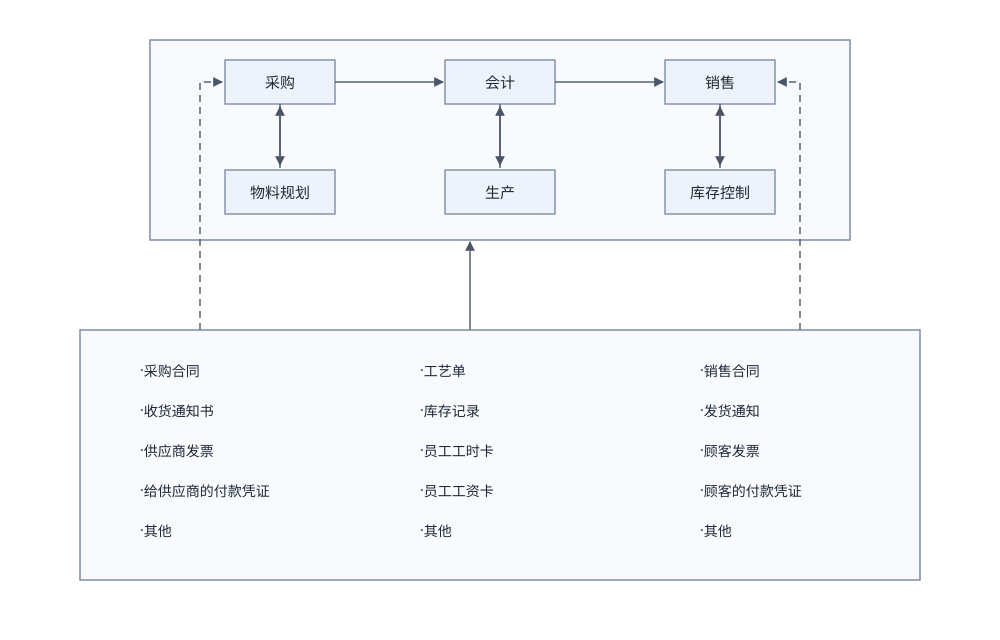
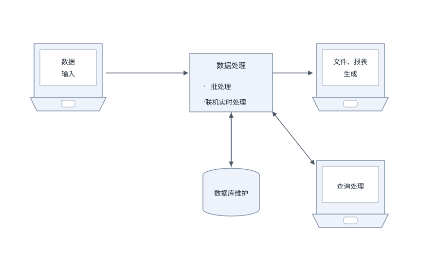
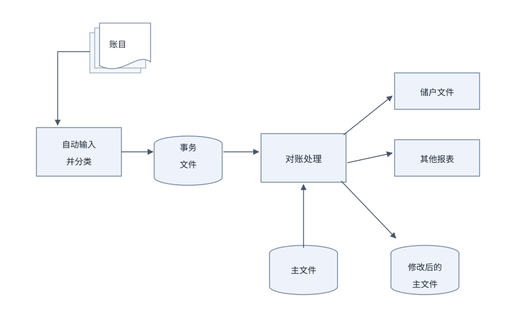

# 3.2 业务处理系统 (TPS)

业务处理系统（Transaction Processing System，TPS）是计算机在管理领域较早的一类应用，用电子数据处理（Electronic Data Processing，EDP）支持日常业务。20 世纪 50 至 60 年代，计算机逐渐用于这类工作，随着信息技术及相关学科的发展，TPS的功能越来越强大，应用的范围也越来越广。可以这样说，在当今世界的各行业各领域的管理系统中，几乎都有TPS的存在。

## 3.2.1 业务处理系统的概念

以传统的凭证和账簿处理为例，企业通过凭证记录、传送和保管经营活动产生的数据，再根据凭证登记账簿。企业内建立反映各种活动的账簿，然后对账簿的内容进行统计、分类等处理，整理出各种用于管理决策的报表。这些“传票”“账簿”“报表”按组织体系有机地结合起来反映和支持整个经营管理活动，如图 3-1所示。所谓事务处理系统，就是针对管理中具体的事务(如财会、销售、库存等)来辅助管理人员记录业务数据、生成传票、记账，并进行统计和分类，并制成报表等活动，为经营决策提供有效信息的基于计算机的信息系统。

> 图 3-1 企业中的事务处理

TPS是服务于组织管理层次中最低层、最基础的信息系统。早期的业务处理系统常按具体事务分别建设，如账务处理系统、工资管理系统、物料进出库管理系统、合同管理系统等。各个子系统有自己专有的软、硬件和专有的数据文件，它们之间一般不交流、不共享某些专用数据库文件。

在作业层上，要处理的任务、所需的资源及要实现的目标都是预先确定的、高度结构化的。
例如，一个公司的订货、发货业务，其处理过程可预先明确规定由如下事务组成。

①接待顾客，商洽订货业务。

②将订货内容记入订货台账。

③检查库存。

④检查顾客的信用度。

⑤生成各种传票。

⑥按出库传票备货。

⑦将出库数量记入出、入库台账。

⑧将送货司机带回的收据和销售传票的内容进行核对。

⑨将结账单和销售传票进行核对。

⑩将结账单内容记入赊销台账。

上述业务大体可分成四个功能：

第1个功能：由事务①②④构成，它们的主要作用是根据所接受的订货要求，确定是否接受这个要求，这组事务完成了订货受理功能。

第2个功能是发货准备。按本例的事务说明，事务③检查库存，事务⑤生成包括出库指示在内的传票。

第3个功能：由事务⑥⑦构成，是仓库的具体发货工作，称为发货功能。

第4个功能：由事务⑧⑨⑩构成，主要是对每一笔订货业务进行发货后的检查核对，并进行财务结账，以便向顾客发出付款通知，完成付款通知功能。

构造支持类似上述业务处理过程的TPS的主要目的在于帮助作业层管理人员减轻处理原始数据负担，提高具体事务的处理效率。在某些情况下，甚至可以完全取代业务层的手工操作。
因此，TPS 的使用终端可设在车间或行政管理办公室，而处于企业系统边界的TPS则能将企业和它的外部环境联系起来。

## 3.2.2 业务处理系统的功能

TPS 的主要功能是输入、处理和输出企业日常业务数据。如图 3-2 所示，TPS 的工作包括以下五项：数据输入、数据处理、数据库的维护、文件报表的生成和查询处理。下面分别说明这些功能。

> 图 3-2 TPS的构成

### 1. 数据输入

数据输入是TPS工作过程的第1个阶段，该阶段主要解决如何将企业经营活动中产生的大量原始数据准确、迅速地输入到计算机系统中并存储起来，这是信息系统进行信息处理的“瓶颈”。因此，数据的输入方式和进度是这个阶段的关键问题。

常见的数据输入方式有3种，即人工、自动及二者结合。若用人工输入数据，在运行TPS中的数据输入模块时，屏幕上就会显示出与原始数据凭证相似格式的画面，而后由作业层的管理人员通过键盘等输入装置进行数据输入，输入的数据以TPS预先确定好的格式(如预先约定的数据字段)存储或由TPS直接使用。这种传统的数据输入方式的缺点是显而易见的，即费时、费力，而且容易出错。

随着计算机及相关技术的迅速发展，原始数据的输入也朝着自动化方向发展，将数据录入装置接入 TPS，并配置相应的数据采集和处理功能，可以实现原始数据的自动化或半自动化输入。常见的自动化输入装置有：

1. POS终端：获取条码或磁卡中的信息。
2. 光学字符识别（OCR）：识别印刷或手写字符，将其转为可处理的文本。
3. 自动柜员机（ATM）：读取银行卡信息，接收用户输入的交易指令。
4. 扫描仪：输入图像信息。
5. 语音识别系统：输入声音信息。
6. 触摸屏：直接接收用户输入的信息。

### 2. 数据处理

TPS中常见的数据处理方式有两种，一种是批处理方式；另一种是联机事务处理方式。

1）批处理（Batch Processing）

批处理将一组事务集中处理，例如按日、周或月处理。下列是批处理可能涉及的操作。

1. 收集原始数据文件，如销售合同、发票等，汇集成批。
2. 转储其他输入介质上的事务数据。
3. 顺序更新主文件时，可按相同的键对事务文件中的记录排序，使两者的顺序一致。
4. 需要异地提交批作业时，可采用远程作业输入（Remote Job Entry，RJE）。

以银行的日终批处理为例，系统可汇集当天的账目，集中对账、更新主文件并生成报表，其处理过程如图 3-3所示。

> 图 3-3 银行的账目批处理

批处理方式的优点是：当有大量的事务数据需要处理时，使用批处理是一种较经济的方式，因为它可以缩减因频繁修改数据库所需的费用。这种方式适合于在事务发生时无须即时修改数据库以及只须定期产生文件、报表的应用。例如，在每周发放工资的情况下，员工的考勤数据及其他有关的工资数据就可以收集成批之后每周处理一次。

批处理方式的缺点是：在定期事务处理的间隔期，主文件尚未反映最近一批未处理的事务，查询因此可能得到较旧的数据。

2）联机事务处理（Online Transaction Processing，OLTP）

这种方式在线处理事务请求，并将结果返回终端用户，通常要求较短的响应时间。事务数据一旦产生，则无须积累成批，也不必先按批次统一分类，就直接从联机的终端上输入到计算机系统中并进行处理。系统可在线存取事务数据，更新有关文件或数据库，并响应终端用户的查询。在联网部署中，OLTP 系统通过网络在事务终端、工作站和其他计算机系统之间传递数据。

证券交易、航空订票等联机业务通常对服务可用性有较高要求。为降低硬件故障造成业务中断的风险，通常要在TPS中采用有关的容错处理。常用的容错技术有：采用具有故障切换能力的冗余处理单元、配置后备机、保存冗余数据等。

OLTP 能在处理事务时更新相关数据，并以较短的响应时间答复用户。为保障数据库的安全性和完整性，需要通过访问控制限制未授权操作，并采取数据校验、备份等措施防范或恢复意外损坏。为达到响应时间和服务可用性目标，系统可能需要增加处理能力、配置冗余设备，从而增加成本。但是，在某些情况下，以费用换取速度、效率和更优质的服务是值得的。

### 3. 数据库的维护

一个组织的数据库通过TPS来更新，以确保数据库中的数据能及时、正确地反映当前最新的经营状况，因此数据库的维护是TPS的一项主要功能。这些数据库是一个企业的数据资源，能为支持中、高层管理人员决策的管理信息系统、决策支持系统和专家系统等提供有用的基础信息。对数据库的访问形式基本有4种：检索、修改、存入和删除。

### 4. 文件报表的产生

TPS的输出就是为终端用户提供所需的有关文件和报表，这些文件和报表根据其用途不同可分为以下几类。

1. 行动文件 (Action Documents): 即该文件的接收者持有文件后可进行某项事务处理，例如，采购订单交给采购员，采购员即可向有关的供应商购货；工资支票交给银行后，银行便向员工支付工资等。
2. 信息文件 (Information Documents): 该类文件向其持有者表明某项业务已发生了，例如订单确认书表明卖方已确认订单，客户发票则列明开票的商品或服务及金额。这类文件有时也可作为控制文件使用。
3. 周转文件 (Turnaround Documents): 这类文件交给接受者之后通常还要返回到发送者手中，故称为周转文件。例如，在采用多联票据的流程中，客户随付款凭证交回其中一联，因此这类文件的信息可通过自动数据录入装置输入到计算机系统中。

TPS还产生一些其他类型的报表，用于记录和监控某段时间内业务发生或处理的结果，它们并不是因管理的需要而特别编制的，例如流水账(即业务日志)等。因此TPS产生的文件、报表是原始数据经简单的分类、汇总之后形成，主要反映具体事务的处理情况；需要分析趋势或比较方案时，可以再汇总这些数据，结合其他信息进行分析。

### 5. 查询处理

TPS支持终端用户的批次查询或联机实时查询，典型的查询方式是用户通过屏幕显示获得查询结果，例如，销售人员可查询客户的合同情况，读者可查询图书馆的借书情况等。这种查询实际上是对数据库进行有条件的检索，因此，为保证数据的安全性和保密性，必须对不同级别的用户授以不同的访问权限。

## 3.2.3 业务处理系统的特点

业务处理系统（TPS）是支撑日常业务的信息系统，但这并不意味着TPS不重要甚至不需要。实际上，TPS是其他类型信息系统的信息产生器，企业在推进全面信息化的过程中往往是从开发TPS入手的。由于TPS支持的是企业的日常业务管理，TPS一旦出现故障，就有可能导致企业的正常运作发生紊乱，例如航空公司的订票系统、银行的存取款/转账系统、企业的物料进出库系统等。同时，许多TPS是处于企业系统的边界，它是将企业与外部环境联系起来的“桥梁”。因此，TPS性能的好坏将直接影响着组织的整体形象，是提高企业市场竞争力的重要因素。

由于TPS面对的是结构化程度很高的管理问题，因此可以采用结构化生命周期法来进行开发。而且同行业事务处理的相似性，使得越来越多的TPS都已商品化。所以，许多企业可直接购买现成的TPS, 经过必要的配置、集成、测试或二次开发后投入使用，避免了低水平的重复开发工作。
