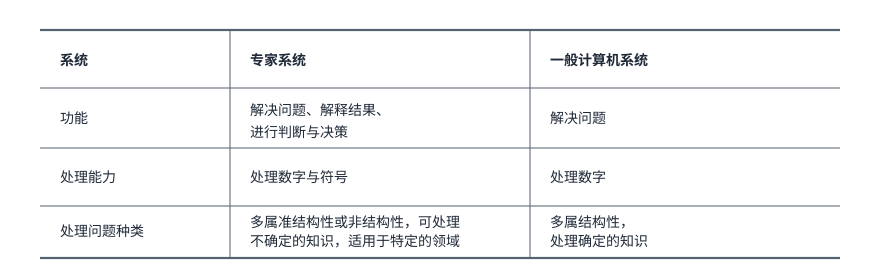
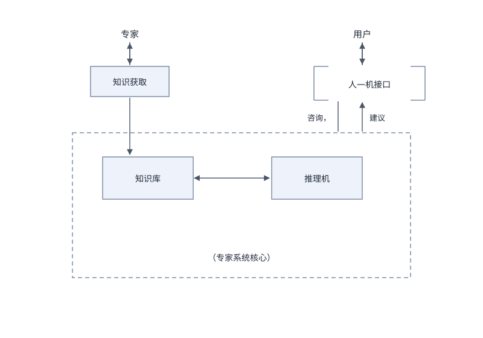

# 3.5 专家系统 (ES)

## 3.5.1 专家系统的概念

### 1. 专家系统

专家系统（Expert System，ES）是人工智能的一个重要分支。
专家系统的能力来自于它所拥有的专家知识，知识的表示及推理的方法则提供了应用的机理。
因此这种基于知识的系统设计是以知识库和推理机为中心而展开的。

知识+推理=系统

而传统的软件的结构是：

数据结构+算法=程序

专家系统是一种智能的计算机程序，该程序使用知识与推理过程，求解那些需要资深专家的专门知识才能解决的高难度问题。

由此定义可以看出，专家系统既不同于传统的应用程序，也不同于其他类型的人工智能问题求解程序。不同点主要表现在以下5个方面。

1. 专家系统属于人工智能范畴，其求解的问题不是传统程序求解的结构化问题，而是半结构化或非结构化问题，需要应用启发法或弱方法来解决，它不同于传统应用程序的算法。
2. 以数值模拟程序为例，它通过数学模型描述问题领域；专家系统则侧重表示和运用专家在该领域的推理知识。
3. 专家系统由3个要素组成：描述问题状态的综合数据库、存放启发式经验知识的知识库和对知识库的知识进行推理的推理机。三要素分别对应数据级、知识库级和控制级三级知识，而传统应用程序只有数据和程序两级结构。它将描述算法的过程性计算信息与控制性判断信息合而为一地编码在程序中，缺乏专家系统的灵活性。
4. 专家系统处理的问题属于现实世界中必须具备人类专家的大量专门知识才能解决的问题，它必须可靠地工作，并在合理的时间内对求解的问题给出可用的解答。所以它面对的往往是实际的问题，而不是纯学术的问题。
5. 从求解手段来看，专家系统通常限定问题领域，利用该领域专家的专门知识提高求解性能。专家系统所拥有的这种启发式知识的数量和质量，将决定专家系统的性能和效率。从这个方面讲，专家系统的问题求解的通用性是较差的。

总之，专家系统是使用某个领域内实际专家所拥有的领域知识来求解问题，而不是用那些从数学或计算机科学中导出的与领域关系不大的方法来解决问题。所以专家系统适合于完成那些没有公认的理论和方法、信息不完整、人类专家短缺或专门知识相对昂贵的工作，诸如规划、设计及决策制定、医疗诊断、质量监控等。

### 2. 人工智能

人工智能（Artificial Intelligence，AI）旨在利用机械、电子、光电或生物器件等制造的装置或机器模仿人类的智能。自古以来，人类对人工智能就有持久、狂热的追求，想用机器来代替人的部分脑力劳动，从而用机器来延伸和扩展人类的智能行为。1955 年，约翰·麦卡锡（John McCarthy）等人提交的达特茅斯夏季研究项目提案已使用“人工智能”一词。1956 年夏季，研讨会在美国达特茅斯学院（Dartmouth College）举行，成为人工智能作为独立研究领域发展的重要标志。

1）人工智能的特点

AI研究的重点放在开发具有智能行为的计算机系统上，智能行为表现出以下5个特点。

1. 从过去的事件或情形中汲取经验，并将从经验中得到的知识应用于新的环境和场景。
然而汲取经验并应用知识不是计算机系统的本性，它需要精心为其设计的软件提供支持。

2. 具有在缺乏重要信息时解决问题的能力。
3. 具有处理和操纵各种符号、理解图像的能力。
4. 想象力和创造力。
5. 善于运用启发式方法。

上面列出的仅是智能行为的部分特征。目前人工智能与人的智能还有巨大的差别。

2）人工智能的主要分支

人工智能是一个极为广泛的领域，AI的主要分支有专家系统、机器人技术、视觉系统、自然语言处理、学习系统和神经网络等，如图 3-13所示。各个分支之间密切关联，一个领域取得的进展往往会引起其他领域的进步。

> 图 3-13 人工智能主要分支

## 3.5.2 专家系统的特点

表 3-1 以传统数值处理程序为参照，概括专家系统运用知识和解释推理结果的特点。一般计算机系统也可以处理符号。进一步剖析专家系统，可发现它具有以下主要特性：

> 表 3-1 专家系统与一般计算机系统的比较

### 1. 超越时间限制

人类专家的工作时间有限，专家系统在设备可用、知识得到维护的条件下，可以全天提供服务。

### 2. 操作成本低廉

开发和维护专家系统需要投入经费。在服务需求较大、知识能够复用时，系统处理单次咨询的成本可能低于直接聘请专家。因此在专家不在或经济上请专家不合算的情况下，专家系统可以在经过验证的适用范围内提供支持。

### 3. 易于传递与复制

专家与专家知识是稀有的资源，在知识密集的工作环境下，新进人员需要做相当多的训练，关键人员的经验若未及时记录，可能随着人事变动而流失，知识传递也耗时费力。已编码的专家知识则较易传递和复制。

### 4. 处理手段一致

人类专家判断决策的结果常会因时或因人而异，采用确定性推理的专家系统在知识库、规则和输入均相同时，可给出一致的输出。

### 5. 善于克服难题

在知识库和推理规则覆盖的范围内，专家系统可以反复执行耗时的判断任务，减轻人工重复工作的负担。

### 6. 适用特定领域

由于获取知识、构建知识库和制定推理规则有一定困难，因此专家系统通常只使用小范围的特定知识领域。而当问题的知识牵涉较广，或是没有一定的处理程序时，就必须靠人类专家的智慧来处理。

目前，专家系统和人工智能所关注的是，把数据和信息转换为可使用知识的能力，吸取和分享专家意见，并且把知识管理成一种至关重要的竞争资源。教材以物流领域的原型应用为例，说明智能系统可用于提高物流效率和服务质量。作为集物流、商流、信息流、资金流于一身的配送中心，智能系统发挥的作用将愈来愈明显。

## 3.5.3 专家系统的组成

由于专家系统的应用领域不同，求解问题的类型不同，专家系统的结构也略有差别。但总的来说，专家系统的核心部分基本相同，其一般结构如图3-14所示。

> 图 3-14 专家系统的一般结构

专家系统的结构与系统的适用性和有效性密切相关，选择什么样的系统结构，要根据系统的应用环境和所执行任务的特点而定。

### 1. 知识库

专家系统的知识库用来存放系统求解实际问题的领域知识。一般来说，知识库中的知识可分成两类：一类为事实性知识；另一类是启发性知识。这些知识可以从书籍中或亲身实践中获得。事实通常指的是公共定义的或已经发生的具体事件。事实性知识尽管相对容易获得，但在求解问题时是不可或缺的。启发性知识是领域专家在长期的工作中获得的经验总结，往往不易条理化，较难理解，且适用范围窄，但对求解问题却十分有效，它使专家系统的决策在领域中具有专家的水平。

知识库中的知识主要供推理机求解问题时使用。知识库的管理机制应支持知识存储、检索、排序和增删改等操作。知识的表示方法和组织结构是设计知识库时必须考虑的问题。知识表示方法要尽量简洁、准确地表达领域专家的知识。知识的组织结构要增强知识的模块性和独立性，便于知识库的管理和维护。

### 2. 综合数据库

综合数据库是专家系统在执行与推理过程中用以存放所需要和产生的各种信息的工作存储器，通常包括欲解决问题的初始状态描述、中间结果、求解过程的记录、用户对系统提问的回答等信息。综合数据库用于保存一次推理中的动态事实和中间结果，其内容在系统运行过程中是不断变化的。相应地把专家系统的知识库称为静态知识库，因为它在一次推理中其内容是保持不变的，只有领域专家或知识工程师通过知识获取模块或系统通过自学习功能才能改变它的内容。可以认为，综合数据库和知识库一起才构成专家系统的完整知识库。在设计专家系统时，一般使综合数据库的数据表示与组织和知识库的知识表示与组织相一致。这样可以方便推理机的推理。

### 3. 推理机

推理机和知识库一起构成专家系统的核心。甚至有人认为专家系统等于知识库加推理机。
推理机也被称为控制结构或规则解释器，通常包括推理机制和控制策略，是一组用来控制系统的运行、执行各种任务、根据知识库进行各种搜索和推理的程序模块。

专家系统中常用的推理方式有3种：正向推理或前向推理、反向推理或逆向推理、双向推理或混合推理。正向推理又称数据驱动策略，即从条件出发推出结论。反向推理又称目标驱动策略，即先假设结论正确，再去验证条件是否满足，若诸条件都满足，则证明结论正确；否则，再由另一个假设去推断结论。当已知事实较多、希望找出可导出的结论时，可采用正向推理；当有明确的待验证目标时，可采用反向推理。双向推理结合正向推理和反向推理，以期在某一时刻使正、反向推理过程达到某种一致状态而获得问题的解。在双向推理中，常常用正向推理来确定各种假设证实的先后次序，一旦确定后，又用反向推理验证假设是否成立。

推理机的构成与实现依赖于领域问题的性质和知识表示方法及组织结构。在设计专家系统时，一般使知识库和推理机相分离，即求解问题的知识与使用知识的程序相分离，以保证专家系统的模块性、灵活性和可维护性。

### 4. 知识获取

知识获取模块用于编辑和求精知识，部分系统还支持自动学习。该模块根据需要添加、修改或删除知识，并相应调整相关条目，以维护知识库的一致性和完整性。知识的编辑与求精，可使领域专家的经验或书本上的知识转化为系统所需的内部形式，作为新知识移入知识库，同时也可以使领域专家方便地修改知识库。自学习功能可以根据系统运行过程中积累的经验自动地修改和补充知识库的知识，发现求解问题的规律，提高系统的性能和处理效率。

### 5. 解释程序

解释程序是面向用户服务的，负责解答用户提出的各种问题。这些问题既可以是和系统运行过程有关的，也可以是关于系统性能和行为的。当用户得到一个问题的答案时，可以通过向专家系统提问的方式，了解推理依据和求解细节，进而判断结果是否合理。这时，通过解释程序，专家系统可以针对性地以一种用户易于理解的形式对用户的问题进行解释，回答推导结论的步骤、每个步骤的根据、所用的各种数据和知识等。一种常见的解释方法是在推理过程中，把每步推理所用的数据和知识按推理的顺序连接起来，一旦需要解释时，就把这个推理链一步一步地显示给用户，以此作为对用户提问的回答。

### 6. 人机接口

人机接口通常包括两部分：一部分是专家系统与用户的接口；另一部分是专家系统与领域专家和知识工程师的接口。与用户的接口可直接处理用户的操作命令和提出的问题，通过对命令的解释和对问题的分析，将结果传送到推理机、综合数据库和知识库，以启动系统的问题求解过程，同时也将系统对用户的提问以及对问题求解过程的跟踪解释传递给用户，使用户对专家系统的执行动态有所了解。与领域专家和知识工程师的接口可接受领域专家或知识工程师的知识，使领域专家或知识工程师了解系统的性能，并进一步改善和提高系统求解问题的能力。

不论是哪种接口，都要包括输入和输出，完成系统的内部表示形式和外部表示形式（用户、领域专家和知识工程师易于理解和接受的形式）的相互转换。随着自然语言理解、语音识别、图像处理、文字识别等技术的不断完善和逐步成熟，专家系统将会更多地采用包含图、文、声、像的多媒体接口。

一般的专家系统通过推理机与知识库和综合数据库的交互作用来求解领域问题。这种求解过程有如下几个步骤。

1. 根据用户的问题对知识库进行搜索，寻找有关的知识。
2. 根据有关的知识和系统的控制策略形成解决问题的途径，即知识操作算子序列，从而构成一个假设集合。
3. 对解决问题的一组可能假设方案进行排序，并挑选其中在某些准则下最优的假设方案。
4. 根据挑选的解决方案去求解具体问题。
5. 如果该方案不能真正解决问题，则追溯到假设方案序列中的下一个假设方案，重复求解问题。
6. 上述过程循环进行，直至问题已经解决或者所有的求解方案都不能解决问题而宣告“本系统未找到该问题的解”为止。
