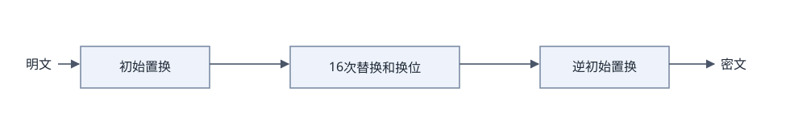

# 4.4 信息加解密技术

## 4.4.1 数据加密

数据加密将明文转换为密文，以保护敏感内容的机密性。未经授权者即使取得密文，也应难以从中恢复明文。密码学包括研究密码体制设计的密码编码学（cryptography）和研究其安全性的密码分析学（cryptanalysis）。密码学有着悠久而光辉的历史，古代的军事家已经用密码传递军事情报了，而现代计算机的应用和计算机科学的发展又为这一古老的科学注入了新的活力。现代密码学是经典密码学的进一步发展和完善。随着密码设计与密码分析不断发展，这门科学还在迅速发展之中。

图 4-1 所示的保密通信模型使用共享密钥。

> 图 4-1 保密通信模型

图中发送端用加密算法 $E$ 和密钥 $K$ 将明文 $P$ 变换为密文 $C=E(K,P)$；接收端用解密算法 $D$ 和同一密钥恢复明文 $P=D(K,C)$。

在这个模型中，加密算法 $E$ 和解密算法 $D$ 可以公开，共享密钥 $K$ 需要保密。抵抗窃听还取决于算法的安全性、密钥的选取和保护，以及加密方案的正确使用。

完美保密是指观察密文不改变观察者对明文取各个可能值的概率判断。许多实用密码体制追求计算安全，即在给定的计算资源和安全假设下，从密文恢复明文在计算上不可行。

## 4.4.2 对称密钥加密算法

对称密钥加密算法中加密密钥和解密密钥是相同的，称为共享密钥算法或对称密钥算法。

### 1. DES（Data Encryption Standard）

1977 年，美国国家标准局发布数据加密标准 DES。DES 的分组长度为 64 位，有效密钥长度为 56 位。一个分组先经初始置换，再进行 16 轮运算，交换左右半部，最后执行初始置换的逆置换，得到 64 位密文，如图 4-2 所示。

> 图 4-2 DES加密算法

DES 的密钥长度和设计过程在推出之初曾引起争议。

20 世纪 70 年代，Diffie 和 Hellman 讨论了专用 DES 密钥搜索设备的设计。DES 的有效密钥为 56 位，共有 $2^{56}$ 种可能取值。他们估计当时建造这样的设备约需 2,000 万美元；这是设计估算。

三重 DES（Triple DES）对每个分组依次执行 DES 加密、解密、加密。三把独立密钥共含 168 个有效密钥位；若第一把和第三把密钥相同，则有两把独立密钥，共 112 个有效密钥位。密钥位数不能直接当作安全强度。双重 DES 的安全强度也不会随密钥位数成比例增加，其中一个原因是中间相遇分析。

以两个密钥 $K_1$ 和 $K_2$ 为例，加密过程如下：

1. 用 $K_1$ 进行 DES 加密。
2. 用 $K_2$ 对第 1 步的结果进行 DES 解密。
3. 用 $K_1$ 对第 2 步的结果进行 DES 加密。

这种方法每个分组需要执行三次 DES 运算。这里介绍的是历史算法，两密钥三重 DES 已不适合用于新数据的加密保护。

### 2. IDEA（International Data Encryption Algorithm）

来学嘉（Xuejia Lai）和 James L. Massey 在苏黎世联邦理工学院研究设计了 IDEA。该算法采用 128 位密钥和 64 位分组，包括 8 轮迭代及最后的输出变换。IDEA 可用硬件或软件实现。教材举例称，一种 25 MHz 的专用芯片实现达到 177 Mb/s；该数值描述特定实现。

IDEA 曾应用于多种商业产品，也被用于某些标准规定的通信方案。

### 3. 高级加密标准（Advanced Encryption Standard，AES）

1997 年 1 月，美国国家标准与技术局（NIST）启动高级加密标准的制定工作，同年 9 月正式征集候选算法。共有 15 个候选算法进入评选，经过公开分析，其中 5 个进入决选。评估既考察安全性，也通过 ANSI C 和 Java 等实现比较加解密速度及密钥设置时间。2000 年 10 月，NIST 选定 Rijndael 算法作为 AES 的基础。FIPS 197 于 2001 年 11 月 26 日发布，于 2002 年 5 月 26 日生效。

AES 支持 128、192 和 256 位三种密钥长度，可在世界范围内免版税使用，也可通过软件或硬件实现。实际保护效果取决于密钥管理、使用方式和具体实现。

## 4.4.3 非对称密钥加密算法

非对称加密算法中使用的加密密钥和解密密钥是不同的，称为不共享密钥算法或非对称密钥算法。1976 年，斯坦福大学的 Diffie 和 Hellman 公开阐述了公钥密码体制的思想。设 $P$ 为明文，$C$ 为密文，$E$ 为使用公钥的加密运算，$D$ 为使用对应私钥的解密运算。这里列出正确性和安全性方面的三个要求：

1. $D(E(P))=P$。
2. 已知公钥和公开的算法，在计算上应难以求得对应私钥。
3. 在选择明文攻击模型中，即使能够得到自选明文的密文，也不应由此有效区分受保护的消息。

加密时计算 $C=E(P)$，解密时计算 $P=D(C)$。公钥加密和私钥解密用于保密通信。数字签名则由签名者使用私钥签名，由验证者使用相应公钥验证。

RSA（Rivest、Shamir 和 Adleman）是一种公钥密码算法。下面说明其密钥对和基本模幂运算。

1. 选择两个互不相同的大素数 $p$ 和 $q$。
2. 令 $n=pq$、$z=(p-1)(q-1)$。
3. 选择 $d$ 与 $z$ 互质。
4. 选择 $e$，使 $ed\equiv1\pmod z$。

在这个数学示例中，将明文分成 $k$ 位的块，选择满足 $2^k\le n$ 的最大整数 $k$，则每块表示的整数 $P$ 均满足 $0\le P<n$。加密时计算

$$C=P^e\bmod n$$

这里的公钥是 $(e,n)$。上述公式只是 RSA 的基本运算，对相同输入给出相同结果。实际加密需使用适当的编码方案，如 RSAES-OAEP。解密的基本运算是

$$P=C^d\bmod n$$

即私钥为 $(d,n)$。

例如，设 $p=3$、$q=11$、$n=33$、$z=20$、$d=7$、$e=3$，则 $C=P^3\bmod 33$，$P=C^7\bmod 33$。取明文 $P=2$，有

$$C=2^3\bmod 33=8$$

$$P=8^7\bmod 33=2097152\bmod 33=2$$

RSA 的安全性与从公开的合数 $n=pq$ 求出其两个大素因数的困难性有关。一旦得到 $p$ 和 $q$，就可求出 $z$，再求 $e$ 模 $z$ 的逆元 $d$。分解的计算成本取决于模数规模、所用算法和计算资源。
