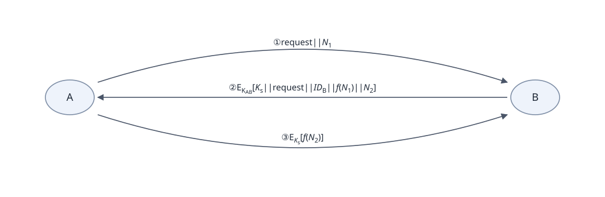
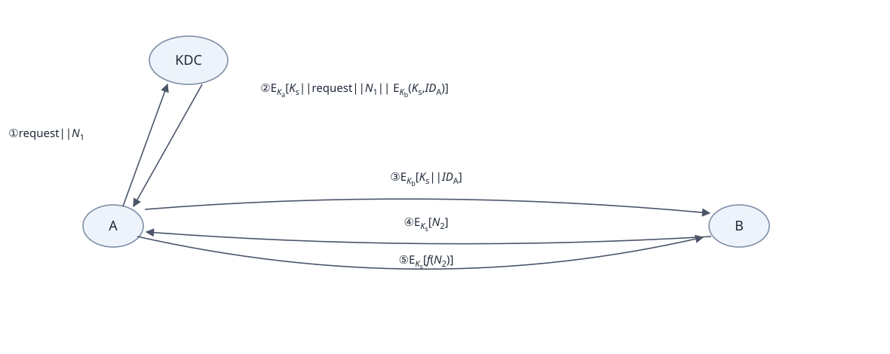
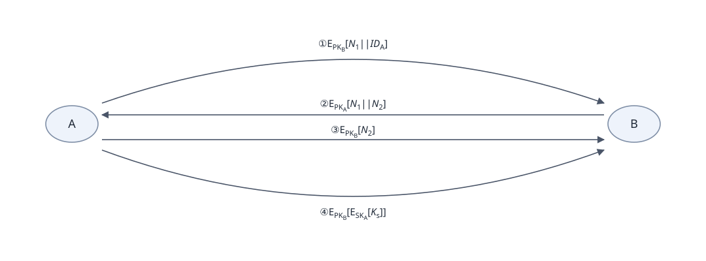

# 4.5 密钥管理技术

## 4.5.1 对称密钥的分配与管理

密钥分配一般要解决两个问题：一是引进自动分配密钥机制，以提高系统的效率；二是尽可能减少系统中驻留的密钥量。这两个问题也可以同步解决。

### 1. 密钥的使用控制

在本节所述的对称加密方案中，通信双方（例如两台主机或两个进程）需要共享秘密密钥，并按密钥有效期及风险情况进行更新。安全分配密钥是保护通信的必要条件。

以下介绍两种用于限制密钥用途的技术。

1）密钥标签

教材介绍的一种历史方案利用 DES 密钥表示中的 8 个校验位记录用途标签，其中前3位分别代表了该密钥的不同信息：主/会话密钥、加密、解密。这类标签可表示的用途有限；若标签随密钥一起被加密，须先解密后才能读取。

2）控制矢量

控制矢量用若干字段表示在不同情况下允许或禁止的密钥用途，且长度可变。它在密钥分配中心（Key Distribution Center，KDC）产生密钥时与密钥的用途绑定：先用杂凑函数将控制矢量映射为与主密钥等长的值，再将其与主密钥异或，用所得密钥加密会话密钥，即：

$$H=h(CV)$$

$$K_n=K_m\ \mathrm{XOR}\ H$$

$$C=E_{K_n}[K_S]$$

其恢复过程为：$K_S=D_{K_n}[C]$

用户只有使用与KDC共享的主密钥以及KDC发送过来的控制矢量才能恢复会话密钥，因此，须保证保留会话密钥与其控制矢量之间的对应关系。

### 2. 密钥的分配

两个用户A 和B 在获得共享密钥时可以有4种方式。

1. 经过A 选取的密钥通过物理手段发送给另一方B。
2. 由第3方选取密钥，再通过物理手段分别发送给 A 和 B。

3. A、B事先已有一个密钥，其中一方选取新密钥后，用已有密钥加密该新密钥后发送给另一方。
4. A、B 各与可信第三方 C 建有保密信道。C 选取密钥后，分别通过这两条信道将其发送给 A 和 B。

前两种方法称为人工发送。若 $N$ 个用户两两通信，每对用户单独预置一个共享密钥，则共需 $N(N-1)/2$ 个。第 3 种方法中，若后续新密钥始终仅受前一密钥保护，持有泄露密钥并取得后续密钥更新密文的一方，就可能恢复该链上后续的密钥。这3种方法的公共弱点在于当N 很大时，密钥的分配代价也变得非常大。但是，这种无中心的密钥控制技术在整个网络的局部范围内却显得非常有用。如图 4-3所示，其中 $N_1$、$N_2$ 表示随机数；第二步使用 A、B 原先共享的密钥，图中统一记作 $K_{AB}$。

> 图 4-3 无KDC的密钥分配

第4种方法是较常用的。第三方 C 是为用户分配密钥的 KDC。每个用户与 KDC 各有一个共享密钥，即主密钥。KDC 使用各用户的主密钥保护分配给通信双方的会话密钥，用于用户间的保密通信。会话密钥在通信结束后立即销毁。若有 $N$ 个用户，各自只需与 KDC 共享一个主密钥，共需 $N$ 个主密钥，可通过物理手段分发。用户对有 $N(N-1)/2$ 个；会话密钥按会话分配，实际数量取决于建立的会话。如图 4-4所示，其中 $N_1$、$N_2$ 表示随机数，$K_s$ 表示会话密钥。

> 图 4-4 有KDC的密钥分配

由于网络中用户数目非常多并且地域分布非常广泛，因此有时需要使用多个KDC的分层结构。可在每个较小范围（如一个局域网或一幢建筑物）内建立本地 KDC，不同范围的本地 KDC 之间可再用一个全局 KDC 连接。分层可简化跨域密钥管理。某个 KDC 失效或失陷的影响范围取决于层级间的信任关系。

另外，应注意会话密钥有效期的设置。缩短密钥有效期可限制单个密钥暴露的影响。
但是另一方面，频繁更换会话密钥会造成网络负担，延迟用户之间的交换。因此在决定其有效期时，应权衡矛盾的两个方面。

## 4.5.2 公钥加密体制的密钥管理

### 1. 公开发布

公开发布是指用户将自己的公钥发送给其他用户，或向某一群体广播。例如，PGP（Pretty Good Privacy）用户可以把自己的公钥附在消息中公开发布。
这种方法虽然简单，但未经认证的公开发布不能证明公钥属于其声称的身份。若接收方误将他人的公钥当成 A 的公钥，用它加密的消息可被相应私钥的持有者解读；把它用作验签公钥，也可能错误地认定签名者身份。

### 2. 公用目录表

公用目录表指一个公用的公钥动态目录表，由某个可信的实体或组织(公用目录的管理员)承担该公用目录表的建立、维护和公钥分发。管理员为每个用户在目录表中建立一个目录，其中包括用户名和用户的公开钥两个数据项，并且定期公布和更新目录表。每个用户都亲自或以某种安全的认证通信在管理者那里注册自己的公开钥，可通过电子手段访问目录表，还可随时替换新密钥。但是，这种公用目录表的管理员私钥一旦被攻击者获取，同样面临被假冒的危险。

### 3. 公钥管理机构

与公用目录表类似的，不过用公钥管理机构来为各用户建立、维护动态的公钥目录，这种对公钥分配更加严密的控制措施可以增强其安全性。特别注意的是，每个用户都需要通过可信方式确认管理机构的公钥，机构应独占并保护相应的私钥。

例如，用户 A 向公钥管理机构请求另一个用户的公钥。机构用自己的私钥对响应签名，A 用已知可信的机构公钥验证响应。

在每次通信都需在线查询的方案中，管理机构可能成为瓶颈。机构还需要保护其目录，防止公钥记录被篡改。

### 4. 公钥证书

证书颁发机构（Certification Authority，CA）可用证书将主体的身份与公钥绑定。以简化记号表示，CA 对包含时间信息 $T$、用户标识 $ID_A$ 和用户公钥 $PK_A$ 的证书数据签名，签名可写作 $\operatorname{Sign}_{SK_{CA}}(T,ID_A,PK_A)$。$SK_{CA}$ 是 CA 的私钥。证书由 CA 签发给 A，包含证书数据及其签名。

用户将自己的公开钥通过公钥证书发给另一用户，接收方使用可信 CA 的公钥验证证书签名，并检查主体、有效期、用途以及适用的吊销信息。证书可以随公钥传递，接收方不必每次都向 CA 查询公钥，但仍依赖对签发机构的信任。

## 4.5.3 公钥加密分配单钥密码体制的密钥

公开钥分配完之后，用户可用公钥加密体制进行保密通信。但是，这种加密体制的加密速度比较慢，因此比较适合于单钥密码体制的密钥分配，如图 4-5所示。

> 图 4-5 密钥分配

假定 A、B 已可靠确认对方公钥的归属，则可利用公钥加密体制按照如下步骤建立共享会话密钥。

1. A 用 B 的公钥加密一次性随机数 $N_1$ 和身份标识 $ID_A$，将所得密文发送给 B。
2. B 用 A 的公钥加密收到的 $N_1$ 和新生成的随机数 $N_2$，将密文返回 A。
3. A 核对 $N_1$ 后，用 B 的公钥加密 $N_2$ 并返回 B，供 B 核对。
4. A 将 $M=E_{PK_B}[E_{SK_A}[K_s]]$ 发送给 B，其中 $K_s$ 为会话密钥，用 B 的公开钥加密是为保证只有 B 能解读加密结果，图中以 A 的私钥运算示意来源认证。
5. B 以 $D_{PK_A}[D_{SK_B}[M]]$ 恢复会话密钥。

该图用于说明密钥分配、随机挑战和来源认证的思路。实际协议的安全性还取决于公钥身份绑定、消息完整性保护及完整协议的设计。
