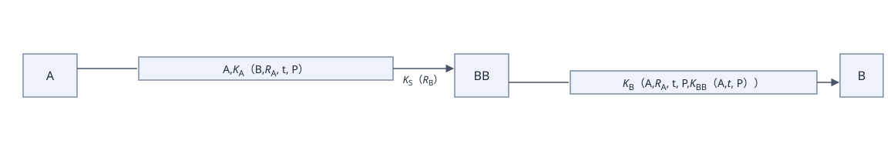

# 4.6 访问控制及数字签名技术

## 4.6.1 访问控制技术

互联网络的蓬勃发展，为信息资源的共享提供了更加完善的手段，企业在信息资源共享的同时也要阻止非授权用户对企业敏感信息的访问。访问控制的目的是为了保护企业在信息系统中存储和处理的信息的安全。

### 1. 访问控制的基本模型

访问控制依据策略决定是否允许主体对客体执行特定操作。
访问控制包括3个要素，即主体、客体和控制策略。访问控制模型是一种从访问控制的角度出发，描述安全系统，建立安全模型的方法。

1. 主体（Subject）是发起访问的实体，简记为 $S$。用户、代表用户运行的进程或服务、以自身身份发起访问的终端都可作为主体；权限也可按用户组分配。
2. 客体（Object）是接受其他实体访问的被动实体，简记为 $O$。客体的概念也很广泛，凡是可以被操作的信息、资源、对象都可以认为是客体。在信息社会中，客体可以是信息、文件和记录等的集合体，也可以是网络上的硬件设施，无线通信中的终端，甚至一个客体可以包含另外一个客体。
3. 控制策略：是主体对客体的操作行为集和约束条件集，简记为KS。简单讲，控制策略是主体对客体的访问规则集，这个规则集直接定义了主体可对客体执行的操作及相应约束条件。系统依据访问策略判断是否允许某主体对某客体执行所请求的操作。

访问控制的实现首先要考虑对合法用户进行验证，然后是对控制策略的选用与管理，并应记录访问活动，审计未经授权的访问和越权操作。所以，访问控制包括认证、控制策略实现和审计3方面的内容：

1. 认证。系统首先确认访问主体的身份；通信双方也可按需实施双向认证。一个实体可以在某一时刻是主体，而在另一时刻是客体，这取决于当前实体的功能是动作的执行者还是动作的被执行者。
2. 控制策略的具体实现。如何设定规则集合从而确保正常用户对信息资源的合法使用，既要防止非法用户，也要考虑敏感资源的泄露，对于合法用户而言，也不得执行超出其授权范围的操作。
3. 审计。审计的重要意义在于，比如客体的管理者即管理员有操作赋予权，其管理权限可受策略约束，操作记录有助于发现滥用。记录这些行为有助于追查异常、发现权限滥用和检验控制措施是否生效。

### 2. 访问控制的实现技术

建立访问控制模型和实现访问控制都是抽象和复杂的行为，实现访问的控制不仅要保证授权用户使用的权限与其所拥有的权限对应，制止非授权用户的非授权行为；还要防止敏感信息在未经授权的主体之间流转。为了便于讨论这一问题，我们以文件的访问控制为例对访问控制的实现做具体说明。通常用户访问信息资源(文件或是数据库),可能的行为有读、写和管理。为方便起见，用Read或是R 表示读操作，Write或是W 表示写操作，Own 或 O 表示管理操作。之所以将管理操作从读写中分离出来，是因为管理员也许会对控制规则本身或是文件的属性等做修改。

1）访问控制矩阵

访问控制矩阵 (Access Control Matrix,ACM) 是通过矩阵形式表示访问控制规则和授权用户权限的方法。也就是说，对每个主体而言，都拥有对哪些客体的哪些访问权限；而对客体而言，又有哪些主体可以访问它；将这种关联关系加以阐述，就形成了控制矩阵。其中，特权用户或特权用户组可以修改主体的访问控制权限。

访问矩阵是以主体为行索引，以客体为列索引的矩阵，矩阵中的每一个元素表示一组访问方式，是若干访问方式的集合。第 $i$ 行第 $j$ 列的元素 $M_{ij}$ 记录主体 $S_i$ 对客体 $O_j$ 的访问权限。例如，$M_{ij}=\{R,W\}$ 表示 $S_i$ 可读、写 $O_j$。

访问控制矩阵的实现很易于理解，但是查找和实现起来有一定的难度，而且，如果用户和文件系统要管理的文件很多，那么完整矩阵的格数等于主体数与客体数的乘积。因为在大型系统中访问矩阵很大而且其中会有很多空值，因此可按行、按列或仅按非空授权项保存信息，无须存储完整的矩阵。

2）访问控制表

访问控制表（Access Control List，ACL）是常见的访问控制实现方式。
在这种表示中，每个客体的访问控制表记录相关主体或组以及适用于它们的访问权限。这种实现技术实际上是按列保存访问矩阵。访问控制表提供了针对客体的方便的查询方法，通过查询一个客体的访问控制表，很容易决定某一个主体对该客体的当前访问权限。删除客体的访问权限也很方便，在采用默认拒绝且无其他授权来源的模型中，可以移除该客体的允许项。但是用访问控制表来查询一个主体对所有客体的所有访问权限是很困难的，必须查询系统中所有客体的访问控制表来获得其中每一个与该主体有关的信息。类似地，删除一个主体对所有客体的所有访问权限也必须查询所有客体的访问控制表，删除与该主体相关的信息。

3）能力表

能力表 (Capabilities) 对应于访问控制表，这种实现技术实际上是按行保存访问矩阵。每个主体有一个能力表（capability list），记录该主体可访问的客体及相应权限。使用能力表实现的访问控制系统可以很方便地查询某一个主体的所有访问权限，只需要遍历这个主体的能力表即可。然而查询对某一个客体具有访问权限的主体信息就很困难了，必须查询系统中所有主体的能力表。基于能力的授权和基于访问控制表的授权是两种不同的设计选择。在一些分布式系统中，也使用了能力表和访问控制表相结合的方法来实现其访问控制安全机制。

4）授权关系表

访问矩阵也有既不对应于行也不对应于列的实现技术，那就是对应访问矩阵中每一个非空元素的实现技术——授权关系表(Authorization Relations)。授权关系表的每一行(或者说元组)就是访问矩阵中的一个非空元素，是某一个主体对应于某一个客体的访问权限信息。按主体组织或索引授权关系，有利于查询主体的权限；按客体组织或索引，则有利于查询客体的授权记录。数据库系统可使用授权关系表记录权限。

## 4.6.2 数字签名

手写签名和数字签名都可用于表明签署行为。数字签名通过密码学运算将签名与特定数据关联。设 A 对消息 $P$ 签名并发送给 B，在公钥归属可信、私钥受到保护的前提下，可达到以下目的：

1. B 可用 A 的公钥验证签名与消息 $P$ 的对应关系，据此判断消息来源。验签本身不能证明 A 本人亲手操作或理解了消息内容。
2. 验证通过的签名可以作为来源和完整性的证据，支持抗抵赖。
3. B 若改动消息，原签名不能再对改动后的消息验证通过。

### 1. 数字签名的条件

可用的数字签名应保证以下几个条件：

1. 签名是可信的。接收者可使用可信的公钥验证签名和消息的对应关系。
2. 签名不可伪造。在签名算法安全、私钥未泄露的前提下，其他人难以生成可验证为该签名者所签的新消息签名。
3. 签名与被签数据绑定。签名可以附在文件中，也可以分开保存。复制同一消息及其签名仍可能通过验证，但把签名附到不同内容上通常无法通过验证。
4. 签名可检验完整性。文件仍可修改，但修改后的文件不能通过原签名的有效验证。
5. 签名是不可抵赖的。签名记录可作为争议处理的证据，证据强度取决于签名者身份、私钥管理及验证过程。

手写签名的图像容易被复制并粘贴到另一份电子文件中。仅凭图像外观，通常难以判断文件在签署后是否被改动。数字签名则通过验证签名与被签数据是否匹配来发现变更；同一签名被复制，不会使它对另一份不同内容的文件有效。

### 2. 对称密钥签名

图 4-6 给出一种依赖可信仲裁人的对称密钥认证方案。它需要仲裁人核验，与可用公钥独立验证的数字签名有所不同。设 BB 是 A 和 B 共同信赖的仲裁人。$K_A$ 和 $K_B$ 分别是 A 和 B 与 BB 之间的密钥，而 $K_{BB}$ 是只有 BB 掌握的密钥，$P$ 是 A 发给 B 的消息，$t$ 是时间戳。
BB 解读了 A 的报文 $\{A,K_A(B,R_A,t,P)\}$ 以后产生了一个签名的消息 $K_{BB}(A,t,P)$，并装配成发给 B 的报文 $\{K_B(A,R_A,t,P,K_{BB}(A,t,P))\}$。B 可以解密该报文，阅读消息 $P$，并保留证据 $K_{BB}(A,t,P)$。A、B 都依赖可信仲裁人 BB 核验通信身份和报文。发生争议时，BB 可核对保留的凭据 $K_{BB}(A,t,P)$，识别其中记录的发送者、时间和原消息。BB 自身也掌握相关密钥，因此该凭据并不能向独立的第三方证明 A 亲自签署；B 可以修改自己的消息副本，但改后的内容与原凭据不符。

> 图 4-6 基于密钥的数字签名

### 3. 公开密钥签名

在对称密码体制中，通信双方须保护共享密钥。公钥密码体制可以减少直接分发共享秘密的需要，但仍须验证公钥属于预期的通信方。在公钥密码系统中，解密密钥和加密密钥是不同的，安全要求是从公钥推算私钥在计算上不可行；在许多体制中，可以由私钥得到相应公钥。

图 4-7 用简化的 RSA 式记号表示先签名再加密；一般数字签名应使用相应算法规定的签名和验证操作。按图示记号，B 可出示 $D_A(P)$ 并用 A 的可信公钥核对它与 $P$ 的关系。实际签名算法的验签结果通常是有效或无效，并不要求从签名恢复原文。即使 B 保留原签名，它也只对应原消息 $P$；在签名算法安全且 A 的私钥未泄露的条件下，B 不能为篡改后的消息生成 A 的有效签名。

> 图 4-7 基于公钥的数字签名

许多数字签名方案在签名过程中按算法规定对消息进行散列，再对包含摘要的规定表示执行签名运算。摘要由全部被签内容计算，因此验证仍然保护这些内容的完整性。此外该协议还有其他优点：首先，签名和文件可以分开保存。验证文件与签名是否匹配时，仍须取得待验证的文件内容或按协议生成的摘要。档案系统可用这类协议来验证文件的存在而不需保存它们的内容。用户可向可信时间戳服务提交文件摘要。事后出示文件并核对其摘要、验证时间戳，可以为该文件在相应时间已经存在提供证据。
