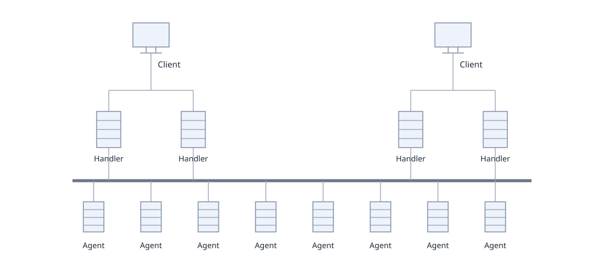
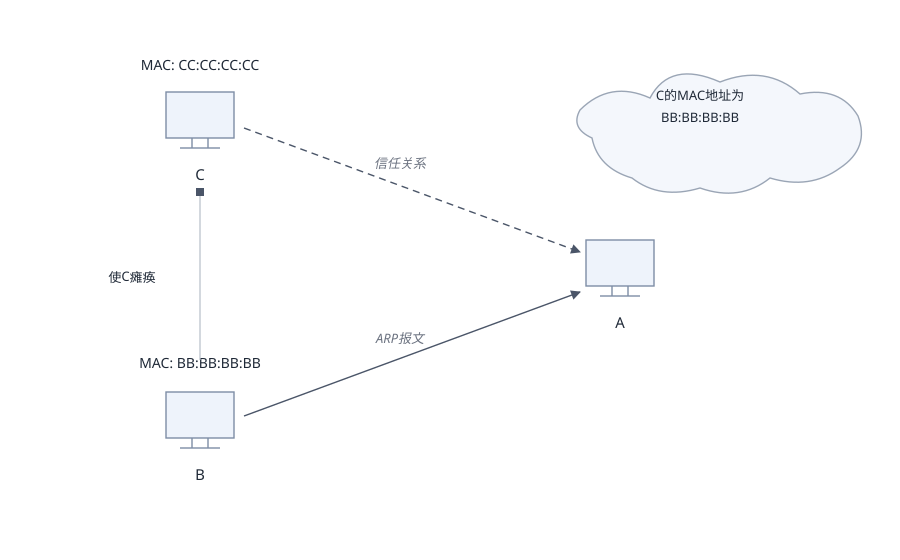
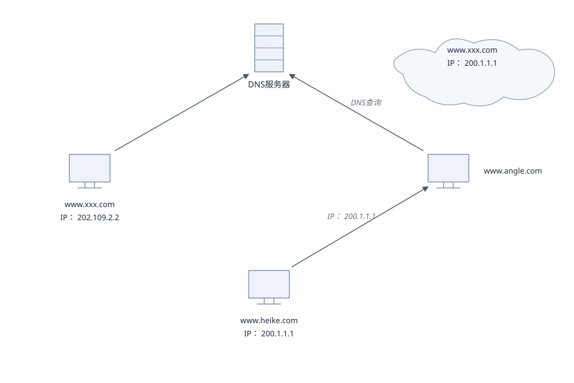
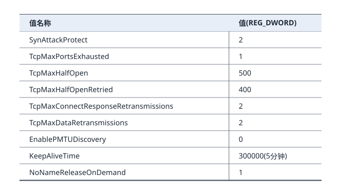

# 4.7 信息安全的抗攻击技术

## 4.7.1 密钥的选择

按用途，本节区分直接加密数据的数据加密密钥（DK）和保护其他密钥的密钥加密密钥（KK）。系统的安全既依赖算法和实现，也依赖密钥的保密性及生成质量。密钥生成应考虑以下三个因素。

### 1. 增大密钥空间

若密钥由 $N$ 个独立二进制位组成，且所有取值均可使用，则密钥空间有 $2^N$ 个元素。限制取值范围或采用可预测的生成方式，都会降低实际搜索难度。

沿用每秒测试 100 万个候选、每字节可取 256 个值的假设，遍历 4、6、8 字节的全部取值，分别约需 1.2 小时、8.9 年和 58.5 万年。这是穷尽全空间的理论用时；标准 ASCII 字符只使用 7 位。

### 2. 选择强钥

容易记忆的短口令通常容易猜测。教材以“Klore”和一串含特殊字符的文本作对比；字符外观本身不能证明随机性。密码算法使用的密钥应按该算法规定的范围和生成要求产生。

### 3. 密钥的随机性

会话密钥应使用适合密码用途的随机源或密码学安全伪随机数生成器产生。公钥密码算法按各自的规则利用随机数生成密钥对。物理噪声可作为熵源；仅通过统计随机性检验，不能证明输出对攻击者不可预测。

随机序列的统计分布和密码学上的不可预测性需要分别考虑。RSA 密钥生成涉及选择大素数；逐一试除到 $\sqrt{N}$ 对大整数效率很低，但这不意味着实用的素性检验都要穷举。相互认证所用的随机挑战和随机生成的会话密钥也应满足各自的不可预测性要求。

## 4.7.2 拒绝服务攻击与防御

拒绝服务攻击（Denial of Service，DoS）旨在损害服务可用性，使合法请求难以及时得到处理。资源耗尽、网络拥塞或服务程序失效都可能造成这一结果。非人为故障也可引起服务中断，二者的原因不同。

分布式拒绝服务攻击（Distributed Denial of Service，DDoS）的流量或请求来自多个来源。主机性能和链路带宽影响承载能力，但单一来源也可能造成拒绝服务。

教材列举两类可用性受损的情形：服务器暂时没有资源接受新的请求，或合法连接受到干扰。

### 1. 传统拒绝服务攻击的分类

拒绝服务攻击有许多种，网络的内外部用户都可以发动这种攻击。内部用户可以通过长时间占用系统的内存、CPU处理时间使其他用户不能及时得到这些资源，而引起拒绝服务攻击；外部黑客也可以通过占用网络连接使其他用户得不到网络服务。本节主要讨论外部用户实施的拒绝服务攻击。

外部用户针对网络连接发动拒绝服务攻击主要有以下几种模式：

1. 消耗资源。合法业务依赖网络带宽、磁盘空间、CPU 时间和内存等有限资源。资源长期被占用，其他请求可能无法及时处理。

2. 破坏或更改配置信息。错误配置可能导致服务中断；未经授权的人员若能修改关键配置，也可能破坏服务可用性。应限制服务配置文件和启动文件的写权限，并审查变更。
3. 物理破坏或改变网络部件。这种拒绝服务针对的是物理安全，一般来说，通过物理破坏或改变网络部件以达到拒绝服务的目的。其攻击的目标有：计算机、路由器、网络配线室、网络主干段、电源、冷却设备、其他的网络关键设备。
4. 服务程序或协议实现的处理错误。教材所举 LAND 是历史案例；发生故障的原因和影响取决于具体实现。

### 2. 分布式拒绝服务攻击DDoS

分布式拒绝服务的请求或流量来自多个来源，可能共同耗尽目标服务或其网络路径的资源，给防御方带来流量识别、容量管理和来源分析方面的困难。可能观察到的现象包括以下几种；单一现象不足以判定攻击。

1. 被攻击主机上有大量等待的TCP连接。
2. 大量到达的数据分组(包括TCP分组和UDP分组)并不是网站服务连接的一部分，往往指向机器的任意端口。
3. 网络中出现大量异常数据包，其源地址有时不可信。
4. 制造高流量的无用数据造成网络拥塞，使受害主机无法正常和外界通信。
5. 利用受害主机提供的服务和传输协议上的缺陷，反复发出服务请求，使受害主机无法及时处理所有正常请求。
6. 严重时会造成死机。

图 4-8 展示一种历史上的三级控制结构，图中的 Client、Handler 和 Agent 分别表示客户端、主控端和代理端。不同的 DDoS 活动未必采用这种结构。

> 图 4-8 DDoS的三级控制结构

### 3. 拒绝服务攻击的防御方法

操作系统和网络设备的缺陷在不断地被发现，并被攻击者利用来进行恶意的攻击。如果清楚地认识到这一点，应当使用下面的方法尽量阻止拒绝服务攻击。

1. 分析报文特征。可将已知特征与流量、时间及主机日志关联，形成调查线索。仅凭某个字符串不能确定人员身份或物理位置。
2. 监视监听端口和异常入站连接，将其与主机上已有的服务清单及业务用途核对。高编号端口本身并不表示主机已经受到入侵。
3. 统计流量变化，将连接数、请求量等指标与正常业务基线对照。流量突增需要结合上下游记录和服务健康状况分析。
4. 及时修复已发现的问题和系统漏洞。

## 4.7.3 欺骗攻击与防御

### 1. ARP欺骗

1）ARP欺骗原理

在同一 IPv4 广播域内，主机可使用 ARP 获取下一跳 IPv4 地址对应的链路层地址，并在本地缓存映射。若缓存中的映射异常，发往预期下一跳的数据帧就可能被送往另一设备，见图 4-9。图中的 MAC 地址是区分设备的简写。

> 图 4-9 ARP欺骗

2）ARP欺骗的防范措施

1. 在地址稳定的小范围网络中，可以为关键邻居配置静态映射。教材以 Windows XP 为例；静态映射需要随地址变更维护。
2. 在受管网络中，可利用交换设备上经过核验的地址绑定信息检查异常映射。
3. 使用端点防护或监测软件时，应评估其兼容性和资源占用，并核对告警所指的实际网络变化。

### 2. DNS欺骗

DNS 解析受到干扰时，用户可能被引向非预期的服务，即便原网站主机仍正常运行。教材以 RSA Security 域名事件作说明；单凭用户看到的网页变化，无法确定变更发生在域名管理、解析还是网站主机。

1）DNS欺骗的原理

DNS 欺骗涉及让解析方接受不可信的域名数据，可能导致连接被引向非预期地址。

2）DNS欺骗示例

图 4-10 对比预期地址与异常解析结果。图中示例域名仅用来区分角色。

> 图 4-10 DNS欺骗

3）DNS欺骗的检测

本节介绍三种检测思路：被动监听、主动探测和交叉核对。

1. 被动监听检测。关联请求与应答，查找异常或互相矛盾的记录。一个应答的回答区可以包含多条资源记录；合法负载均衡、缓存与配置差异也可能造成查询结果不同。
2. 主动探测。在受控环境中对照预期行为检查异常响应，并结合网络配置、日志和其他证据研判；意外响应本身不能证明攻击。
3. 交叉检查查询。可向可信来源核对记录；正向解析与反向解析相符或不符都不足以单独证明数据真伪。对于已正确签名且具备可信验证链的区域，DNSSEC 可验证 DNS 数据来源和完整性。

### 3. IP欺骗

1）IP欺骗的原理

IP 欺骗是指报文携带了伪造的源 IP 地址。TCP 的可靠传输机制本身不为通信对端提供密码学身份认证。

2）IP欺骗的防范

在网络边界实施源地址验证，过滤与接入网络不符的源地址。旧式 UNIX 主机信任配置仅涉及特定服务；应分别核查信任关系和服务权限，避免仅凭主机地址授权。

## 4.7.4 端口扫描

端口扫描是从网络侧观察服务暴露面的一种手段。在授权资产检查中，端口可达性可与资产清单对照；单凭端口号或响应不能可靠确定操作系统，也不能证明系统存在可利用的漏洞。

### 1. 端口扫描原理

TCP 和 UDP 通过端口号区分传输层端点。IP 地址和端口号用于描述端点，服务可达性还取决于协议、监听状态、防火墙及网络路径。任何响应都不能一概解释为服务已开放。

### 2. 扫描原理分类

教材列有完整 TCP 连接、半开放式、FIN 和经第三方进行观察等类别。观测结果受操作系统、过滤策略和网络位置影响。防守方可结合主机和网络日志核查异常活动；连接未完成也可能留下记录。

## 4.7.5 强化TCP/IP堆栈以抵御拒绝服务攻击

针对TCP/IP堆栈的攻击方式有多种类型，下面分别介绍攻击原理及抵御方法。

### 1. 同步包风暴(SYN Flooding)

SYN 洪水是一类针对 TCP 连接建立过程的拒绝服务攻击。过多尚未完成握手的连接可能占用服务器维护连接状态的资源，使合法请求受到延迟或被拒绝。半连接资源耗尽不等同于内存栈溢出，具体影响取决于协议栈实现和防护配置。

表 4-1 保留了旧版 Windows 教材示例中的注册表值。各项用途和适用版本并不相同，不宜将整表作为通用配置；应根据系统版本、厂商说明和实际连接负载选择防护措施。

> 表 4-1 旧版 Windows 配置示例（教材用于说明 SYN 洪水防护）

### 2. ICMP攻击

ICMP 用于传递差错和诊断信息。例如，ping 可发送回显请求并观察回显应答。网络拥塞并不意味着路由器会发送源抑制消息；ICMP 源抑制机制已被废弃。

教材提到的历史案例“Ping of Death”涉及旧系统处理异常报文时的实现缺陷。其影响不能推广到所有 ICMP 通信或所有操作系统。

表 4-2 是旧版 Windows 对接受 ICMP 重定向的配置示例。该开关的作用限于重定向，不能阻止所有利用 ICMP 的攻击，也不能替代安装安全更新。

> 表 4-2 旧版 Windows 的 ICMP 重定向设置示例

### 3. SNMP攻击

SNMP 是网络管理协议，可查询设备状态，也可在设备支持且权限允许时修改受管对象。防护应限制管理接口的可达范围和写权限，并在支持的部署中使用带认证和隐私保护的 SNMPv3 安全配置。

表 4-3 收录的旧版 Windows 参数 EnableDeadGWDetect 管理失效网关检测，值 0 表示关闭该检测。此项不控制 SNMP 的认证、访问权限或服务状态。

> 表 4-3 旧版 Windows 的失效网关检测设置示例

## 4.7.6 系统漏洞扫描

系统漏洞扫描用于检查信息系统，识别需要核实的安全弱点。扫描结果可供风险评估和修复决策参考；仅凭扫描结果不能断定弱点一定可以被利用。按检查视角，本节区分基于网络和基于主机的扫描。

### 1. 基于网络的漏洞扫描

基于网络的漏洞扫描器从网络侧检查可达服务及其可观察的配置或版本信息。例如，检测到特定 BIND 版本可以提示需要核查的风险；实际是否受影响，还取决于补丁、配置和部署条件。典型组件如下。

1. 漏洞数据库模块。漏洞数据库包含了各种操作系统的各种漏洞信息，以及如何检测漏洞的指令。
2. 用户配置控制台模块。用户配置控制台与安全管理员进行交互，用来设置要扫描的目标系统以及扫描哪些漏洞。
3. 扫描引擎模块。扫描引擎是扫描器的主要部件。根据用户配置控制台部分的相关设置，扫描引擎组装好相应的数据包，发送到目标系统，将接收到的目标系统的应答数据包与漏洞数据库中的漏洞特征进行比较，以标记需要核查的问题。
4. 当前活动的扫描知识库模块。通过查看内存中的配置信息，该模块监控当前活动的扫描，将要扫描的漏洞的相关信息提供给扫描引擎。
5. 结果存储器和报告生成工具。报告生成工具，利用当前活动扫描知识库中存储的扫描结果，生成扫描报告。

基于网络的漏洞扫描器有很多优点：

1. 可从少量集中节点覆盖多个网络资产，具体成本取决于部署和维护范围。
2. 无凭据检查通常不需要目标主机的本地账户，使用凭据的检查则需要相应授权。
3. 从网络侧开展的检查通常无须在每台目标主机安装常驻代理。
4. 网络发生变化后，应重新核对覆盖范围、路由、访问控制和资产清单。

### 2. 基于主机的漏洞扫描

基于主机的评估通常通过本地代理或服务读取主机配置、软件版本及运行状态。能检查的内容取决于所授权限、检查规则与平台支持。

基于主机的漏洞扫描优点：

1. 可检查部分从网络侧不易观察的本地配置和软件问题。
2. 集中化管理。在采用集中管理的部署中，管理服务器可以统一下发任务、管理代理版本并汇总结果，便于维护多台主机。
3. 本地检查可减少部分远程检查流量。以本节的 ESM 为例，代理在本机执行检查并向管理器回传结果；任务分发、更新及结果传输仍会占用网络带宽。
