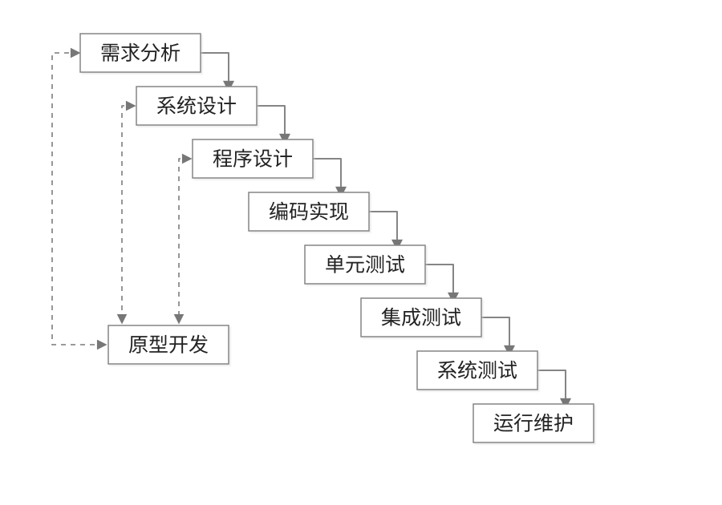
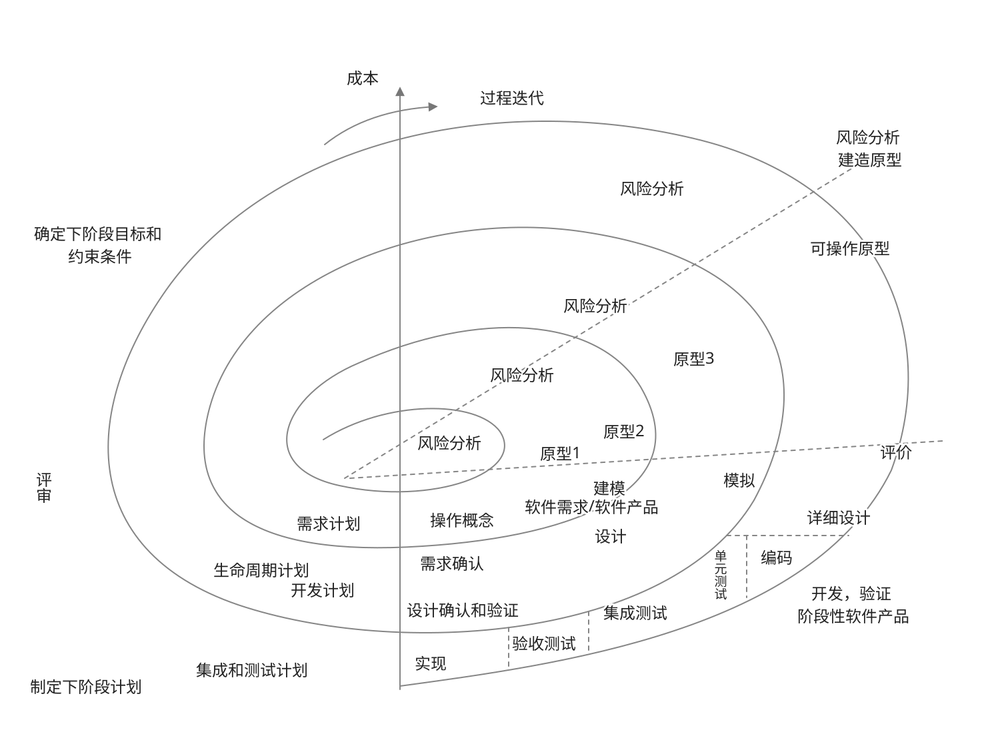
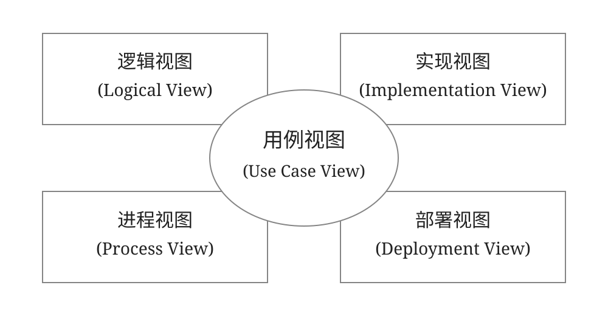

# 5.1 软件工程

20 世纪 60 年代以前，许多程序针对特定应用和计算机编写，使用与机器密切相关的机器代码或汇编语言。部分项目规模较小、文档较少，常由同一人承担设计、编程和使用工作。

60年代中期，大容量、高速度计算机的出现，使计算机的应用范围迅速扩大，软件开发量急剧增长，软件系统的规模越来越大，复杂程度越来越高，软件可靠性问题也越来越突出。1968年，北大西洋公约组织（NATO）在联邦德国召开的软件工程会议讨论了当时的软件危机（software crisis）。

软件危机的具体表现为：

- 软件开发进度难以预测；
- 软件开发成本难以控制；
- 软件功能难以满足用户期望；
- 软件质量无法保证；
- 软件难以维护；
- 软件缺少适当的文档资料。

为讨论这些问题，NATO 于 1968 年和 1969 年召开了两次软件工程会议，推动了软件工程方法的传播。

## 5.1.1 软件工程定义

软件工程一直以来都缺乏一个统一的定义，很多学者和组织机构都分别给出了自己的定义：

- Barry Boehm: 运用现代科学技术知识来设计并构造计算机程序及为开发、运行和维护这些程序所必需的相关文件资料。
- IEEE: 软件工程是：①将系统化的、严格约束的、可量化的方法应用于软件的开发、运行和维护，即将工程化应用于软件；②对①中所述方法的研究。
- Fritz Bauer: 在NATO会议上给出的定义，建立并使用完善的工程化原则，以较经济的手段获得能在实际机器上有效运行的可靠软件的一系列方法。

- 《计算机科学技术百科全书》：软件工程是应用计算机科学、数学、逻辑学及管理科学等原理，开发软件的工程。软件工程借鉴传统工程的原则和方法，以提高质量、降低成本和改进算法。其中，计算机科学、数学用于构建模型与算法；工程科学用于制定规范、设计范型 (Paradigm)、评估成本及确定权衡；管理科学用于计划、资源、质量、成本等管理。

软件工程过程是指为获得软件产品，在工具支持下开展的一系列工程活动。下列四类活动可贯穿软件生命周期。

1. 软件规格说明。规定软件的功能及其运行时的限制。
2. 软件开发。开发出满足规格说明的软件。
3. 软件确认。确认开发的软件能够满足用户的需求。
4. 软件演进。软件在运行中不断改进，以满足客户的新需求。

过程改进中还可采用 PDCA 循环，即计划（Plan）、执行（Do）、检查（Check）和处置（Act）。

## 5.1.2 软件过程模型

软件要经历从需求分析、软件设计、软件开发、运行维护，直至被淘汰这样的全过程，这个全过程称为软件的生命周期。软件生命周期描述了软件从生到死的全过程。

为了使软件生命周期中的各项任务能够有序地按照规程进行，需要一定的工作模型对各项任务给予规程约束，这样的工作模型被称为软件过程模型，有时也称之为软件生命周期模型。

### 1. 瀑布模型

瀑布模型 (Waterfall Model) 是最早使用的软件过程模型之一，包含一系列活动。这些活动从一个阶段到另一个阶段逐次下降，它的工作流程在形式上很像瀑布，因此被称为瀑布模型，如图 5-1所示。

> 图 5-1 瀑布模型

瀑布模型的特点是因果关系紧密相连，前一个阶段工作的输出结果，是后一个阶段工作的输入。每一个阶段都是建筑在前一个阶段正确实施的结果之上。每一个阶段工作完成后都伴随着一个里程碑，团队依据约定的条件对该阶段的工作进行审查和确认。历史上，瀑布模型起到了重要作用，它的出现有利于人员的组织管理，有利于软件开发方法和工具的研究。

瀑布模型的主要缺点有：

1. 在项目初期，很难完整、准确地确定需求。用户可能还不能清楚说明目标系统要做什么，后续变化也难以预测。
2. 瀑布模型是一个严格串行化的过程模型，使得用户和软件项目负责人要相当长的时间才能得到一个可以看得见的软件系统。如果出现与用户的期望不一致，或者出现需求变更，将会带来巨大的损失(例如人力、财力、时间等)。
3. 如果假定每个阶段都能一次完成而没有遗漏，就容易低估发现问题后返工的成本。

### 2. 原型化模型

原型模型（Prototype Model）通过构建原型探索或验证需求，快速原型是其中一种做法。针对瀑布模型的局限，人们借鉴建筑师、工程师建造原型的经验，提出了原型模型。该模型如图 5-2所示。

> 图 5-2 原型模型

原型模型主要有以下两个阶段。

1）原型开发阶段。软件开发人员根据用户对系统的初步描述，快速开发一个原型。原型应体现目标系统的关键问题和大致面貌，展示其全部或部分功能、性能等。

开发原型可以考虑以下三种途径。

- 模拟系统的人机界面和交互方式。
- 开发可运行的原型。
- 找来一个或几个正在运行的类似系统进行比较。

2）目标软件开发阶段。征求用户意见，修改完善原型，对目标系统的需求取得一致理解，再开发实际系统。用于探索需求的原型可在完成任务后废弃。使用原型模型时应注意以下几点。

- 用户对目标系统认识模糊时，可以用原型帮助澄清需求。
- 要有一定的开发环境和工具支持。
- 原型的若干次修改应收敛到目标范围内。
- 对于大型软件，可以选取关键功能制作原型，控制原型的复杂程度。

按照原型的作用，可以区分抛弃型原型和演化型原型。

抛弃型原型是将原型作为需求确认的手段，在需求确认结束后，原型就被抛弃不用，再根据确认后的需求开发实际产品。演化型原型是在需求确认结束后，不断补充和完善原型，直至形成一个完整的产品。原型的概念也被后续出现的过程模型采纳，如螺旋模型和敏捷方法。

### 3. 螺旋模型

螺旋模型（Spiral Model）以风险分析驱动迭代，可以结合原型等方法降低不确定性。如图 5-3 所示，每一轮包括以下四类活动。

> 图 5-3 螺旋模型

1. 目标设定。为该项目进行需求分析，定义和确定这一个阶段的专门目标，指定对过程和产品的约束，并且制订详细的管理计划。

2. 风险分析。对可选方案进行风险识别和详细分析，制定解决办法，采取相应措施应对这些风险。
3. 开发和验证。风险评估后，选择合适的开发方法，开发并验证本轮的成果；必要时可以构建原型。
4. 评审。对项目进行评审，以确定是否进入下一轮迭代；如果决定继续，就要制订下一阶段计划。

螺旋模型的软件开发过程实际上是上述4个部分的迭代过程，每迭代一次，螺旋线就增加一圈，本轮就形成与其风险和目标相应的成果，例如需求说明、设计、原型或产品增量。经过若干次的迭代后，系统应该尽快地收敛到用户允许或可以接受的目标范围内，否则也有可能中途夭折。

该模型支持大型软件开发，适用于面向规格说明、面向过程和面向对象的软件开发方法，也适用于几种开发方法的组合。

## 5.1.3 敏捷模型

20 世纪 90 年代，面向对象编程得到推广，互联网商业应用也带来快速交付的压力。需求频繁变化时，长周期内一次性确定的详细计划较难保持有效。

2001年2月，17位著名的软件开发专家齐聚在美国犹他州雪鸟镇，举行了一次敏捷方法发起者和实践者的聚会。在这次会议上，共同签署了《敏捷软件开发宣言》。

### 1. 敏捷方法的特点

敏捷型方法主要有两个特点，这也是其区别于其他方法，尤其是计划驱动或重型开发方法的最主要的特征。

敏捷型方法是“适应性” (adaptive) 而非“预设性” (predictive) 的。重型方法试图对一个软件开发项目在很长的时间跨度内做出详细的计划，然后依计划进行开发。计划驱动方法一般通过变更控制调整计划；敏捷方法强调通过频繁反馈适应变化。其实，敏捷的目的就是成为适应变化的过程，甚至能允许改变自身来适应变化。

敏捷型方法是“面向人的”(People-oriented) 而非“面向过程的” (Process-oriented)。它们试图使软件开发工作能够充分发挥人的创造能力。它们强调软件开发应当是一项愉快的活动。

下面是对上面两点的详细解释。

1）适应性和预设性

传统开发方法借鉴了土木工程等领域在施工前进行设计、据图分工的做法。工程实施中仍可能需要根据现场条件修改设计。

软件开发同样需要设计知识和创造性工作。土木工程可依据工程实践和数学模型推演部分设计结果，软件设计也可使用形式化模型。

软件设计和实现之间存在反馈：有些设计问题要到编码和测试时才会暴露，需要据此调整设计。

所以，软件过程不可能照搬其他工程领域原有的方法，需要有适应其特点的新开发方法。

需求变化会增加对开发工作量和完成时间作出准确预测的难度。

在不确定性较高的环境中，长期计划需要随反馈更新，短期目标仍可用于指导和检查工作。

但是，必须对这样的过程进行监控，以使得整个过程能向期望的目标前进。于是Agile方法引入“适应性”方法，该方法使用反馈机制对不可预测过程进行控制。

2）面向人而非面向过程

计划驱动方法通常明确分析员、程序员、测试员和管理人员等角色的职责，以减少人员变化对开发的影响。敏捷方法更强调个人的技能和团队协作。

如果开发过程完全由脱离一线实践的管理人员制定，开发人员可能难以接受。让实际参与开发的人共同改进过程，有助于解决这一问题。

敏捷开发重视一线开发人员参与技术决策。他们了解开发细节，可以根据技术变化及时提出判断，并与管理人员共同对开发过程负责。

敏捷方法特别强调相关人员之间的信息交流。重要信息没有及时准确地送达有关人员，可能导致项目失败。管理人员和开发人员需要持续了解需求变化，并共同调整后续工作。

敏捷方法还特别提倡直接的面对面交流。直接交谈有助于快速澄清问题，书面资料则便于跨时间、地点共享和追溯。团队可按相关工作划分小组，并减少组间依赖。

### 2. 敏捷方法的核心思想

敏捷方法的核心思想主要有下面3点。

1. 敏捷方法是适应型，而非可预测型。与传统方法不同，敏捷方法拥抱变化，也可以说它的初衷就是适应变化的需求，利用变化来发展，甚至改变自己，最后完善自己。
2. 敏捷方法以人为本，强调发挥人的主动性。团队在缺乏过程控制和控制过度之间寻求平衡，以支持软件质量。
3. 迭代增量式的开发过程。敏捷方法通常采用迭代增量式开发，也可用原型探索需求，发行版本小型化。它根据客户需求的优先级和开发风险，制订版本发行计划，后续发行版可增加功能，也可修复缺陷或改进现有功能，具体范围依据反馈和优先级调整。

### 3. 主要敏捷方法简介

这里简单介绍几种影响比较大的敏捷方法。

1）极限编程 (Extreme Programming，XP)。在所有的敏捷型方法中，XP是最引人瞩目的。
极限编程是一个轻量级的、灵巧的软件开发方法；同时它也是一个非常严谨和周密的方法。早期 XP 强调交流、简单、反馈和勇气，即任何一个软件项目都可以从4个方面入手进行改善：加强交流；从简单做起；寻求反馈；勇于实事求是。

XP 采用短周期迭代开发，它将复杂的开发过程分解为一个个相对比较简单的小周期；通过积极的交流、反馈以及其他一系列的方法，开发人员和客户可以非常清楚开发进度、变化、待解决的问题和潜在的困难等，并根据实际情况及时地调整开发过程。

2）水晶系列方法。水晶系列方法是由Alistair Cockburn提出的敏捷方法系列。它与XP方法一样，都有以人为中心的理念，但在实践上有所不同。其目的是发展一种提倡“机动性的”方法，包含具有共性的核心元素，每个都含有独特的角色、过程模式、工作产品和实践。
Crystal家族实际上是一组经过证明、对不同类型项目非常有效的敏捷过程，它的发明使得敏捷团队可以根据其项目和环境选择最合适的Crystal家族成员。

3）Scrum。Scrum 是一种支持迭代、增量开发的轻量级框架。产品待办列表（Product Backlog）按顺序列出改进产品所需的工作，商业价值是排序时可以考虑的因素之一。

开发工作在一系列短周期（Sprint）中进行。Sprint 待办列表包括本次 Sprint 的目标、选入的产品待办项以及交付增量的可执行计划。每个 Sprint 都要产生可用的产品增量，达到完成定义的增量可以在 Sprint 结束前交付。

4）特征驱动开发方法 (Feature-Driven Development，FDD)。FDD是由 Jeff De Luca 和 Peter Coad提出来的。FDD是一个迭代的开发模型。FDD认为有效的软件开发需要3个要素：人、过程和技术。

FDD定义了6种关键的项目角色：项目经理、首席架构设计师、开发经理、主程序员、程序员和领域专家。根据项目规模，一人可以兼任多个角色。

FDD有5个核心过程：开发整体对象模型、构造特征列表、计划特征开发、特征设计和特征构建。其中，计划特征开发根据构造出的特征列表、特征间的依赖关系进行计划，设计出包含特征设计和特征构建过程组成的多次迭代。

## 5.1.4 统一过程模型(RUP)

软件统一过程 (Rational Unified Process,RUP) 是Rational软件公司创造的软件工程方法。
RUP描述了如何有效地利用商业的、可靠的方法开发和部署软件，是一种重量级过程。RUP类似一个在线的指导者，它可以为所有方面和层次的程序开发提供指导方针、模板和示例。

### 1. RUP的生命周期

RUP 从两个维度描述开发过程：时间维度由阶段和迭代组成，工作内容维度由各类工作流组成。经典 RUP 的九个核心工作流如下。

- 业务建模 (Business Modeling): 理解待开发系统所在的机构及其商业运作，确保所有参与人员对待开发系统所在的机构有共同的认识，评估待开发系统对所在机构的影响。
- 需求 (Requirements): 定义系统功能及用户界面，使客户知道系统的功能，使开发人员理解系统的需求，为项目预算及计划提供基础。
- 分析与设计 (Analysis & Design): 把需求分析的结果转化为分析与设计模型。
- 实现 (Implementation): 把设计模型转换为实现结果，对开发的代码做单元测试，将不同实现人员开发的模块集成为可执行系统。
- 测试 (Test): 检查各子系统之间的交互、集成，验证所有需求是否均被正确实现，对发现的软件质量上的缺陷进行归档，对软件质量提出改进建议。
- 部署 (Deployment): 打包、分发、安装软件，升级旧系统；培训用户及销售人员，并提供技术支持。
- 配置与变更管理 (Configuration & Change Management): 跟踪并维护系统开发过程中产生的所有制品的完整性和一致性。
- 项目管理 (Project Management): 为软件开发项目提供计划、人员分配、执行、监控等方面的指导，为风险管理提供框架。
- 环境 (Environment): 为软件开发机构提供软件开发环境，即提供过程管理和工具的支持。

表示核心工作流的术语 Discipline 有多种中文译法，根据RUP的定义，Discipline是相关活动的集合，这些活动都和项目的某一个方面有关，如这些活动都是和业务建模相关的，或者都是和需求相关的，或者都是和分析设计相关的，等等。

RUP把软件开发生命周期划分为多个循环 (Cycle), 每个循环生成产品的一个新的版本，每个循环依次由4个连续的阶段 (Phase) 组成，每个阶段完成确定的任务。这4个阶段如下。

- 初始 (inception) 阶段：明确产品愿景和业务模型，并确定系统范围。
- 细化 (elaboration) 阶段：设计及确定系统的体系结构，制订工作计划及资源要求。
- 构造 (construction) 阶段：构造产品并继续完善需求、体系结构和计划，使产品具备移交条件。
- 移交(transition) 阶段：把产品提交给用户使用。

每一个阶段都由一个或多个连续的迭代 (Iteration) 组成。迭代并不是重复地做相同的事，而是围绕本轮目标细化和实现选定的用例、处理风险或验证架构。每一个迭代都是一个完整的开发过程，它需要项目经理根据当前迭代所处的阶段以及上次迭代的结果，适当地对核心工作流中的行为进行裁剪。

在每个阶段结束前有一个里程碑 (Milestone) 评估该阶段的工作。如果未能通过该里程碑的评估，则决策者应该做出决定，是取消该项目还是继续做该阶段的工作。

### 2. RUP中的核心概念

RUP中定义了如下一些核心概念，理解这些概念对于理解RUP很有帮助。
- 角色 (Role):Who的问题。角色描述某个人或一个小组的行为与职责。RUP预先定义了很多角色，如体系结构师 (Architect)、设计人员 (Designer)、实现人员(Implementer)、测试员 (tester) 和配置管理人员(Configuration Manager) 等，并对每一个角色的工作和职责都做了详尽的说明。
- 活动 (Activity):How的问题。活动是一个有明确目的的独立工作单元。
- 制品(Artifact):What的问题。制品是活动生成、创建或修改的一段信息。也有些书把Artifact翻译为产品、工件等，和制品的意思差不多。
- 工作流 (Workflow):When的问题。工作流描述了一个有意义的连续的活动序列，每个工作流产生一些有价值的产品，并显示了角色之间的关系。

RUP 2003 对这些概念有比较详细的解释，并用类图描述了这些概念之间的关系，除了角色、活动、制品和工作流这4个核心概念外，还有其他一些基本概念，如工具教程 (Tool Mentor)、检查点 (Checkpoints)、模板 (Template) 和报告 (Report) 等。

### 3. RUP的特点

RUP是用例驱动的、以体系结构为中心的、迭代和增量的软件开发过程。下面对这些特点做进一步的分析。

1）用例驱动

RUP中的开发活动是用例驱动的，即需求分析、设计、实现和测试等活动都是用例驱动的。

2）以体系结构为中心

RUP中的开发活动是围绕体系结构展开的。软件体系结构侧重系统的整体组织。实现代码应遵循体系结构决策，语言和平台的约束也可能影响这些决策。软件体系结构是软件设计过程中的一个层次，这一层次超越计算过程中的算法设计和数据结构设计。体系结构层次的设计问题包括系统的总体组织和全局控制、通信协议、同步、数据存取、给设计元素分配功能、设计元素的组织、物理分布、系统的伸缩性和性能等。

体系结构的设计需要考虑多方面的问题：在功能性特征方面要考虑系统的功能；在非功能性特征方面要考虑系统的性能、安全性和可用性等；与软件开发有关的特征要考虑可修改性、可移植性、可重用性、可集成性和可测试性等；与开发经济学有关的特征要考虑开发时间、费用、系统的生命期等。当然，这些特征之间有些是相互冲突的，一个系统不可能在所有的特征上都达到最优，这时就需要系统体系结构设计师在各种可能的选择之间进行权衡。

对于一个软件系统，不同人员所关心的内容是不一样的。因此，软件的体系结构是一个多维的结构，也就是说，会采用多个视图 (View) 来描述软件体系结构。RUP采用如图 5-4所示的“4+1”视图模型来描述软件系统的体系结构。

在“4+1”视图模型中，分析人员和测试人员关心的是系统的行为，会侧重于用例视图；最终用户关心的是系统的功能，会侧重于逻辑视图；程序员关心的是系统的配置、装配等问题，会侧重于实现视图；系统集成人员关心的是系统的性能、可伸缩性、吞吐率等问题，会侧重于进程视图；系统工程师关心的是系统的发布、安装、拓扑结构等问题，会侧重于部署视图。

> 图 5-4 “4+1”视图模型

3）迭代与增量

RUP强调采用迭代和增量的方式来开发软件，把整个项目开发分为多个迭代过程。在每次迭代中，只考虑系统的一部分需求，进行分析、设计、实现、测试和部署等过程；每次迭代是在已完成部分的基础上进行的，每次可增加功能、完善已有实现或降低技术风险，以此进行下去，直至最后项目的完成。软件开发采用迭代和增量的方式有以下好处。

1. 在软件开发的早期就可以对关键的、影响大的风险进行处理。
2. 可以提出一个软件体系结构来指导开发。
3. 可以更好地处理不可避免的需求变更。
4. 可以较早得到一个可运行的系统，鼓舞开发团队的士气，增强项目成功的信心。
5. 为开发人员提供一个能更有效工作的开发过程。

## 5.1.5 软件能力成熟度模型

软件能力成熟度模型 (Capability Maturity Model for Software,CMM) 是一个概念模型，模型框架和表示是刚性的，不能随意改变，但模型的解释和实现有一定弹性。CMM模型自20世纪80年代末推出，并于20世纪90年代广泛应用于软件过程的改进以来，极大地促进了软件生产率的提高和软件质量的提高。

能力成熟度模型集成（Capability Maturity Model Integration，CMMI）在 CMM 等过程改进模型的基础上发展而来，用于指导组织改进过程并评估其成熟度。

以下按 CMMI 经典阶段式表示介绍五个成熟度等级，作为组织逐步改进过程的参考。

1）Level 1 初始级

处于成熟度级别1级时，过程通常是随意且混乱的。这些组织的成功依赖于组织内人员的能力与英雄主义。成熟度1级的组织也常常能产出能用的产品与服务，但它们常常超出预算或延误进度。

2）Level 2 已管理级

在该等级下，意味着组织要确保策划、文档化、执行、监督和控制项目级的过程，并且需要为过程建立明确的目标，并跟踪成本、进度和质量等目标的实现情况。

3）Level 3 已定义级

组织建立并维护标准过程及其他过程资产，项目按需要裁剪组织标准过程，形成并执行项目的已定义过程。

4）Level 4 量化管理级

在成熟度4级，组织建立了产品质量、服务质量以及过程性能的定量目标。成熟度级别3级与4级的关键区别在于利用统计和其他定量技术了解过程性能的变化，提高对过程结果的预测能力。

5）Level 5 优化级

优化级关注组织层面的持续过程改进。成熟度级别5级关注于通过增量式的与创新式的过程与技术改进，不断地改进过程性能。处于成熟度5级时，组织使用从多个项目收集来的数据对整体的组织级绩效进行关注。

有关软件能力成熟度模型的详细介绍，可参考CMM相关专业书籍。
