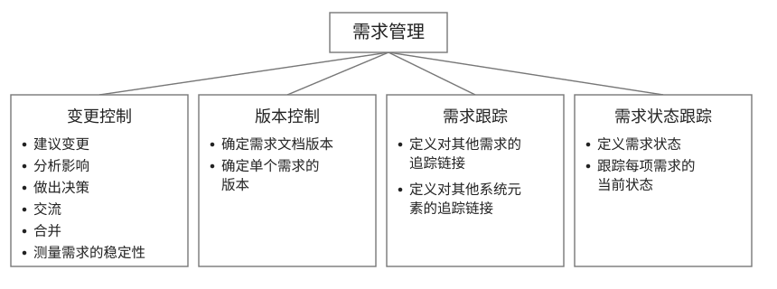

# 5.2 需求工程

软件需求目前并没有统一的定义，但都包含以下几方面的内容。

1. 用户解决问题或达到目标所需的条件或能力（Capability）。
2. 系统或系统部件要满足合同、标准、规范或其他正式规定文档所需具有的条件或能力。
3. 一种反映上面(1)或(2)所述条件或能力的文档说明。它包括功能性需求及非功能性需求，非功能性需求对设计和实现提出了限制，比如性能要求、质量标准或者设计限制。

在经典的瀑布软件过程模型中，将需求分析作为软件开发的第1个阶段，明确指出该阶段的输出成果为用户原始需求说明书和软件需求描述规约。从这点看，需求阶段首先需要定义用户的原始需求，并与用户、客户达成一致；其次，需要对原始需求进行分析，给出一个初步的软件解决方案，并给出该软件的需求描述规约，以指导后续的软件开发。这两个文档之间存在一个转换过程。

软件需求可从业务需求、用户需求和软件层面的需求三个层次描述。软件层面的需求包括功能需求和非功能需求。

1. 业务需求 (business requirement) 反映了组织机构或客户对系统、产品高层次的目标要求。
2. 用户需求 (user requirement) 描述了用户使用产品必须要完成的任务，是用户对该软件产品的期望。这两种构成了用户原始需求文档的内容。
3. 功能需求 (functional requirement) 定义了开发人员必须实现的软件功能，使得用户能完成他们的任务，从而满足业务需求。所谓特性 (feature) 是指逻辑上相关的功能需求的集合，给用户提供处理能力并满足业务需求。作为补充，软件需求规格说明还应包括非功能需求，它描述系统应达到的质量水平和需要遵循的约束等。它包括产品必须遵从的标准、规范和合约；外部接口需要遵守的约束；性能要求；设计或实现的约束条件及质量属性。所谓约束是指对开发人员在软件产品设计和构造上的限制，常见的有设计约束和过程约束。质量属性是通过多种角度对产品的特点进行描述，从而反映产品的质量特征。多角度描述产品对用户和开发人员都极为重要。

开发软件系统最困难的部分就是准确说明开发什么，因为用户往往很难给出完整正确的原始需求，也很难想象出未来的软件应该提供哪些功能，以解决自己的业务问题。这些都需要软件开发人员协助，通过多次的讨论方能最终确认。而如果前期需求分析不透彻，一旦出错，将最终会给系统带来极大损害，并且以后再对它进行修改也极为困难，容易导致项目失败。

1987 年，Frederick Brooks 在《No Silver Bullet: Essence and Accidents of Software Engineering》中，充分说明了需求过程在软件项目中扮演的重要角色。

20世纪80年代中期，形成了软件工程的子领域，需求工程 (Requirements Engineering，RE)。需求工程是随着计算机的发展而发展的，在计算机发展的初期，软件规模不大，软件开发所关注的是代码编写，需求分析很少受到重视。随着软件系统规模的扩大，需求分析与定义在整个软件开发与维护过程中越来越重要，直接关系到软件的成功与否。人们逐渐认识到需求分析活动不再仅限于软件开发的最初阶段，它贯穿于系统开发的整个生命周期。

需求工程是指应用已证实有效的原理、方法，通过合适的工具和记号，系统地描述待开发系统及其行为特征和相关约束。需求工程在体系结构设计前就已开展，并贯穿后续开发和维护活动，主要包括分析客户要求、对未来系统的各项功能性及非功能性需求进行规格说明。需求工程的目标简单明了：确定客户需求，定义设想中系统的所有外部特征。

需求工程的活动可按以下类别说明。根据项目情况，这些活动可以交叉或反复开展。

1. 需求获取：通过与用户的交流，对现有系统的观察及对任务进行分析，从而开发、捕获和修订用户的需求。
2. 需求分析：为系统建立一个概念模型，作为对需求的抽象描述，并尽可能充分地描述现实世界的语义。
3. 形成需求规格(或称之为需求文档化):按照相关标准，生成需求模型的文档描述，用户原始需求书作为用户和开发者之间的一个协约，往往被作为合同的附件；软件需求描述规约作为后续软件系统开发的指南。
4. 需求确认与验证：以需求规格说明为输入，通过用户确认、复审会议、符号执行、模拟仿真或快速原型等途径与方法，确认和验证需求规格的完整性、正确性、一致性、可测试性和可行性，包含有效性检查、一致性检查、可行性检查和确认可验证性。
5. 需求管理：包括需求文档的追踪管理、变更控制、版本控制等管理性活动。

软件需求开发的最终文档经过评审批准后，则定义了开发工作的需求基线 (Baseline)。这个基线在客户和开发者之间构筑了计划产品功能需求和非功能需求的一个约定 (Agreement)。

需求约定是需求开发和需求管理之间的桥梁。

需求管理是了解、跟踪并控制系统需求及其变更的过程。需求管理过程与需求开发过程相互关联，在获取初始需求时就可以规划管理工作，随后持续维护需求的版本、状态和关联。需求管理的主要活动如图 5-5所示。

> 图 5-5 需求管理的主要活动

需求管理强调的内容如下。

1. 控制对需求基线的变动。
2. 保持项目计划与需求一致。
3. 控制单个需求和需求文档的版本情况。
4. 维护需求之间的追踪链接，以及需求与其他项目可交付成果之间的关联。
5. 跟踪基线中的需求状态。

由于需求分析的方法有很多种，后面将结合具体的开发方法进行相关论述。

## 5.2.1 需求获取

用户需求陈述可能由用户单方面写出，也可能由业务分析员、系统分析员配合用户共同写出。需求陈述的内容包括问题范围、功能需求、应用环境及假设条件等。此外，也包含涉及相关软件工程标准、技术方案、将来可能做的扩充及可维护性要求等方面的约束条件。总之，需求陈述应该阐明“做什么”，并记录必须遵守的实现约束。

需求获取是开发者、用户之间为了定义新系统而进行的交流，需求获取是获得系统必要的特征，或者是获得用户能接受的、系统必须满足的约束。如果双方所理解的领域内容在系统分析、设计过程出现问题，通常在开发过程的后期才会被发现，将会使整个系统交付延迟，或上线的系统无法或难以使用，最终导致项目失败。例如，遗漏的需求或理解错误的需求。

### 1. 需求获取的基本步骤

对于不同规模及不同类型的项目，需求获取的过程不会完全一样。下面给出需求获取过程的参考步骤。

1）开发高层的业务模型

所谓应用领域，即目标系统的应用环境，如银行、电信公司等。如果系统分析员对该领域有了充分了解，就可以建立一个业务模型，描述用户的业务过程，确定用户的初始需求。然后通过迭代，更深入地了解应用领域，之后再对业务模型进行改进。

2）定义项目范围和高层需求

在项目开始之前，应当在所有涉众(项目的利益攸关方)之间建立共同的项目愿景，即定义项目范围和高层需求。项目范围描述系统的边界以及系统与其交互参与者（包括组织、人、硬件设备、其他软件等）之间的关系。高层需求不涉及过多的细节，主要表示系统需求的概貌。常见的建模手段包括系统上下文图和系统顶层用例图等。

3）识别用户角色和用户代表

涉众不仅包括传统的用户、客户等，还包括测试人员、维护人员、市场人员等，他们也对项目有利益诉求。因此，首先确定所有涉众，然后从各类涉众中选出代表，与他们一起工作。

与系统交互的参与者可以是人，也可以是其他应用程序或硬件设备。对于外部系统或设备，可由熟悉其接口和运行条件的人员提供需求信息。

4）获取具体的需求

确定了项目范围和高层需求，并确定了所有涉众后，就需要获取每个涉众的具体、完整和详细的需求。

5）确定目标系统的业务工作流

具体到当前待开发的应用系统，确定系统的业务工作流和主要的业务规则。往往需要采取多重方法来获取所需的信息。

6）需求整理与总结

最后对上面步骤取得的需求资料进行整理和总结，确定对软件系统的综合要求，即软件的需求。并提出这些需求的实现条件，以及需求应达到的标准。这些需求包括功能需求、性能需求、环境需求、可靠性需求、安全保密需求、用户界面需求、资源使用需求等。项目开发预算和交付进度则应作为项目约束另行记录。

### 2. 需求获取方法

针对不同类型的软件项目，需要采用不同的需求获取方法。常见的需求获取方法如下。

1）用户面谈

这是理解用户需求的常用方法。面谈需要认真计划和准备；面谈之后，需要复查笔记的准确性、完整性和可理解性；把所收集的信息转化为适当的模型和文档；确定需要进一步澄清的问题。

2）需求专题讨论会

需求专题讨论会也是需求获取的一种有力技术。在短暂而紧凑的时间段内将相关涉众集中在一起集体讨论，与会者可以在应用需求上达成共识，对操作过程尽快取得统一的意见。参加会议的人员包括主持人、用户、技术人员、项目组人员。

专题讨论会具有以下优点。

1. 协助建立一支高效的团队，围绕项目成功的目标。
2. 鼓励各方利益相关者畅所欲言。
3. 促进利益相关者和开发团队达成共识。
4. 揭露和解决那些妨碍项目成功的行政问题。
5. 能够很快地产生初步的系统定义。
6. 可以有效地解决不同涉众之间的需求冲突。

3）问卷调查

问卷调查可用于确认假设和收集统计倾向数据。存在的问题是：预先设定的问题可能遗漏重要事项，问题背后的假设可能使答案产生偏差，难以探索新领域，也难以追问含糊的回答。在完成最初的面谈和分析后，问卷调查可作为一项协作技术收到良好效果。

4）现场观察

该方法主要是通过观察用户实际执行业务的过程，来直观地了解业务的执行过程，发现访谈中容易遗漏的需求细节。执行业务可能是手工操作，也可能是在原有的业务系统上执行。

5）原型化方法

在需求的早期，用户往往在具体的需求定义上存在很多不确定性，尤其是信息系统的人机交互界面和查询报表类的需求上。此时往往可以通过在需求阶段采用原型化方法，通过开发系统原型以及与用户的多次迭代反馈，解决在早期阶段需求不确定的问题，尤其是在人机界面等高度不确定的需求。

6）头脑风暴法

在一些新业务拓展的软件项目中，由于业务是新出现的，而且业务流程存在高度的不确定性，例如互联网上的新业务系统、App等，一群人围绕该业务，发散思维，不断产生新的观点，参会者敞开思想使各种设想在相互碰撞中激起大脑的创造性风暴，形成可供后续分析和确认的候选需求。

## 5.2.2 需求变更

在当前的软件开发过程中，需求变更已经成为一种常态。需求变更的原因有很多种，可能是需求获取不完整，存在遗漏的需求；可能是对需求的理解产生了误差；也可能是业务变化导致了需求的变化等。一些需求的改进是合理的而且不可避免，要使得软件需求完全不变更，基本上是不可能的。但毫无控制的变更会导致项目陷入混乱，不能按进度完成或者软件质量无法保证。

事实上，迟到的需求变更会对已进行的工作产生非常大的影响。如果不控制变更的影响范围，在项目开发过程中持续不断地采纳新功能，不断地调整资源、进度或者质量标准是极为有害的。如果每一个建议的需求变更都采用，该项目将有可能永远不能完成。

软件需求文档应该精确描述要交付的产品，这是一个基本的原则。为了使开发组织能够严格控制软件项目，应该确保以下事项：

- 仔细评估已建议的变更。
- 挑选合适的人选对变更做出判定。
- 变更应及时通知所有相关人员。
- 项目要按一定的程序来采纳需求变更，对变更的过程和状态进行控制。

### 1. 变更控制过程

变更控制过程用来跟踪已建议变更的状态，以免遗漏变更建议。一旦确定了需求基线，应该使所有已建议的变更都遵循变更控制过程。

需求变更管理过程如图 5-6所示。

> 图 5-6 需求变更管理过程

1. 问题分析和变更描述。当提出一份变更提议后，需要对该提议做进一步的问题分析，检查它的有效性，从而产生一个更明确的需求变更提议。
2. 变更分析和成本计算。当受理该变更提议后，需要对需求变更提议进行影响分析和评估。变更成本计算应该包括对该变更所引起的所有改动的成本，例如修改需求文档、相应的设计、实现等工作成本。一旦分析完成并且被确认，应该进行是否执行这一变更的决策。
3. 变更实现。当确定执行该变更后，需要根据该变更的影响范围，按照开发的过程模型执行相应的变更。在计划驱动过程模型中，往往需要回溯到需求分析阶段开始，重新作对应的需求分析、设计和实现等步骤；在敏捷开发模型中，可依变更的优先级和影响安排在适当的迭代中实施。

变更控制过程使项目能够在实施前评估变更的收益、成本和风险，记录决定并跟踪处理结果。

控制需求变更与项目其他配置的管理决策也有着密切的联系。项目管理应该达成一个策略，用来描述如何处理需求变更，而且策略应具有现实可行性。

常见的需求变更策略：

1. 所有需求变更必须遵循变更控制过程。
2. 对于未获得批准的变更，不应该做设计和实现工作。
3. 由获得相应授权的人员或机构（如项目变更控制委员会）决定是否实施变更。
4. 项目利益相关者应能了解与其有关的变更内容。
5. 应保留变更请求的原始记录及后续修订历史，使批准依据可供追溯。
6. 每一个集成的需求变更必须能跟踪到一个经核准的变更请求，以保持变更的可追踪性。

目前存在很多需求变更跟踪工具，这些工具用来收集、存储和管理需求变更。问题跟踪工具也可以随时按变更状态分类报告变更请求的数目。

### 2. 变更控制委员会

变更控制委员会（Change Control Board，CCB）是项目授权的变更决策机构，可由用户和实施方等相关人员组成。在授权范围内，它评审变更请求并决定是否接受或上报；变更方案通常由相关人员分析和拟订。

变更控制委员会可能包括如下方面的代表。

1. 产品或计划管理部门。
2. 项目管理部门。
3. 开发部门。
4. 测试或质量保证部门。
5. 市场部或客户代表。
6. 制作用户文档的部门。
7. 技术支持部门。
8. 服务台或用户支持热线部门。
9. 配置管理部门。

变更控制委员会应该有一个总则，用于描述变更控制委员会的目的、授权范围、成员构成、做出决策的过程及操作步骤。总则也应该说明举行会议的频度和事由。管理范围描述该委员会能做什么样的决策，以及有哪一类决策应上报到高一级的委员会。过程及操作步骤如下。

1）制定决策

制定决策过程的描述应确认：

- 使会议决策有效所需的最低出席人数。
- 决策的方法(例如投票，一致通过或其他机制)。
- 变更控制委员会主席是否可以否决该集体的决定。

变更控制委员会应该对每个变更权衡利弊后做出决定。“利”包括节省的资金或额外的收入、增强的客户满意度、竞争优势、缩短产品上市所需的时间；“弊”是指接受变更后产生的负面影响，包括增加的开发费用、推迟的交付日期、产品质量的下降、减少的功能、用户不满意度。

2）交流情况

一旦变更控制委员会做出决策，指派的人员应及时更新请求的状态。

3）重新协商约定

变更总是有代价的，即使拒绝的变更也因为决策行为(提交、评估、决策)而耗费了资源。

当项目接受了重要的需求变更时，为了适应变更情况要与管理部门和客户重新协商约定。协商的内容可能包括推迟交货时间、要求增加人手、推迟实现尚未实现的较低优先级的需求，或者质量上进行折中。

## 5.2.3 需求追踪

需求跟踪包括编制每个需求同系统元素之间的联系文档，这些元素包括其他需求、体系结构、其他设计部件、源代码模块、测试、帮助文件和文档等，目的是建立需求之间以及需求与其他工件之间的追踪关系。跟踪能力信息使变更影响分析十分便利，有利于确认和评估实现某个建议的需求变更所需的工作。

需求追踪使项目成员能够从需求查到相关设计、代码和测试，也能反向查到其来源。这些联系有助于检查需求覆盖情况及工作成果的一致性。

需求跟踪有两种方式：

1. 正向跟踪。检查《产品需求规格说明书》中的每个需求是否都能在后继工作成果中找到对应点。
2. 逆向跟踪。检查设计文档、代码、测试用例等工作成果是否都能在《产品需求规格说明书》中找到出处。

正向跟踪和逆向跟踪合称为“双向跟踪”。可以用需求跟踪矩阵记录需求与后继工作成果的对应关系，也可以在管理工具中直接维护这些链接。

跟踪能力是优秀需求规格说明书的一个特征，为了实现可跟踪能力，应为每一项需求分配唯一且稳定的标识，以便能明确地进行查阅。

维护需求跟踪关系需要组织支持；依靠手工维护时，工作量可能很大。随着系统开发的进行和维护的执行，要保持关联信息与实际一致。如果追踪信息过时，可核对需求与工作成果并重建链接，但会增加核查成本。在实际项目中，往往采用专门的配置管理工具来实现需求跟踪。
