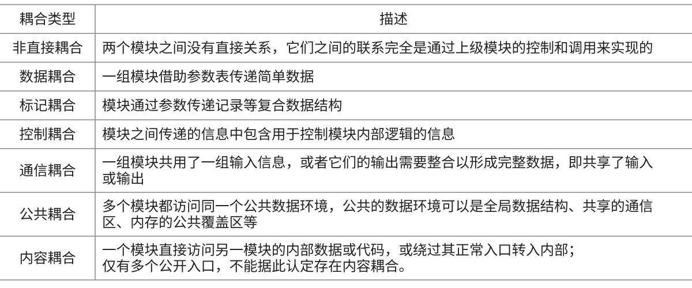
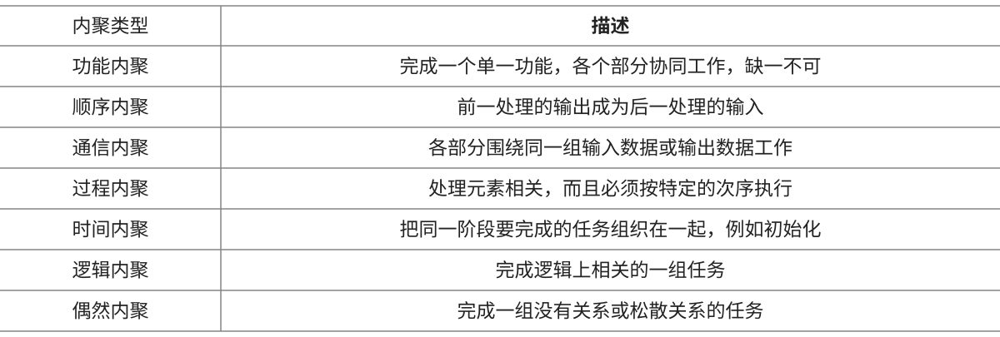

# 5.3 系统分析与设计

系统分析阶段是应用系统思想和方法，把复杂的对象分解为简单的组成部分，找出这些部分的基本属性和彼此之间的关系的过程，其基本任务是系统分析师和用户在充分了解用户需求的基础上，把双方对新系统的理解表达为系统需求规格说明书。

系统设计的目标是根据系统分析的结果，形成可供实施的系统设计方案。其主要目的是绘制系统的蓝图，权衡和比较各种技术和实施方法的利弊，合理分配各种资源，构建新系统的详细设计方案和相关模型，指导系统实施工作的顺利开展。系统设计的主要内容包括概要设计和详细设计。

## 5.3.1 结构化方法

E. Yourdon 和 L. L. Constantine 是结构化设计的代表人物。结构化分析与设计（Structured Analysis and Structured Design，SASD）也称为面向功能或面向数据流的软件开发方法。

Yourdon 方法在 20 世纪 80 年代得到广泛应用。

结构化开发方法提出了一组提高软件结构合理性的准则，如分解与抽象、模块独立性、信息隐蔽等。针对软件生存周期各个不同的阶段，它有结构化分析（SA）、结构化设计（SD）和结构化编程（SP）等方法。

### 1. 结构化分析

结构化分析方法给出一组帮助系统分析人员产生功能规约的原理与技术。它一般利用图形表达用户需求，使用的手段主要有数据流图、数据字典、结构化语言、判定表以及判定树等。

结构化分析的步骤如下：

1. 分析业务情况，做出反映当前物理模型的数据流图（Data Flow Diagram，DFD）；
2. 推导出等价的逻辑模型的 DFD；
3. 设计新的逻辑系统，生成数据字典和基元描述；
4. 建立人机接口，提出可供选择的目标系统物理模型的 DFD；
5. 确定各种方案的成本和风险等级，据此对各种方案进行分析；
6. 选择一种方案；
7. 建立完整的需求规约。

结构化分析的常用手段是数据流图（DFD）和数据字典。

1）数据流图

数据流图是过程建模或功能建模的一种工具。DFD 建模方法的核心是数据流，从应用系统的数据流着手以图形方式刻画和表示一个具体业务系统中的数据处理过程和数据流。

DFD 建模方法首先抽象出具体应用的主要业务流程，然后分析其输入，如其初始的数据有哪些，这些数据从哪里来，将流向何处，又经过了什么加工，加工后又变成了什么数据，这些数据流最终将得到什么结果。通过对系统业务流程的层层追踪和分析把要解决的问题清晰地展现及描述出来，为后续的设计、编码及实现系统的各项功能打下基础。

DFD 方法由4种基本元素（模型对象）组成：数据流、处理/加工、数据存储和外部项。

1. 数据流（Data Flow）。数据流用一个箭头描述数据的流向，箭头上标注的内容可以是信息说明或数据项。
2. 处理（Process）。表示对数据进行的加工和转换，在不同的 DFD 记法中，可用圆或圆角矩形表示。指向处理的数据流为该处理的输入数据，离开处理的数据流为该处理的输出数据。
3. 数据存储。表示用数据库形式（或者文件形式）存储的数据，对其进行的存取分别以指向或离开数据存储的箭头表示。
4. 外部项。也称为数据源或者数据终点。描述系统数据的提供者或者数据的使用者，如教师、学生、采购员、某个组织或部门或其他系统，常用矩形表示。

建立 DFD 的目的是描述系统的功能需求。DFD 方法利用应用问题域中数据及信息的提供者与使用者、信息的流向、处理、存储4种元素描述系统需求，建立应用系统的功能模型。

具体的建模过程及步骤如下。

（1）明确目标，确定系统范围。

首先要明确目标系统的功能需求，并将用户对目标系统的功能需求完整、准确、一致地描述出来，然后确定模型要描述的问题域。虽然在建模过程中这些内容是逐步细化的，但必须自始至终保持一致、清晰和准确。

（2）建立顶层 DFD。

顶层 DFD 表达和描述了将要实现的系统的主要功能，同时也确定了整个模型的内外关系，表达了系统的边界及范围，也构成了进一步分解的基础。

（3）构建第一层 DFD 分解图。

根据应用系统的逻辑功能，把顶层 DFD 中的处理分解成多个更细化的处理。

（4）开发 DFD 层次结构图。

对第一层 DFD 分解图中的每个处理框作进一步分解，在分解图中要列出所有的处理及其相关信息，并要注意子图的边界输入、输出与父图中被分解的处理相对应。分解可采用以下原则：保持均匀的模型深度；按困难程度进行选择；如果一个处理难以确切命名，可以考虑对它重新分解。

（5）检查确认 DFD。

按照规则检查和确定 DFD，以确保构建的 DFD 模型是正确的、一致的，且满足要求。

具体规则包括：父图中被分解处理的输入、输出应与子图边界上的数据流保持平衡；一条组合数据流可以分解为对应的分量；一个处理至少有一个输入流和一个输出流；应检查数据存储的读、写数据流是否符合系统范围，外部已维护的只读数据可以只有读出流；一个数据流至少有一端是处理端；模型图中表达和描述的信息是全面的、完整的、正确的和一致的。

经过以上过程与步骤后，顶层图被逐层细化，同时也把面向问题的术语逐渐转化为面向现实的解法，并得到最终的 DFD 层次结构图。层次结构图中的上一层是下一层的抽象，下一层是上一层的求精和细化，而最后一层中的每个处理都是面向一个具体的描述，即一个处理模块仅描述和解决一个问题。

2）数据字典

数据字典（Data Dictionary）集中记录数据及其含义、结构、来源和使用方式等元数据。

数据字典是指对数据的数据项、数据结构、数据流、数据存储、处理逻辑等进行定义和描述，其目的是对数据流程图中的各个元素做出详细的说明。简而言之，数据字典是描述数据的信息集合，是对系统中使用的所有数据元素定义的集合。

数据字典最重要的作用是作为分析阶段的工具。任何字典最重要的用途都是供人查询，在结构化分析中，数据字典的作用是给数据流图上每个元素加以定义和说明。换句话说，数据流图上所有元素的定义和解释的文字集合就是数据字典。数据字典中建立的严密一致的定义，有助于改进分析员和用户的通信与交互。数据字典各部分的描述如下。

（1）数据项：数据流图中数据块的数据结构中的数据项说明。数据项是在当前模型中不再细分的数据单位。对数据项的描述通常包括以下内容：

数据项描述={数据项名，数据项含义说明，别名，数据类型，长度，取值范围，取值含义，与其他数据项的逻辑关系}

其中“取值范围”“与其他数据项的逻辑关系”定义了数据的完整性约束条件，是设计数据检验功能的依据。若干个数据项可以组成一个数据结构。

（2）数据结构：数据流图中数据块的数据结构说明。数据结构反映了数据之间的组合关系。

一个数据结构可以由若干个数据项组成，也可以由若干个数据结构组成，或由若干个数据项和数据结构混合组成。对数据结构的描述通常包括以下内容：

数据结构描述={数据结构名，含义说明，组成：{数据项或数据结构}}

（3）数据流：数据流图中流线的说明。数据流是数据结构在系统内传输的路径。对数据流的描述通常包括以下内容：

数据流描述={数据流名，说明，数据流来源，数据流去向，组成：{数据结构}，平均流量，高峰期流量}

其中“数据流来源”是指该数据流的起点，“数据流去向”是指其终点。起点或终点可以是处理、数据存储或外部项，同一条数据流至少有一端是处理。“平均流量”是指在单位时间（每天、每周、每月等）里的传输次数。“高峰期流量”则是指在高峰时期的数据流量。

（4）数据存储：数据流图中数据块的存储特性说明。数据存储是数据结构停留或保存的地方，也是数据流的来源和去向之一。对数据存储的描述通常包括以下内容：

数据存储描述={数据存储名，说明，编号，流入的数据流，流出的数据流，组成：{数据结构}，数据量，存取方式}

其中“数据量”说明存储规模或每次读写的数据量，每天或每小时读写几次则属于存取频度。“存取方式”包括是批处理，还是联机处理；是检索还是更新；是顺序检索还是随机检索等。另外“流入的数据流”要指出其来源，“流出的数据流”要指出其去向。

（5）处理过程：数据流图中功能块的说明。数据字典中只需要描述处理过程的说明性信息，通常包括以下内容：

处理过程描述={处理过程名，说明，输入：{数据流}，输出：{数据流}，处理：{简要说明}}

其中“简要说明”中主要说明该处理过程的功能及处理要求。功能是指该处理过程用来做什么，而非如何实现。处理要求包括处理频度要求，如单位时间里处理多少事务，多少数据量，响应时间要求等，这些处理要求是后面物理设计的输入及性能评价的标准。

### 2. 结构化设计

结构化设计（Structured Design，SD）是一种面向数据流的设计方法，它以 SRS 和 SA 阶段所产生的数据流图和数据字典等文档为基础，是一个自顶向下、逐步求精和模块化的过程。SD 方法的基本思想是将软件设计成由相对独立且具有单一功能的模块组成的结构，分为概要设计和详细设计两个阶段，其中概要设计的主要任务是确定软件系统的结构，对系统进行模块划分，确定每个模块的功能、接口和模块之间的调用关系；详细设计的主要任务是为每个模块设计实现的细节。

1）模块结构

系统是一个整体，它具有整体性的目标和功能，但这些目标和功能的实现又是由相互联系的各个组成部分共同工作的结果。人们在解决复杂问题时使用的一个很重要的原则，就是将它分解成多个小问题分别处理，在处理过程中，需要根据系统总体要求，协调各业务部门的关系。

在 SD 中，这种功能分解就是将系统划分为模块，模块是组成系统的基本单位，可以按功能分解，并通过约定的接口组合，系统中任何一个处理功能都可以看成一个模块。

（1）信息隐藏与抽象。

信息隐藏原则要求采用封装技术，将程序模块的实现细节（过程或数据）隐藏起来，对于不需要这些信息的其他模块来说是不能访问的，使模块接口尽量简单。按照信息隐藏的原则，系统中的模块应设计成“黑盒”，模块外部只能使用模块接口说明中给出的信息，例如，操作和数据类型等。模块之间相对独立，既易于实现，也易于理解和维护。

抽象原则要求抽取事物最基本的特性和行为，忽略非本质的细节，采用分层次抽象的方式可以控制软件开发过程的复杂性，有利于软件的可理解性和开发过程的管理。通常，抽象的形式包括过程抽象、数据抽象和控制抽象。

（2）模块化。

在 SD 方法中，模块是实现功能的基本单位，它一般具有功能、逻辑和状态3个基本属性，其中功能是指该模块“做什么”，逻辑是描述模块内部“怎么做”，状态是该模块使用时的环境和条件。在描述一个模块时，必须按模块的外部特性与内部特性分别描述。模块的外部特性是指模块的模块名、参数表和给程序乃至整个系统造成的影响，而模块的内部特性则是指完成其功能的程序代码和仅供该模块内部使用的数据。对于模块的外部环境（例如，需要调用这个模块的上级模块）来说，只需要了解这个模块的外部特性就足够了，不必了解它的内部特性。而软件设计阶段，通常是先确定模块的外部特性，然后再确定它的内部特性。

（3）耦合。

耦合表示模块之间联系的程度。紧密耦合表示模块之间联系非常强，松散耦合表示模块之间联系比较弱，非直接耦合则表示模块之间无任何直接联系。表 5-1 按本节采用的分类，从较弱到较强列出七种耦合情形。其中“通信耦合”沿用表内用语，指模块之间共用输入或汇合输出；表 5-2 的“通信内聚”描述同一模块内部各部分围绕共同数据工作。

> 表 5-1 模块的耦合类型

对于模块之间耦合的强度，主要依赖于一个模块对另一个模块的调用、一个模块向另一个模块传递的数据量、一个模块施加到另一个模块的控制的多少，以及模块之间接口的复杂程度。

（4）内聚。

内聚表示模块内部各代码成分之间联系的紧密程度，是从功能角度来度量模块内的联系，一个好的内聚模块应当恰好做好目标单一的一件事情。模块的内聚类型通常也可以分为7种，根据内聚度从高到低的排序如表 5-2 所示。

> 表 5-2 模块的内聚类型

内聚衡量模块内部各部分的关联，耦合衡量模块之间的依赖。提高内聚并不能保证降低耦合。耦合低使得模块间尽可能相对独立，各模块可以单独开发和维护；内聚高使得模块的可理解性和维护性大大增强。因此，在模块的分解中应尽量减少模块的耦合，力求增加模块的内聚，遵循“高内聚、低耦合”的设计原则。

2）系统结构图

系统结构图（Structure Chart，SC）又称为模块结构图，它是软件概要设计阶段的工具，反映系统的功能实现和模块之间的联系与通信，包括各模块之间的层次结构，即反映了系统的总体结构。在系统分析阶段，系统分析师可以采用 SA 方法获取由 DFD、数据字典和加工说明等组成的系统的逻辑模型；在系统设计阶段，系统设计师可根据一些规则，从 DFD 中导出系统初始的 SC。

详细设计的主要任务是设计每个模块的实现算法、所需的局部数据结构。详细设计的目标有两个：实现模块功能的算法要逻辑上正确和算法描述要简明易懂。详细设计必须遵循概要设计来进行。详细设计如需改变概要设计，应按项目的变更流程由具备相应权限的人评审确认。详细设计应形成文档，主要是模块的详细设计方案说明。

以输入、输出数据结构为起点时，设计步骤如下。

1. 分析并确定输入/输出数据的逻辑结构。
2. 找出输入数据结构和输出数据结构中有对应关系的数据单元。
3. 按一定的规则由输入、输出的数据结构导出程序结构。
4. 列出基本操作与条件，并把它们分配到程序结构图的适当位置。
5. 用伪码写出程序。

详细设计的表示工具有图形工具、表格工具和语言工具。

（1）图形工具。

利用图形工具可以把过程的细节用图形描述出来。具体的图形有业务流图、程序流程图、PAD（Problem Analysis Diagram）图、NS 流程图（由Nassi 和Shneiderman 开发，简称 NS）等。

程序流程图又称为程序框图，是使用最广泛的一种描述程序逻辑结构的工具。它用方框表示一个处理步骤，菱形表示一个逻辑条件，箭头表示控制流向。其优点是：结构清晰，易于理解，易于修改。缺点是：侧重表示控制流程，难以完整描述数据结构和数据关系。

NS 流程图，也称为盒图，是一种强制使用结构化构造的图示工具，也称为方框图。其具有以下特点：功能域明确、不可能任意转移控制、很容易确定局部和全局数据的作用域、很容易表示嵌套关系及模块的层次关系。

PAD 图是一种改进的图形描述方式，可以用来取代程序流程图，相比程序流程图更直观，结构更清晰。它可以表示自顶向下逐步细化的过程。PAD 提供了5种基本控制结构的图示，并允许递归使用。PAD 的特点如下：

- 使用 PAD 符号设计出的程序代码是结构化程序代码；
- PAD 所描绘的程序结构十分清晰；
- 用 PAD 图表现程序的逻辑易读、易懂和易记；
- 在表示足够明确且有相应工具支持时，可将 PAD 图转换为高级语言源程序；
- 既可以表示逻辑，也可用来描绘数据结构；
- 支持自顶向下方法的使用。

（2）表格工具。

可以用一张表来描述过程的细节，在这张表中列出了各种可能的操作和相应的条件。

（3）语言工具。

可以用伪码或程序设计语言（Program Design Language，PDL）描述过程的细节。

PDL 也可称为伪码或结构化语言，它用于描述模块内部的具体算法，以便开发人员之间比较精确地进行交流。语法是开放式的，其外层语法是确定的，而内层语法则不确定。外层语法描述控制结构，它用类似于一般编程语言控制结构的关键字表示，所以是确定的。内层语法描述具体操作，考虑到不同软件系统的实际操作种类繁多，内层语法因而不确定，它可以按系统的具体情况和不同的设计层次灵活选用。

- PDL 的优点：可以作为注释直接插在源程序中；可以使用普通的文本编辑工具或文字处理工具产生和管理；对形式与语义有明确约定的 PDL，可用相应工具辅助生成代码。
- PDL 的不足：不如图形工具形象直观，描述复杂的条件组合与动作间对应关系时，不如判定树清晰简单。

### 3. 结构化编程

E. W. Dijkstra 是结构化程序设计（Structured Programming，SP）的代表人物之一。“面向结构”的程序设计方法即结构化程序设计方法，是“面向过程”方法的改进，结构上将软件系统划分为若干功能模块，各模块按要求单独编程，再组合构成相应的软件系统。该方法强调程序的结构性，所以容易做到易读易懂。该方法思路清晰，做法规范，有助于减少程序错误并降低维护工作量。

结构化程序设计采用自顶向下、逐步求精的设计方法，以顺序、选择和循环组织模块内部的控制流程；经典的基本控制结构有一个入口和一个出口。

“程序＝算法＋数据结构”概括了程序中算法与数据组织的关系。

在面向过程的设计中，可以分别描述算法和数据结构，并以函数或过程组织计算。算法设计与数据结构选择需要相互配合。

结构化程序设计提出的原则可以归纳为32个字：自顶向下，逐步细化；清晰第一，效率第二；书写规范，缩进格式；基本结构，组合而成。

### 4. 数据库设计

数据库设计是指根据用户的需求，在某一具体的数据库管理系统上，设计数据库的结构和建立数据库的过程。数据库设计的内容包括：需求分析、概念结构设计、逻辑结构设计、物理结构设计、数据库的实施和数据库的运行和维护。本小节主要讨论数据库的概念结构设计，其他内容详见数据库章节。

1）概念结构设计

概念结构设计是对用户要求描述的现实世界（可能是一个工厂、商场、学校或企业等），通过对其中实体事物的分类、聚集和概括，建立抽象的概念数据模型。这个概念模型应反映现实世界各部门的信息结构、信息流动情况、信息间的互相制约关系以及各部门对信息储存、查询和加工的要求等。通常采用实体-联系图（Entity Relationship Diagram，E-R 图）来表示。

E-R 图提供了表示实体类型、属性和联系的方法，用来描述现实世界的概念模型。它表达的是概念层的实体和联系，可以在逻辑设计阶段转换为关系模式。

在 E-R 图中有如下成分：矩形框表示实体；菱形框表示联系；椭圆形框表示实体或联系的属性，标识实体的键属性名用下划线表示。

（1）实体。一般认为，客观上可以相互区分的事物就是实体，实体可以是具体的人和物，也可以是抽象的概念与联系。关键在于一个实体能与另一个实体相区别，具有相同属性的实体具有相同的特征和性质。用实体类型名及其属性名集合描述同类实体。在 E-R 图中用矩形表示，矩形框内写明实体名；比如学生张三、学生李四都是实体对象。

（2）属性。实体所具有的某一特性，一个实体可由若干个属性来刻画。属性可以描述实体，也可以描述联系。在 E-R 图中用椭圆形表示，并用无向边与相应的实体或联系相连。例如学生的姓名、学号、性别都是属性。多值属性用双线椭圆表示；派生属性用虚线椭圆表示。

（3）联系。E-R 模型中的联系表示实体实例之间的关联。参与联系的实体可以属于不同实体集，也可以属于同一实体集。在 E-R 图中用菱形表示，菱形框内写明联系名，并用无向边分别与有关实体连接起来，同时在无向边旁标上联系的类型（1:1、1:N 或 M:N）。比如老师给学生授课存在授课关系，学生选课存在选课关系。弱实体与其所有者之间用于标识弱实体的联系用双菱形表示。

E-R 图中的联系存在3种一般性约束：一对一约束（联系）、一对多约束（联系）和多对多约束（联系），它们用来描述实体集之间的数量约束。

（1）一对一联系（1:1）。

对于实体集 A 和 B，A 中每个实体至多与 B 中一个实体关联，反之亦然。

一个学校只有一个正校长，而一个校长只在一个学校中任职，则学校与校长之间具有一对一联系。

（2）一对多联系（1:N）。
A 中一个实体可以与 B 中多个实体关联，B 中每个实体至多与 A 中一个实体关联。

例如，某校教师与课程之间存在一对多的联系“教”，即每位教师可以教多门课程，但是，每门课程只能由一位教师来教，教师与课程之间具有一对多联系。一个专业中有若干名学生，而每个学生只在一个专业中学习，专业与学生之间具有一对多联系。

（3）多对多联系（M:N）。
A 中一个实体可以与 B 中多个实体关联，B 中一个实体也可以与 A 中多个实体关联。三类联系描述的是允许的最大基数，仅观察某一时刻已有的关联数不能确定建模约束。

例如，表示学生与课程间的联系“选修”是多对多的，即一个学生可以学多门课程，而每门课程可以有多个学生来学。

联系也可能有属性。例如，学生“选修”某门课程所取得的成绩，既不是学生的属性也不是课程的属性。由于“成绩”既依赖于特定学生又依赖于某门特定的课程，所以它是学生与课程之间的联系“选修”的属性。

E-R 图的基本作图步骤如下。

（1）确定所有的实体集合。

（2）选择每个实体集应该包含的属性。

（3）确定实体集之间的联系。

（4）确定实体集的键，用下划线标出构成该键的属性。

（5）确定联系的类型，在用线将表示联系的菱形框联系到实体集时，在线旁注明是1或n 来表示联系的类型。

## 5.3.2 面向对象方法

面向对象（Object-Oriented，OO）开发方法将面向对象的思想应用于软件开发过程中，指导开发活动，是建立在“对象”概念基础上的方法学。面向对象方法的本质是主张参照人们认识一个现实系统的方法，完成分析、设计与实现一个软件系统，提倡用人类在现实生活中常用的思维方法来认识和理解描述客观事物，强调最终建立的系统能映射问题域，使得系统中的对象，以及对象之间的关系能够如实地反映问题域中固有的事物及其关系。

面向对象开发方法认为客观世界是由对象组成的，对象由属性和操作组成，对象可按其属性进行分类，对象之间的联系通过传递消息来实现，基于类的模型可通过封装、继承和多态描述对象的状态和行为。例如，统一过程采用用例驱动、以体系结构为中心的迭代增量开发。需求分析、系统分析、系统设计和系统实现等活动可以在各次迭代中反复开展。

### 1. 面向对象分析

面向对象的分析方法（Object-Oriented Analysis，OOA），是在一个系统的开发过程中进行了系统业务调查以后，按照面向对象的思想来分析问题。OOA 与结构化分析有较大的区别。

OOA 所强调的是在系统调查资料的基础上，针对 OO 方法所需要的素材进行的归类分析和整理，以识别业务对象及其联系，理解其状态与行为。

本节介绍的 OOA 模型由五个层次（主题层、对象类层、结构层、属性层和服务层）和5个活动（标识对象类、标识结构、定义主题、定义属性和定义服务）组成。在这种方法中定义了两种对象类之间的结构，一种称为分类结构；另一种称为组装结构。分类结构就是所谓的一般与特殊的关系。组装结构则反映了对象之间的整体与部分的关系。

1）OOA 原则

OOA 的基本原则包括如下内容。

（1）抽象。抽象是从许多事物中舍弃个别的、非本质的特征，抽取共同的、本质性的特征。

抽象是形成概念的必要手段。抽象是面向对象方法中使用最为广泛的原则。抽象原则包括过程抽象和数据抽象两个方面。过程抽象是指，任何一个完成确定功能的操作序列，其使用者都可以把它看作一个单一的实体，尽管实际上它可能是由一系列更低级的操作完成的。数据抽象是根据施加于数据之上的操作来定义数据类型，并限定数据的值只能由这些操作来修改和观察。

数据抽象是 OOA 的核心原则。它强调把数据（属性）和操作（服务）结合为一个不可分的系统单位（即对象），对象的外部只需要知道它做什么，而不必知道它如何做。

（2）封装。封装就是把对象的属性和服务结合为一个不可分的系统单位，并尽可能隐藏对象的内部细节。这个概念也经常用于从外部隐藏程序单元的内部表示或状态。

（3）继承。特殊类的对象拥有其对应的一般类的全部属性与服务，称作特殊类对一般类的继承。在 OOA 中运用继承原则，在特殊类中不再重复地定义一般类中已定义的东西，但是，在语义上，特殊类却自动地、隐含地拥有一般类（以及所有更上层的一般类）中定义的全部属性和服务。继承原则的好处是：使系统模型比较简练也比较清晰。

（4）分类。分类就是把具有相同属性和服务的对象划分为一类，用类作为这些对象的抽象描述。分类原则实际上是抽象原则运用于对象描述时的一种表现形式。

（5）聚合。聚合又称组装，其原则是：把一个复杂的事物看成若干比较简单的事物的组装体，从而简化对复杂事物的描述。

（6）关联。关联是人类思考问题时经常运用的思想方法：通过一个事物联想到另外的事物。

能使人发生联想的原因是事物之间确实存在着某些联系。

（7）消息通信。这一原则要求对象之间只能通过消息进行通信，而不允许在对象之外直接地存取对象内部的属性。通过消息进行通信是由于封装原则而引起的。在 OOA 中要求用消息连接表示出对象之间的动态联系。

（8）粒度控制。一般来讲，人在面对一个复杂的问题域时，不可能在同一时刻既能纵观全局，又能洞察秋毫。因此需要控制自己的视野：考虑全局时，注意其大的组成部分，暂时不考虑具体的细节；考虑某部分的细节时则暂时撇开其余的部分。这就是粒度控制原则。

（9）行为分析。现实世界中事物的行为是复杂的，由大量的事物所构成的问题域中各种行为往往相互依赖、相互交织。

2）基本步骤

OOA 大致上遵循如下5个基本步骤。

（1）确定对象和类。这里所说的对象是对数据及其处理方式的抽象，它反映了系统保存和处理现实世界中某些事物的信息的能力。类是多个对象的共同属性和方法集合的描述，它包括如何在一个类中建立一个新对象的描述。

（2）确定结构。分析问题域中的一般—特殊结构和整体—部分结构。前者反映类之间的泛化与特化，后者反映整体及其组成部分的关系。

（3）确定主题。按问题域中彼此相关的对象类和结构划分主题，便于分块理解总体分析模型。

（4）确定属性。属性就是数据元素，可用来描述对象或分类结构的实例，可在图中给出，并在对象的存储中指定。

（5）确定方法。说明对象收到消息后提供的服务及其处理要求。模型中可省略约定俗成的基本操作，对需要明确表达的服务则应显式说明。

### 2. 面向对象设计

面向对象设计方法（Object-Oriented Design，OOD）是 OOA 方法的延续，其基本思想包括抽象、封装和可扩展性，其中可扩展性主要通过继承和多态来实现。在 OOD 中，数据结构和在数据结构上定义的操作算法封装在一个对象之中。由于现实世界中的事物都可以抽象出对象的集合，所以 OOD 方法是一种更接近现实世界、更自然的系统设计方法。

类封装了信息和行为，是面向对象的重要组成部分，它是具有相同属性、方法和关系的对象集合的总称。在系统中，每个类都具有一定的职责，职责是指类所担任的任务。一个类可以有多种职责，设计得好的类一般至少有一种职责。在定义类时，将类的职责分解为类的属性和方法，其中属性用于封装数据，方法用于封装行为。设计类是 OOD 中最重要的组成部分，也是最复杂和最耗时的部分。

本节按职责介绍实体类、控制类和边界类。

1）实体类

实体类表示问题域中需要在系统内描述和管理的业务实体。例如，在线教育平台中的学员类和课程类都可以是实体类。实体的某些属性和关系需要长期保存，有时会贯穿系统的整个生存期。

实体类通常以业务领域的名词命名。可以从需求规格说明书中的业务名词和需要记录的信息识别候选实体类。用例中的参与者表示与系统交互的外部角色；系统需要保存其业务信息时，才可能另设相应的实体类。实体类可以同时描述业务状态和行为。

2）控制类

控制类是用于控制用例工作的类，一般是由动宾结构的短语（“动词+名词”或“名词+动词”）转化来的名词，例如，用例“身份验证”可以对应于一个控制类“身份验证器”，它提供了与身份验证相关的所有操作。控制类用于对一个或几个用例所特有的控制行为进行建模，控制对象（控制类的实例）通常控制其他对象，因此，它们的行为具有协调性。

控制类将用例的特有行为进行封装，控制对象的行为与特定用例的实现密切相关，控制对象可以在执行用例时创建，并在处理结束后释放，也可以设计为复用。控制类以协调行为为主，需要时可以保存流程状态。

3）边界类

边界类用于封装在用例内、外流动的信息或数据流。边界类位于系统与外界的交接处，包括所有窗体、报表、打印机和扫描仪等硬件的接口，以及与其他系统的接口。要寻找和定义边界类，可以检查用例模型，识别各项交互需要的接口。一个边界类可以支持多个用例或参与者。边界类是一种用于对系统外部环境与其内部运作之间的交互进行建模的类。常见的边界类有窗口、通信协议、打印机接口、传感器和终端等。实际上，在系统设计时，产生的报表都可以作为边界类来处理。

边界类用于系统接口与系统外部进行交互，边界对象将系统与其外部环境的变更（例如，与其他系统的接口的变更、用户需求的变更等）分隔开，以减少这些变更对系统其他部分的影响。通常情况下，边界类可以既有属性也有方法。

### 3. 面向对象编程

面向对象程序设计（Object-Oriented Programming，OOP）是一种以相互协作的对象组织程序的编程范式。封装、继承和多态等机制有助于实现重用、灵活性和扩展性。在本节讨论的基于类的模型中，类和对象是核心概念。

面向对象程序设计方法是尽可能模拟人类的思维方式，使得软件的开发方法与过程尽可能接近人类认识世界、解决现实问题的方法和过程，也即使得描述问题的问题空间与问题的解决方案空间在结构上尽可能一致，把客观世界中的实体抽象为问题域中的对象。

面向对象程序设计以对象为核心，该方法认为程序由一系列对象组成。类是对现实世界的抽象，包括表示静态属性的数据和对数据的操作，对象是类的实例。对象间通过消息传递相互通信，来模拟现实世界中不同实体间的联系。在面向对象的程序设计中，对象是组成程序的基本模块。

OOP 的基本特点有封装、继承和多态。

1）封装

封装将相关的数据和操作组织在一起，通过明确的接口提供服务，并限制外部对内部表示的直接依赖。在基于类的语言中，可以用类声明对象的状态和行为。

调用者可通过公开接口使用对象，无需了解其内部实现。恰当的封装有助于提高内聚、降低耦合。

2）继承

在基于类的程序设计中，继承表示子类从父类继承可继承的成员，并可增加或重定义行为。按直接父类的数量划分，单继承的类只有一个直接父类，多继承的类有多个直接父类。多继承可能出现命名或行为冲突，须按语言规则处理。本节还从继承内容的变化讨论取代继承、包含继承、受限继承和特化继承等分类。

3）多态

在面向对象的动态多态中，调用者可以通过同一接口向不同类型的对象发送相同的消息，实际执行的操作取决于接收对象的类型。例如，对同一操作的调用可以执行不同子类各自提供的实现。

### 4. 数据持久化与数据库

对象持久化（Persistence）将需要保留的对象状态写入数据库或其他持久存储，使状态在创建对象的进程结束后仍可恢复。多层软件可以设置持久层（Persistence Layer），封装对象的存取和转换，减少业务逻辑对具体存储方式的依赖。

将对象状态保存到 Db2、Oracle、SQL Server 等关系数据库时，需要定义对象与关系数据之间的对应关系。这称为对象关系映射（Object-Relational Mapping，ORM）。

下面以 Hibernate、iBATIS 和 JDO 为例，说明对象关系映射框架、SQL 映射工具和持久化规范的不同做法。

Hibernate 是开源的对象关系映射框架，可按映射配置将普通 Java 对象（POJO）与关系数据库表关联，并为常见持久化操作生成和执行 SQL。开发者仍需定义映射并处理事务、查询和性能等问题。

iBATIS 将开发者编写的 SQL 与 Java 对象关联，可将对象属性绑定为 SQL 参数，也可将查询结果映射回对象。它适合需要显式控制 SQL 的场景。

JDO（Java Data Objects，Java 数据对象）是描述 Java 对象持久化语义的标准 API。JDO 实现可以提供透明持久化，减少开发者直接编写 JDBC 等底层访问代码的需要；应用仍须管理持久化操作及事务。

JDBC 通过驱动访问数据源，常用于关系数据库。JDO 在对象持久化层面提供统一接口，具体实现可支持关系数据库、文件、XML 或对象数据库等后端。可用的后端和跨后端的可移植性取决于实现及应用使用的功能。
