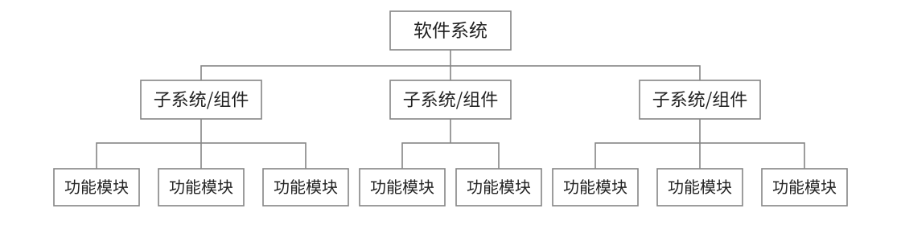
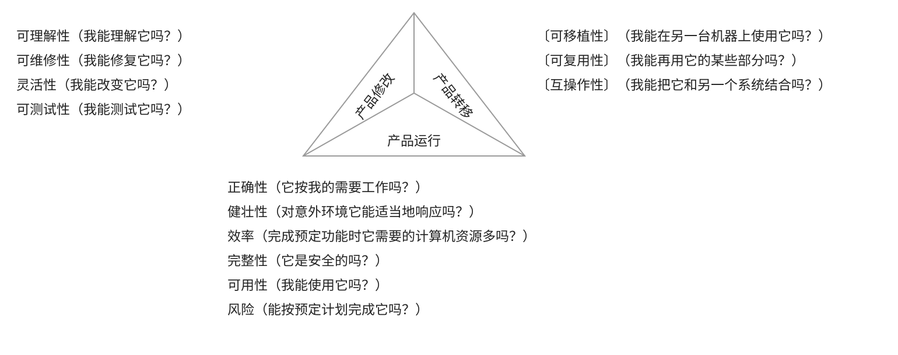

# 5.7 软件项目管理

## 5.7.1 项目管理概述

教材以 20 世纪 70 年代中期美国国防部的一项研究为例，说明软件项目管理受到重视的背景。该研究讨论了软件开发不能按时提交、预算超支和质量达不到用户要求的原因，按教材转述，有 70% 的项目因管理不善而出现上述问题，但本段未给出样本范围及归因方法。于是软件开发者逐渐重视软件开发中的各项管理。到了20世纪90年代中期，软件研发项目管理不善的问题仍然存在。

软件项目管理和其他的项目管理相比有一定的特殊性。首先，软件是纯知识产品，其开发进度和质量很难估计和度量，生产效率也难以预测和保证。其次，软件系统的复杂性也导致了开发过程中各种风险的难以预见和控制。

软件项目管理的对象是软件工程项目。它所涉及的范围覆盖了整个软件工程过程。为使软件项目开发获得成功，关键问题是必须对软件项目的工作范围、可能风险、需要资源(人、硬件/软件)、要实现的任务、经历的里程碑、所需工作量和成本、进度安排等进行预先计划和执行。这种管理在技术工作开始之前就应开始，贯穿软件从概念到实现的过程，当软件工程过程最后结束时才终止。

软件项目管理是为了使软件项目能够按照预定的成本、进度、质量顺利完成，而对人员(People)、产品 (Product)、过程 (Process) 和项目 (Project) 进行分析和管理的活动。

下面对软件进度、配置、质量和风险管理进行简单介绍。

## 5.7.2 软件进度管理

按时完成软件项目是项目经理最大的挑战之一。所谓进度，指的是对执行活动和里程碑所制定的工作计划，而进度管理指的是为了确保项目按期完成所需要的管理过程。在软件进度管理过程中，一般包括：活动定义、活动排序、活动资源估计、活动历时估计、制定进度计划和进度控制。

### 1. 工作分解结构

软件项目往往是比较大而复杂的，往往需要进行层层分解，将大的任务分解成一个个的单一小任务进行处理。工作分解结构 (Work Breakdown Structure,WBS) 如图 5-7所示，按层次分解项目范围，直至形成可估算、可分派和可管理的工作包。活动可以在编制进度计划时进一步确定。工作分解结构是以可交付成果为导向对项目工作进行的层次分解，它归纳和定义了项目的整个工作范围，每下降一层代表对项目工作的更详细定义。WBS总是处于计划过程的中心，也是制订进度计划、资源需求、成本预算、风险管理计划和采购计划等的重要基础。

> 图 5-7 WBS示意图

WBS 最底层的工作单元称为工作包，表示完成相应可交付成果所需的工作。工作包应有明确的责任主体，实际工作可以由多人完成。

WBS常见的分解方式包括：按产品的物理结构分解、按产品或项目的功能分解、按照实施过程分解、按照项目的实施单位分解、按照项目的目标分解、按部门或职能进行分解等。不管采用哪种分解方式，最终都要满足以下对任务分解的基本要求。

（1）WBS的工作包是可控和可管理的，不能过于复杂。

（2）任务分解也不能过细，分解深度应以工作包是否便于估算、分派和控制为准，并无统一的六层上限。

（3）每个工作包要有一个交付成果。

（4）每个任务必须有明确定义的完成标准。

（5）WBS必须有利于责任分配。

### 2. 任务活动图

经过工作分解之后，会得到一组活动任务，这时需要对每个活动进行定义，并确定活动之间的关系。

活动定义是指确定完成项目的各个交付成果所必须进行的各项具体活动，应识别活动间的依赖关系，估算持续时间，并记录适用的日期约束、里程碑或交付成果。前驱活动是与本活动存在先后依赖关系的活动；持续时间是指完成该活动的时间长度(一般单位为天或周);必须完成日期指的是该活动必须完成的具体日期；里程碑是项目中的重要事件或节点，在进度计划中通常以零持续时间表示。

每个活动在明确了前驱、必须完成日期等内容后，就确定了活动之间的相互关系，也就是活动执行的前后顺序。根据活动顺序就可以得到对应的任务活动图。任务活动图是项目进度管理、项目成本管理等一系列项目管理活动的基础。

在项目管理中，目前通常采用甘特图等方式来展示和管理项目活动。

## 5.7.3 软件配置管理

软件配置管理 (Software Configuration Management,SCM) 是一种标识、组织和控制修改的技术。软件配置管理应用于整个软件工程过程。在软件建立时变更是不可避免的，而变更加剧了项目中软件开发者之间的混乱。SCM活动的目标就是为了标识变更、控制变更、确保变更正确实现并向其他有关人员报告变更。从某种角度讲，SCM是一种标识、组织和控制修改的技术，目的是使错误降为最小并最有效地提高生产效率。

软件配置管理核心内容包括版本控制和变更控制。

（1）版本控制 (Version Control)。版本控制是指对软件开发过程中各种程序代码、配置文件及说明文档等文件变更的管理，是软件配置管理的核心思想之一。版本控制最主要的功能就是追踪文件的变更。它将什么时候、什么人更改了文件的什么内容等信息忠实地记录下来。提交或保存为新版本后，版本控制系统会记录相应的修订；版本标识不一定是递增数字。除了记录版本变更外，版本控制的另一个重要功能是并行开发。软件开发往往是多人协同作业，版本控制记录各开发者的修改，支持通过分支和合并将修复应用于相应版本。遇到修改冲突时，仍需开发者协调、解决并验证。

（2）变更控制 (Change Control)。变更控制的目的并不是控制变更的发生，而是对变更进行管理，确保变更有序进行。对于软件开发项目来说，发生变更的环节比较多，因此变更控制显得格外重要。项目中引起变更的因素有两个：一是来自外部的变更要求，如客户要求修改工作范围和需求等；二是开发过程内部的变更要求，如为解决测试中发现的一些错误而修改源码甚至设计。比较而言，最难处理的是来自外部的需求变更，因为IT项目需求变更的概率大，引发的工作量也大(特别是到项目的后期)。

## 5.7.4 软件质量管理

软件质量反映软件满足明确需求和隐含需求的程度，更具体地说，软件质量是软件符合明确地叙述的功能和性能需求、文档中明确描述的开发标准以及所有专业开发的软件都应具有的隐含特征的程度。

从管理角度出发，可以将影响软件质量的因素划分为3组，分别反映用户在使用软件产品时的3种不同倾向和观点。这3组分别是：产品运行、产品修改和产品转移（如图5-8所示）。

> 图 5-8 影响软件质量的三个主要因素关系图

图中右侧三项名称部分模糊，〔〕内按各自的问题释义。下方“风险”所问的“能按预定计划完成它吗”涉及项目交付进度，应与产品运行时表现出的质量特征区分。

### 1. 软件质量保证

软件质量保证 (Software Quality Assurance,SQA) 是建立一套有计划，有系统的方法，来向管理层保证拟定出的标准、步骤、实践和方法能够正确地被所有项目所采用。软件质量保证的目的是使软件过程对于管理人员来说是可见的。它通过对软件产品和活动进行评审和审计来验证软件是合乎标准的。软件质量保证组在项目开始时就一起参与建立计划、标准和过程。这些使软件项目满足机构方针的要求。

软件质量保证的关注点集中在于一开始就避免缺陷的产生。质量保证的主要目标是：

（1）事前预防工作，例如，着重于缺陷预防而不是缺陷检查。

（2）尽量在刚刚引入缺陷时即将其捕获，而不是让缺陷扩散到下一个阶段。

（3）重视过程改进，同时通过审查软件工作产品检查过程的执行情况。

（4）贯穿于所有的活动之中，而不是只集中于一点。

软件质量保证的目标是通过相对于受审活动独立的审查，监督软件开发任务的执行，就软件项目是否正确遵循已制订的计划、标准和规程给开发人员和管理层提供反映产品和过程质量的信息和数据，提高项目透明度，同时辅助软件工程取得高质量的软件产品。

软件质量保证的主要作用是给管理者提供预定义的软件过程的保证，因此SQA组织要保证如下内容的实现：选定的开发方法被采用、选定的标准和规程得到采用和遵循、进行独立的审查、偏离标准和规程的问题得到及时的反映和处理、项目定义的每个软件任务得到实际的执行。

软件质量保证的主要任务是以下3个方面。

（1）SQA审计与评审。SQA审计包括对软件工作产品、软件工具和设备的审计，评价这几项内容是否符合组织规定的标准。SQA评审的主要任务是保证软件工作组的活动与预定的软件过程一致，确保软件过程在软件产品的生产中得到遵循。

（2）SQA报告。SQA人员应记录工作的结果，并写入到报告之中，发布给相关的人员。
SQA报告的发布应遵循三条原则：SQA和高级管理者之间应有直接沟通的渠道；SQA 报告应送达软件工程组以及对有关问题承担处置责任的项目管理人员；在可能的情况下向关心软件质量的人发布SQA报告。

（3）处理不符合问题。这是SQA的一个重要的任务，SQA人员要对工作过程中发现的问题进行处理，并及时向有关人员及高级管理者报告。

### 2. 软件质量认证

质量管理体系认证考察组织在规定范围内的质量管理体系是否符合适用标准要求。评价某一软件产品的质量，还需要针对该产品的证据。本节分别介绍 ISO 9000 族质量管理体系标准和软件能力成熟度模型（CMM）。二者的作用不同：前者中的 ISO 9001 可作为质量管理体系认证的依据，后者用于评估和改进软件过程成熟度。

1）ISO 9000

ISO 9000 族由国际标准化组织质量管理和质量保证技术委员会（ISO/TC 176）制定。ISO 9000 和 ISO 9001 均已有 1987 年首版；1994 年版属于后续修订。“ISO 9000 族”泛指一组标准，“ISO 9000”也是其中一份标准的编号。例如，ISO 9000:2015 阐明质量管理基础和术语，ISO 9001:2015 规定质量管理体系要求。

教材所述设计、开发、生产、安装和服务的质量保证模式及 20 项要求，指 ISO 9001:1994 的历史结构。组织符合某版标准的适用要求，与已经通过认证是两件事；获得认证还须经过相应的认证审核。

2）CMM

软件能力成熟度模型（CMM）源于美国卡内基梅隆大学软件工程研究所的工作，用于评估和改进软件开发过程的成熟度。有关 CMM 的内容见 5.1.5 节。

## 5.7.5 软件风险管理

软件项目风险管理是软件项目管理的重要内容。在进行软件项目风险管理时，要辨识风险，评估它们出现的概率及产生的影响，然后建立一个规划来管理风险。风险管理的目标是识别、评估和应对可能影响项目目标的不确定事件或条件。预算超支、进度延误等已发生的问题应与尚未发生的风险区分。软件项目风险会影响项目计划的实现，如果项目风险变成现实，就有可能影响项目的进度，增加项目的成本，甚至使软件项目不能实现。

美国Boehm的软件风险管理体系，把风险管理活动分成风险估计(风险辨识、风险分析、风险排序)和风险控制(风险管理计划、风险处理、风险监督)两大阶段。该体系偏重理论。

美国Charette的风险分析和管理体系，把风险分成分析(辨识、估计、评价)和管理(计划、控制、监督)两大阶段。该体系偏重理论，与Boehm体系接近。

美国卡内基梅隆大学软件工程研究所（CMU-SEI）的风险管理体系，包括SRE、CRM(Continuous Risk Management)、TRM(Team Risk Management) 与CMM配合的软件风险管理，是基于实践的全面风险管理体系，并将软件需求方作为软件风险管理的要素。
