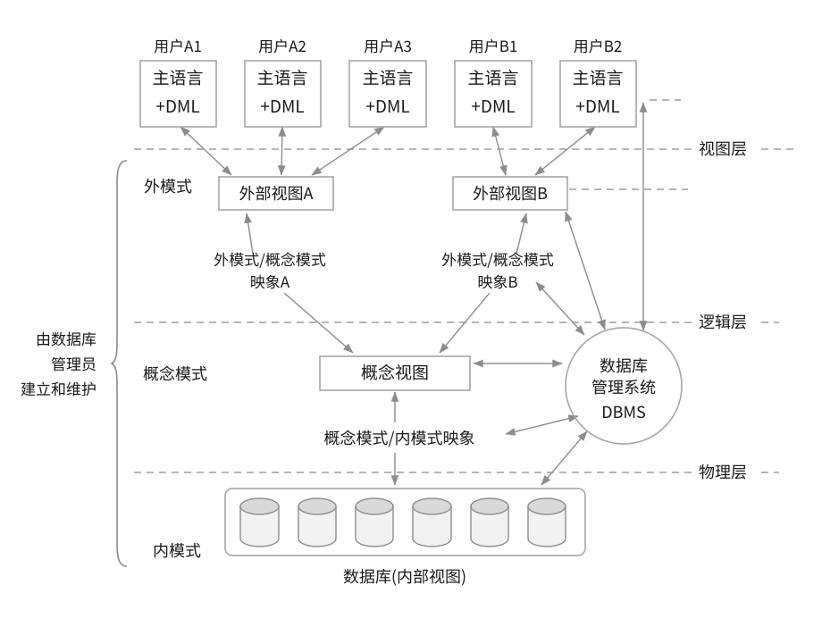

# 6.1 数据库基本概念

数据（Data） 是描述事物的符号记录，它具有多种表现形式，可以是文字、图形、图像、声音和语言等。信息（Information） 是现实世界事物的存在方式或状态的反映。信息具有可感知、可存储、可加工、可传递和可再生等自然属性，信息已是社会各行各业不可缺少的资源，这也是信息的社会属性。数据是信息的符号表示，而信息是数据在特定语境中表达的含义。

数据库系统（Database System，DBS） 是一个采用了数据库技术，有组织地、动态地存储大量相关联数据，从而方便多用户访问的计算机系统。数据库系统包括数据库、数据库管理系统（Database Management System，DBMS）及其运行环境等。

数据库（Database，DB） 是统一管理的、长期储存在计算机内的，有组织的相关数据的集合。其特点是数据间联系密切、冗余度小、独立性较高、易扩展，并且可为各类用户共享。存储设备承载数据；数据库指按一定结构组织的数据集合。

DBMS 是数据库系统的核心软件，用于定义、组织、访问和管理数据库中的数据。DBMS要在操作系统的支持下工作，它是一种解决如何科学地组织和储存数据，如何高效地获取和维护数据的系统软件。其主要功能包括数据定义功能、数据操纵功能、数据库的运行管理和数据库的建立与维护。

## 6.1.1 数据库技术的发展

数据处理是对各种数据进行收集、存储、加工和传播的一系列活动。数据管理是对数据进行分类、组织、编码、存储、检索和维护的活动。数据管理技术的发展经历了3个阶段：人工管理、文件系统和数据库系统阶段。

### 1. 人工管理阶段

在人工管理阶段，早期计算机主要用于科学计算，程序员自行安排数据的组织与存取，通常没有专门的数据管理软件。在这一阶段，数据管理具有以下特点。

1. 数据量较少。数据通常为特定程序组织，数据面向应用，独立性很差。
2. 数据通常不长期保存。该阶段计算机主要用于科学计算，一般不需要将数据长期保存，只在计算一个题目时，将数据输入计算机，计算完成得到计算结果即可。
3. 没有软件系统对数据进行管理。程序员不仅要规定数据的逻辑结构，而且在程序中还要设计物理结构，包括存储结构、数据存取方法、输入输出方式等。

人工管理数据有两个缺点。

1. 应用程序与数据之间的依赖性太强，不相互独立。
2. 数据组和数据组之间可能有许多重复数据，造成数据冗余。

### 2. 文件系统阶段

由于大容量的磁盘等辅助存储设备的出现，专门管理辅助存储设备上数据的文件系统应运而生。在文件系统中，按一定的规则将数据组织成为一个文件，应用程序通过文件系统对文件中的数据进行存取和加工。

在文件系统阶段中数据管理的特点如下。

1. 数据可以长期保留，数据的逻辑结构和物理结构有了区别，程序可以按照文件名称访问文件，不必关心数据的物理位置，由文件系统提供存取方法。
2. 数据不属于某个特定的应用，即应用程序和数据之间不再是直接的对应关系，数据可以重复使用。但是文件系统只是简单地存取数据，相互之间并没有有机的联系，即数据存取依赖于应用程序的使用方法，不同的应用程序仍然很难共享同一数据文件。
3. 文件组织形式的多样化，有索引文件、链接文件和散列文件等。文件可以保存相关数据，但应用通常需要自行解释和维护文件之间的联系。

文件系统具有如下缺点。

1. 数据冗余（Data Redundancy）。文件与应用程序密切相关，相同的数据集合在不同的应用程序中使用时，经常需要重复定义、重复存储，数据冗余度大。
2. 数据不一致性（Data Inconsistency）。由于相同数据的重复存储，单独管理，同样的数据可能存在于多个不同的文件中，给数据的修改和维护带来难度，容易造成数据的不一致。
3. 数据孤立（Data Isolation），即跨文件整合数据较困难。由于数据分散在不同的文件中，而这些文件可能具有不同的文件格式，文件之间是孤立的，所以从整体上看文件之间没有反映现实世界事物之间的内在联系，因此很难对数据进行合理的组织以适应不同应用的需要。

### 3. 数据库系统阶段

数据库系统是由计算机软件、硬件资源组成的系统，它有组织地、动态地存储大量关联数据，方便多用户访问，它与文件系统的重要区别是数据的充分共享、交叉访问、与应用程序的高度独立性。

数据库系统阶段数据管理的特点如下。

1. 采用复杂的数据模型表示数据结构。数据模型不仅描述数据本身的特点，还描述数据之间的联系。数据不再面向某个应用，而是面向整个应用系统。数据冗余明显减少，实现了数据共享。

2. 有较高的数据独立性。数据库可以用文件存储数据，但是它是数据的一种更高级的组织形式，在应用程序和数据库之间由DBMS负责数据的存取。DBMS对数据的处理方式和文件系统不同，它把所有应用程序中使用的数据以及数据间的联系汇集在一起，以便于应用程序查询和使用。

数据库系统用统一的数据模型和访问接口组织共享数据。不同应用可以通过 DBMS 访问数据，无须各自维护其物理存取方法。DBMS 还提供完整性约束、权限控制和操作命令，帮助应用安全、一致地使用数据。

## 6.1.2 数据模型

数据模型是描述数据结构、数据操作和约束的一组概念，是组织数据库的基础。数据模型的三要素是数据结构、数据操作和数据的约束条件。

1. 数据结构。对象类型的集合，是对系统静态特性的描述。
2. 数据操作。对数据库中各种对象类型的实例允许执行的操作集合，包括操作及操作规则。如操作有检索、插入、删除和修改，操作规则有优先级等。数据操作是对系统动态特性的描述。
3. 数据的约束条件。是一组完整性规则的集合。也就是说，对于具体的应用数据必须遵循特定的语义约束条件，以保证数据的正确、有效和相容。

按照不同的数据模型，可以将数据库的发展历史分为3个阶段。

### 1. 层次和网状数据库系统

层次模型采用树形结构表示数据与数据间的联系。在层次模型中，每个结点表示一个记录类型，结点之间的连线表示记录类型之间的联系，并且根结点以外的其他结点有且仅有一个双亲结点。相邻两层的联系为一对多，一对一是其特例。

采用网络结构表示数据间联系的数据模型称为网状模型。在网状模型中，允许一个以上的结点无双亲，或者一个结点可以有多于一个的双亲。

网状模型是一个比层次模型更具有普遍性的数据结构，层次模型是网状模型的一个特例。网状模型可以直接地描述现实世界，因为去掉了层次模型的两个限制，允许两个结点之间有多种联系(称之为复合联系)。需要说明的是，在以一对多的记录集联系为基本结构的网状模型中，可引入联结记录表示多对多联系。

层次模型和网状模型的逻辑结构都可用图表示。采用这些模型的传统数据库系统常有以下特点。

- 支持三级模式的体系结构；
- 用存取路径来表示数据之间的联系；
- 独立的数据定义语言；
- 导航的数据操纵语言。

### 2. 关系数据库系统

关系模型（Relational Model）是目前最常用的数据模型之一。关系数据库系统采用关系模型作为数据的组织方式，在关系模型中用表格结构表达实体集以及实体集之间的联系，其最大特色是描述的一致性。关系数据库模式由若干关系模式及其约束组成。一个关系模式相当于一个记录型，对应于程序设计语言中类型定义的概念。在某一时刻，符合关系模式的元组集合称为关系实例，通常用表表示。更新数据会改变实例的内容。

由于关系模型比网状、层次模型更为简单灵活，因此，数据处理领域中，关系数据库的使用已相当普遍。

### 3. 第三代数据库系统

层次、网状和关系数据库系统的设计目标源于商业事务处理，面对当前层出不穷的新型应用显得力不从心。从20世纪80年代开始，出现了许多新型应用，数据管理出现了许多新的数据模型，如面向对象模型、语义数据模型、XML数据模型、半结构化数据模型等。数据模型的发展，需要数据库系统支持日益复杂的数据类型。其中最典型的是 NoSQL 运动。NoSQL 常被解释为 Not Only SQL。

1998 年，Carlo Strozzi 将其开发的一个轻量、开源、不使用 SQL 接口的关系数据库命名为 NoSQL。2009 年，Johan Oskarsson 在旧金山组织了关于分布式开源数据库的聚会，Eric Evans 建议使用 NoSQL 称呼这次聚会，该名称随后广泛传播，这里的 NoSQL 泛指多种非关系型数据库；是否支持分布式部署和 ACID 事务取决于具体产品。2009 年在亚特兰大举行的讨论会是一个里程碑，其口号是“select fun, profit from real_world where relational=false;”。因此，通常所说的 NoSQL 数据库包括键值存储（Key-Value Stores）和文档数据库等，它们为不同的数据访问需求提供了关系数据库之外的选择。

随着 Web 2.0 和大规模社交网站的发展，高并发访问、多样的数据类型和快速扩展给数据管理带来了新的需求。这些需求推动了 NoSQL 数据库的发展。适合的数据库取决于应用的访问方式、一致性要求和数据规模。

## 6.1.3 数据库管理系统

DBMS 负责组织、管理和存取共享数据，主要功能和特点如下。

### 1. DBMS功能

DBMS功能主要包括数据定义、数据库操作、数据库运行管理、数据组织、存储和管理、数据库的建立和维护。

1. 数据定义。
DBMS 提供数据定义语言（Data Definition Language，DDL），用于定义数据库对象、视图和完整性约束等。DBMS 还提供用户认证和权限管理功能。模式定义和相关元数据保存在数据字典中。

2. 数据库操作。
DBMS 向用户提供数据操纵语言（Data Manipulation Language，DML），实现对数据库中数据的基本操作，如检索、插入、修改和删除。

3. 数据库运行管理。
数据库在运行期间，多用户环境下的并发控制、安全性检查和存取控制、完整性检查和执行、运行日志的组织管理、事务管理和自动恢复等都是DBMS的重要组成部分。这些功能支持数据库系统在多用户环境下可靠运行。

4. 数据组织、存储和管理。
DBMS分类组织、存储和管理各种数据，包括数据字典、用户数据和存取路径等。要确定以何种文件结构和存取方式在存储级别上组织这些数据，以提高存取效率。数据组织和存储需要兼顾访问效率、数据间联系的表示及存储空间的利用率。

5. 数据库的建立和维护。
数据库的建立和维护，包括数据库的初始建立、数据的转换、数据库的转储和恢复、数据库的重组和重构、性能监测和分析等。

6. 其他功能。
如DBMS与网络中其他软件系统的通信功能，一个DBMS与另一个DBMS或文件系统的数据转换功能等。

### 2. DBMS的特点

通过DBMS来管理数据具有如下特点。

1. 数据结构化且统一管理。数据库中的数据由DBMS统一管理。由于数据库系统采用数据模型表示数据结构，数据模型不仅描述数据本身的特点，还描述数据之间的联系。数据不再面向某个应用，而是面向需要共享这些数据的相关应用。数据易维护、易扩展，数据冗余明显减少，真正实现了数据的共享。
2. 有较高的数据独立性。数据的独立性是指数据与程序独立，将数据的定义从程序中分离出去，由DBMS负责数据的存储，应用程序关心的只是数据的逻辑结构，无须了解数据在磁盘上的存储形式，从而简化应用程序，大大减少应用程序编制的工作量。数据的独立性包括数据的物理独立性和数据的逻辑独立性。
3. 数据控制功能。DBMS提供了数据控制功能，以适应共享数据的环境。数据控制功能包括对数据库中数据的安全性、完整性、并发和恢复的控制。
- 数据库的安全性 (Security) 是指保护数据库以防止不合法的使用所造成的数据泄露、更改或破坏。这样，用户只能按规定对数据进行处理，例如，划分了不同的权限，有的用户只有读数据的权限，有的用户有修改数据的权限，用户只能在规定的权限范围内操纵数据库。
- 数据完整性（Data Integrity）指数据符合已规定的约束。DBMS 可以拒绝违反约束的更新，但不能仅凭这些约束判定所有录入内容都符合事实。
- 并发控制（Concurrency Control）用于协调同时访问数据的事务。DBMS 按所采用的隔离级别限制并发操作间的相互影响；应用仍须选择适当的隔离级别并正确实现事务。

- 故障恢复（Recovery from Failure）。数据库可能发生事务故障、系统故障或介质故障，恶意软件也可能损坏数据。恢复可以利用日志、备份等信息，将数据库恢复到符合一致性要求的状态。可恢复到哪个时间点，取决于故障范围以及实际保留的备份和日志。

## 6.1.4 数据库三级模式

站在数据库管理系统的角度看，数据库系统一般采用三级模式结构，其体系结构如图 6-1所示。事实上，一个可用的数据库系统必须能够高效地检索数据。这种高效性的需求促使数据库设计者使用复杂的数据结构来表示数据。视图层、逻辑层和物理层分别描述用户关心的数据、全库的逻辑结构和数据的存储方式，使用户无须了解各层的实现细节。

> 图 6-1 数据库系统体系结构

1. 视图层 (View Level) 是最高层次的抽象，描述整个数据库的某个部分的数据。因为数据库系统的很多用户并不关心数据库中的所有信息，而只关心所需要的那部分数据。可以通过构建视图层来实现用户的数据需求，这样做可以简化用户与系统的交互，并配合权限控制限制其可见的数据。
2. 逻辑层 (Logical Level) 是比物理层更高一层的抽象，描述数据库中存储的数据以及这些数据间存在的关系。逻辑层通过相对简单的结构描述了整个数据库。尽管逻辑层简单结构的实现涉及了复杂的物理层结构，但逻辑层的用户不必知道这些复杂性。数据库设计人员和管理员可以在逻辑层描述需要保存的信息及其联系。
3. 物理层 (Physical Level) 是最低层次的抽象，描述数据在存储器中是如何存储的。物理层详细地描述复杂的底层结构。

实际上，数据库的产品很多，它们支持不同的数据模型，使用不同的数据库语言，建立在不同的操作系统上，而且数据的存储结构也各不相同，可以借助三级模式理解其数据抽象，具体产品提供的层次和接口可能不同。

数据库系统采用三级模式结构，这是数据库管理系统内部的系统结构。数据库有“型”和“值”的概念，“型”是指对某一数据的结构和属性的说明，“值”是型的一个具体赋值。

从数据库管理系统的角度，数据库也分为三级模式，分别是外模式、概念模式和内模式。

概念模式也称模式，是数据库中全部数据的逻辑结构和特征的描述，它由若干个概念记录类型组成，只涉及“型”的描述，不涉及具体的值。概念模式的一个具体值称为模式的一个实例，同一个模式可以有很多实例。概念模式反映的是数据库的结构及其联系，所以是相对稳定的；而实例反映的是数据库某一时刻的状态，是相对变动的。

需要说明的是，概念模式不仅要描述概念记录类型，还要描述记录间的联系、操作、数据的完整性和安全性等要求。但是，概念模式不涉及存储结构、访问技术等细节。通过概念模式与内模式之间的映射，改变存储结构时可以保持概念模式不变，这体现了物理数据独立性。

外模式也称用户模式或子模式，是用户与数据库系统的接口，是用户需要使用的部分数据的描述。它由若干个外部记录类型组成。用户使用数据操纵语言对数据库进行操作，实际上是对外模式的外部记录进行操作。

内模式也称存储模式，描述数据的物理结构和存储方式，包括内部记录类型、索引、文件组织方式及相关存取细节。

总之，数据按外模式呈现给用户，按内模式组织和存储。外模式与概念模式之间的映射有助于实现逻辑数据独立性，概念模式与内模式之间的映射有助于实现物理数据独立性。
