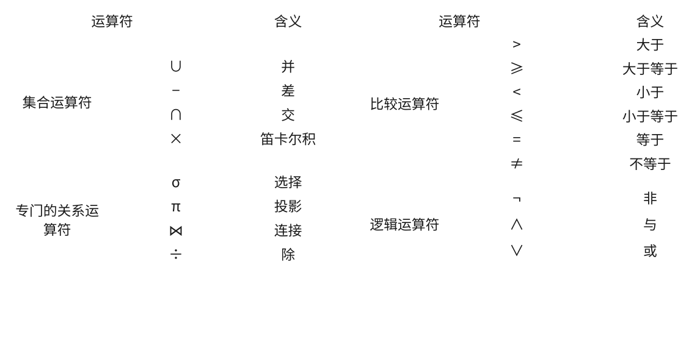

# 6.2 关系数据库

关系数据库是目前应用非常广泛的数据库之一，有一套完整的理论支持。关系模型是关系数据库的基础，由关系数据结构、关系操作集合和关系完整性规则3部分组成。本节介绍关系模型的基本概念、关系代数和关系数据库设计理论方面的内容。

## 6.2.1 关系数据库基本概念

关系数据库系统支持关系数据模型。早期的数据处理研究已使用代数和集合论方法，例如 1962 年 CODASYL 的《信息代数》和 David L. Childs 于 1968 年发表的集合论数据结构研究。IBM 的 E. F. Codd 随后系统地提出了关系模型。

1970年E.F.Codd在美国计算机学会会刊 *Communications of the ACM* 上发表了题为 *A Relational Model of Data for Large Shared Data Banks* 的论文，开创了数据库系统的新纪元。此后，他连续发表了多篇论文，奠定了关系数据库的理论基础。

几十年来，关系数据库系统的研究取得了辉煌的成就。关系方法从实验室走向了社会，涌现出许多性能良好的商业化关系数据库管理系统 (RDBMS), 如著名的IBM DB2、Oracle、Ingres、SYBASE、Informix等。数据库的应用领域迅速扩大。

### 1. 关系的基本术语

1. 属性 (Attribute): 在现实世界中，要描述一个事物常常取若干特征来表示。这些特征称为属性。例如学生通过学号、姓名、性别、系别、年龄、籍贯等属性来描述。
2. 域 (Domain): 每个属性的取值范围对应一个值的集合，称为该属性的域。例如，某个示例可以将学号限定为六位数字串，将姓名限定为一定长度的字符串，并为其他属性规定有效取值集合。一般在关系数据模型中，对域还加了一个限制，即每个属性值都应在所采用的模型中被视为不可再分的原子值（atomic value）。例如，整数、字符串是原子数据，而集合、记录、数组是非原子数据。关系数据模型的这种限制称为第一范式 (First Normal Form，1NF) 条件。但也有些关系数据模型突破了 1NF 的限制。
3. 目或度 (Degree): 目或度指的是一个关系中属性的个数。
4. 候选码（Candidate Key）：能够唯一标识元组的最小属性集合，即去掉其中任意一个属性后，剩余属性就不再具有这种唯一标识能力。
5. 主码 (Primary Key): 或称主键，若一个关系有多个候选码，则选定其中一个作为主码。
6. 主属性 (Prime Attribute): 至少出现在一个候选码中的属性称为主属性。不包含在任何候选码中的属性称为非主属性 (Non-Prime Attribute)。
7. 外码（Foreign Key）：关系中的一个或多个属性，用来引用同一关系或另一关系的候选码。外码也可以是本关系主码的一部分，甚至与本关系的主码相同。

例如，客户与贷款之间的借贷联系c-1(c-id,loan-no), 属性c-id是客户关系中的码，所以c-id是外码；属性loan-no是贷款关系中的码，所以loan-no也是外码。

8. 全码（All-key）：当关系的全部属性合在一起构成候选码时，称为全码。

例如，关系模式R(T,C,S), 属性T 表示教师，属性C 表示课程，属性S 表示学生。

假设一个教师可讲授多门课程、一门课程可由多位教师讲授，学生可选择不同教师讲授的课程。如果业务上允许同一学生跟不同教师学习同一课程，而且任意两个属性都不能唯一标识一条选课记录，则三个属性合在一起构成全码。

9. 笛卡尔积：

**【定义6.1】**设 $D_1,D_2,D_3,\ldots,D_n$ 为任意集合，定义 $D_1,D_2,D_3,\ldots,D_n$ 的笛卡尔积为：

$$D_1\times D_2\times D_3\times\cdots\times D_n=\{(d_1,d_2,d_3,\ldots,d_n)\mid d_i\in D_i,\ i=1,2,3,\ldots,n\}$$

其中，集合中的每一个元素 $(d_1,d_2,d_3,\ldots,d_n)$ 叫作一个 $n$ 元组（$n$-tuple，即 $n$ 个属性的元组），元素中的每一个值 $d_i$ 叫作元组一个分量。若各 $D_i$（$i=1,2,\ldots,n$）均为有限集，其基数（即各域中的元素个数）为 $m_i(i=1,2,3,\ldots,n)$，则 $D_1\times D_2\times D_3\times\cdots\times D_n$ 的基数 $M$ 为：

$$M=\prod_{i=1}^{n}m_i$$

### 2. 关系数据库模式

在数据库中要区分型和值。关系数据库中的型也称为关系数据库模式，是关系数据库结构的描述。它包括若干域的定义以及在这些域上定义的若干关系模式。关系数据库的值是这些关系模式在某一时刻对应的关系的集合，通常称之为关系数据库。

**【定义6.2】**关系的描述称为关系模式 (Relation Schema)。可以形式化地表示为：

`R(U, D, dom, F)`

其中，`R` 表示关系名；`U` 是组成该关系的属性名集合；`D` 是这些属性所用域的集合；`dom` 是从 `U` 到 `D` 的映射，为每个属性指定一个域；`F` 为属性间数据的依赖关系集合。

通常将关系模式简记为：

`R(U)` 或 `R(A₁, A₂, A₃, …, Aₙ)`

其中，`R` 为关系名，`A₁, A₂, A₃, …, Aₙ` 在这里列出各属性名；其取值域由 `dom` 指定。多个属性可以使用同一个域。通常在选作主码的各属性名下画实线。

例如：学生关系 `S` 有学号 `Sno`、学生姓名 `Sname`、系名 `SD`、年龄 `SA` 属性；课程关系 `C` 有课程号 `Cno`、课程名 `Cname`、先修课程号 `PCno` 属性；学生选课关系 `SC` 有学号 `Sno`、课程号 `Cno`、成绩 `Grade` 属性。定义关系模式及主码如下（本题未考虑 `F` 属性间数据的依赖，该问题在后续内容讨论）。

1. 学生关系模式 `S(Sno, Sname, SD, SA)`，主码为 `Sno`。
2. 课程关系模式 `C(Cno, Cname, PCno)`，主码为 `Cno`。先修课程号 `PCno` 和课程号 `Cno` 是不同的属性，但取自同一课程号域，即 `dom(PCno) = dom(Cno)`。
3. 学生选课关系模式 `SC(Sno, Cno, Grade)`。本例中，`(Sno, Cno)` 合在一起构成主码；`Sno` 和 `Cno` 又分别是引用学生关系和课程关系主码的外码。

### 3. 关系的完整性约束

完整性规则提供了一种手段来保证当授权用户对数据库做修改时不会破坏数据的一致性。因此，完整性规则防止的是对数据的意外破坏。关系模型的完整性规则是对关系的某种约束条件。例如，企业可按自己的薪酬规则为实验室管理员的基本薪资设置允许范围，拒绝不在范围内的值。

关系的完整性约束共分为3类：实体完整性、参照完整性(也称引用完整性)和用户定义完整性。

1. 实体完整性（Entity Integrity）。选定的主码必须能唯一标识每个元组，且主码中的每个属性均不得取空值。复合主码要求各属性的值合在一起唯一。
2. 参照完整性 (Referential Integrity)。现实世界中的实体之间往往存在某种联系，在关系模型中实体及实体间的联系是用关系来描述的，这样自然就存在着关系与关系间的引用。

**参照完整性规定：** 若关系 `R` 上的外码 `F` 引用关系 `S` 的主码，则每个非空的外码值都必须匹配 `S` 中已有的主码值。`R` 和 `S` 可以是同一关系。外码能否取空值取决于相应列的约束；复合外码含空值时，还要遵守所采用的匹配规则。

例如，某企业员工Emp关系模式和部门Dept关系模式表示如下：

Emp (员工号，姓名，性别，参加工作时间，部门号)

Dept (部门号，名称，电话，负责人)

Emp和Dept关系存在着属性的引用，即员工关系中的“部门号”值必须是确实存在的部门的部门号。按照关系的完整性规则，员工关系中的“部门号”属性取值要参照部门关系的“部门号”属性取值。如果新入职的员工还未分配具体的部门，且该属性允许空值，可以暂将部门号设为空值。

注意：本书若在关系模式的属性名下画实线，通常表示该属性为**主码属性**；如果在关系模式属性上加虚下画线，通常表示该属性为外码属性。

3. 用户定义完整性 (User Defined Integrity)。就是针对某一具体的关系数据库的约束条件，反映某一具体应用所涉及的数据必须满足的语义要求，由应用的环境决定。例如，某系统可规定账户编号的取值须大于或等于 100000 且小于 999999。

## 6.2.2 关系运算

关系操作的特点是操作对象和操作结果都是集合。

关系代数用到集合运算符、专门的关系运算符、比较运算符和逻辑运算符，如表 6-1 所示。传统的集合运算包括并、交、差及广义笛卡尔积。并、交、差对相容关系的元组集合进行运算，广义笛卡尔积则将两侧的元组拼接。专门的关系运算包括选择、投影、连接及除法。

> 表 6-1 关系代数运算符

本节采用的五种基本关系代数运算是并、差、笛卡尔积、投影和选择。交、连接和除等运算可由它们导出。

### 1. 并（Union）

并运算要求关系 $R$ 和 $S$ 相容，即元数相同，且对应属性的域相同。$R$ 与 $S$ 的并由属于 $R$ 或属于 $S$ 的元组构成，记作 $R\cup S$。其形式定义如下，式中 $t$ 为元组变量。

$$R\cup S=\{t\mid t\in R\lor t\in S\}$$

### 2. 差（Difference）

设关系 $R$ 与 $S$ 相容。它们的差由属于 $R$ 但不属于 $S$ 的元组构成，记作 $R-S$。其形式定义如下：

$$R-S=\{t\mid t\in R\land t\notin S\}$$

### 3. 广义笛卡尔积（Extended Cartesian Product）

设关系 $R$ 和 $S$ 的元数分别为 $n$ 和 $m$。它们的广义笛卡尔积由 $n+m$ 列的元组构成。每个元组的前 $n$ 列取自 $R$ 的一个元组，后 $m$ 列取自 $S$ 的一个元组，记作 $R\times S$。其形式定义如下：

$$R\times S=\{t\mid t=\langle t^n,t^m\rangle\land t^n\in R\land t^m\in S\}$$

如果R 和S 中有相同的属性名，可在属性名前加关系名作为限定，以示区别。若R 有 $K_1$ 个元组，S 有 $K_2$ 个元组，则R和S的广义笛卡尔积有 $K_1\times K_2$ 个元组。

注意：本书中的 $\langle t^n,t^m\rangle$ 意为元组 $t^n$ 和 $t^m$ 拼接成的一个元组。

### 4. 投影（Projection）

投影从关系 $R$ 中选取属性组 $A$ 对应的列，去掉重复元组后形成新的关系，记作 $\pi_A(R)$。其形式定义如下：

$$\pi_A(R)=\{t[A]\mid t\in R\}$$

### 5. 选择（Selection）

选择从关系 $R$ 中取出满足给定条件 $F$ 的所有元组，记作 $\sigma_F(R)$。其形式定义如下：

$$\sigma_F(R)=\{t\mid t\in R\land F(t)=\mathrm{True}\}$$

其中，$F$ 的运算对象可以是属性（也可按列序号指定）或常量，可用比较运算符（$=$、$<$、$\le$、$>$、$\ge$、$\ne$）和逻辑运算符（$\neg$、$\land$、$\lor$）构造条件。例如，以 $A_i$ 表示第 $i$ 列，$\sigma_{A_1\ge A_6}(R)$ 选取第 1 列的值大于或等于第 6 列的值的元组，$\sigma_{A_1\ge 6}(R)$ 则将第 1 列的值与常量 6 比较。

以下分别介绍交、连接、除，以及广义投影、外连接和聚集等扩展运算。

### 6. 交（Intersection）

设关系 $R$ 和 $S$ 相容。它们的交由同时属于 $R$ 和 $S$ 的元组构成，记作 $R\cap S$。其形式定义如下：

$$R\cap S=\{t\mid t\in R\land t\in S\}$$

显然，$R\cap S=R-(R-S)$，或者$R\cap S=S-(S-R)$。

### 7. 连接（Join）

θ 连接从两个关系的笛卡尔积中选取满足比较条件的元组。等值连接是比较条件为等式的 θ 连接，自然连接还要求所有同名属性相等，并去掉重复的属性列。

1）θ连接

θ连接是从R 与S 的笛卡尔积中选取属性满足一定条件的元组。其形式定义如下：

$$R\bowtie_{X\theta Y}S=\{t\mid t=\langle t^n,t^m\rangle\land t^n\in R\land t^m\in S\land t^n[X]\theta t^m[Y]\}$$

其中，$X\theta Y$ 是连接条件，$\theta$ 是比较运算符。$X$ 和 $Y$ 分别是 $R$ 和 $S$ 中长度相等、对应分量可比较的属性组。$t^n[X]$ 和 $t^m[Y]$ 表示相应元组在这些属性上的取值。需要说明的是：

（1）θ连接也可以表示为：

$$R\bowtie_{i\theta j}S=\{t\mid t=\langle t^n,t^m\rangle\land t^n\in R\land t^m\in S\land t^n[i]\theta t^m[j]\}$$

其中，$1\le i\le n$，$1\le j\le m$。条件 $i\theta j$ 表示比较 $R$ 的第 $i$ 列和 $S$ 的第 $j$ 列。

（2）θ 连接可由笛卡尔积和选择运算导出。在积中，$S$ 的第 $j$ 列位于第 $n+j$ 列，因此：

$$R\bowtie_{X\theta Y}S=\sigma_{X\theta Y}(R\times S)\ \text{或}\ R\bowtie_{i\theta j}S=\sigma_{i\theta(n+j)}(R\times S)$$

2）等值连接（Equijoin）

当θ为“=”时，称之为等值连接，记为 $R\bowtie_{X=Y}S$。其形式定义如下：

$$R\bowtie_{X=Y}S=\{t\mid t=\langle t^n,t^m\rangle\land t^n\in R\land t^m\in S\land t^n[X]=t^m[Y]\}$$

3）自然连接（Natural Join）是一种特殊的等值连接，它要求两个关系中进行比较的分量必须是相同的属性组，并且在结果集中将重复属性列去掉。

令 $t^n$ 和 $t^m$ 分别为 $R$ 和 $S$ 的元组变量。两关系的全部公共属性为 $B=(B_1,\ldots,B_k)$。设 $R$ 的属性依次为 $A_1,\ldots,A_{n-k},B_1,\ldots,B_k$，$S$ 的属性依次为 $B_1,\ldots,B_m$。记 $t^{m\prime}$ 为 $t^m$ 去掉公共属性后的部分，则自然连接可定义为：

$$R\bowtie S=\{\langle t^n,t^{m\prime}\rangle\mid t^n\in R\land t^m\in S\land t^n[B_1]=t^m[B_1]\land\cdots\land t^n[B_k]=t^m[B_k]\}$$

自然连接可由笛卡尔积、选择和投影导出。选择检验全部公共属性是否相等，投影去掉重复列：

$$R\bowtie S=\pi_{A_1,A_2,\cdots,A_{n-k},R.B_1,R.B_2,\cdots,R.B_k,B_{k+1},B_{k+2},\cdots,B_m}\left(\sigma_{R.B_1=S.B_1\land R.B_2=S.B_2\land\cdots\land R.B_k=S.B_k}(R\times S)\right)$$

**特别需要说明的是：** θ 连接筛选笛卡尔积中的元组，自然连接还要去掉重复的公共属性列。两个关系没有公共属性时，自然连接等价于笛卡尔积。

### 8. 除（Division）

给定关系 $R(X,Y)$ 和 $S(Y,Z)$，这里以 $S$ 在公共属性组 $Y$ 上的投影作为除数。商由这样的 $x$ 构成：$x$ 出现在 $R$ 的 $X$ 属性上，且除数中的每个 $y$ 都与 $x$ 一同出现在 $R$ 中。其形式定义如下：

$$R\div S=\{t^r[X]\mid t^r\in R\land \pi_Y(S)\subseteq Y_x\}$$

其中，$x=t^r[X]$，$Y_x=\{y\mid (x,y)\in R\}$ 是 $x$ 在 $R$ 中的像集。商的属性组为 $X$。

### 9. 广义投影（Generalized Projection）

广义投影运算允许在投影列表中使用算术运算，实现了对投影运算的扩充。

设 $F_1,\ldots,F_n$ 是可用 $R$ 的属性和常量构成的表达式，则广义投影记作 $\pi_{F_1,\ldots,F_n}(R)$。

### 10. 外连接（Outer Join）

外连接运算是连接运算的扩展，可以处理缺失的信息。外连接运算有三种：左外连接、右外连接和全外连接。

① 左外连接（Left Outer Join，⟕）

在自然连接结果的基础上，保留左侧关系中所有未匹配的元组。对这些元组，只将右侧独有的属性填为 NULL。

② 右外连接（Right Outer Join，⟖）

在自然连接结果的基础上，保留右侧关系中所有未匹配的元组。对这些元组，只将左侧独有的属性填为 NULL。

③ 全外连接（Full Outer Join，⟗）

在自然连接结果的基础上，保留两侧所有未匹配的元组，将另一侧独有的属性填为 NULL。

### 11. 聚集函数

聚集函数接收一组值，返回单个结果。以 {2, 4, 6, 8, 10, 15} 为例，sum 返回总和 45，avg 返回平均值 7.5，count 返回元素个数 6，min 返回最小值 2，max 返回最大值 15。

需要说明的是，聚集函数的输入中，一个值可以出现多次，值出现的顺序是无关紧要的，这样的集合称之为多重集。集合是多重集的一个特例，其中每个值都只出现一次。

有时需要在聚集前去掉重复值。例如，本节用 count-distinct 表示先去重、再计数。

## 6.2.3 关系数据库设计基本理论

关系数据理论是指导数据库设计的基础，关系数据库设计是数据库语义学的问题。要保证构造的关系既能准确地反映现实世界，又有利于应用和具体的操作。关系数据库设计的目标是生成一组合适的、性能良好的关系模式，以减少系统中信息存储的冗余度，但又可以方便地获取信息。

### 1. 函数依赖

数据依赖是通过一个关系中属性间值的相等与否体现出来的数据间的相互关系，是现实世界属性间联系和约束的抽象，是数据内在的性质，是语义的体现。函数依赖则是一种最重要、最基本的数据依赖。

**【定义6.3】** 设 $R(U)$ 是属性集 $U$ 上的关系模式，$X,Y\subseteq U$。对 $R$ 的每个合法实例 $r$，如果任意两个元组在 $X$ 上的取值相同，就一定在 $Y$ 上的取值也相同，则称 $X$ 函数决定 $Y$，或 $Y$ 函数依赖于 $X$，记作 $X\to Y$。

如果 $X\to Y$ 且 $Y\nsubseteq X$，则称 $X\to Y$ 是非平凡的函数依赖。一般情况下总是讨论非平凡的函数依赖。

如果 $X\to Y$ 且 $Y\subseteq X$，则称 $X\to Y$ 是平凡的函数依赖。

函数依赖要求关系模式的每个合法实例都满足该条件。仅凭某一时刻的实例满足该条件，不能断定该依赖成立。

例如，在 Student(Sno, Sname, SD, Sage, Sex) 的某个实例中，每位学生的年龄可能恰好都不同，但日后可能出现年龄相同而学号不同的学生，因而不能据此断定 Sage → Sno。

函数依赖由关系模式的语义约束决定。例如，若学生姓名唯一，则姓名决定年龄；若允许同名，且未要求同名学生年龄相同，则不能保证姓名决定年龄。

**【定义6.4】** 在 `R(U)` 中，如果 $X\to Y$，并且对于 $X$ 的任何一个真子集 $X'$，都有 $X'$ 不能决定 $Y$，则称 $Y$ 对 $X$ 完全函数依赖，记作 $X\xrightarrow{F}Y$。如果 $X\to Y$，但 $Y$ 不完全函数依赖于 $X$，则称 $Y$ 对 $X$ 部分函数依赖，记作 $X\xrightarrow{P}Y$。部分函数依赖也称作局部函数依赖。

例如，设学生选课关系为 SC(Sno, Cno, G)，给定函数依赖集 $F=\{(\mathrm{Sno},\mathrm{Cno})\to\mathrm{G}\}$。在这些约束下，单独的学号或课程号都不能决定成绩，因此其真子集（包括空集）均不能决定成绩，成绩完全依赖于二者的组合。

**【定义6.5】** 在 `R(U,F)` 中，如果 $X\to Y$，$Y\nsubseteq X$，$Y\nrightarrow X$，$Y\to Z$，则称 $Z$ 对 $X$ 传递依赖。

### 2. 多值依赖

**【定义6.6】** 设关系模式 $R(U)$ 中 $X,Y\subseteq U$，$Z=U-(X\cup Y)$。对 $R$ 的每个合法实例，若固定 $X$ 的取值 $x$，则每个与 $x$ 同时出现的 $z$ 所对应的 $Y$ 值集合都相同，此时称 $Y$ 多值依赖于 $X$，记作 $X\twoheadrightarrow Y$。

多值依赖具有以下6条性质：

- 多值依赖具有对称性。即若 $X\twoheadrightarrow Y$，则 $X\twoheadrightarrow Z$，其中 $Z=U-X-Y$。
- 多值依赖具有传递性。即若 $X\twoheadrightarrow Y$，$Y\twoheadrightarrow Z$，则 $X\twoheadrightarrow Z-Y$。
- 函数依赖可以看成是多值依赖的特殊情况。
- 若 $X\twoheadrightarrow Y$，$X\twoheadrightarrow Z$，则 $X\twoheadrightarrow YZ$。
- 若 $X\twoheadrightarrow Y$，$X\twoheadrightarrow Z$，则 $X\twoheadrightarrow Y\cap Z$。
- 若 $X\twoheadrightarrow Y$，$X\twoheadrightarrow Z$，则 $X\twoheadrightarrow Z-Y$。

### 3. 规范化

关系数据库设计的一种方法是将关系模式规范化。常见范式有 1NF、2NF、3NF、BCNF、4NF 和 5NF。将每种范式视为满足其条件的模式集合，包含关系为 $\mathrm{5NF}\subseteq\mathrm{4NF}\subseteq\mathrm{BCNF}\subseteq\mathrm{3NF}\subseteq\mathrm{2NF}\subseteq\mathrm{1NF}$。

通过无损连接分解，可以把关系模式分解为符合更高范式的若干模式。设计时还要考虑能否保持依赖。下面介绍 1NF 到 4NF。

1）1NF

**【定义6.7】** 若关系模式 $R$ 的每一个分量都是不可再分的数据项，则关系模式 $R$ 属于第一范式。记为 $R\in\mathrm{1NF}$。

例如，供应者和它所提供的零件信息，关系模式FIRST和函数依赖集F 如下：

`FIRST(Sno, Sname, Status, City, Pno, Qty)`

`F={Sno→Sname, Sno→Status, Status→City, (Sno,Pno)→Qty}`

表 6-2 给出了 FIRST 的一个实例。每个分量都是原子值，该模式满足 1NF。但在本例的函数依赖下，FIRST 存在以下四个问题。

> 表 6-2 FIRST

1. 冗余度大。例如每个供应者的Sno、Sname、Status、City会随供应的每种零件重复存储。
2. 引起修改操作的不一致性。例如供应者S1从“天津”搬到“上海”，若不注意，会使一些数据被修改，另一些数据未被修改，导致数据修改的不一致性。
3. 插入异常。关系模式FIRST的主码为 (Sno, Pno)，按照关系模式实体完整性规定主码不能取空值或部分取空值。这样，当某个供应者的某些信息未提供时（如 Pno），则不能进行插入操作，这就是所谓的插入异常。
4. 删除异常。若供应商S4的P2零件销售完了，并且以后不再销售P2零件，那么应删除该元组。这样，在基本关系FIRST找不到 S4，但该供应者仍是客观存在的。

为减少本例中的冗余和更新异常，可以分解 FIRST。以下先考察 2NF。

2）2NF

**【定义6.8】** 设关系模式 $R$ 满足 1NF。若每个非主属性完全函数依赖于每一个候选码，则 $R$ 满足 2NF。换言之，不存在非主属性对任何候选码的部分函数依赖。

例如，FIRST 的候选码是 (Sno, Pno)。由于 Sno → Status，非主属性 Status 只依赖候选码的一部分，因此 FIRST 不满足 2NF。

将 FIRST 分解为两个关系模式：

$\mathrm{FIRST}_1$(Sno, Sname, Status, City)

$\mathrm{FIRST}_2$(Sno, Pno, Qty)

第一个模式的候选码为 Sno，Sname、Status、City 都完全依赖于 Sno。第二个模式的候选码为 (Sno, Pno)，Qty 完全依赖于该组合，因而两个模式都满足 2NF。

3）3NF

**【定义6.9】** 设关系模式 $R(U,F)$ 满足 1NF。对 $F$ 所蕴含的每一个非平凡函数依赖 $X\to A$（$A$ 为单个属性），若 $X$ 是超码或 $A$ 是主属性，则该依赖满足 3NF 的条件。所有此类依赖都满足条件时，$R$ 属于 3NF。

即当2NF消除了非主属性对码的传递函数依赖，则称为3NF。

例如，$\mathrm{FIRST}_1$ 不属于 3NF。由 Sno → Status、Status → City，非主属性 City 传递依赖于候选码 Sno，且 Status 不是超码。可将 $\mathrm{FIRST}_1$ 继续分解为：

$\mathrm{FIRST}_{11}$(Sno, Sname, Status)

$\mathrm{FIRST}_{12}$(Status, City)

最终得到 $\mathrm{FIRST}_{11}$、$\mathrm{FIRST}_{12}$ 和 $\mathrm{FIRST}_2$ 三个子模式。按给定的函数依赖，它们均满足 3NF。

满足 3NF 的模式一定满足 2NF。消除非主属性对候选码的部分依赖和传递依赖，可以减少由这些依赖引起的冗余和更新异常。具体查询的执行性能还取决于访问方式、连接代价等因素。

4）BCNF（Boyce–Codd Normal Form，博伊斯–科德范式）

**【定义6.10】** 设关系模式 $R$ 满足 1NF。对其中每个非平凡函数依赖 $X\to Y$（$Y\nsubseteq X$），若 $X$ 都是超码，则 $R$ 属于 BCNF。超码包含至少一个候选码。

与 3NF 相比，BCNF 在依赖右侧为主属性时也要求非平凡依赖的决定因素是超码。

结论：一个满足BCNF的关系模式，应有如下性质：

1. 所有非主属性对每一个码都是完全函数依赖；
2. 每个主属性都完全函数依赖于不包含它的每一个候选码；
3. 对于任何非平凡函数依赖，其决定因素不能是不包含候选码的属性组。

例如，设R(Pno,Pname,Mname) 的属性分别表示零件号、零件名和厂商名，如果约定，每种零件号只有一个零件名，但不同的零件号可以有相同的零件名；每种零件可以有多个厂商生产，但每家厂商生产的零件应有不同的零件名。这样我们可以得到如下一组函数依赖：

`Pno → Pname,(Pname, Mname) → Pno`

关系模式 R 有两个候选码 (Pname, Mname) 和 (Pno, Mname)。所有属性都是主属性，所以 R 满足 3NF。但在非平凡函数依赖 Pno → Pname 中，Pno 不能决定 Mname，不是超码，因此 R 不满足 BCNF。同一零件由多家厂商生产时，其零件号和零件名会重复存储，带来冗余和更新异常。可将 R 分解为：

R₁(Pno, Pname) 和 R₂(Pno, Mname)

这两个模式都满足 BCNF，且公共属性 Pno 决定 R₁ 的全部属性，因此分解是无损的。原依赖 (Pname, Mname) → Pno 不能仅靠分别检查两个子模式来保证。

5）4NF

**【定义6.11】** 设关系模式 $R(U)$ 满足 1NF。若每个非平凡多值依赖 $X\twoheadrightarrow Y$ 的决定因素 $X$ 都是超码，则 $R$ 属于 4NF。这里“非平凡”是指 $Y\nsubseteq X$ 且 $X\cup Y\ne U$。

因此，违反 4NF 的是决定因素不是超码的非平凡多值依赖。

BCNF 针对函数依赖，4NF 还考虑多值依赖。进一步考虑更一般的连接依赖时，还可以讨论 5NF。
