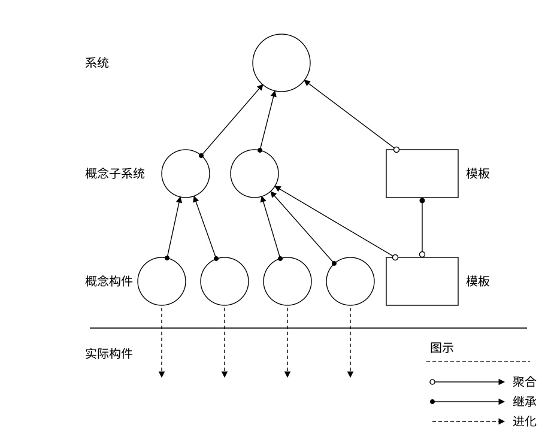

# 7.2 基于架构的软件开发方法

## 7.2.1 体系结构的设计方法概述

基于体系结构的软件设计（Architecture-Based Software Design，ABSD）由影响体系结构的业务目标、质量属性需求和功能需求共同驱动。项目的总体功能框架明确后，即可开始体系结构设计，同时继续获取和分析需求。对于产品线系统或长期演化的系统，需求往往难以一次确定，尽早开展设计有助于验证关键决策。

ABSD 方法有三个基础。第一，通过功能分解组织模块，考虑模块的内聚和模块间的耦合。第二，根据质量需求和业务目标选择合适的体系结构风格。第三，使用软件模板复用已有的结构组织方式。

ABSD 递归地细化设计，明确各轮迭代的步骤，使团队能够在每轮结束时检查已经形成的结构和仍待细化的部分。

## 7.2.2 概念与术语

### 1. 设计元素

ABSD 采用自顶向下、递归细化的方法，将软件系统的体系结构逐步细化，直至可以设计和实现软件构件与类。

ABSD 方法中使用的设计元素如图 7-1 所示。在最顶层，系统被分解为若干概念子系统和一个或若干个软件模板。在第 2 层，概念子系统又被分解成概念构件和一个或若干个附加软件模板。

> 图 7-1 ABSD 方法过程

### 2. 视角与视图

设计人员可以从不同视角（perspective）考察体系结构，并用相应的视图表达设计。静态视图展示功能组织，有助于分析可修改性等属性；动态视图展示并发和运行时交互，有助于分析系统行为。逻辑视图、进程视图、实现视图和配置视图可以彼此补充。逻辑视图记录设计元素的功能和概念接口，说明各元素在系统中承担的职责。

### 3. 用例和质量场景

用例描述参与者为实现某个目标而与系统进行的一组交互，以及交互带来的可观察结果，可用于获取功能需求。

质量场景描述系统在特定条件和刺激下应如何响应，可用于明确可修改性、性能、可靠性和交互性等质量需求。设计人员可以同时考虑预期情况和超出常规预期的情况。例如，分别考察用户数每年增长 10% 和 100% 时系统需要达到的响应时间或吞吐量。后者即使未发生，也有助于检验设计边界。

## 7.2.3 基于体系结构的开发模型

本节讨论基于体系结构的软件开发模型。若采用顺序推进的开发过程，可以依次开展问题定义、需求分析、软件设计、实现及测试。在这种安排下，可在初步需求分析后形成体系结构，并在概要设计中细化；采用迭代过程时，需求与体系结构设计可以并行推进。

传统的顺序开发过程在需求变化频繁时可能增加返工，也需要专门安排构件复用。这里的 ABSD 模型将基于体系结构的软件过程划分为体系结构需求、设计、文档化、复审、实现和演化六个子过程，如图 7-2 所示。

> 图 7-2 体系结构开发模型

## 7.2.4 体系结构需求

需求是指用户对目标软件系统在功能、行为、性能、设计约束等方面的期望。体系结构需求受技术环境和体系结构设计师的经验影响。需求过程主要是获取用户需求，标识系统中所要用到的构件。体系结构需求过程如图 7-3 所示。如果以前有类似的系统体系结构的需求，我们可以从需求库中取出，加以利用和修改，以节省需求获取的时间，减少重复劳动，提高开发效率。

### 1. 需求获取

本节从系统的质量目标、系统的业务目标和开发组织的业务目标三个方面识别体系结构驱动因素。需求获取还要明确用户完成任务所需的功能，以及可检验的质量属性需求。

### 2. 标识构件

图 7-3 的虚框表示标识构件的过程。该过程从初步逻辑结构中识别候选构件，分为以下三步。

> 图 7-3 体系结构需求过程

第 1 步：生成类图。可借助计算机辅助软件工程（CASE）工具绘制类图，或从已有模型和代码生成类图。Rational Rose 2000 是本节使用的工具示例。

第 2 步：对类进行分组。在类图基础上按职责和关系分组，可以简化图的结构。可将相对独立的类归为一组，也可根据泛化、聚合或组合关系识别候选分组。

第 3 步：把类打包成构件。把在第 2 步得到的类簇打包成构件，这些构件可以分组合并成更大的构件。

### 3. 架构需求评审

由分析人员、客户、设计人员和测试人员等组成评审小组，审查需求是否反映用户的实际要求，类的分组和构件的合并是否合理。必要时，在需求获取、标识构件和需求评审之间迭代。

## 7.2.5 体系结构设计

体系结构需求为设计决策提供依据，不同视图表达与质量目标相关的信息。设计是迭代的；若新系统可复用已有系统的大部分结构，可以从已有体系结构出发调整设计。软件体系结构设计过程如图 7-4 所示。

> 图 7-4 体系结构设计过程

### 1. 提出软件体系结构模型

在建立体系结构的初期，选择一个合适的体系结构风格是首要的。在这个风格的基础上，开发人员通过体系结构模型，可以获得关于体系结构属性的理解。此时，虽然这个模型是理想化的(其中的某些部分可能错误地表示了应用的特征)，但是，该模型为将来的实现和演化过程建立了目标。

### 2. 把已标识的构件映射到软件体系结构中

把在体系结构需求阶段已标识的构件映射到体系结构中，将产生一个中间结构，这个中间结构只包含那些能明确适合体系结构模型的构件。

### 3. 分析构件之间的相互作用

为了把所有已标识的构件集成到体系结构中，必须认真分析这些构件的相互作用和关系。

### 4. 产生软件体系结构

确定关键构件的关系和交互后，即可在第 2 步映射构件所得的中间结构上进一步细化。

### 5. 设计评审

体系结构形成后，应安排具有独立视角的评审人员检查设计，必要时邀请项目以外的领域专家参加。

## 7.2.6 体系结构文档化

体系结构常由概念性的构件和关系描述。例如，架构中的“层”不一定直接对应某种语言构造。体系结构文档帮助分析人员和程序员把这些概念落实到实现，也是各阶段沟通设计、分析设计决策并提出修改的依据。

本模型给出两类主要文档：体系结构规格说明，以及说明如何检验体系结构质量需求的质量设计说明书。对需求模型及其构件的精确描述有助于用户和开发方形成共同约定。文档应面向实际使用者编写，提供给相关开发人员，并保持版本一致。

## 7.2.7 体系结构复审

从图 7-2 中可以看出，体系结构设计、文档化和复审是一个迭代过程。从这个方面来说，在一个主版本的软件体系结构分析之后，要安排一次由外部人员(用户代表和领域专家)参加的复审。

为识别风险，团队可以按架构设计搭建最小可运行系统，评估关键需求是否得到满足，并检查可能的技术风险和协作风险。

复审的目的是标识潜在的风险，及早发现体系结构设计中的缺陷和错误，包括体系结构能否满足需求、质量需求是否在设计中得到体现、层次是否清晰、构件的划分是否合理、文档表达是否明确、构件的设计是否满足功能与性能的要求等。

## 7.2.8 体系结构实现

体系结构实现是将结构性设计决策落实到软件中：把系统划分为规定的构件，并按设计建立构件间的交互。其过程如图 7-5 所示。

> 图 7-5 体系结构实现过程

图 7-5 中的虚框表示体系结构的实现过程。实现以复审后的体系结构说明书为依据，每个构件应履行其中规定的职责。系统级或项目级约束可能无法从单个构件的代码中看出，因而应向实现人员说明。

体系结构说明书规定了构件及其关系。可根据接口约束从构件库中查找候选实现，再核对其行为、质量属性和部署约束；找不到合适实现时再开发新构件。最后，按照设计组装各构件，完成系统集成。

最后一步是测试，包括单个构件的功能性测试和被组装的应用的整体功能和性能测试。

## 7.2.9 体系结构的演化

开发过程中，或系统投用后迁移到新的使用环境时，用户需求都可能变化。应先评估变更影响；涉及体系结构决策时，再相应调整体系结构。演化过程如图 7-6 所示。

> 图 7-6 体系结构演化过程

体系结构演化是使用系统演化步骤去修改应用，以满足新的需求。主要包括以下 6 个步骤。

### 1. 需求变化归类

首先对需求变化进行归类，标明受影响的已有构件。暂时找不到对应构件的需求也应记录，以便评估是否需要新增构件。

### 2. 制订体系结构演化计划

在改变原有结构之前，开发组织必须制订一个周密的体系结构演化计划，作为后续演化开发工作的指南。

### 3. 修改、增加或删除构件

根据演化计划及第 1 步的归类结果，确定需要修改或删除的已有构件，以及需要新增的构件。对新增或修改的构件进行功能测试。

### 4. 更新构件的相互作用

构件发生增删或修改时，应检查相关接口、控制流和数据流，并更新受影响的交互。

### 5. 构件组装与测试

通过组装支持工具把这些构件的实现体组装起来，完成整个软件系统的连接与合成，形成新的体系结构。然后对组装后的系统整体功能和性能进行测试。

### 6. 技术评审

技术评审核对组装后的系统及其体系结构是否反映需求变更、符合用户要求。若有偏差，可回到第 2 步调整计划并迭代，直至通过评审。

将本轮变更整合到系统及其体系结构说明中，完成此次演化。
