# 7.3 软件架构风格

软件体系结构设计的一个目标是复用经过验证的组织方式。不同系统可以采用同一种体系结构风格，同时根据各自的需求选择具体构件及实现。

## 7.3.1 软件架构风格概述

软件体系结构风格描述一类系统惯用的组织方式，可跨越多个应用领域。一种风格通过构件和连接件类型构成的词汇表，以及约束它们组合方式的规则，定义一个系统家族。风格概括该家族共有的结构和交互特征，有助于复用已有设计。例如，“客户/服务器”让人知道客户向服务器请求服务，但不能单凭风格名称得知具体接口和部署方案。

## 7.3.2 数据流体系结构风格

数据流软件体系结构按数据的输入、变换和输出组织处理步骤，步骤之间通过传递数据协作。它描述的是软件组织方式，不限定底层处理器是否使用程序计数器。可并发执行的步骤即使调度顺序不同，也可能产生确定的结果。本节介绍批处理和管道-过滤器两种风格。

### 1. 批处理体系结构风格

在图 7-7 所示的批处理顺序风格中，每个步骤由独立程序完成。上一步处理完一批数据后，再把整批结果交给下一步。独立程序是构件，保存并传递批量数据的文件或其他介质充当连接件。数据流图展示这些构件的连接拓扑。

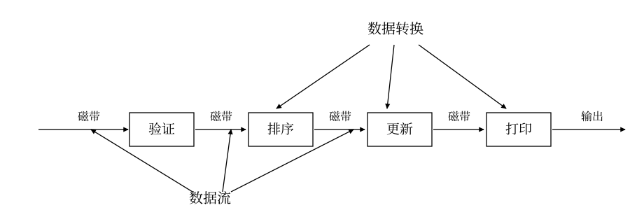

> 图 7-7 批处理体系结构风格示意图

### 2. 管道-过滤器体系结构风格

在管道-过滤器风格中，过滤器（filter）读取输入流，对数据进行分析、计算或转换，再输出结果。管道（pipe）将输出流传给下游过滤器。只要某个过滤器已获得足够的输入，就可以开始处理，不必一律等整批数据处理完毕。除了串联，还可以有分支和汇合，如图 7-8 所示。

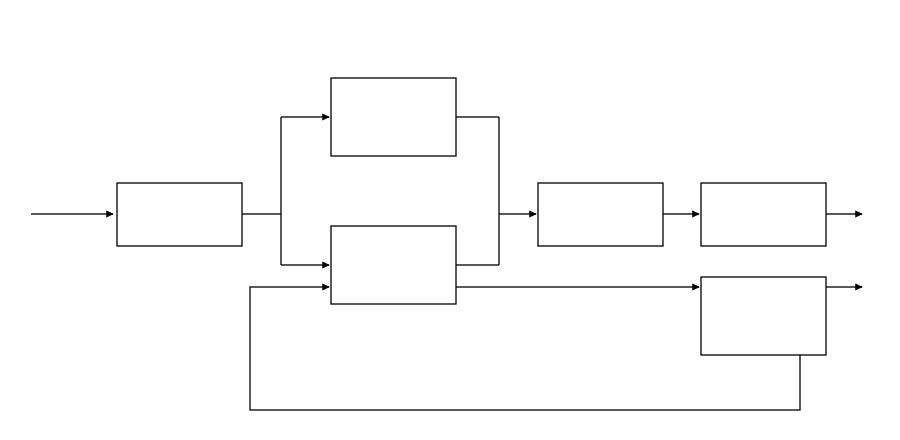

> 图 7-8 管道/过滤器体系结构风格

## 7.3.3 调用/返回体系结构风格

调用/返回风格通过调用传递控制，在被调用构件完成后把控制交还调用方。系统可以按职责分解为多个构件，降低理解和修改的复杂度。本节讨论主程序/子程序、面向对象、层次型以及客户端/服务器风格中采用这种机制的情形。

### 1. 主程序/子程序风格

在典型的主程序/子程序风格中，主程序把任务分解为多个步骤，通过过程调用组织子程序。主程序和子程序是构件，调用是连接件。调用可以形成层次；一个子程序能否正确工作，取决于其自身逻辑，以及它和被调用子程序是否履行各自约定。

### 2. 面向对象体系结构风格

面向对象风格以对象为构件，将数据及相应操作封装在对象中，通过接口和方法调用与其他对象交互。图 7-9 展示了对象及其过程调用。

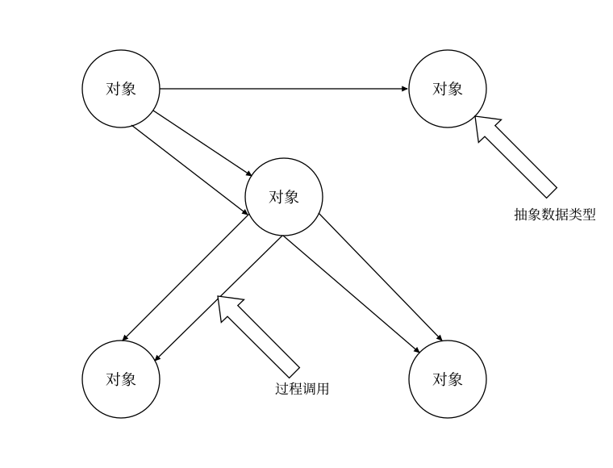

> 图 7-9 面向对象体系结构风格

### 3. 层次型体系结构风格

层次型系统按抽象层次组织构件，通常由下层向上层提供服务（见图 7-10）。在严格分层的系统中，只允许直接访问相邻层公开的接口；也有允许跨层访问的设计。每一层可以向上提供较高层次的抽象，其交互协议约束允许的调用。若接口和行为约定不变，某一层的实现通常可独立替换。变化的间接影响仍可能传递到其他层。

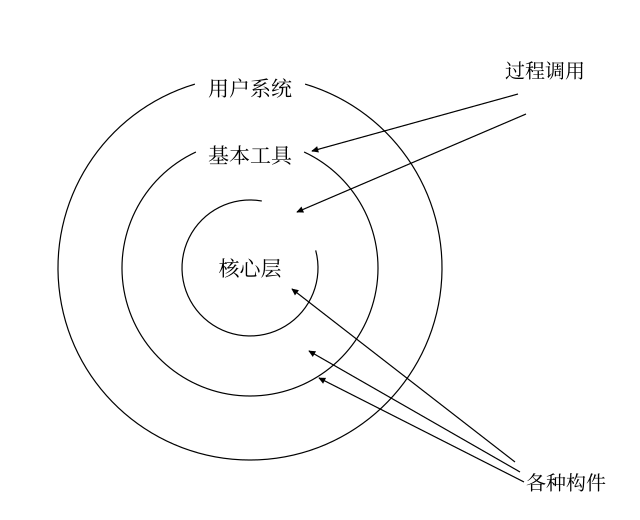

> 图 7-10 层次型体系结构风格

### 4. 客户端/服务器体系结构风格

客户端/服务器（C/S）风格按请求服务和提供服务的角色组织系统（见图 7-11）。数据库应用是两层 C/S 的常见实例，由客户端应用经网络访问数据库服务器。客户端若同时承担用户交互和较多业务处理，则称为“胖客户机”；具体的职责分配取决于设计。

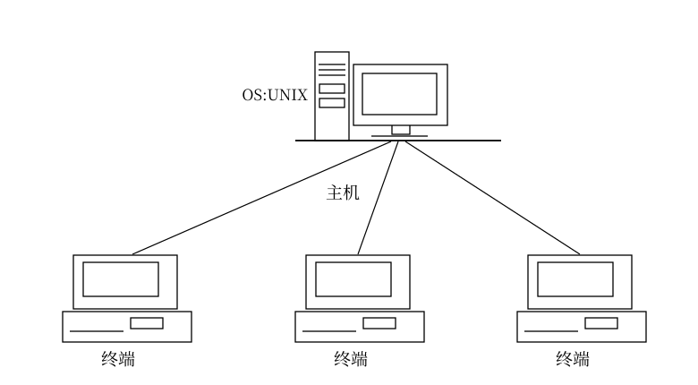

> 图 7-11 C/S 体系结构风格

图 7-12 所示的三层 C/S 结构在客户机和数据库之间加入应用服务器。表示层负责用户交互，功能层在应用服务器上处理主要业务逻辑，数据层负责持久化和数据管理。在这种部署中，客户端主要承担表示职责，通常称为“瘦客户机”。逻辑层的划分并不规定每层只能部署在一台机器上。

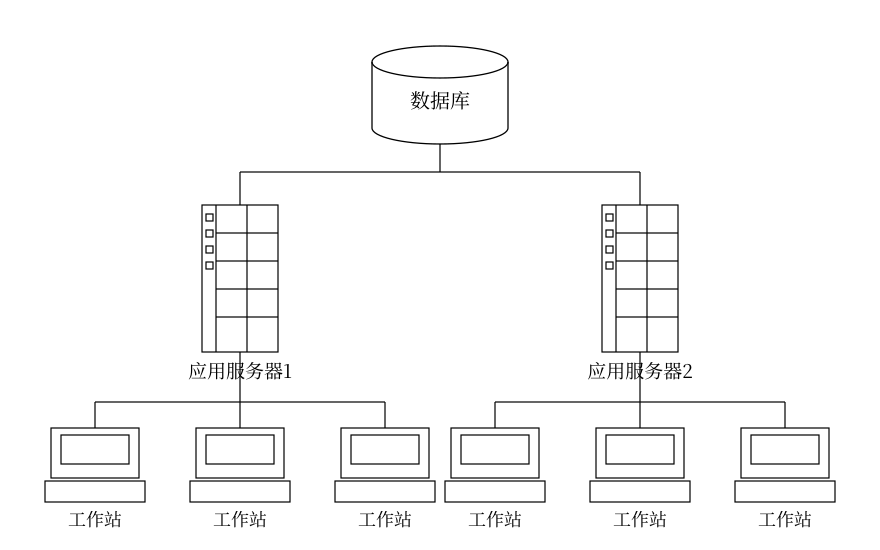

> 图 7-12 三层 C/S 体系结构风格

## 7.3.4 以数据为中心的体系结构风格

以数据为中心的体系结构风格主要包括仓库体系结构风格和黑板体系结构风格。

### 1. 仓库体系结构风格

仓库（repository）集中存储和维护共享数据。在图 7-13 中，中央仓库保存当前数据状态，多个独立构件通过仓库接口读取或更新数据。构件与仓库之间的数据访问机制充当连接件。

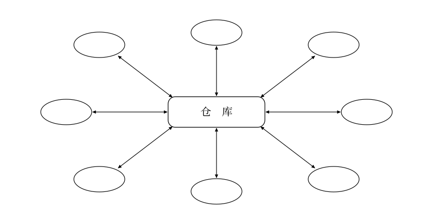

> 图 7-13 仓库体系结构风格

### 2. 黑板体系结构风格

黑板风格适用于需要综合多种知识逐步求解的问题（见图 7-14）。各知识源通过共享黑板读取当前状态、写入部分解，控制机制根据当前状态选择后续可执行的操作。黑板可以按问题所需的抽象层次组织部分解，各层用相应的术语描述。知识源可在同一层或不同层次间转换信息。具体的知识表示、推理方式和控制策略由应用问题决定。

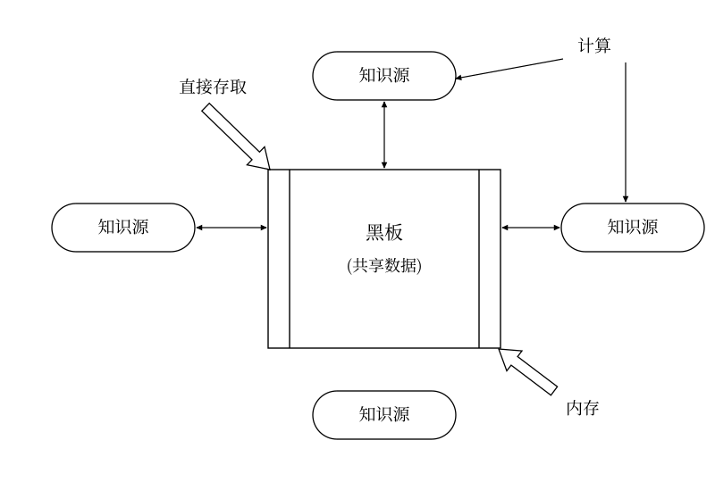

> 图 7-14 黑板体系结构风格

黑板系统通常由黑板、知识源和控制机制组成，可利用已有黑板编程环境实现。应用例子包括语音识别，以及多个松耦合代理通过黑板共享中间结果。

## 7.3.5 虚拟机体系结构风格

虚拟机体系结构风格的基本思想是人为构建一个运行环境，在这个环境之上，可以解析与运行自定义的一些语言，这样来增加架构的灵活性。虚拟机体系结构风格主要包括解释器风格和规则系统风格。

### 1. 解释器体系结构风格

图 7-15 的解释器模型包括解释引擎、待执行的程序、程序执行的当前状态和解释引擎的内部状态。程序状态可包括变量值，解释引擎的内部状态可记录下一步要执行的操作。

解释器按语言规则执行源程序或中间表示，可以用虚拟机弥合程序语义与底层机器之间的差异。逐步解释通常会产生额外开销，实际效率取决于实现。语言解释器是直接的例子；基于规则的专家系统也可使用专门的规则解释器。

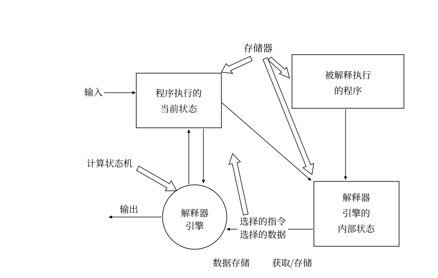

> 图 7-15 解释器体系结构风格

### 2. 规则系统体系结构风格

图 7-16 的规则系统包含保存规则和事实的知识库、工作内存、规则/数据选择器及规则解释器。选择器根据工作内存的当前数据匹配规则，解释器执行选定的规则，并可更新工作内存。

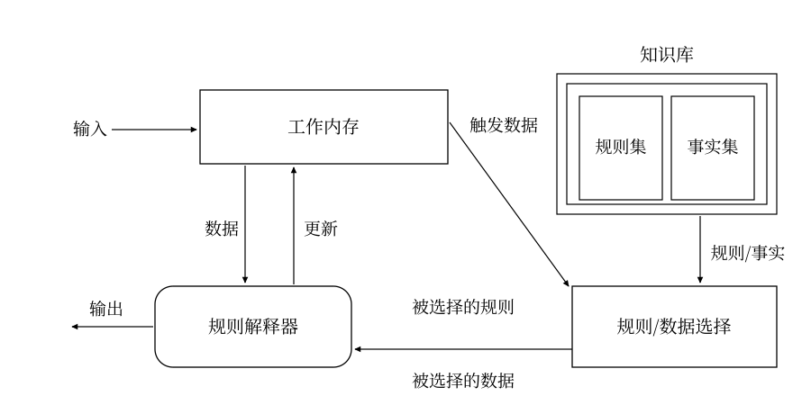

> 图 7-16 规则系统体系结构风格

## 7.3.6 独立构件体系结构风格

独立构件风格强调构件能够相对独立地运行，通过消息或事件协作，从而降低对彼此实现的依赖。进程可以直接交换消息，也可以借助中介。下文介绍进程通信和事件系统两种风格。

### 1. 进程通信体系结构风格

在进程通信体系结构风格中，构件是相对独立的进程，通过消息等机制协作。消息可以点对点传递，交互可以采用同步或异步方式。远程过程调用则把请求和响应封装为一次调用。

### 2. 事件系统体系结构风格

在基于事件的隐式调用中，发布者发出事件，其他构件为所关注的事件注册处理程序。系统按注册关系和分发规则通知相应处理程序，发布者无须逐个调用它们（见图 7-17）。

这种风格以模块为构件。模块可以定义事件和处理程序，也可以公开供直接调用的过程。

事件发布者通常无须知道订阅者的身份，也不能仅凭发布时间推定各处理程序的执行顺序。若系统明确规定了顺序，则按其分发规则执行。隐式调用可以和显式调用并用。

基于事件的隐式调用可用于集成开发工具、在数据库中响应数据变化、更新用户界面或触发编辑器的语法检查。例如，编辑器和变量监视器可订阅调试器（debugger）的断点事件。调试器在断点处暂停并发布事件后，编辑器显示断点所在位置，变量监视器刷新变量值。调试器无须知道具体由哪些处理程序响应。

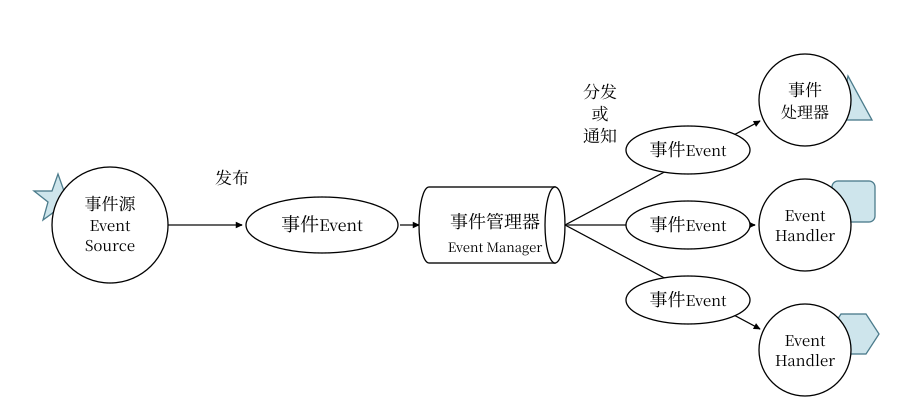

> 图 7-17 事件系统体系结构风格
