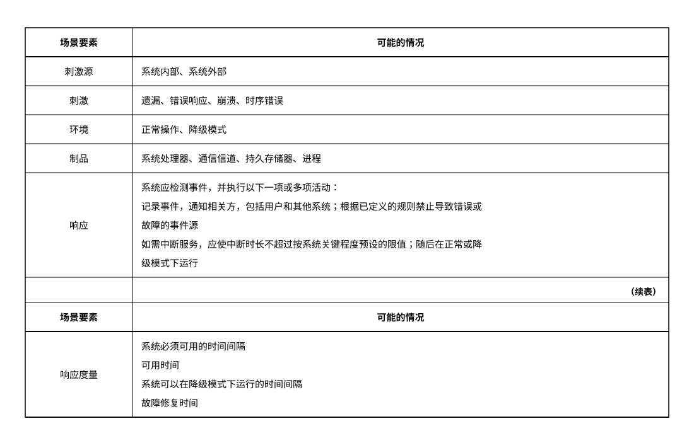
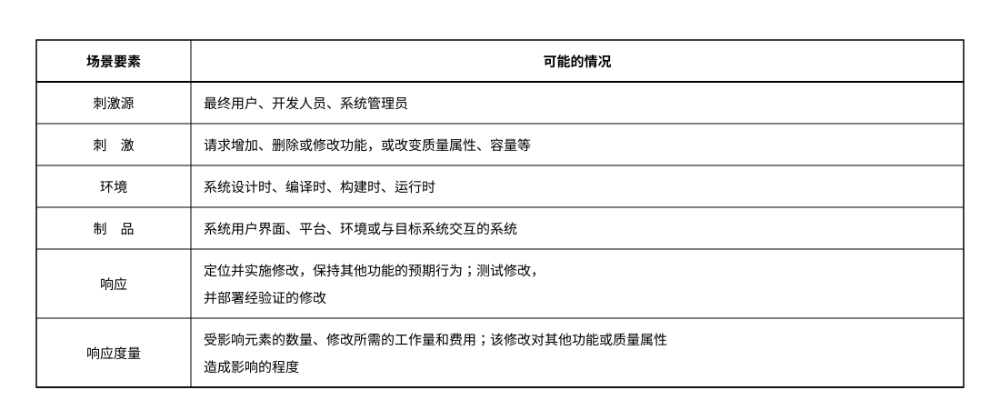
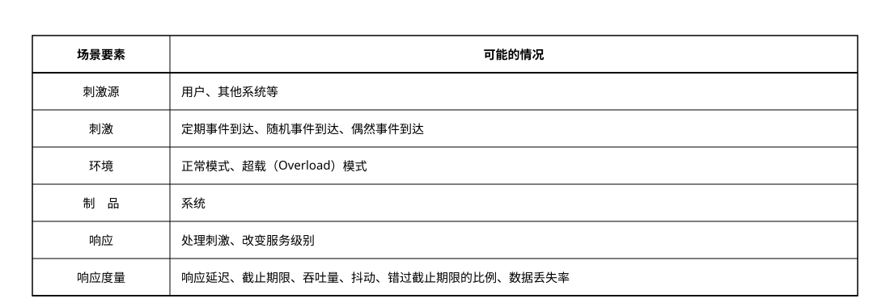
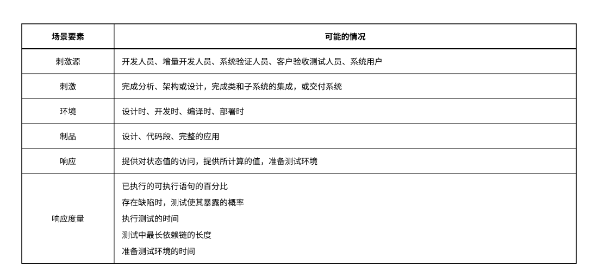
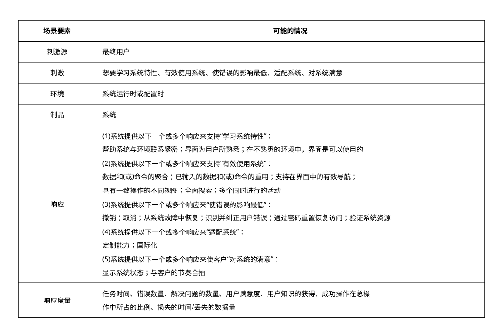
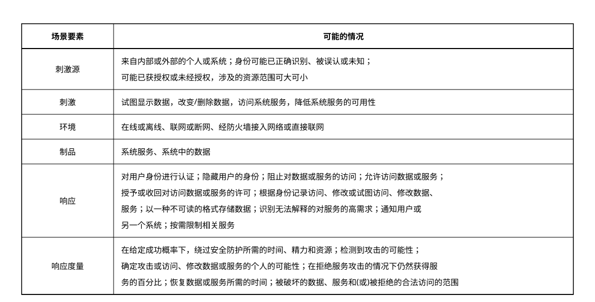

# 8.1 软件系统质量属性

## 8.1.1 质量属性概念

软件系统的质量就是“软件系统与明确地和隐含地定义的需求相一致的程度”。更具体地说，软件系统质量是软件与明确叙述的功能和性能需求、文档中明确规定的开发标准，以及任何专业开发的软件产品都应该具有的隐含特征相一致的程度。按 `GB/T 16260.1—2006` 的软件产品质量模型，内部质量和外部质量可用六项特性描述：功能性、可靠性、易用性、效率、维护性与可移植性。以下列举部分子特性：功能性包括适合性、准确性、互操作性、安全性等；可靠性包括容错性、易恢复性、成熟性；易用性包括易学性、易理解性、易操作性；效率包括资源特性和时间特性；维护性包括可测试性、可修改性、稳定性和易分析性；可移植性包括适应性、易安装性、共存性和易替换性等。

软件系统质量属性(`Quality Attribute`)是一个系统的可测量或者可测试的属性，用来描述系统满足利益相关者(`Stakeholders`)需求的程度。基于软件系统的生命周期，可以将软件系统的质量属性按主要关注阶段分为开发期质量属性和运行期质量属性；有些属性跨越两个阶段。

### 1. 开发期质量属性

开发期质量属性主要指在软件开发阶段所关注的质量属性，本节列举以下 6 项。

1. 易理解性：指设计被开发人员理解的难易程度。
2. 可扩展性：软件通过增加新功能来适应新需求或需求变化的能力，是灵活性的一种体现。
3. 可重用性：指重用软件系统或某一部分的难易程度。
4. 可测试性：设计和执行测试以检验软件是否满足规定需求的难易程度。
5. 可维护性：当需要修复缺陷、增加功能或改进质量属性时，识别修改点并实施修改的难易程度。
6. 可移植性：将软件系统从一个运行环境转移到另一个不同的运行环境的难易程度。

### 2. 运行期质量属性

运行期质量属性主要指在软件运行阶段所关注的质量属性，本节列举以下 7 项。

1. 性能：性能是指软件系统及时提供相应服务的能力，可用响应时间、吞吐量和给定服务目标下的处理容量等指标描述。
2. 安全性：指软件系统同时兼顾向合法用户提供服务，以及阻止非授权使用的能力。
3. 可伸缩性：指负载变化时，软件系统通过调整资源来维持要求的服务水平的能力。例如，可增加服务器以承载更多并发请求。
4. 互操作性：指本软件系统与其他系统交换数据和相互调用服务的难易程度。
5. 可靠性：软件系统在规定条件和时间内持续执行规定功能的能力。
6. 可用性：指系统在规定观察期内能够提供规定服务的时间占应提供服务时间的比例。可用性会受到系统错误、恶意攻击、高负载等问题的影响。
7. 鲁棒性：是指软件系统在异常情况下（如输入无效或相关软硬件发生故障）仍能按规定方式作出响应的能力，也称健壮性。

## 8.1.2 面向架构评估的质量属性

为了评价一个软件系统，特别是软件系统的架构，需要进行架构评估。在架构评估过程中，评估人员所关注的是系统的质量属性。评估方法所普遍关注的质量属性有以下几种。

### 1. 性能

性能(`Performance`)是指系统的响应能力，即要经过多长时间才能对某个事件做出响应，或者在给定时间内系统能处理多少个事件。经常用单位时间内所处理事务的数量或系统完成某个事务处理所需的时间来对性能进行定量表示。性能测试经常要使用基准测试程序。

### 2. 可靠性

可靠性(`Reliability`)描述软件在规定条件和时间内持续执行规定功能的能力。平均失效前时间（mean time to failure，MTTF）描述从开始工作到失效的平均时间，常用于不可修复对象。对于可修复系统，可用平均失效间隔时间（mean time between failures，MTBF）描述相邻失效之间的平均间隔，并说明统计口径是否计入修复时间。以下从容错和健壮性两个角度说明系统如何应对异常。

1. 容错。容错的目的是在发生特定故障时，使系统仍能提供规定的服务。例如在一个分布式软件系统中失去了一个与远程构件的连接，接下来恢复了连接。恢复连接后，系统可重试能够安全重复的操作；对于可能已生效的请求，应避免重复执行。
2. 健壮性。这里说的是保护应用程序不受错误使用和错误输入的影响，在发生意外错误事件时确保应用系统处于预先定义好的状态。健壮的系统可以拒绝无效输入后继续运行，也可以在无法安全继续时按预定方式终止。软件架构对软件系统的可靠性有巨大的影响。例如，软件架构设计上通过在应用程序内部采用冗余机制，或集成监控构件和异常处理，以提升系统可靠性。

### 3. 可用性

可用性(`Availability`)可以用规定观察期内系统能够提供规定服务的时间占应提供服务时间的比例表示。故障发生的频率和每次恢复所需的时间都会影响这个比例。

### 4. 安全性

安全性(`Security`)是指系统在向合法用户提供服务的同时防止未授权使用、抵御对服务可用性的威胁的能力。安全性可根据系统可能受到的安全威胁类型来分类。安全性又可划分为机密性、完整性、不可否认性及可控性等特性。其中，机密性保证信息不泄露给未授权的用户、实体或过程；完整性保证信息的完整和准确，防止信息被非法修改；不可否认性是指能提供可验证的证据，以解决对发送或接收行为的争议；可控性保证对信息的传播及内容具有控制的能力，防止为非法者所用。

### 5. 可修改性

可修改性(`Modifiability`)是指能够快速地以较高的性价比对系统进行变更的能力。通常以某些具体的变更为基准，通过考查这些变更的代价来衡量可修改性。本节从以下四个方面讨论架构如何支持变更。

1. 可维护性(`Maintainability`)。修复缺陷是维护活动的一种，还包括适应环境变化和改进系统。可维护性好的软件架构往往能做局部性的修改并能使对其他构件的负面影响最小化。
2. 可扩展性(`Extendibility`)。这一点关注的是使用新特性来扩展软件系统，以及用改进版本替换构件，并删除不再需要的特性和构件。松散耦合有助于降低扩展功能时对其他构件的影响。其目标是实现一种架构，能使开发人员在不影响构件客户的情况下替换构件。支持把新构件集成到现有的架构中也是必要的。
3. 结构重组(`Reassemble`)。这一点处理的是重新组织软件系统的构件及构件间的关系，例如通过将构件移动到一个不同的子系统而改变它的位置。为了支持结构重组，软件系统需要精心设计构件之间的关系。理想情况下，它们允许开发人员在不影响实现的主体部分的情况下灵活地配置构件。
4. 可移植性(`Portability`)。可移植性使软件系统适用于多种硬件平台、用户界面、操作系统、编程语言或编译器。为便于移植，可将平台相关部分与其余代码隔离。可移植性是系统能够在不同计算环境下运行的能力，这些环境可能是硬件、软件，也可能是两者的结合。如果移植到新的系统需要做适当更改，则该可移植性就是一种特殊的可修改性。

### 6. 功能性

功能性(`Functionality`)是系统能完成所期望的工作的能力。一项任务可能由一个构件完成，也可能由多个构件协作完成。

### 7. 可变性

可变性（`Variability`）指架构支持在预设变化点选择或配置不同方案，形成多个产品变体的能力。这些产品变体遵循共同的架构规则，在选定的变化点上有所不同。当要将某个架构作为一系列相关产品(例如，软件产品线)的基础时，可变性是很重要的。

### 8. 互操作性

作为系统组成部分的软件不是独立存在的，通常与其他系统或自身环境相互作用。为了支持互操作性，架构应明确系统间的接口、交换的数据格式及其含义。采用不同编程语言的系统之间如何交换并使用信息，是一个互操作性问题，这种互操作性也影响应用的软件架构。

## 8.1.3 质量属性场景描述

为了精确描述软件系统的质量属性，通常采用质量属性场景(`Quality Attribute Scenario`)作为描述质量属性的手段。质量属性场景是一个具体的质量属性需求，简要描述在给定环境中，系统或相关人员应如何响应某个刺激，以及如何度量响应。

质量属性场景是一种面向特定质量属性的需求。它由 6 部分组成：

- 刺激源(`Source`)：这是某个生成该刺激的实体(人、计算机系统或者任何其他刺激器)。
- 刺激(`Stimulus`)：刺激是触发响应的事件或条件。
- 环境(`Environment`)：环境指刺激发生时系统所处的条件，例如正常运行或过载。
- 制品(`Artifact`)：制品指受刺激影响的对象。这可能是整个系统，也可能是系统的一部分。
- 响应(`Response`)：响应指针对刺激采取的行动。
- 响应度量（Response Measure）：当响应发生时，应当能够以某种方式对其进行度量，以对需求进行测试。

本节以可用性、可修改性、性能、可测试性、易用性和安全性六类质量属性为例，下面分别列表进行介绍。

### 1. 可用性质量属性场景

可用性质量属性场景所关注的方面包括系统故障发生的频率、出现故障时会发生什么情况、允许系统在多长时间内不能提供规定的服务、在哪些运行条件下可以容许服务中断、如何防止故障的发生以及发生故障时要求进行哪种通知，表 8-1 给出了详细描述。

> 表 8-1 可用性质量属性场景描述

### 2. 可修改性质量属性场景

可修改性质量属性场景主要关注系统在改变功能、质量属性时需要付出的成本和难度，可修改性质量属性场景可能发生在系统设计、编译、构建、运行等多种情况和环境下，表 8-2 给出了详细描述。

> 表 8-2 可修改性质量属性场景描述

### 3. 性能质量属性场景

性能质量属性场景主要关注系统的响应速度，可以在给定负载下，通过响应时间、吞吐量和资源利用率等指标评价性能，表 8-3 给出了详细描述。

> 表 8-3 性能质量属性场景描述

### 4. 可测试性质量属性场景

可测试性质量属性场景主要关注系统测试过程中的效率，发现系统缺陷或故障的难易程度等，表 8-4 给出了详细描述。

> 表 8-4 可测试性质量属性场景描述

### 5. 易用性质量属性场景

易用性质量属性场景主要关注用户在使用系统时的容易程度，包括系统的学习曲线、完成操作的效率、对系统使用过程的满意程度等，表 8-5 给出了详细描述。

> 表 8-5 易用性质量属性场景描述

### 6. 安全性质量属性场景

安全性质量属性场景主要关注系统在安全性方面的要素，衡量系统在向合法用户提供服务的同时，阻止未经授权的访问或操作的能力，表 8-6 给出了详细描述。

> 表 8-6 安全性质量属性场景描述
