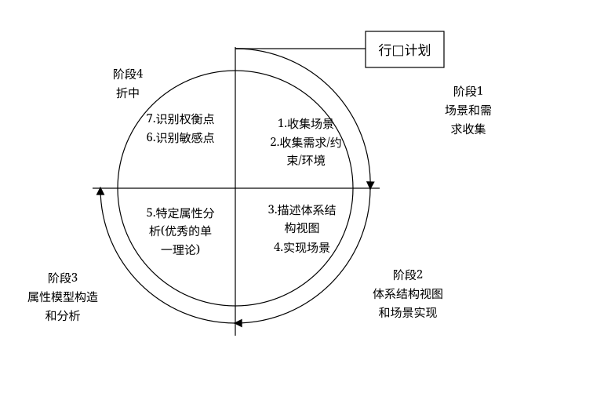
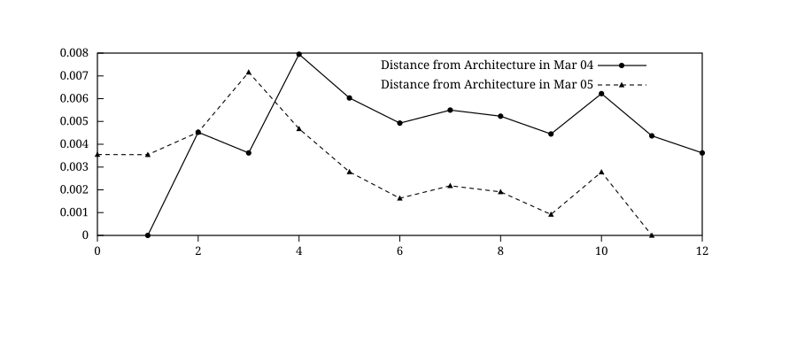
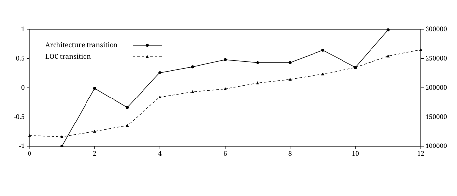

# 8.2 系统架构评估

系统架构评估通过分析候选架构对系统目标和质量要求的支持程度，为选择架构策略提供依据。它利用数学或逻辑分析技术，针对系统的一致性、正确性、质量属性、规划结果等不同方面，提供描述性、预测性和指令性的分析结果。

系统架构评估的方法通常可以分为 3 类：基于调查问卷或检查表的方式、基于场景的方式和基于度量的方式。

1. 基于调查问卷或检查表的方法。该方法的关键是要设计好问卷或检查表，充分利用系统相关人员的经验和知识，获得对架构的评估。该方法的缺点是在很大程度上依赖于评估人员的主观推断。
2. 基于场景的评估方法。卡内基梅隆大学软件工程研究所的架构权衡分析方法（Architecture Tradeoff Analysis Method，ATAM）和软件架构分析方法（Software Architecture Analysis Method，SAAM）都使用场景。它是通过分析软件架构对场景(也就是对系统的使用或修改活动)的支持程度，从而判断该架构对这一场景所代表的质量需求的满足程度。
3. 基于度量的评估方法。它是建立在软件架构度量的基础上的，涉及 3 个基本活动，首先需要建立质量属性和度量之间的映射原则，然后从软件架构文档中获取度量信息，最后根据映射原则分析推导出系统的质量属性。

本节首先介绍系统架构评估中的重要概念，然后对 `SAAM`、`ATAM` 和 `CBAM` 等 3 种重要的架构评估方法进行详细论述，并简要说明其他评估方法。

## 8.2.1 系统架构评估中的重要概念

**（1）敏感点（Sensitivity Point）和权衡点（Tradeoff Point）。** 当一个或多个构件或其关系的某项特性发生变化，某一质量属性的响应也显著变化时，这项特性就是该质量属性的敏感点。研究敏感点可使设计人员或分析员明确在搞清楚如何实现质量目标时应注意什么。权衡点是影响多个质量属性的特性，是多个质量属性的敏感点。例如，改变加密级别可能会对安全性和性能产生非常重要的影响。提高加密级别可以提高安全性，但可能要耗费更多的处理时间，影响系统性能。如果某个机密消息的处理有严格的时间延迟要求，则加密级别可能就会成为一个权衡点。

**（2）利益相关者（Stakeholders，也称风险承担者）。** 架构决策涉及多方利益。表 8-7 列出可能参与架构评估的利益相关者及其关注的问题。

> 表 8-7 系统架构评估涉及的问题

**（3）场景（Scenarios）。** 场景从利益相关者的角度简要描述系统的使用、修改或运行情况，用于把质量目标具体化。简要描述可先写刺激、环境和响应。完整的质量属性场景还应写明刺激源、受影响的制品及响应度量。

## 8.2.2 系统架构评估方法

### 1. SAAM 方法

软件架构分析方法（Software Architecture Analysis Method，SAAM）采用场景分析软件架构。Kazman 等人在 1994 年发表论文介绍了这一方法。早期应用着重于比较候选架构的可修改性；也可用具体场景分析可移植性、可扩展性等质量属性。

1. 特定目标。`SAAM` 的目标是依据描述应用程序属性的文档验证基本的架构假设和原则。此外，该分析方法有利于评估架构固有的风险。`SAAM` 指导对架构的检查，使其主要关注潜在的问题点，如需求冲突，或仅从某一参与者观点出发得出的不全面的系统设计。`SAAM` 不仅能够评估架构满足特定系统需求的能力，也能被用来比较不同的架构。
2. 评估技术。`SAAM` 所使用的评估技术是场景技术。场景代表了描述架构属性的基础，描述了各种系统必须支持的活动和可能存在的状态变化。
3. 质量属性。这一方法的基本特点是把任何形式的质量属性都具体化为场景，但可修改性是 `SAAM` 分析的主要质量属性。
4. 风险承担者。`SAAM` 协调不同参与者之间感兴趣的共同方面，作为后续决策的基础，达成对架构的共识。
5. 架构描述。只要架构描述已能支持场景走查，即可开展评估，例如在详细设计前比较候选架构。架构的描述形式应当被所有参与者理解。功能、结构和分配被定义为描述架构的 3 个主要方面。
6. 方法活动。`SAAM` 的主要输入是问题描述、需求声明和架构描述。图 8-1 描绘了 `SAAM` 分析活动的相关输入及评估过程。

> 图 8-1 SAAM 输入与评估过程

`SAAM` 分析评估架构的过程包括 5 个步骤，即场景开发、架构描述、单个场景评估、场景交互和总体评估。

通过各类风险承担者协商讨论，开发一些任务场景，体现系统所支持的各种活动。

用参与者能理解、语法明确的表示法描述软件架构，体现系统的计算构件、数据构件以及构件之间的关系（数据和控制）。针对待评估架构列出直接场景和间接场景。直接场景可由现有架构支持；间接场景需要改动架构，应说明涉及的构件、连接及修改代价。通过对场景交互的分析，能得出系统中所有场景对系统中的构件所产生影响的列表。最后，对场景和场景间的交互作一个总体的权衡和评价。

7. 已有知识库的可重用性。`SAAM` 不考虑这个问题。
8. 方法验证。`SAAM` 是一种成熟的方法，已被应用到众多系统中，这些系统包括空中交通管制、嵌入式音频系统、`WRCS`（修正控制系统）、`KWIC`（根据上下文查找关键词系统）等。

### 2. ATAM 方法

架构权衡分析方法（Architecture Tradeoff Analysis Method，ATAM）在 SAAM 的基础上发展而来。它可在开发早期分析性能、可用性、安全性和可修改性等质量属性之间的权衡，也可用于评估已有架构。

1. 特定目标。`ATAM` 的目标是在考虑多个相互影响的质量属性的情况下，从原则上提供一种理解软件架构的能力的方法。对于特定的软件架构，在系统开发之前，可以使用 `ATAM` 方法确定在多个质量属性之间折中的必要性。
2. 质量属性。`ATAM` 方法分析多个相互竞争的质量属性。开始时考虑的是系统的可修改性、安全性、性能和可用性。
3. 风险承担者。在场景、需求收集相关活动中，`ATAM` 方法需要能代表主要利益相关方的人员参与。
4. 架构描述。架构空间受到历史遗留系统、互操作性和以前失败的项目约束。这里举例采用 5 种基本结构描述架构，这 5 种结构是从 Kruchten 的 `4+1` 视图派生而来的。其中逻辑视图被分为功能结构和代码结构。这些结构加上它们之间适当的映射可用于描述与本次评估有关的架构特性。
   用一组消息顺序图表示运行时的交互和场景，对架构描述加以注解。`ATAM` 方法被用于架构设计中，或被另一组分析人员用于检查最终版本的架构。
5. 评估技术。可以把 `ATAM` 方法视为一个框架，该框架依赖于质量属性，可以使用不同的分析技术。它集成了多种优秀的单一理论模型，其中每种都能够高效、实用地处理属性。该方法使用了场景技术。从不同的架构角度，有 3 种不同类型的场景，分别是用例（包括对系统典型的使用、引出信息）、增长场景（用于涵盖预期的系统修改）、探测场景（用于涵盖那些可能会对系统造成过载的极端修改）。
   `ATAM` 还使用定性的启发式分析方法(`Qualitative Analysis Heuristics`)，在对一个质量属性构造了一个精确分析模型时要进行分析，定性的启发式分析方法就是这种分析的粗粒度版本。
6. 方法的活动。图 8-2 按 4 个活动领域展示早期 ATAM 设计与分析过程，分别是场景和需求收集、架构视图和场景实现、属性模型构造和分析、折中。图 8-2 描述了与每个阶段相关的步骤，还描述了架构设计和分析改进中可能存在的迭代。

> 图 8-2 ATAM 分析评估过程

属性专家独立地创建和分析他们的模型，然后交换信息（澄清和创建新的需求）。属性分析是相互依赖的，因为每个属性都会涉及其他属性。获得属性关联的方法有两种，即使用敏感度分析来发现折中点和通过检查假设。

在架构设计中，`ATAM` 提供了迭代的改进。除了通常从场景派生而来的需求，还有很多对行为模式和执行环境的假设。由于属性之间存在着折中，每一个假设都要被检查、验证和询问，以此作为 `ATAM` 方法的结果。在完成所有这些操作之后，把分析的结果和需求进行比较；如果系统预期的行为大多接近于需求，设计者就可以继续进行下一步更为详细的设计或实现。

7. 领域知识库的可重用性。领域知识库通过基于属性的架构风格（Attribute-Based Architectural Style，ABAS）维护。`ABAS` 有助于从架构风格的概念转向基于特定质量属性模型的推理能力。获取一组基于属性的架构风格的目标在于要把架构设计变得更为惯例化和更可预测，并得到一个基于属性的架构分析的标准问题集合，使设计与分析之间的联系更为紧密。
8. 方法验证。该方法已经应用到多个软件系统，但仍处在研究之中。虽然软件架构分析与评价已经取得了很大的进步，但是在某些方面也存在一些问题。例如，架构的描述、质量特征的分析、场景不确定性的处理、度量的应用、架构分析和评价支持工具等，这些都影响和制约着分析评估技术的发展。Clement 认为在未来的 5～10 年内，架构的分析是架构发展的 5 个方向之一。

ATAM 使用效用树（utility tree）组织质量属性并确定具体场景的优先级。从根节点向下依次是质量属性、细分属性和质量属性场景。性能、安全性、可修改性和可用性是常见分支，实际分支取决于项目的业务目标和利益相关者的关注点。

得到初始的效用树后，需要修剪这棵树，保留重要场景（数量取决于评估范围和资源），再对场景按重要性给定优先级（用 `H/M/L` 的形式），再按场景实现的难易度来确定优先级（用 `H/M/L` 的形式），这样对所选定的每个场景就有一个优先级对（重要度、难易度），如（H、L）表示该场景重要且易实现。

### 3. CBAM 方法

在大型复杂系统的构建过程中，经济性通常是需要考虑的首要因素。因此，需要从经济角度建立成本、收益、风险和进度等方面软件的“经济”模型。成本效益分析方法（Cost Benefit Analysis Method，CBAM）可利用 ATAM 的分析结果，用来对架构设计决策的成本和收益进行建模，是优化此类决策的一种手段。`CBAM` 的思想就是架构策略影响系统的质量属性，反过来这些质量属性又会为系统的项目干系人带来一些收益(称为“效用”)，`CBAM` 协助项目干系人根据其投资回报(`Return On Investment`，`ROI`)选择架构策略。例如，评估团队可沿用 ATAM 中已确定的质量属性场景。

`CBAM` 方法的主要活动可概括为以下 8 步；选出策略后，还需与利益相关者核对结果。

1. 整理场景。整理 `ATAM` 中获取的场景，根据商业目标确定这些场景的优先级，并选取优先级最高的约三分之一场景进行分析。
2. 对场景进行求精。为每个场景获取最坏情况、当前情况、期望情况和最好情况的质量属性响应级别。
3. 确定场景的优先级。利益相关者对场景进行投票，其投票是基于每个场景“所期望的”响应值，根据投票结果和票的权值，生成一个分值(场景的权值)。
4. 分配效用。对场景的响应级别(最坏情况、当前情况、期望情况和最好情况)确定效用表。
5. 架构策略涉及哪些质量属性及响应级别，形成相关的“策略—场景—响应级别”的对应关系。
6. 使用内插法确定“期望的”质量属性响应级别的效用。即根据第 4 步的效用表以及第 5 步的对应关系，确定架构策略及其对应场景的效用表。
7. 计算各架构策略的总收益。将采用策略后的预期效用与当前效用之差乘以相应的场景权重，再对各场景求和。
8. 根据受成本限制影响的 `ROI` 选择架构策略。根据开发经验估算架构策略的成本，以第 7 步的预期收益除以实施成本得到 ROI，并结合预算、进度以及策略之间的依赖关系确定优先级。

### 4. 其他评估方法

上面所介绍的 `SAAM`、`ATAM` 和 `CBAM` 方法是架构评估中被公认的 3 种方法。当然，架构评估还有多种方法，下面再简要介绍一些其他评估方法，详细算法描述请参考相关资料。

1）SAEM 方法

`SAEM` 方法将软件架构看作一个最终产品以及设计过程中的一个中间产品，从外部质量属性和内部质量属性两个角度来阐述它的评估模型，旨在为软件架构的质量评估创建一个基础框架。

外部质量属性关注系统在运行和使用中表现出的特性；内部质量属性关注不运行系统也能从架构、设计或代码中分析的特性。该评估模型包含以下流程。

1. 对待评估的质量属性进行规约建模，参考该方法采用的历史标准 ISO/IEC 9126-1中的质量模型，先从用户的角度描述架构的外部质量属性，再基于外部质量属性规约从开发者的角度描述架构的内部质量属性。
2. 为外部和内部的质量属性创建度量准则，先从评估目的（如软件架构比较、最终产品的质量预测）、评估角度（如开发者、用户、维护者）、评估环境（架构作为最终产品或设计中间产品）出发来定义架构评估的目标，再根据目标相关的属性来提出问题，然后回答每个问题并提出相应的度量准则。
3. 评估质量属性，包括数据收集、度量和结果分析 3 个活动。该模型已在相关系统领域得到应用。

2）SAABNet 方法

软件架构定性的评估技术依赖于专家知识，包括某些特定类型问题的解决方案以及可能的诱导因素、以往项目的统计资料（如维护成本占比）、审美观等，这些定性的知识比较含糊且难以文档化。`SAABNet` 是一种表达和利用这些知识以辅助架构定性评估的方法。

该方法来源于人工智能（`AI`），允许不确定、不完整知识的推理。该方法使用 `BBN`（`Bayesian Belief Networks`）来表示和使用开发过程中的知识，包含定性和定量的描述，其中定性的描述是表示变量及其依赖关系的有向无环图；定量描述包括根结点的先验分布和其他结点在给定父结点时的条件概率分布，为了将软件架构开发中的定性知识放到 `BBN` 中，需要经过以下几个步骤。

1. 识别架构中的相关变量。
2. 定义变量之间的概率依赖，这就是 `BBN` 的定性描述。
3. 评估条件概率，这就是 `BBN` 的定量描述。
4. 测试 `BBN` 来验证其输出是否正确。

给定 BBN 的结构、概率参数和观察证据，可以推断某个已建模质量目标得到满足的条件概率。根据该方法创建了 `SAABNet`，其中的变量可分为 3 类，即架构质量属性变量（如可维护性、灵活性等）、质量属性的度量准则变量（如容错性、响应性等）和架构特征变量（如继承深度、编程语言等），高层抽象的质量属性变量分解为低层抽象的度量准则变量，度量准则变量则分解为更低层抽象的架构特征变量。至于 `SAABNet` 的定量规约，由于难以获取足够的架构信息，可以结合实验数据和专家判断估计概率参数，另外由于缺乏详细的信息，只能大概估计结点之间的条件概率，`SAABNet` 的目的是辅助架构的定性评估，仅分析依赖关系时可先使用定性模型；要得到数值概率则必须给出相应的概率分布。`SAABNet` 可以帮助诊断软件架构问题的可能导致原因，以及分析架构中的修改给质量属性带来的影响、预测架构的质量属性，帮助架构设计做决策。

`SAABNet` 度量的对象包括架构属性、质量准则和质量因素 3 部分，其中每部分包含的可能变量如表 8-8 所示。

> 表 8-8 架构属性、质量准则和质量因素

3）SACMM 方法

当一个软件发生修改时，一个重要的问题是，在修改流程中其软件架构是否也发生了修改。伴随着架构修改的软件修改通常是比较困难的，因为软件架构的修改涉及多个组件之间连接件的修改，度量架构的修改可以为描述软件的修改和预测修改的消耗提供有用的信息。一般的研究在类似大小、复杂性、耦合度和内聚度这样的架构度量准则层次考虑架构的修改，但这样的抽象层次太高了，无法度量两个架构之间的不同，架构需要一个结构化的描述方式，而不是一个简单的标量值。很多逆向工程研究从软件程序中抽取出一个图结构的软件架构，可以利用这样的图结构来比较两个架构之间的不同。

`SACMM` 方法是一种软件架构修改的度量方法，首先基于图内核定义差异度量准则来计算两个软件架构之间的距离，图内核的基本思想是将结构化的对象描述为它的子结构的集合，通过子结构的配对比较来分析对象之间的相似性。假设可以提取到软件架构实际值的属性向量，表示为 $\varphi(A)=(\varphi_1(A),\varphi_2(A),\ldots)$，两个架构 $A_x$ 和 $A_y$ 相似度（即内核）可以通过其内含子结构的相似度总和来计算：

$$K(A_x,A_y)=\langle\varphi(A_x),\varphi(A_y)\rangle=\sum_i\varphi_i(A_x)\varphi_i(A_y)$$

使用该定义，可以计算 $A_x$ 和 $A_y$ 之间的距离：

$$d(A_x,A_y)=\sqrt{K(A_x,A_x)-2K(A_x,A_y)+K(A_y,A_y)}$$

由于 $A_x$ 和 $A_y$ 的子结构的个数可能是指数级的大小，$\varphi(A_x)$ 和 $\varphi(A_y)$ 的计算通常是不可行的，可以将 $K(A_x,A_y)$ 递归地分解为子结构内核的卷积，即 $A_x$ 和 $A_y$ 中所有可能子结构内核的权重和：

$$K(A_x,A_y)=\sum_{s\in S(A_x)}\sum_{s'\in S(A_y)}f(s\mid A_x)f(s'\mid A_y)K_s(s,s')$$

其中，$S(A_x)$ 和 $S(A_y)$ 是 $A_x$ 和 $A_y$ 的子结构集合；$f(s\mid A_x)$ 和 $f(s'\mid A_y)$ 是 $s\in S(A_x)$ 和 $s'\in S(A_y)$ 的权重。

在带标签的架构图中，可将随机游走经过的结点、边的标签序列作为子结构。假设从两图的结点中分别均匀选取起点；有邻居时，每步以概率 $\gamma$ 停止，否则均匀选择一个邻居继续（$0<\gamma\leq 1$）。没有邻居时立即停止。令 $V_x,V_y$ 表示两图非空的结点集合，相似度可写为：

$$
K(A_x,A_y)=\frac{1}{|V_x|\,|V_y|}
\sum_{\substack{h_1\in V_x,\ h'_1\in V_y\\l(h_1)=l(h'_1)}}R_\infty(h_1,h'_1).
$$

其中，$h_1,h'_1$ 为起点，$l(h)$ 表示结点 $h$ 的标签，$N(h)$ 表示可从 $h$ 到达的相邻结点。对于标签相同且均有邻居的当前结点，递推式为：

$$
R_\infty(h_1,h'_1)=\gamma^2+
\frac{(1-\gamma)^2}{|N(h_1)|\,|N(h'_1)|}
\sum_{\substack{i\in N(h_1),\,j\in N(h'_1)\\l(i)=l(j)}}R_\infty(i,j).
$$

若边也带标签，求和仅取两条边标签相同的后继结点对。若任一当前结点没有邻居，两条游走同时结束的概率就是该项的值。

使用以上的图内核函数来计算软件架构的距离时，先要将软件架构用图模型来描述，选择一个合适的模型需要考虑 3 个因素：①抽象层次。每个组件对应一个结点，该组件可以是文件、类/接口或者方法，最详细的层次可以是每个表达式对应一个结点，但是太详细的抽象会导致模型的计算过于复杂，若对表达式层次的修改不感兴趣，还会导致相似度的结果不精确。②结点标签的赋值。决定了两个架构中哪些结点可以匹配。若将源文件的名字赋给结点标签，文件在修改过程中重命名会导致无法匹配，另一个极端是给所有的结点赋同样的标签，但这样得出的相似度会偏高，因此可以采取中间的方法，如给不同类的结点赋不同的标签。③连接标签的赋值。与结点的赋值类似，但可能更难，因为连接的类型很多。

基于距离度量可以描述架构在修改过程中的转换模型，将架构修改过程的两个端点 $A_0$ 和 $A_n$ 设为参考点，根据这两个参考点检查中间软件架构中连接件的修改 $d(A_i,A_0)$ 和 $d(A_i,A_n)$，从而将架构修改过程建模为一系列架构转换 $A_0,A_1,\ldots,A_n$ 的轨道，描述了架构在何时以及如何修改，有助于定量和定性的分析。进一步定义了软件版本 $P_i$ 的修改准则为 $L(P_i)$，它应该满足：

$$|L(P_i)-L(P_0)|:|L(P_i)-L(P_n)|=d(A_i,A_0):d(A_i,A_n)$$

假设 $L(P_0)\leqslant L(P_i)\leqslant L(P_n)$，且两项距离之和大于零，可得架构转移度量：

$$L(P_i)=\frac{d(A_i,A_0)L(P_n)+d(A_i,A_n)L(P_0)}{d(A_i,A_0)+d(A_i,A_n)}$$

该方法考虑了软件架构中组件之间连接件的修改，可以比较以相同规则建模的架构；若标签不依赖组件名称，则能减少重命名对匹配的干扰。结果仍取决于图的抽象层次和标签选择。除了该方法的理论分析，该方法还应用于 4 个开源软件中，以评价该方法的正确性和有用性。

Nakamura 等人应用 `SACMM` 方法对 `Azureus` 等 4 个开源工具进行了度量，获取了 `Azureus` 从 2004 年 3 月 1 日至 2005 年 3 月 1 日这一年的架构信息，并度量计算其架构变化差距，如图8-3所示。

图 8-4 展示架构转移度量与代码行数（LOC）的变化。左侧纵轴为架构转移度量，右侧纵轴为代码行数。

在此示例中，代码行数增至初始值的约 2.2 倍。所选模型没有显示与代码规模同步的剧烈架构变化。可能是项目保持了原有架构，也可能是所选度量未能捕捉到变化。

> 图 8-3 架构变化曲线

> 图 8-4 架构转移度量与 LOC 变化趋势

4）SASAM 方法

`SASAM` 方法通过对预期架构（架构设计阶段的相关描述材料）和实际架构（从源代码中提取的架构）进行映射和比较来静态地评估软件架构，并将静态评估与架构开发方法 `PuLSE-DSSA` 结合，识别出 10 种不同的目的和需求来指导静态的架构评估。

静态评估方法对预期架构模型和实际架构模型中的每个元素进行映射，比较某个模型元素或关联是否在两个架构模型中都存在，还是只存在于其中某个架构模型中，从而得到评估结果，其中映射需要手工完成，比较评估可以在软件架构可视化和评估工具 `SAVE` 中执行。10 个评估目的包括：

1. 产品线可能性。分析几个不相干的系统是否适用于某个共有的架构，即分析它们是否能成为预期产品线的一部分。
2. 产品对准性。评估系统的软件架构是否与产品线的软件架构一致。
3. 重用可能性。分析组件是否能重用。
4. 组件充分性。评估组件的内在质量。
5. 对软件架构的理解。
6. 一致性。评估架构文档和执行的一致性。
7. 完备性。检测未被文档化的架构实体。
8. 软件系统或产品线的文档。
9. 控制演化。
10. 支持架构结构的分解。

5）ALRRA 方法

可靠性风险主要包含两个因素：故障发生的可能性以及故障所致后果的严重性。`ALRRA` 是一种软件架构可靠性风险评估方法，该方法使用动态复杂度准则和动态耦合度准则来定义组件和连接件的复杂性因素，其中，动态复杂度准则在某个场景的执行中分析组件的动态行为来度量组件的复杂性，动态耦合度准则在某个场景的执行中分析连接件的消息传递协议来度量连接件的复杂性。该方法利用失效模式和影响分析（`FMEA`）来定义故障引起的后果的严重性因素，并将复杂度和严重性因素组合起来定义组件和连接件的启发式风险因素，然后基于组件依赖图定义风险分析模型和风险分析算法，将组件和连接件的风险因素集成到架构层次的风险因素中。

使用 `ALRRA` 方法进行软件架构可靠性风险评估的步骤：

1. 使用架构描述语言(`ADL`)建模软件架构。
2. 使用仿真进行复杂性分析。
3. 使用 `FMEA` 和失效严重性分析。
4. 为组件和连接件启发式地定义可靠性风险因素。
5. 构造组件依赖图（CDG）。以 $C_i$ 表示组件，以 $C_i$ 到 $C_j$ 的边表示依赖；分别为结点和边赋予组件与连接件的可靠性风险因子。
6. 用图遍历算法执行架构的风险评估和分析，架构的可靠性风险因素可以通过集成其组件和连接件的风险因素获取。

6）AHP 方法

在软件架构评估量化方式中，层次分析法（`Analytic Hierarchy Process`，`AHP`）是多种架构评估度量方法的基础理论。`AHP` 在 20 世纪 70 年代由美国运筹学家 T. L. Saaty 提出，它是对定性问题进行定量分析的一种简便、灵活而又实用的多准则决策方法。

`AHP` 方法的特点是把复杂问题中的各种因素通过划分为相联系的有序层次使之条理化，并在一般情况下通过两两对比，根据一定客观现实的主观判断结构，把专家意见和分析者的客观判断结果直接、有效地结合起来，将一定层次上元素的某些重要性进行定量描述，之后利用数学方法计算反映每一层次元素的相对重要性次序的权值，并最后通过所有层次之间的总排序计算所有元素的相对权重及对权重进行排序。该方法可以把定性分析和定量计算相结合，并对各种决策因素进行处理，而且该方法的使用过程较为简单，已经在包括软件架构分析与评估、能源系统分析、城市规划、经济管理、科研评估等很多领域得到广泛的重视与应用。

层次分析法对 `AHP` 问题域的分析、度量一般分为 5 步。

1. 通过对系统的深入认识，确定该系统的总目标，得出规划决策所涉及的范围、所要采取的措施方案和政策、实现目标的准则以及策略和各种约束条件等，并广泛收集在分析过程中要用到的多种信息。
2. 建立一个多层次的递阶结构，按目标的不同、实施功能的差异，将系统分为几个等级层次。
3. 确定以上递阶结构中相邻层次元素间的相关程度，通过构造比较判断矩阵及矩阵运算的数学方法，计算本层各元素对上一层某一元素的相对权重，并检验判断矩阵的一致性；必要时重新评议比较判断。
4. 计算各层元素对系统目标的合成权重，进行总排序，确定递阶结构图中底层的各个元素的重要程度。
5. 根据分析计算结果，考虑相应的决策。

软件架构评估包括对各种质量属性的评估以及其他一些成本等其他决策因素的评估，这些属性之间有时存在某些冲突。`AHP` 是一种重要的辅助决策方法，通常被用来解决这种冲突。`AHP` 可以帮助对提供的设计方案进行整体排名。

7）COSMIC + UML 方法

基于面向对象系统源代码的可维护性度量准则(包括复杂度、耦合度和内聚度的度量准则)，Anjos 等人提出了基于度量模型来评估软件架构可维护性的方法。针对不同表达方式的软件架构，该研究将 COSMIC 功能规模度量与面向对象的结构度量结合，用于辅助评估。例如，针对 `UML` 组件图描述的软件架构，其可维护性度量包括以下 3 个步骤。

1. 将面向对象的度量准则与 `COSMIC` 方法相关联。
2. 对 `COSMIC` 标记进行完善以适用于描述 `UML` 组件图。
3. 提出 `UML` 组件图的度量准则：复杂度、耦合度和内聚度等。

该方法主要是为了辅助分析软件架构的演化方案是否可行，并在开源软件 `DCMMS` 的软件架构 `UML` 组件图上得以验证。
