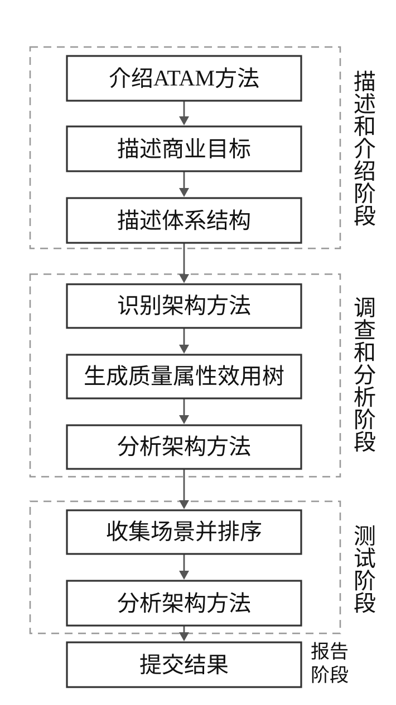
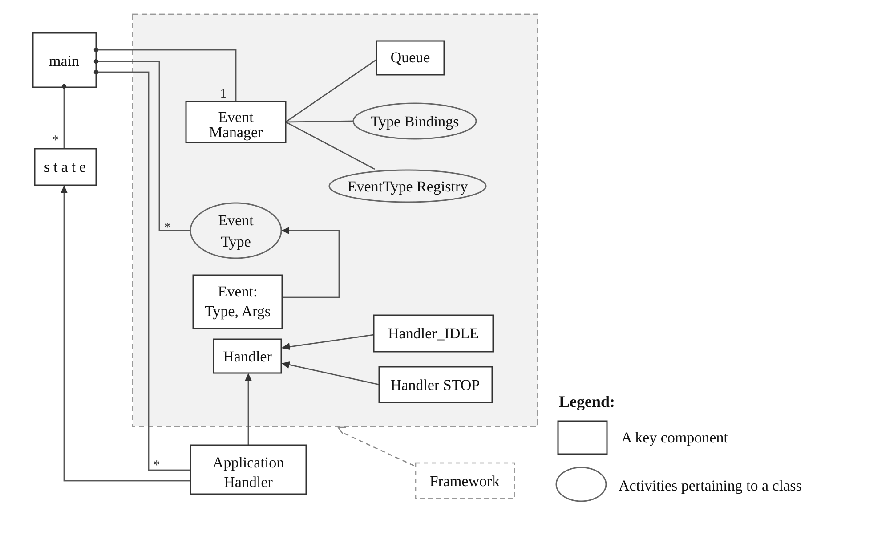
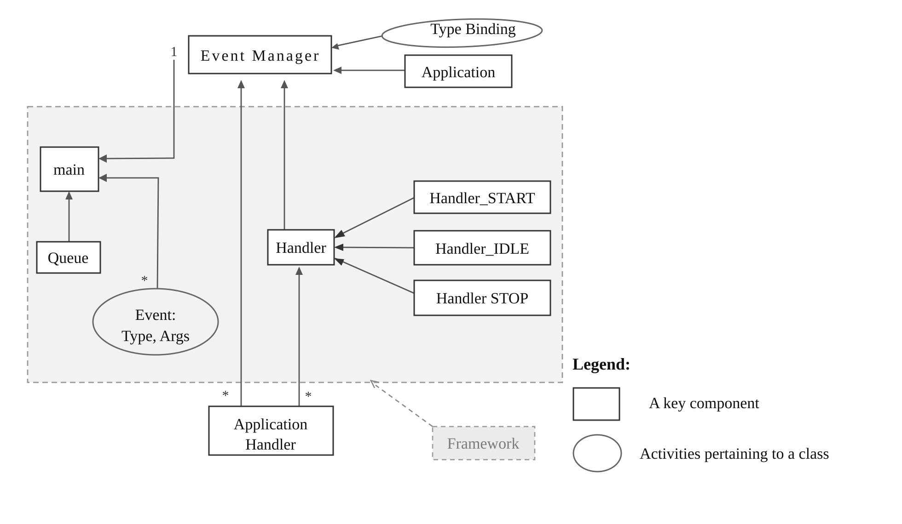
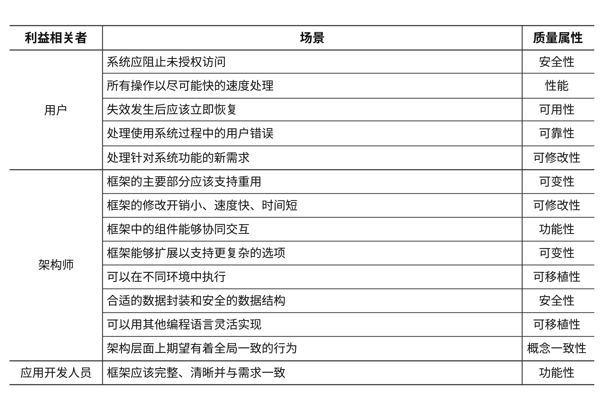
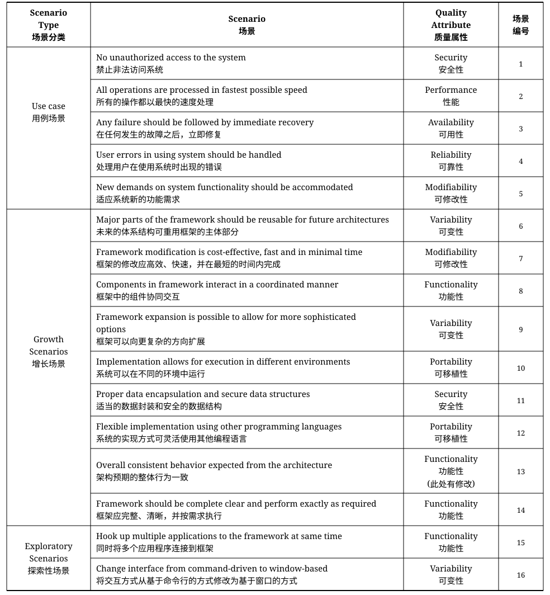
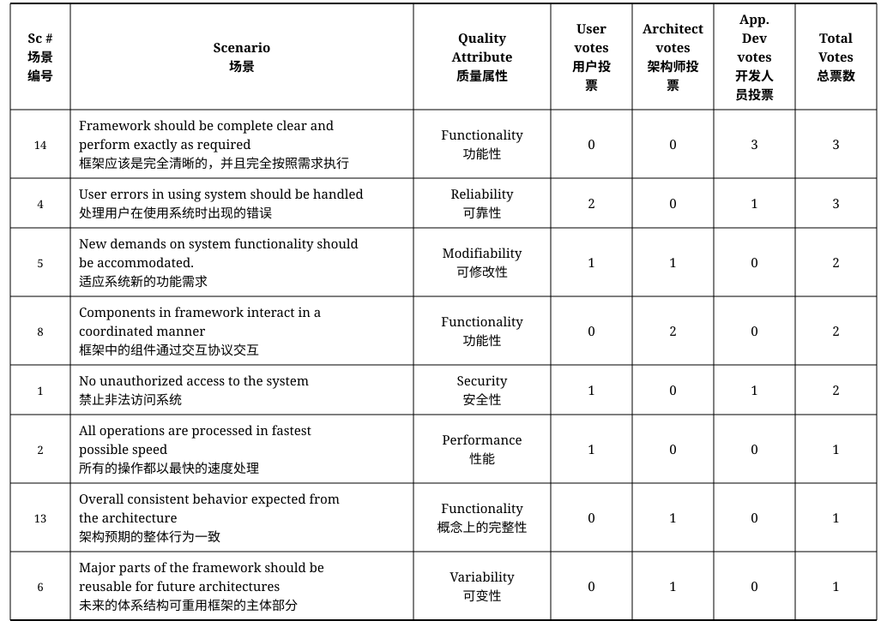
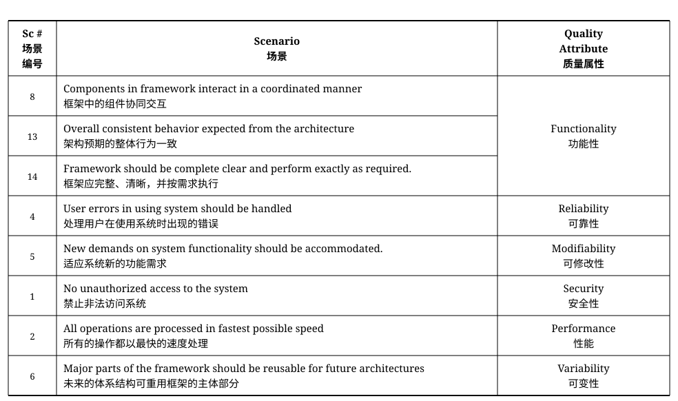

# 8.3 ATAM 方法架构评估实践

本案例把 ATAM 的九个步骤分为四组：演示、调查和分析、测试、报告评估结果（见图 8-5）。其中“测试”指邀请更多利益相关者提出场景，用这些场景检验架构方法。

> 图 8-5 ATAM 方法的评估实践阶段划分

## 8.3.1 阶段 1——演示（Presentation）

这是使用 `ATAM` 评估软件体系结构的初始阶段。此阶段有3个主要步骤。在本文中，我们将重点介绍下面的3个演示步骤。

### 第 1 步：介绍 ATAM

这一步涉及 `ATAM` 评估过程的描述。在此步骤中，评估负责人向所有相关参与者提供有关 `ATAM` 过程的一般信息。领导者说明评估中使用的分析技术以及评估的预期结果。领导者解决小组成员的任何疑虑、期望或问题。

### 第 2 步：介绍业务驱动因素

在这一步中，介绍驱动架构设计的业务目标。这一步着重于系统的业务视角。它提供了有关系统功能、主要利益相关方、业务目标和系统其他限制的更多信息。

本步骤将定义被评估系统的主要功能以及涉及的利益相关方。在对体系结构的评估工作中，应用程序使用 `Event` 框架。`Event` 框架的主要功能是接收、分派和处理事件。该任务通过框架中现有的不同组件之间的交互来完成。应用程序组件是利用框架的系统的另一部分。

评估这两种架构时考虑的主要利益相关者包括：最终用户、架构师和应用程序开发人员。这三个利益相关者在两个系统中执行不同的重要任务。最终用户通过在命令行界面向系统提供输入来使用“成品”；架构师是事件框架的创建者；应用程序开发人员负责构建使用事件框架的事件驱动的应用程序。所有利益相关者在系统中都有不同的期望和关切。

### 第 3 步：介绍要评估的体系结构

在这一步中，架构团队描述了要评估的架构。它侧重于体系结构、时间可用性以及体系结构的质量要求。此步骤中的体系结构演示非常重要，因为它会影响分析的质量。这里涉及的关键问题包括技术约束，与正在评估的系统交互的其他系统，以及为满足质量属性而实施的架构方法。系统的质量属性是代表系统所需质量的问题。这些属性的例子包括性能、可靠性等。

下面将详细介绍胡佛事件架构和“银行”事件架构。

1) 胡佛（Hoover）事件架构

胡佛事件架构的简单类图如图8-6所示，随后描述了系统及其组件。

> 图 8-6 Hoover 体系结构的简单类图

胡佛的事件架构由组成事件框架的组件和利用框架服务的应用程序组成。

如前所述，该框架基于事件框架，根据事件不同的类型进行相应处理。一个事件由两个主要部分组成：事件类型(`Event Type`)和事件需要处理的参数(`Args`)。为了处理多个事件，系统中存在一个事件队列(`Queue`)组件。

事件队列（`Event Queue`）保存待处理的事件，按先进先出（`FIFO`）的顺序提供事件。

该框架的核心组件是事件管理器（`Event Manager`）。它与事件队列交互，维护事件类型注册表（`Event Type Registry`）及类型绑定（`Type Bindings`）。注册表记录事件类型与处理程序的对应关系，一个事件类型可以关联多个处理程序。分派事件时，管理器按事件类型查找相应的处理程序。

该框架还有一个 `Handler` 组件，它是所有处理程序的基类。框架提供两种以它为基类的标准处理程序：

- `STOP handler`：此处理程序负责系统终止。
- `IDLE handler`：此处理程序执行“空闲等待”，直到用户输入一个输入事件。它将系统维持在空闲状态，直到有任意输入被提交给系统处理。

应用程序在某些定义的“挂钩”处挂钩到上述框架。如图8-6所示，灰色背景阴影区域代表了胡佛架构的框架。主进程控制事件类型和应用程序的状态，它也控制着事件管理器。应用程序处理程序可以更新系统状态；图 8-6 中的 `*` 表示多重性，应用程序可有多个处理程序。但是，只有一个事件管理器控制系统。

2) “银行”（Banking）事件架构

图8-7显示了一个简单的“银行”体系结构类图，其后是对系统及其组件的描述。

> 图 8-7 一个简单的“银行”体系结构类图

“银行”体系结构由组成事件框架的组件和利用框架服务的应用程序组成。

这个框架与上面描述的架构类似，但有一些区别。在这种架构中，事件由框架处理，图中没有单独的事件组件，而是以椭圆标出事件的类型和参数。在这种架构中，事件有两个主要部分：类型(`Type`)及其参数(`Args`)。

事件队列(`Queue`)组件对事件进行排队，并以先进先出 `FIFO` 模式进行处理。如果没有要返回的事件，则会生成“空闲”事件。

框架以 `Handler` 为处理程序的基类，提供以下三种标准处理程序，并允许应用程序扩展处理逻辑。

- `START handler`：在启动时初始化系统。
- `STOP handler`：终止系统。
- `IDLE handler`：此处理程序执行“空闲等待”，直到用户输入一个事件。当用户输入事件后，该处理程序验证输入事件是否有效。如果有效，则事件排队；否则会产生另一个空闲事件。该处理程序将系统保持在空闲状态，直到系统处理任何输入事件。

在这个架构中，主模块(`Main`)是框架的一部分。该组件将事件管理器和事件队列绑定到一起。该模块的基本功能是从事件队列中取出一个事件并将其分派给事件管理器进行处理。该组件中没有应用程序的特定信息。

在此框架中，应用程序挂接在事件管理器，应用程序处理器(`Application Handler`)也链接到此事件处理器中。框架支持定义多个系统事件和多个应用程序处理程序，但只有一个事件队列和一个事件管理器。

## 8.3.2 阶段 2——调查和分析

这是使用 `ATAM` 技术评估架构的第 2 阶段。在这个阶段，人们对评估期间需要重点关注的一些关键问题进行彻底调查。这个阶段被细分为后边的3个步骤。

### 第 4 步：确定架构方法

这一步涉及能够理解系统关键需求的关键架构方法。在这一步中，架构团队解释了架构的流程控制，并提供了关于如何达成关键目标以及是否达到关键目标的适当解释。以下是与正在评估的两种体系结构有关的两种体系结构方法的讨论。

1) 胡佛的架构

在此体系结构中，系统从空闲处理程序生成的命令提示符处接受输入。输入事件被传递给事件管理器，事件管理器将事件存储在事件队列中。主进程从事件队列中取出事件，并将其分派给事件管理器进行处理。事件管理器将事件绑定到其相应的事件处理程序。如果事件未被注册，则事件管理器丢弃该事件并将控制传递给主进程。下一个要处理的事件从事件队列中取出，并再次发送给事件管理器。如果没有要处理的事件，则会生成空闲事件，执行空闲等待，直到从系统用户接收到输入为止。如果事件在事件管理器事件注册表中已注册，则事件与正确的事件处理程序匹配。该处理程序执行该事件，可能导致系统状态的变化。

从质量属性角度来看结构，可以提出以下几点。从图8-6中可以清楚地看出框架之外的应用。框架与应用分离，有利于复用组件和修改应用。另外，这些组件相互之间适当地进行交互并执行其预期的工作，实现功能的质量属性。框架为应用程序开发者提供明确的钩子接口，应用程序可以通过这些接口扩展框架。

2) “银行”事件架构

在此体系结构中，系统由“开始”事件初始化，该事件在内部生成并处理。从空闲处理程序生成的命令提示符处接收输入。当输入事件输入时，`IDLE_Handler` 检查它的有效性，将有效事件存入队列。处理事件时，首先从队列中提取事件并分派给事件管理器进一步处理。输入已通过初步校验，事件管理器按事件类型匹配并调用相应的处理程序。如果事件队列中没有可处理的事件，则事件队列发送空闲事件。

关于这个架构中提到的质量属性，需要注意以下几点：

1. 这种体系结构的一个明显缺陷是，事件管理器组件暴露给了应用程序，没有在框架中封装（见图8-7）。因此可修改性较差。
2. 这些组件高度相互依赖，互相协同以完成特定功能。由于组件的相互依赖性，此架构的可重用性较差。
3. 空闲处理程序在事件入队前解析、校验输入。这会增加前端处理开销，也有助于尽早发现无效输入。

### 第 5 步：生成质量属性效用树

在评估阶段，系统最重要的质量属性目标被确定，并确定优先次序和完善。这一步至关重要，因为它将所有利益相关方和评估人员的注意力集中在关系到体系成功至关重要的体系结构的不同方面。这是通过建立效用树来实现的。

效用树把系统的质量目标细化为场景，并让利益相关者比较场景的重要性。每个场景描述特定条件下的刺激及期望的系统响应，供评估人员判断架构能否达到相应的质量目标。

此阶段完成的结果将成为 `ATAM` 评估步骤其余部分使用的场景优先列表。它缩小了在架构中探索的风险和架构的选择范围。因此，这一步在评估过程中是非常宝贵的。

在这个项目中， `Event` 系统有两个相互竞争的体系结构，在这一步中，将会有一棵效用树代表系统的质量目标，这些场景是代表三个利益相关者生成的：最终用户、架构师和应用程序开发人员。如上所述，质量属性需求（场景）在这一步中是非常重要的。经过仔细地思考，利益相关者会提出可能的场景。

1) 场景生成

场景生成是创建效用树之前的重要步骤。表8-9显示了与每个利益相关者有关的场景以及它所代表的质量属性。

> 表 8-9 与利益相关者有关的场景和其代表的质量属性

2) 质量属性效用树生成

效用树以“效用”作为根结点，质量属性构成效用树的辅助级别。这些属性位于表8-9中的第3列。在每个质量属性中都会包含特定的质量属性说明，以提供对方案更精确的描述。具体场景构成效用树的叶节点。每个场景按两个维度标注优先级：每个场景对系统成功的重要性以及对此场景实现（从架构师的角度来看）所带来的难易程度的估计。效用树中的优先级排名为高（`H`）、中（`M`）和低（`L`）。

### 第 6 步：分析体系结构方法

这是“调查和分析”阶段的最后一步。在这一步中，人们分析前一步生成的效用树的输出，并进行彻底调查和分析，找出处理相应质量属性架构的方法。人们根据这些质量属性分析这两种架构，并为它们提供适当的解释。这里还确定了每种架构方法的风险、非风险、敏感点和权衡点。

从步骤 5 的效用树中选取高优先级场景进行分析。例如，比较以下两个场景：

- `(L, M)` 所有操作都以最快的速度处理（性能）。
- `(H, M)` 应该处理系统中的用户错误（可靠性）。

场景旁的两个等级依次表示对系统成功的重要性和实现难度。本例中，两个场景的实现难度均为中等，第二个场景的重要性为高，因此优先分析。初步选出的高优先级场景涉及可变性、可靠性、概念完整性（Conceptual Integrity）、功能性和可修改性。性能、可用性、安全性和可移植性在这次初排中优先级较低。

这一步可分为四个主要阶段：

- 调查架构方法。

- 创建分析问题。

- 分析问题的答案。

- 找出风险、非风险、敏感点和权衡点。

1) 调查架构方法

在识别出对系统目标至关重要的质量属性后，我们分析两种架构并确定它们如何支持这些质量属性。我们对体系结构进行详细的调查，以了解这些质量属性要求是否得到满足。

1. 可变性。可变性是定义如何扩展或修改架构以生成新体系结构的属性。

   - 胡佛架构。 胡佛架构如图 8-6 所示，该框架非常灵活。`Event` 框架维护一个队列，其独立于应用程序的处理程序和事件组件。由于该应用程序未嵌入许多组件，因此该系统具有高度可修改性。例如，如果架构团队希望包含主模块调用队列的新方案，则可以在稍后阶段完成。由于架构清楚地显示了所有组件的交互作用，因此可以评估重构组件或新增组件的影响；符合既有接口的改动有机会局限在单个组件内。因此，胡佛架构高度支持可变性。
   - 银行体系结构。 如图 8-7 所示，架构的组件是高度相互依赖的，并且许多组件包含特定于应用程序的信息。例如，如果主模块调用应用程序处理程序，则事件管理器会受到影响，因为后者包含特定于应用程序的信息。但是，架构的某些部分支持可变性。例如，如果事件队列更改为绑定到事件管理器，而不是当前体系结构中的主模块，则不会影响其他组件。因此，这种架构在一定程度上支持变化。

   另外，这种架构的一个主要缺陷是事件管理器被排除在框架之外，因为它包含与应用程序相关的信息。事件管理器应该是框架内的核心组件。如果这种架构在未来得到扩展，这个缺陷将会造成很大的困难。一般而言，某些组件的更改或新组件的包含很可能会影响其他相关组件。

2. 可靠性。可靠性是决定系统响应故障的行为以及系统如何随时间运行的特性。

   - 胡佛架构。 在这个架构中的输入阶段，任何输入都是在没有消除任何“有缺陷”的输入的情况下处理的。传播有缺陷的输入直到事件绑定时的主要原因是，它是一个特定于应用程序的细节。因此，无论应用程序是否与之相关，框架保持不变。然而，最终在事件管理器组件中以适当的方式处理有缺陷的输入。因此，该体系结构支持可靠性。
   - 银行体系结构。 在此体系结构中，在空闲事件的输入活动中识别有缺陷的输入。因此，在事件存储到队列中之前，将检查类型和参数的有效性。请注意：这是一个特定于应用程序的细节。尽管这是一个与应用程序相关的活动，但在本例所述无效输入场景中，系统可以拒绝该输入并继续等待事件。但是，如果任何其他应用程序挂钩到框架，则此验证过程必须更改。

3. 概念完整性（`Conceptual Integrity`）。该属性定义了统一各级系统设计的基础主题。架构应该是一致的，在执行架构的所有进程时使用最少的数据和控制机制。

   - 胡佛架构。 在这个架构中，事件在整个系统中以类似的方式处理。无论事件类型如何，主模块都将事件传递给事件管理器，后者将事件绑定到执行该过程的处理程序。在系统中执行任何操作都涉及很少的控制机制，并且后者以有效的方式执行。因此，概念完整性得以实现。
   - 银行体系结构。 在这个架构中，所有事件都以类似的方式处理，但所使用的控制机制的数量相当多。在这个体系结构中，事件从事件队列中提取并传递给事件管理器，事件管理器相对于某些特定于应用程序的细节处理事件。处理事件后，事件管理器通过调用应用程序处理程序将该事件传播到其处理程序，处理程序依次处理该事件。虽然类似的方法被用于架构中的所有事件，但是使用的控制机制的数量可以被最小化。因此，在这个架构中，概念完整性的属性没有得到妥善处理。

4. 功能性。此属性标识系统中组件之间的交互以及系统是否执行预期的任务。

   - 胡佛架构。 如前所述，在这个架构中，组件之间展示了适当的相互作用。该体系结构还以有效的方式执行事件处理的预期任务。组件之间的交互是合理和适当的。事件队列保存事件，根据请求分派给事件管理器。另外，事件管理器与应用程序处理程序协调，并将事件绑定到相应的处理程序。因此，在这种架构中，组件间的交互支持了事件分派与处理这一预期功能。
   - 银行体系结构。 在这种架构中，组件之间存在适当的交互，系统通常适当地执行预期的任务。尽管在系统的许多组件中都嵌入了特定于应用程序的细节，但组件协调也是合理的。因此，在这种架构中适当地解决了功能问题。

5. 可修改性。顾名思义，该属性验证系统是否能够以一种快速、经济、高效的方式进行修改。它验证了体系结构如何处理对组件所做的更改，以及是否可以将任何不同的应用程序挂接到框架。

   - 胡佛架构。 在此体系结构中，可修改性的程度很高，因为所有框架组件都与应用程序分离。如果要包含任何新的特定于应用程序的组件，该体系结构有能力以经济有效的方式适应这种修改。事件管理器组件维护一个事件类型的注册表，它将每个事件注册到它的处理程序。此注册表的内容不固定，但依赖于使用事件框架的应用程序。这确保了架构中的高度可修改性。
   - 银行体系结构。 在这种架构中，应用程序嵌入在许多组件中。因此，重新使用不同应用程序的框架或添加任何新的应用程序特定组件都会涉及很多困难和修改。因此修改过程可能不是成本有效的。鉴于这些观点，这种架构没有表现出足够的可修改性。

2) 创建分析问题

本步骤的下一个阶段涉及收集上面讨论过的高优先级场景中产生的分析问题。在现实生活中，所有利益相关者都会收集分析问题。在这个项目中，我们只是简单地创建了优先场景中显著的示例问题。分析问题与上面讨论的每种架构方法相关联；并面向重要的质量属性。以下是分析问题列表和正在解决的属性：

1. 架构的组件可以重复用于未来的项目吗？（可变性）
2. 未来可以扩展框架以适应新的应用程序或新组件吗？（可变性）
3. 系统会处理用户提供的任何输入并处理无效输入吗？（可靠性）
4. 架构的行为是否一致？（概念完整性）
5. 是否可以将任何新的应用程序特定功能添加到架构中？（可修改性）
6. 系统能否在较短时间内以合理成本进行修改？（可修改性）
7. 组件是否正确交互？（功能性）
8. 体系结构是否正确执行其事件处理任务？（功能性）

3) 分析问题的答案

这一步的第三阶段是根据两种评估架构对上述分析问题提供合理的解释或答案。以下是在每个架构中如何处理这些问题的讨论。

(1)胡佛架构。

1. 架构的组件可以重复用于未来的项目吗？
   如前所述，此体系结构中的每个组件都是相互独立的，并以适当的方式进行协调。例如，无论它链接到哪个组件，事件管理器都会在使用任何注册的事件类型调用时，将事件绑定到相应的处理程序。
2. 未来可以扩展框架以适应新的应用程序或新组件吗？
   是的。这个架构可以很容易地扩展以适应符合现有扩展接口的组件和应用程序。这是由于上一个问题中给出的原因。
3. 系统是否处理用户提供的任何输入并处理无效输入？
   虽然有缺陷的输入在稍后阶段被识别，但系统会处理用户给出的所有输入并处理任何无效输入。
4. 架构的行为是否一致？
   这些事件遵循相同的分派机制。是否还可精简控制路径，需要结合实现判断。
5. 是否可以将任何新的特定于应用程序的功能添加到架构中？
   应用程序可通过框架定义的钩子增加特定功能。符合现有接口的扩展可以局限在应用侧；若需调整接口，还要检查调用方。
6. 系统是否可以在短时间内以具有成本效益的方式进行修改？
   是的。因为应用程序没有嵌入到许多组件中，并且在极小的地方与框架链接，所以可以在更短的时间内以经济高效的方式进行修改。
7. 组件是否正确交互？
   正如上述架构方法的讨论中所解释的，此架构中的组件以协调的方式进行交互。
8. 体系结构是否正确执行其事件处理任务？
   胡佛的体系结构提供了所需的结果，因为事件处理的主要任务是通过系统中各组件之间的适当交互来处理的。

(2)银行体系结构。

1. 架构的组件可以重复用于未来的项目吗？
   这些组件可以重用，但会涉及一些重大更改，因为应用程序嵌入了许多组件。但是，像事件队列这样的组件可以被重用。
2. 未来可以扩展框架以适应新的应用程序或新组件吗？
   使用框架来改变应用程序并不是一件容易的事情，因为必须对框架的主要部分进行重大更改。事件管理器组件在此体系结构中是高度特定于应用程序的，更换应用时需检查这些细节是否也要修改。出于同样的原因，添加任何新功能都需要付出很大的努力。
3. 系统是否处理用户提供的任何输入并处理无效输入？
   是的。系统处理系统用户给出的所有输入，并丢弃无效的输入事件。
4. 架构的行为是否一致？
   在这种体系结构中，一致性没有充分显示，因为控制权被转移到一系列组件中以执行任何任务。
5. 是否可以将任何新的特定于应用程序的功能添加到架构中？
   可以扩展功能，但可能需要同时修改多个组件。
6. 系统是否可以在短时间内以具有成本效益的方式进行修改？
   鉴于该应用程序嵌入到系统中涉及的许多组件中，所以修改需要更多时间，并且可能不具有成本效益优势。
7. 组件是否正确交互？
   这些组件以适当的方式进行交互（如上面在架构方法讨论中所述）。
8. 体系结构是否正确执行其事件处理任务？
   我们的体系结构提供了所需的结果，因为事件处理的主要任务得到处理，即使系统中还存在其他缺陷。

4) 找出风险、非风险、敏感点和权衡点。

此步骤的最后阶段是确定风险、非风险、敏感点和权衡点。

风险是可能妨碍质量目标实现的架构决策或遗漏；非风险是在给定场景和假设下、有理由认为能够满足目标的决策。对某个质量属性的响应有显著影响的架构参数是敏感点。同一决策对多个属性有显著影响时，需要分析它们之间的权衡（见 8.2.1 节）。表 8-10 按属性汇总本案例在所选场景下的初步判断。

> 表 8-10 两种体系结构的风险和非风险对比

(1)敏感点。

这两种体系结构的敏感点：

- 更改体系结构的范围对应用程序嵌入到系统中的位置数量很敏感。
- 错误输入的处理对应用程序中事件类型的数量很敏感（因为在验证过程中，输入事件是针对已知事件进行验证的）。
- 系统一致性水平对用于处理流程的控制机制的数量很敏感。
- 从系统获取所需输出的过程，对组件协调的方式以及彼此之间的交互方式非常敏感。
- 向应用程序添加新功能的能力，对应用程序嵌入到系统中的位置数量很敏感。

(2)权衡点。

应用程序特有逻辑的分布会影响可变性和可修改性。这个分布范围是两者共同的敏感点，也可列为候选权衡点；还需说明改变分布如何影响这两个目标。

在银行架构中，应用程序特有逻辑分布较广，这一问题更突出。胡佛架构的逻辑分布较集中。

## 8.3.3 阶段 3——测试

### 第 7 步：集思广益并确定场景优先级

这是本案例“测试”阶段的第一步。步骤 5 的效用树主要体现业务方和架构师的优先事项；此处邀请更广泛的利益相关者提出场景并确定优先级。

将头脑风暴场景的优先列表与在步骤5中从树中获得的优先场景进行比较。利益相关者需要使用头脑风暴的三种场景：

- 用例场景：描述用户或其他参与方按预期使用系统的情况。
- 增长场景：代表了架构发展的方式。
- 探索性场景：探索超出现有假设的重大变化及其影响。

这一步执行的活动如下：

- 通过头脑风暴，收集利益相关者提出的场景。
- 与提出者核实后，合并含义重复的场景。同属一种质量属性的场景可以有不同的刺激和响应，应分别保留。随后，利益相关者为最重要的场景投票。本例按以下比例分配每人的票数，并四舍五入到整数：

$$每人票数=\operatorname{round}(场景总数\times 30\%)$$

- 投票结束后，投票结果会被记录下来，场景按总票数排序。优先分析达到本轮得票门槛的场景。
- 将投票后优先分析的场景与步骤 5 的效用树对照，识别新增场景。

与效用树已有叶节点相同的场景可以对应到原节点；新增场景可以补入已有分支，必要时增设分支。

此处再次分析架构方法，用的是范围更广的利益相关者提出的场景。

本案例模拟最终用户、架构师和应用程序开发人员的意见。实际评估应邀请相应的利益相关者参与。

这里，首先介绍这一步中的头脑风暴场景列表，用于正在评估的架构中的三个利益相关者。场景列表不需要与步骤 5 中生成的场景不同，但也可以通过头脑风暴过程生成新场景。表8-11显示了编号场景的列表、类型以及所代表的质量属性。

> 表 8-11 编号场景的列表、类型以及所代表的质量属性

在这一点上，头脑风暴的场景清单已经准备就绪。下一步是让利益相关者为他们认为重要的场景进行投票。分配给每个利益相关者的票数定义如下：

$$每人票数=\operatorname{round}(16\times 30\%)=\operatorname{round}(4.8)=5$$

因此，三位利益相关者各有 5 票，共 15 票。接下来，我们模拟一个投票活动，每个利益相关者对他们最感兴趣的场景进行投票。在这个阶段，我们根据不同的利益相关者进行思考，并对各种情况进行投票。示例投票活动的结果显示在下面的表8-12中（得到0张选票的情况均不包含在此表中）。最终，根据不同的需求类别对投票结果进行整理统计，统计结果如表8-13所示。

> 表 8-12 示例投票活动的结果

场景 5 和 1 的用户投票格在电子底本中显示为短横。两行各合计 2 票，扣除另外两人的票数后，用户在两行各投 1 票。三列各计 5 票。

> 表 8-13 示例统计结果

场景 13 描述架构整体行为的一致性。表 8-12 的英文列为 Functionality，中文写作“概念上的完整性”；表 8-11 和表 8-13 将它归入功能性。这里保留案例的分组，该场景在统计中只计一次。

### 第 8 步——分析架构方法

这是“测试”阶段的最后一步。在这一步中，我们分析上一步中高优先级的质量属性。我们找到了处理这些质量属性的架构设计方案，并检查相应的架构设计方案是否可支持满足这些属性。这一步重复“调查和分析”阶段的第6步。唯一的区别在于，在步骤6中，高优先级质量属性来自效用树，而这一步需要考虑在头脑风暴投票中，高得票数的质量属性。一些在步骤6中被认为是高优先级的质量属性可能在头脑风暴的步骤中，仍被认为是高优先级的质量属性。同时，头脑风暴的过程也可能产生一些新的高优先级的质量属性。最后，分析架构设计方案中的风险、非风险、敏感点和权衡点。

从上一步的投票表中，本次获得选票的场景涉及的质量属性有功能性、可靠性、可修改性、安全性、性能和可变性。由于其中一些质量属性已经在步骤6中讨论过，所以这里只关注新出现的属于安全和性能质量属性的情况。在这一步中，仅根据这两种情况分析两种体系结构。

这一步分为四个主要阶段：

- 调查架构方法。

- 创建分析问题。

- 分析问题的答案。

- 找出风险、非风险、敏感点和权衡点。

1) 调查架构方法

1. 安全性。此属性验证系统是否有能力限制未经授权的访问，以及体系结构是否提供任何数据机密性。

   - 胡佛架构。事件管理器封装了对注册表的操作，减少其他组件直接接触注册表的机会。要判断谁能调用管理器、谁能读取相应数据，还需检查身份验证、授权规则及其执行位置。
   - 银行体系结构。应用信息分散在多个组件中，需要核实各处的访问权限。图中仅由事件管理器调用应用程序处理程序，这能说明调用关系；数据机密性还取决于哪些主体实际能读取数据。

2. 性能。该属性使我们能够了解系统的响应性。性能因素通常表示为每单位时间的交易次数或执行一次交易所花费的时间。

   - 胡佛架构。命令驱动的系统也可测量单位时间处理的事务数。该架构的事件处理路径涉及较少组件，可在给定工作负载下测量吞吐量及从输入到处理完成的响应时间。
   - 银行体系结构。处理一个事件涉及较多组件，额外调用可能带来开销。要比较两种架构，应在相同工作负载和资源条件下测量，并计入排队及各组件的处理时间。

2) 创建分析问题

以下问题来自利益相关者投票选出的安全性和性能场景。

1. 系统是否允许未经授权的访问？（安全性）
2. 架构如何保护数据机密性？（安全性）
3. 在约定负载下，事件处理能否满足响应时间目标？（性能）

3) 分析问题的答案

现在我们在这两种体系结构中找到这些分析问题的合理答案。

(1)胡佛架构。

1. 系统是否允许未经授权的访问？
   框架限制了对注册表的直接调用。应用程序还需按调用者身份实施授权，才能判断具体的未授权请求是否会被拒绝。
2. 架构如何保护数据机密性？
   封装缩小了需要检查的访问范围。还需核对敏感数据的实际流向和读取权限。
3. 在约定负载下，事件处理能否满足响应时间目标？
   本例给出了较短的处理路径，没有给出负载、目标时限和实测响应时间，尚不能确定是否达标。

(2)银行体系结构。

1. 系统是否允许未经授权的访问？
   图中可以识别受限的组件调用关系。要判断是否允许未授权访问，还需核实各入口的授权检查。
2. 架构如何保护数据机密性？
   应用信息分布在多个组件中，应逐处核查其访问权限。仅凭分布范围无法判断是否发生机密性问题。
3. 在约定负载下，事件处理能否满足响应时间目标？
   处理事件涉及较多组件，可能增加调用开销；是否超过时限仍需在约定负载下验证。

4) 找出风险、非风险、敏感点和权衡点。

（1）风险与非风险见表 8-14。该表保留案例依据架构图所作的初步分类。“—”表示本例未列出相应项目；安全性和性能仍需分别用访问控制证据和测量结果验证。

> 表 8-14 两种体系结构涉及的风险和非风险

(2)敏感点。

- 应用信息的分布范围可能影响维护机密性的难度。
- 处理路径中的组件数量和每个组件的开销可能影响响应时间。

(3)权衡点。

结合上述敏感点和步骤 6 的分析，案例列出两个候选权衡点：

- 应用程序嵌入的地点数量。
- 处理任务所涉及的组件数量。

胡佛架构把应用细节与框架分离，示例处理路径涉及的组件较少。银行架构的应用细节较分散，处理路径较长。要确定实际权衡，应结合具体的修改、安全和性能场景，比较这些设计选择的收益和代价。

## 8.3.4 阶段 4——报告评估结果

在第 9 步，ATAM 团队向利益相关者报告评估中使用的场景、分析依据及主要发现。

`ATAM` 团队的主要发现通常包括：

- 一种效用树；
- 一组生成的场景；
- 一组分析问题；
- 识别出的风险、非风险、敏感点和权衡点；
- 确定的架构方法。

报告中包含的所有内容在前述的8个步骤中已经进行了介绍。
