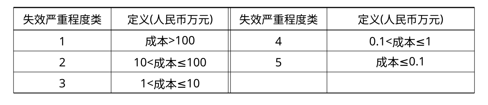
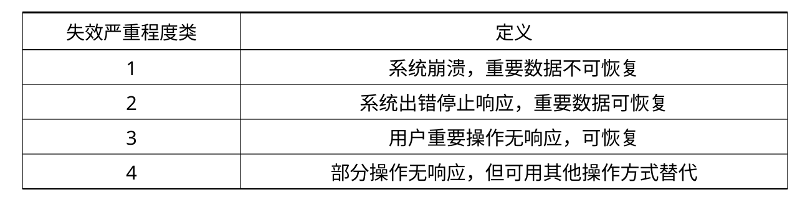
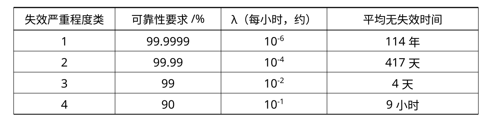
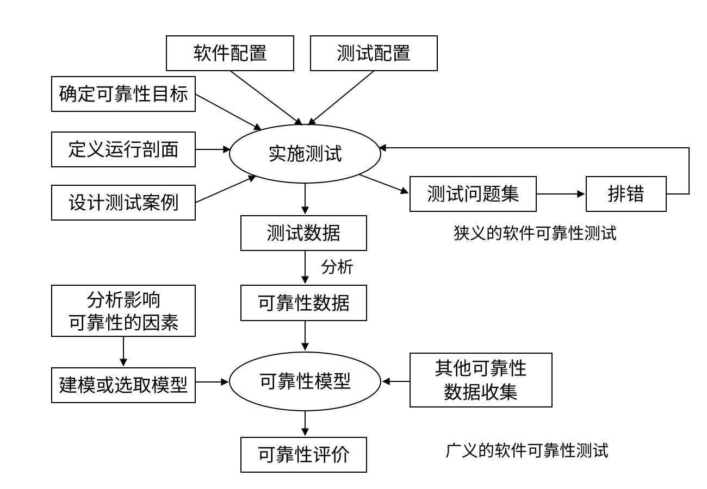

# 9.1 软件可靠性基本概念

在现代军事和商用系统中，以软件为核心的产品得到了广泛的应用。随着系统中软件成分的不断增加，系统对软件的依赖性越来越强，对软件可靠性的要求也越来越高。软件可靠性技术研究成为当今可靠性工程研究领域中一个重要领域。

国外从 20 世纪 60 年代后期开始加强对软件可靠性的研究工作，此后陆续提出各种可靠性模型和预测方法，并于 1990 年前后形成了较为系统的软件可靠性工程体系。同时，从 20 世纪 80 年代中期开始，西方各主要工业强国均确立了专门的研究计划和课题，如英国的 Alvey 信息技术研究计划、欧洲的 `ESPRIT`(欧洲信息技术研究与发展战略)计划、`SPMMS`(软件生产和维护管理保障)课题和 `Eureka`(尤里卡)计划等。每年都有大量的人力、物力投入到软件可靠性研究项目中，并取得了一定的成果。

国内的软件可靠性研究也涉及量化理论、度量标准（指标体系）、建模技术、设计方法和测试技术等方面。

## 9.1.1 软件可靠性定义

软件可靠性(`Software Reliability`)是软件产品在规定的条件下、规定的时间区间内完成规定功能的能力。规定的条件是指直接与软件运行相关的使用该软件的计算机系统的状态和软件的输入条件，或统称为软件运行时的外部输入条件；规定的时间区间应注明所用的时间基准；规定功能是指为提供给定的服务，软件产品所必须具备的功能。

软件与硬件有很多不同点，但从可靠性的角度来看，它们主要有如下 4 个不同点。

1. 复杂性。软件逻辑可能高度复杂，设计或实现缺陷是软件失效的重要原因。硬件也可能因设计缺陷而失效。
2. 物理退化。软件本身不会像硬件那样因物理磨损而退化；其可靠性要在规定的运行条件和任务时间内评价。然而，一个正确的硬件元器件或系统，则可能在某个时刻失效。
3. 复制的一致性。同一版本软件的精确副本具有相同的程序逻辑和固有缺陷，而硬件个体可能存在制造差异。对相同的软件副本，可以利用输入和运行条件的概率分布来描述软件失效的可能性。
4. 版本更新较快。与已定型的硬件相比，软件较易在发布后变更。需求变化或缺陷修复可能带来版本更新，评估时需要区分不同版本的运行数据。

1983 年，美国 IEEE 计算机学会对“软件可靠性”做出了明确的定义，随后，此定义经美国标准化研究所批准为美国的国家标准。在 1989 年，我国国家标准 `GB/T 11457` 也采用了这个定义。这个定义就是：在规定的条件下，在规定的时间内，软件不引起系统失效的概率，该概率取决于软件中存在的缺陷、系统输入和使用方式；不同输入可能触发不同缺陷。

简言之，就是在规定的时间周期内，在所述条件下程序执行所要求的功能的能力。显而易见，美国 IEEE 计算机学会关于“软件可靠性”的定义仍然沿用了“产品可靠性”的定义，但有了更具体的定位和更深入的描述。

下面来分析一下软件可靠性的框架性定义。

(1)规定的时间。

评价软件在使用中的可靠性时，可以将运行时间作为时间基准。“运行时间”包括软件系统运行后工作与挂起(开启但空闲)的累计时间。由于软件运行的环境与程序路径选取的随机性，软件的失效为随机事件，所以可将规定使用条件下的首次失效时间作为随机变量。

(2)规定的条件。

规定的条件主要指软件的运行环境。它涉及软件系统运行时所需的各种支持要素，如支持硬件平台(服务器、台式机和网络平台等)、操作系统、数据库管理系统、中间件，以及其他支持软件、输入数据格式和范围及操作规程等。不同环境条件下，软件的可靠性可能不同。评估时应记录计算机配置、输入数据要求，以及对其他运行条件作出的假设。有了明确规定的环境条件，有助于区分规定条件内的失效与超出使用条件的情况。

(3)所要求的功能。

软件可靠性还与规定的任务和功能有关。由于要完成的任务不同，软件的运行情况会有所区别，则调用的子模块就不同(包括程序选择路径不同)，其可靠性也就可能不同。所以，要准确度量软件系统的可靠性，必须先明确它的任务和功能。

(4)“软件可靠性”定义具有以下特点。

①用内在的“缺陷”和外在的“失效”关系来描述可靠性，更能深刻地体现软件的本质特点。

②定义使人们对软件可靠性进行量化评估成为可能。对于软件的可靠性这样一个质量特性，很难用一个明确直观的数值去体现。而依据这个定义，人们有可能通过分析影响可靠性的因素，用函数的形式，按照不同的目的建立各种数学模型去分析软件可靠性。

③可靠性可以用概率描述。即使程序逻辑是确定的，输入和运行状态仍会随使用情况而变化。缺陷被触发后，其影响也可能被屏蔽。因此，可靠度关注规定条件和时间内没有发生可观察失效的概率。

## 9.1.2 软件可靠性的定量描述

从软件可靠性的定义可以看到，软件的可靠性可以用基于使用条件、规定时间、系统输入、系统使用和软件缺陷等因素的数学表达式来描述。下面从可靠性定义中的术语“规定时间”“失效概率”开始，探讨软件可靠性的定量描述，并相应地引入一些概念。

### 1. 规定时间

对于“规定时间”有 3 种概念：一种是自然时间，也就是日历时间，指人们日常计时用的年、月、周、日等自然流逝的时间段；一种是运行时间，指软件从启动开始，到运行结束的时间段；最后一种是执行时间，指软件运行过程中，中央处理器(`CPU`)执行程序指令所用的时间总和。

例如，某单位有一套供会计人员使用的财务软件，我们来关注一整天的时间，上午 9:00 上班开机运行，下午 5:00 下班退出程序。在这里，自然时间是一天，也就是 24 小时，运行时间是 8 个小时，而 CPU 处理程序的执行时间可能不到 2 小时，这要视会计的业务繁忙状况、使用软件的频度和软件本身的设计而定。

选用哪一种时间基准取决于任务和运行方式。例如，关注处理器工作量时可采用执行时间，要求连续提供服务时可采用运行时间。如果运行的软件系统处于一种相对稳定的工作状态，可以根据一定的经验值，按一定的换算比例，对这三种时间进行折算。

### 2. 失效概率

从软件运行开始，到某一时刻 `t` 为止，设首次失效时间为随机变量 `T`，到 `t` 时刻至少发生一次失效的概率为分布函数 `F(t)=P(T≤t)`。根据我们对软件可靠性的分析，函数 `F(t)` 有如下特征。

1. `F(0)=0`，这里假设系统在初始时刻正常。
2. `F(t)` 在时间域 `(0,+∞)` 上是单调不减的。
3. 若假设首次失效最终必然发生，则 `F(t)` 随时间趋于 1。单凭软件存在缺陷，不能推出该缺陷在给定使用条件下一定引发失效。

为了简化分析，把 `F(t)` 看作关于时间 `t` 的一个连续函数，并且可导。

### 3. 可靠度

人们用来表示可靠性最为直接的方式就是可靠度，根据可靠性的定义，可靠度就是软件系统在规定的条件下、规定的时间内不发生失效的概率。如果用 `F(t)` 来表示到 `t` 时刻止，软件已出现失效的概率，则可靠度的公式为

```text
R(t) = 1 - F(t)    (9-1)
```

在上述初始正常且最终必然失效的假设下，`R(0)=1`，且 `R(t)` 随时间趋于 0。

### 4. 失效强度

对于可能反复失效的系统，用 `N(t)` 表示截至 `t` 的累计失效次数。平均失效强度（Failure Intensity）是预期累计失效次数随时间的变化率，即 `dE[N(t)]/dt`。若只考察首次失效，区间 `(t,t+Δt]` 的失效概率为 `F(t+Δt)-F(t)`。除以区间长度并取极限，得到首次失效时间的概率密度 `f(t)`。在 `R(t)>0` 时，已运行至 `t` 而未失效的条件失效率为 `h(t)=f(t)/R(t)`。概率密度为

```text
f(t) = lim_{Δt→0} (F(t+Δt)-F(t))/Δt = F'(t)    (9-2)
```

### 5. 平均失效前时间

可靠度为 `R(t)` 的系统平均失效前时间(`Mean Time To Failure`，`MTTF`)定义为从 `t=0` 时到首次失效时的运行时间的期望值：

```text
MTTF = ∫_0^∞ R(t)dt
```

对于不可修复系统，用时间度量寿命时，系统的平均寿命指发生失效前的平均工作（或存储）时间，也称为系统在失效前的平均时间。`MTTF` 取决于规定条件下的失效时间分布；是否计入老化造成的失效，应按研究对象和失效定义确定。

### 6. 平均恢复前时间

平均恢复前时间(`Mean Time To Restoration`，`MTTR`)是随机变量恢复时间的期望值，就是从发生失效到恢复规定服务所经过的时间，包括检测、诊断、修复和重新投入使用所需的时间。`MTTR` 越短表示易恢复性越好。

### 7. 平均故障间隔时间

`MTBF`(`Mean Time Between Failures`，平均故障间隔时间)用于可修复系统，表示相邻两次失效之间的平均间隔。统计时应说明采用工作时间还是包含停机时间的日历间隔。

若每次恢复后系统可视为更新，且按包含停机的日历间隔计量，一个周期由恢复前的停机时间和恢复后至下次失效的工作时间组成，因此有：

```text
按日历时间计的平均相邻失效间隔 = MTTF + MTTR
```

当讨论完对软件可靠性的定量描述问题之后，需要对软件可靠度这个直接反映软件可靠性的度量指标作下列补充说明。

1. 描述的软件对象必须明确，即需指明它与其他软件的界限。
2. 软件失效必须明确定义。
3. 若只评价软件本身，可规定硬件正常、输入符合约定；若任务包括处理异常输入或硬件故障，则应把这些条件纳入评价。
4. 运行环境包括硬件环境、软件支持环境和确定的软件输入域。
5. 规定的时间必须指明时间基准，可以是自然时间(日历时间)、运行时间、执行时间(`CPU` 时间)或其他时间基准。
6. 本节用概率度量无失效运行的机会。采用模糊模型时，可以使用可能性度量，但不能把它直接当作概率。
7. 上述定义是在时间域上进行的，这时软件可靠度是一种动态度量。也可以是在数据域上将软件可靠度定义为一种静态度量，表示软件成功执行一个回合的概率。软件回合(`Run`)是指软件在规定环境下的一个基本执行过程，如给定一组输入数据，到软件给定相应的输出数据这一过程。在这种按回合建模的方法中，应先界定一次执行的起点和终点，再统计各回合的结果。
8. 有时将软件运行环境简单地理解为软件运行剖面(`Operational Profile`)。欧空局(`ESA`)标准 `PSS-01-21(1991)`“ESA 软件产品保证要求”中，“软件运行剖面”的定义为：“对系统使用条件的定义。系统的输入值都用其按时间的分布或按它们在可能输入范围内的出现概率的分布来定义”。简单来说，运行剖面描述规定使用条件下各类操作或输入及其出现概率，可据此选择测试数据；硬件、软件环境等条件还需另行说明。

## 9.1.3 可靠性目标

前面定量分析软件的可靠性时，使用失效强度来表示软件失效发生的频繁程度。然而在实际情况中，对软件运行的影响程度不仅取决于软件失效发生的概率，还和软件失效的严重程度有很大关系。这里引出另外一个概念——失效严重程度类(`Failure Severity Class`)。

失效严重程度类就是对用户具有相同程度影响的失效集合。

对失效严重程度的分级可以按照不同的标准进行，最为常见的是按对成本影响、对系统能力的影响等标准划分软件失效的严重程度类。

对成本的影响可能包括失效引起的额外运行成本、修复和恢复成本、现有或潜在的业务机会的损失等。当失效造成的成本相差较大时，可按数量级设置成本分级的阈值。

表 9-1 给出了一个按照对成本的影响划分失效严重程度类的例子，这个例子涉及的软件系统是某电子商务运营系统。



> 表 9-1 按照对成本的影响划分失效严重程度类

对系统能力的影响常常表现为关键数据的损失、系统异常退出、系统崩溃、导致用户操作无效等。对于不同性质的软件系统，相同的表现可能造成的失效严重程度是不同的，例如对可用性要求较高的系统，导致长时间停机的失效常常会划分到较高的严重级别中去。

表 9-2 给出了一个按照对系统能力的影响划分失效严重程度类的例子，这个例子涉及的软件系统是某电信实时计费系统。



> 表 9-2 按照对系统能力的影响划分失效严重程度类

有了失效严重程度的划分，现在可以结合失效强度来定量地表示一个软件系统的可靠性目标了。

可靠性目标是用户对软件在规定条件和时间内完成规定功能的要求。通常用可靠度、失效强度和平均失效前时间（`MTTF`）等指标来描述，根据不同项目的不同需要而定。建立定量的可靠性指标需要对可靠性、交付时间和成本进行平衡。为了定义系统的可靠性指标，必须确定系统的运行模式，划分失效严重程度等级，并确定相应的失效强度目标。

例如，对于表 9-1 的例子，可以根据经验和用户的需求确定软件系统需要达到的可靠程度，表 9-3 给出前四类的参考目标。为说明换算，取任务时间为 1 小时，并假定失效率 λ 恒定：此时 R(t)=exp(−λt)，MTTF=1/λ。表中的 λ 和时间均为近似值。



> 表 9-3 可靠性目标参考表

## 9.1.4 可靠性测试的意义

软件可靠性问题已被越来越多的软件工程专家所重视，人们已开始投入大量的人力、物力去研究软件可靠性的设计、评估和测试等课题。以下多个方面可以反映出软件可靠性问题对软件工程实践，乃至对生产活动和社会活动产生的深远影响。

1. 软件失效可能造成灾难性的后果。例如，飞行控制软件失效可能使控制系统发出错误指令。而目前由于计算机和软件在各行各业中应用的日益广泛和深入，例如军用作战系统、民航指挥系统、银行支付系统和交通调控系统等，一旦发生严重级别的软件失效，轻则造成经济损失，重则危及人们的生命安全，危害国家安全。
2. 软件是计算机系统失效的可能来源之一。软件相关失效所占比例取决于系统类型及统计口径。软件系统的结构可能十分复杂，一个较简单的程序，其所有的路径数就可能是一个天文数字。在软件开发的过程中，很难用全路径覆盖方式的测试去发现软件系统中隐藏的所有缺陷，也就是说，很难完全排除软件缺陷。
3. 软件和硬件的失效机理不同，采用可靠性分析技术时需要结合分析对象。例如在硬件可靠性领域，故障树分析(`Fault Tree Analysis`，`FTA`)、失效模式与效应分析(`Failure Modes and Effects Analysis`，`FMEA`)等技术比较成熟，容错技术也有广泛应用，在软件可靠性分析中，应结合软件的状态、控制流程和运行环境使用这些技术。
4. 软件失效会带来诊断、修复、恢复服务等成本，因此需要在开发中考虑可靠性。
5. 计算机技术获得日益广泛的应用，随着计算机应用系统中软件成分的不断增加，使得系统对于软件的依赖性越来越强，软件对生产活动和社会生活的影响越来越大，从而增加了软件可靠性问题在软件工程领域乃至整个计算机工程领域的重要性。

软件可靠性问题的重要性凸显了发展用于预防缺陷的可靠性设计技术，以及用于发现缺陷和评价可靠性的测试技术的迫切性。

## 9.1.5 广义的可靠性测试与狭义的可靠性测试

广义的软件可靠性测试是指为了最终评价软件系统的可靠性而运用建模、统计、试验、分析和评价等一系列手段对软件系统实施的一种测试。一个完整的软件可靠性测试包括如图 9-1 所示的过程。



> 图 9-1 广义的软件可靠性测试

狭义的软件可靠性测试是指为了获取可靠性数据，按预先确定的测试用例，在软件的预期使用环境中，对软件实施的一种测试。狭义的软件可靠性测试也叫“软件可靠性试验”(`Software Reliability Test`)，它按预期使用方式运行软件，观察并记录失效，每一次测试代表用户将要完成的一组操作，使测试成为最终产品使用的预演。当测试用例和环境能代表实际运行剖面时，所获得的数据可用于估计实际使用中的可靠性。

其实，软件可靠性测试是软件测试的一种形式，和易用性测试、性能测试、标准符合性测试等前面介绍的测试类型一样，是针对软件的某个重要质量特性，使用一定的测试用例对软件进行测试的过程。

可靠性测试是对软件产品的可靠性进行调查、分析和评价的一种手段。它不仅仅是为了用测试数据确定软件产品是否达到可靠性目标，还要对检测出的失效的分布、原因及后果进行分析，并给出纠正建议。总的来说，可靠性测试的目的可归纳为以下 3 个方面。

1. 发现软件系统在需求、设计、编码、测试和实施等方面的各种缺陷。
2. 为软件的使用和维护提供可靠性数据。
3. 依据试验数据和规定的统计准则，评估软件是否达到定量可靠性要求。
