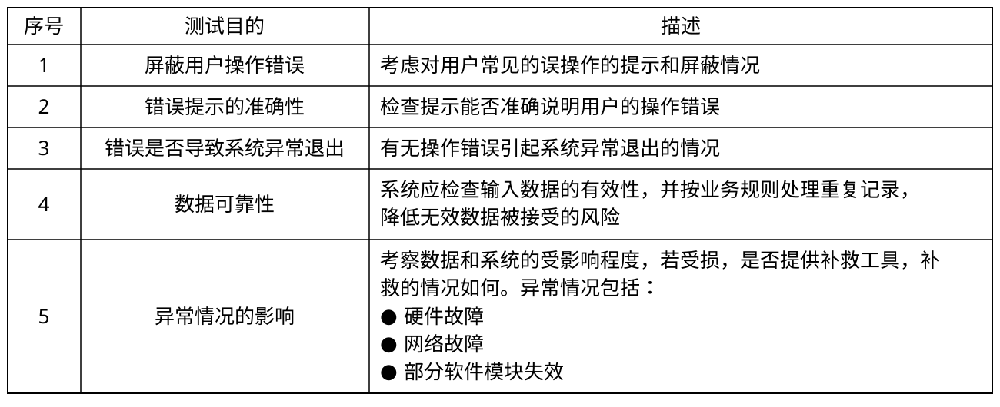

# 9.5 软件可靠性测试

## 9.5.1 软件可靠性测试概述

软件测试者可以使用很多方法进行软件测试，如按行为或结构来划分输入域的划分测试，纯粹随机选择输入的随机测试，基于功能、路径、数据流或控制流的覆盖测试等。对于给定的软件，每种测试方法都局限于暴露一定数量和一些类别的缺陷。测试可暴露失效，后续诊断和修复可消除某些缺陷，实现一定意义上的软件可靠性增长。针对特定缺陷或覆盖目标挑选的用例，通常不能直接代表实际使用。按目标运行剖面随机抽样所得的结果，则可在相应统计假设下用于可靠性评价。

软件可靠性测试由可靠性目标的确定、运行剖面的开发、测试用例的设计、测试实施、测试结果的分析等主要活动组成。

软件可靠性测试还必须考虑对软件开发进度和成本的影响，最好是在受控的自动测试环境下，由专业测试机构完成。

软件可靠性测试是一种有效的软件测试和软件可靠性评价技术。尽管软件可靠性测试也不能保证软件中残存的缺陷数最少，但有代表性的试验可在给定置信水平下检验软件是否达到规定的可靠性目标，对于开发高可靠性与高安全性软件系统很有帮助。

软件可靠性测试要在工程上获得广泛应用，还有许多实际问题需要解决。

## 9.5.2 定义软件运行剖面

定义运行剖面首先需要为软件的使用行为建模，建模可以采用马尔可夫链来完成。从用户角度把软件使用过程表示为一组状态及其间的转移。采用马尔可夫链时，给定当前状态后，下一步转移的概率不再依赖更早的状态历史。弧用来连接状态并表示由各种激励导致的转换，这些激励可能由硬件、人机接口或其他软件等产生。将转换概率分配给每个弧，表示在当前状态下各后继转换发生的条件概率；同一状态所有可能转移的概率之和为 1。这里采用的是有限状态离散时间马尔可夫链，这类模型可以用有向图或转换矩阵表示。

定义运行剖面的下一步是开发使用模型，明确需要测试的内容。软件系统可能会有许多用户和用户类别，每类用户都可能以不同的方式使用系统。开发使用模型涉及将输入域分层，有两种类型的分层形式：用户级分层和用法级分层。用户级分层依赖于谁或什么能激励系统；用法级分层依赖于在测试状态下系统能做什么。换句话说，用户级分层考虑各种类型的用户以及他们如何使用系统；用法级分层则要求考虑系统能够提供的所有功能。一旦用户和用法模型被开发出来，弧上的概率将被分配。这些概率估计主要是基于如下几个方面。

1. 从现有系统收集到的数据。
2. 与用户的交谈或对用户进行观察获得的信息。
3. 原型使用与测试分析的结果。
4. 相关领域专家的意见。

估计使用概率时，优先采用能代表目标使用情况的用户数据；原型或前一版本的数据需检查其适用性；其次是由该软件应用领域的用户和专家提供的预期使用数据；在没有任何数据可用的情况下，若暂将同一状态的各条出弧设为等概率，应标明这是一项待验证的假设。

由于软件可靠性行为是相对于软件实际的运行剖面而言的，同一软件在不同运行剖面下其可靠性表现可能大不相同，所以用于可靠性测试准备的运行剖面的开发与定义必须充分分析和考虑软件的实际运行情况。

运行剖面描述各操作的使用频率；不同操作在执行时发生失效的条件概率可以不同。因此，常用操作不一定具有最高的单次失效概率。典型的例子是飞机的飞行控制软件，在正常飞行、起飞、降落、地面运动和地面等待这 5 个状态中，即使起飞和降落的时间占比较低，也需要按它们的失效后果设计测试。对于高安全性要求的软件，一个看起来很少使用的代码路径也可能带来灾难性的后果。因此，对于边界、跃迁情况和关键功能不应该用简单的运行剖面来对待，应该构造专门的运行剖面，补充统计模型之外的测试用例。在覆盖率水平不够时，可根据具体空白，进行适当的补充测试。如果补充测试发现了错误，就可分析这些错误，估计其对可靠性产生的影响。

一个产品有可能需要开发多个运行剖面，这取决于它所包含的运行模式和关键操作，通常需要为关键操作单独定义运行剖面。

## 9.5.3 可靠性测试用例设计

为了对软件可靠性进行良好的预计，必须在软件的运行域上对其进行测试。首先定义一个相应的剖面来镜像运行域，然后使用这个剖面驱动测试，这样可以使测试真实地反映软件的使用情况。

由于可能的输入几乎是无限的，测试必须从中选择出一些样本，即测试用例。测试用例要能够反映实际的使用情况，反映系统的运行剖面。将统计方法运用到运行剖面开发和测试用例生成中去，并为在运行剖面中的每个元素都定量地赋予一个发生概率值和关键因子，然后根据这些因素分配测试资源，挑选和生成测试用例。

在这种测试中，优先测试那些最重要或最频繁使用的功能，优先处理高风险，有助于尽早发现那些对可靠性有最大影响的故障，为交付决策提供依据。

设计测试用例就是针对特定功能或组合功能设计测试方案，并编写成文档。测试用例的选择既要有一般情况，也应有极限情况以及最大和最小的边界值情况。因为测试的目的是暴露应用软件中隐藏的缺陷，所以在设计选取测试用例和数据时要考虑那些易于发现缺陷的测试用例和数据，结合复杂的运行环境，在所有可能的输入条件和输出条件中确定测试数据，来检查应用软件在所选用例下能否产生预期输出。

一个典型的测试用例应该包括下列组成部分。

1. 测试用例标识。
2. 被测对象。
3. 测试环境及条件。
4. 测试输入。
5. 操作步骤。
6. 预期输出。
7. 判定实际结果是否符合预期的准则。
8. 测试对象的特殊需求。

由于可靠性测试的主要目的是评估软件系统的可靠性，因此，除了常规的测试用例集仍然适用外，还要着重考虑和可靠性密切相关的一些特殊情况。在测试中，可以考虑进行“强化输入”，即比正常输入更严苛但仍合理的输入。应把这类定向测试与按运行剖面抽样的测试分开记录。表 9-4 给出了一些参考实例。

> 表 9-4 可靠性测试用例设计时重点考虑的特殊情况

## 9.5.4 可靠性测试的实施

在进行应用软件的可靠性测试前有必要检查软件需求与设计文档是否一致，检查软件开发过程中形成的文档的准确性、完整性以及与程序的一致性，检查所交付程序和数据以及相应的软件支持环境是否符合要求。

这些检查虽然增加了工作量，但对于在测试早期发现错误和提高软件的质量是非常必要的。

软件可靠性测试必须是受控测试，在运行此类测试时，为了保证统计数据的有效性，评估某一固定版本时，各样本应来自该版本；若修复后换版，应分版记录，或使用明确考虑版本变化的可靠性增长模型。

在有些情况下，不能进行纯粹的可靠性测试。因为客户的要求、合同的规定或者标准的约束，需要补充其他形式的非统计测试。这时的最佳选择是既执行可靠性测试，也执行非统计测试(如覆盖测试)。两类测试的先后顺序本身不决定统计有效性。应区分抽样方式、软件版本和测试环境；发现新失效后还应重新判断原评价是否适用于拟交付版本。

软件可靠性测试同样依赖于软件的可测试性。可靠性测试的难点就在于判断测试用例的运行是成功还是失败。在控制系统及类似的软件中，失效由详细说明、时间(通常是 `CPU` 时间或时钟时间)来客观地定义。一般应用系统也应依据规格和验收准则判定失效。若用户期望尚未量化，应在测试前明确相应的功能或性能判据。在一些科学计算中，计算结果只能由计算机给出，在这种情况下，如果软件给出错误的数值结果而仍正常退出，仅检查退出状态可能发现不了这种失效。此时可以将测试分成两个阶段进行。第一阶段运行较少量的测试用例，并对照规范进行仔细检查。第二阶段再运行大量测试用例。第二阶段不用人工检查输出的每项内容，而是找失效现象，包括错误信息、断电、崩溃和死机。也可把输出记录到文件中，采用搜索或过滤方法进行处理。如果软件有足够的可测试性，这种方法可发现部分严重失效，但未报警并不证明输出正确。对难以直接核验的计算结果，还可采用独立参考结果、可检查的性质或形式化方法辅助验证。

开发方交付的任何软件文档中与可靠性质量特性有关的部分、程序以及数据都应当按照需求说明和质量需求进行测试。在项目合同、需求说明书和用户文档中规定的所有配置情况下，程序和数据都必须进行测试。

软件可靠性数据是可靠性评价的基础。为了获得更多的可靠性数据，可以在可比环境中并行运行同一版本，并记录各实例的工作负载和运行时间；合并数据时要考虑重复输入或共同故障造成的相关性。应该建立软件错误报告、分析与纠正措施系统。按照相关标准的要求，制定和实施软件错误报告和可靠性数据收集、保存、分析和处理的规程，完整、准确地记录软件测试阶段的软件错误报告和收集可靠性数据。

用时间描述的失效数据可分为四类。已知观测起点时，逐次失效时刻与失效间隔可以互算；按相同区间记录的失效数与累计失效数也可以互算。但只有分组计数时，不能还原组内各次失效的准确时刻。

1. 失效时间数据：记录从共同的观测起点到每次失效所经历的时间。
2. 失效间隔时间数据：记录本次失效与上一次失效间的间隔时间。
3. 分组时间内的失效数：记录某个时间区内发生了多少次失效。
4. 分组时间的累积失效数：记录截至某个区间末的累积失效数。

在测试过程中必须真实地进行记录，每个测试记录必须包含如下信息。

1. 测试时间。
2. 含有测试用例的测试说明或标识。
3. 所有与测试有关的测试结果，包括失效数据。
4. 测试人员。

测试活动结束后要编写《软件可靠性测试报告》，对测试用例及测试结果在测试报告中加以总结归纳。编写时教材举例参考历史版本 `GJB 438A-97` 中的《软件测试报告》格式，并应根据情况进行裁剪。测试报告应具备如下内容。

1. 软件产品标识。
2. 测试环境配置(硬件和软件)。
3. 测试依据。
4. 测试结果。
5. 测试问题。
6. 测试时间。

把可靠性测试过程进行规范化，有利于获得真实有效的数据，为最终得到客观的可靠性评价结果奠定基础。
