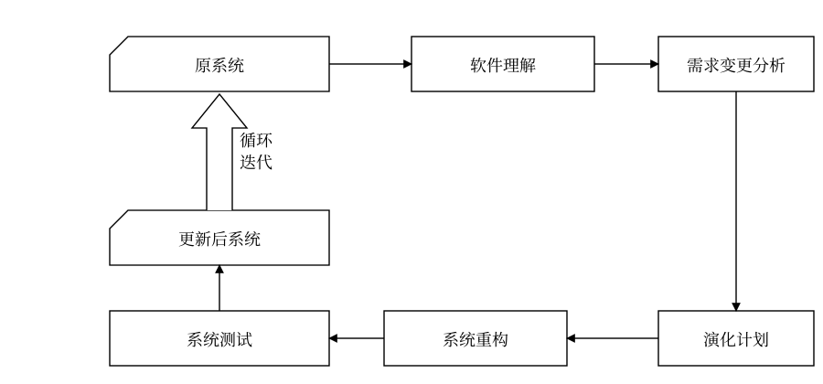
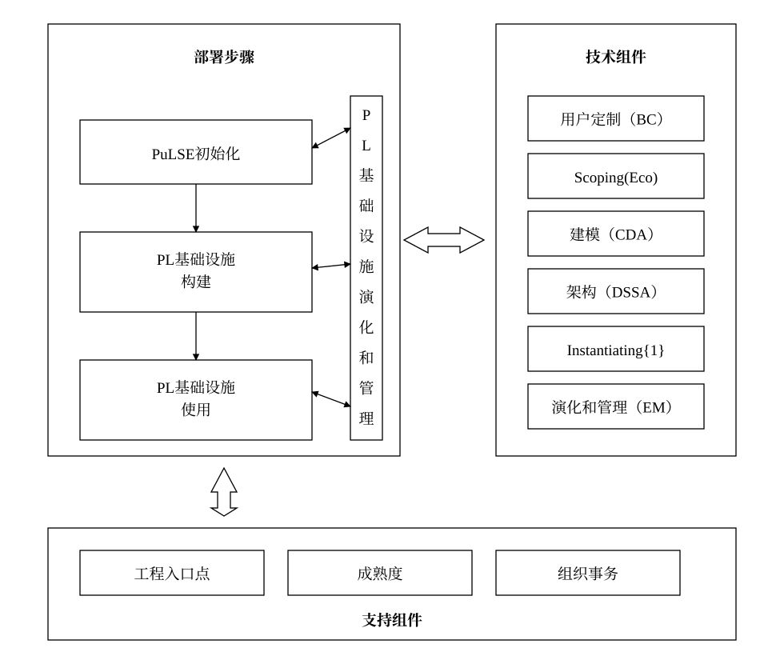

# 10.3 软件架构演化方式的分类

目前，软件架构演化方式没有一种公认的分类法，分类方法很多，以下举例说明 3 种较典型的分类方法：

1. 按照软件架构的实现方式和实施粒度分类：基于过程和函数的演化、面向对象的演化、基于组件的演化和基于架构的演化。
2. 按照研究方法将软件架构演化方式分为 4 类(Jeffrey M.Barnes 等人的分类方法)：第 1 类是对演化的支持，如代码模块化的准则、可维护性的指示(如内聚和耦合)、代码重构等；第 2 类是版本和工程的管理工具，如 `CVS` 和 `COCOMO`；第 3 类是架构变换的形式方法，包括系统结构和行为变换的模型，以及架构演化的重现风格等；第 4 类是架构演化的成本收益分析，决定如何增加系统的弹性。
3. 针对软件架构的演化过程是否处于系统运行时期，可以将软件架构演化分为静态演化(`Static Evolution`)和动态演化(`Dynamic Evolution`)，前者发生在软件架构的设计、实现和维护过程中，软件系统还未运行或者处在运行停止状态；后者发生在软件系统运行过程中。

本章重点介绍软件架构的静态演化和动态演化。

## 10.3.1 软件架构演化时期

### 1. 设计时演化

设计时演化(`Design-Time Evolution`)是指发生在体系结构模型和与之相关的代码编译之前的软件架构演化。

### 2. 运行前演化

运行前演化(`Pre-Execution Evolution`)是指发生在执行之前、编译之后的软件架构演化，这时由于应用程序并未执行，修改时可以不考虑应用程序状态，但需要考虑系统的体系结构，而且系统需要具有添加和删除组件的机制。

### 3. 有限制运行时演化

有限制运行时演化(`Constrained Runtime Evolution`)是指系统在设计时就规定了演化的具体条件，将系统置于“安全”模式下，演化只发生在某些特定约束满足时，可以进行一些规定好的演化操作。

### 4. 运行时演化

运行时演化(`Runtime Evolution`)是指系统的体系结构在运行时不能满足要求时发生的软件架构演化，包括添加组件、删除组件、升级替换组件、改变体系结构的拓扑结构等。此时的演化是最难实现的。

## 10.3.2 软件架构静态演化

### 1. 静态演化需求

软件架构静态演化的需求是广泛存在的，可以归结为两个方面。

1. 设计时演化需求。在架构开发和实现过程中对原有架构进行调整，保证软件实现与架构的一致性以及软件开发过程的顺利进行。
2. 运行前演化需求。软件发布之后由于运行环境的变化，需要对软件进行修改升级，在此期间软件的架构同样要进行演化。

下面分别介绍软件演化中的架构静态演化和适应该静态演化的应用实例——正交软件架构，以及软件开发过程中的架构静态演化。

### 2. 静态演化的一般过程

软件静态演化是系统停止运行期间的修改和更新，即一般意义上的软件修复和升级。与此相对应的维护方法有 3 类：更正性维护、适应性维护和完善性维护。

软件的静态演化一般包括如下 5 个步骤，如图 10-4 所示。

1. 软件理解：查阅软件文档，分析软件架构，识别系统组成元素及其之间的相互关系，提取系统的抽象表示形式。
2. 需求变更分析：静态演化往往是由于用户需求变化、系统运行出错和运行环境发生改变等原因所引起的，需要找出新的软件需求与原有需求之间的差异。
3. 演化计划：分析原系统，确定演化范围和成本，选择合适的演化计划。
4. 系统重构：根据演化计划对系统进行重构，使之适应当前的需求。
5. 系统测试：对演化后的系统进行测试，查找其中的错误和不足之处。

> 图 10-4 静态演化过程模型

在系统未运行的情况下，软件功能的变更或环境变化可能会带来架构中组件元素的增加、替换、删除、组合和拆分操作。架构静态演化需要对这些操作给其他组件和系统本身带来的影响进行分析，通过对组件间的影响关系进行建模，按照可达矩阵的方式即可计算出每种组件变更操作所影响的范围。

### 3. 静态演化的原子演化操作

一次完整软件架构演化过程可以看作经过一系列原子演化操作组合而成。所谓原子演化操作是指基于 `UML` 模型表示的软件架构，在逻辑语义上粒度最小的架构修改操作。

这些操作并非物理结构上不可分割。例如增加一个新的模块，该模块需要与架构其余部分相关联，必然导致模块间依赖关系的增加。然而模块的增加还涉及模块内部的类、接口以及与模块相关的规约条件，这些对架构相关质量属性的度量均有影响，因而我们认为模块的增加是单独的原子粒度不可再拆分的架构修改操作。

每经过一次原子演化操作，架构会形成一个演化中间版本 `Ai`。对于不同的质量属性度量和评估，影响该质量属性变化的原子演化操作类型不同，形成软件架构的中间版本序列 `A0，A1，A2，…，An` 也不同。例如，假设我们需要度量软件架构的可维护性和可靠性，就应该讨论影响可维护性和可靠性的度量结果的各种原子演化操作。

1)与可维护性相关的架构演化操作

架构演化的可维护性度量基于组件图表示的软件架构，在较高层次上评估架构的某个原子修改操作对整个架构所产生的影响。这些原子修改操作包括增加/删除模块间的依赖、增加/删除模块间的接口、增加/删除模块、拆分/聚合模块等，如表 10-1 所示。

> 表 10-1 可维护性相关架构演化操作

- `AMD/RMD`：模块间的依赖关系体现了模块逻辑组织结构和控制关系，包含模块对其他模块的直接依赖和间接依赖，对模块依赖关系的修改改变了模块的控制关系以及逻辑响应，从整体上影响了架构的组织结构，可能导致架构的外部质量属性发生变化。
- `AMI/RMI`：模块间的接口表示模块间的调用方式，模块通过接口直接提供相应可执行功能，对接口的修改可直接改变模块间的调用关系和调用方式，并可能导致具体的执行事件的顺序和方式发生更改
- `AM/RM`：在架构中，模块封装了一系列逻辑耦合度高或部署紧密的子模块，用来表达完整的功能。模块的增加、删除不仅仅表示软件功能的更改，该模块与其他模块的耦合方式可能使得架构整体组织结构的变化，从而引入 `AMD` 和 `RMD` 操作。过多的耦合会造成修改影响范围增大，不利于软件的维护以及持续演化。另外模块本身内部设计的正确性、合理性等问题将会影响软件潜在风险。
- `SM/AGM`：拆分和聚合模块通常发生在软件调整过程中，对模块的拆分和聚合可直接影响软件的内聚度和耦合度，从而影响软件整体复杂性。

2)与可靠性相关的架构演化操作

架构演化的可靠性评估基于用例图、部署图和顺序图，分析在架构模块的交互过程中某个原子演化操作对交互场景的可靠程度的影响。这些原子修改操作包括增加/删除消息、增加/删除交互对象、增加/删除/修改消息片段、增加/删除用例执行、增加/删除角色等，如表 10-2 所示。

> 表 10-2 可靠性相关架构修改操作

- `AMS/RMS`：模块间消息交互体现在 UML 顺序图中。消息变化包含增加消息、删除消息和修改消息，消息的修改可能为顺序更改、交互对象更改等，该变化可通过删除原消息和增加新的消息等操作组合而成，因而这里只讨论原子粒度的增加消息和删除消息两种操作。消息的删减导致交互过程中时序复杂度的变化，可能引入运行时风险。
- `AO/RO`：在顺序图中增加或删除交互对象将引入 `AMS/DMS` 操作，即与该对象相关的消息将被同时增加或删除，同时，在部署图中还须将该模块添加到相关站点或从相关站点删除该模块。由于一个执行场景的可靠性直接取决于组件和连接件的可靠性，交互对象的增减将直接影响一个或多个包含该模块的场景的交互复杂性。
- `AF/RF/CF`：消息片段为顺序图中一组交互消息的循环调用，消息片段的增加、删除或者调用次数的修改将影响交互过程的复杂度，从而影响该场景的执行风险。
- `AU/RU`：为参与者增加或删除可执行用例，表示参与者执行权限的变化，一般来说可执行用例越多的参与者其权限越高。用户在运行系统时以某一参与者的身份执行用例，由于其参与的执行事件的增加或者事件执行方式的多样化，将导致系统运行更为复杂，运行时风险增加。
- `AA/RA`：增加或删除某一参与者意味着执行权限的增加或减少，该操作将引入 `AU/RU` 操作。参与者的增减虽然不会导致软件结构上的变化，然而不同的参与者有不同的执行方式，因而会导致系统动态交互上的变化，对程序运行时的风险有影响。

### 4. 静态演化实例：正交软件架构(`Orthogonal Software Architecture`)

在静态演化中，为了高效地对修改进行分析和管理，一种应用广泛的处理方式就是使用正交软件架构。

对于复杂的应用系统，通过对功能进行分层和线索化，可以形成正交体系结构，同一层次中的组件不允许相互调用，故每个变动仅影响一条线索，如图 10-5 所示。

> 图 10-5 正交软件体系结构的演化

正交体系的演化过程概括如下：

1. 需求变动归类，使需求的变化和现有组件及线索相对应，判断重用情况。
2. 制订架构演化计划。
3. 修改、增加或删除组件。
4. 更新组件之间的相互作用。
5. 产生演化后的软件架构，作为系统更新的详细设计方案和实现基础。

## 10.3.3 软件架构动态演化

动态演化是在系统运行期间进行的演化，需要在不停止系统功能的情况下完成，较之静态演化更加困难，具体发生在有限制的运行时演化和运行时演化阶段。

### 1. 动态演化的需求

架构的动态演化主要来自两类需求。

1. 软件内部执行所导致的体系结构改变。例如，许多服务器端软件会在客户请求到达时创建新的组件来响应用户需求。
2. 软件系统外部的请求对软件进行重配置。例如，操作系统在升级时无须重新启动，在运行过程中就可以完成对体系结构的修改。

对于一些需要长期运行且具有特殊使命的系统(如航空航天、生命维持、金融、交通等)，如果系统需求或环境发生了变化，此时停止系统运行进行更新或维护将会产生高额的费用和巨大的风险，对系统的安全性也会产生很大的影响。静态体系结构缺乏表示动态更新的机制，很难用其分析、描述这样的系统，更不能用它来指导系统进行动态演化。因此，动态演化架构的研究应运而生。

随着网络和许多新兴软件技术(如 `Agent`、网格计算、普适计算、移动计算、网构软件等)的发展，对架构提出了许多更高的要求，如架构的扩展性、复用性、适应性等，而传统的静态体系结构已难以满足这些要求。

### 2. 动态演化的类型

1)软件动态性的等级

Carlos E. Cuesta 等人将软件的动态性分为 3 个级别(见图 10-6)。

1. 交互动态性(`Interactive Dynamism`)：要求数据在固定的结构下动态交互。
2. 结构动态性(`Structural Dynamism`)：允许对结构进行修改，通常的形式是组件和连接件实例的添加和删除，这种动态性是研究和应用的主流。
3. 架构动态性(`Architectural Dynamism`)：允许软件架构的基本构造的变动，即结构可以被重定义，如新的组件类型的定义。

> 图 10-6 软件的三级动态性

以 Cuesta 划分标准衡量，目前软件架构的动态演化研究大多仅支持发生在级别 1 和级别 2 上的动态性，而对级别 3 上的动态性支持甚少。但是 Cuesta 坚持认为，只有级别 3 的架构才是真正的动态架构。

2)动态演化的内容

根据所修改的内容不同，软件动态演化主要包括以下 4 个方面。

1. 属性改名：目前所有的 `ADL` 都支持对非功能属性的分析和规约，而在运行过程中，用户可能会对这些指标进行重新定义，如服务响应时间。
2. 行为变化：在运行过程中，用户需求变化或系统自身服务质量的调节都将引发软件行为的变化。诸如，为了提高安全级别而更换加密算法，将 `HTTP` 协议改为 `HTTPS` 协议；组件和连接件的替换和重新配置。
3. 拓扑结构改变：如增删组件、增删连接件、改变组件与连接件之间的关联关系等。
4. 风格变化：一般软件演化后其架构风格应当保持不变，如果非要改变软件的架构风格，也只能将架构风格变为其衍生风格，如将两层 `C/S` 结构调整为三层 `C/S` 结构或 `C/S` 与 `B/S` 的混合结构，将“1 对 1”的请求响应结构改为“1 对 N”的请求响应结构，以实现负载的平衡

目前，实现软件架构动态演化的技术主要有两种：采用动态软件架构(`Dynamic Software Architecture`，`DSA`)和进行动态重配置(`Dynamic Reconfiguration`，`DR`)。`DSA` 是指在运行时刻会发生变化的系统框架结构，允许在运行过程中通过框架结构的动态演化实现对架构的修改；`DR` 从组件和连接件的配置入手，允许在运行过程中增删组件，增删连接件，修改连接关系等操作。二者从不同侧面对软件和架构的动态演化进行研究，尚无明确的分类。在此，我们将 `DSA` 归结为架构动态性，将 `DR` 归结为结构动态性。下面分别对二者进行讨论。

### 3. 动态软件架构

Perry 在 2000 年第十六届世界计算机大会中提出，软件架构中最为重要的 3 个研究方向，即软件架构风格、软件架构连接件和 `DSA`。`DSA` 指那些在软件运行时刻会发生变化的体系结构。与静态软件架构相比，`DSA` 的特殊之处在于它的动态性。软件架构的动态性指由于系统需求、技术、环境、分布等因素的变化而导致软件架构在软件运行时刻的变化，主要通过软件架构的动态演化来体现。

Bradbury 等人为 `DSA` 做了如下定义：动态软件架构（`DSA`）可以修改自身的架构，并在系统执行期间进行修改。

`DSA` 的意义主要在于能够减少系统开发的费用和风险。由于采用 `DSA`，一些具有特殊使命的系统能够在系统运行时根据需求对系统进行更新，并降低更新的费用和风险。此外，`DSA` 能增强用户自定义性和可扩展性，并可为用户提供更新系统属性的服务。

1）基于 DSA 实现动态演化的基本原理

实现软件架构动态演化的基本原理是使 `DSA` 在可运行应用系统中以一类有状态、有行为、可操作的实体显式地表示出来，并且被整个运行环境共享，作为整个系统运行的依据。也就是说，运行时刻体系结构相关信息的改变可用来触发、驱动系统自身的动态调整。此外，对系统自身所做的动态调整结果可反映在体系结构这一抽象层面上。

在系统结构上，通过引入运行时体系结构对象，使得相关协同逻辑可从计算组件中分离出来，显式、集中地得以表达，符合关注分离的原则；同时又解除了系统组件之间的直接耦合，这些都有助于系统的动态调整。由于动态演化实现起来比静态演化复杂得多，系统必须提供 `SA` 动态演化的一些相关功能。

首先，系统必须提供保存当前软件架构信息（拓扑结构、组件状态和数目等）的功能；其次，实施动态演化还须设置一个监控管理机制，对系统有无需求变化进行监视。当发现有需求变化时，应能分析并判断可否实施演化，以及何时演化和演化范围，并最终分析或生成演化策略。再者，还应保证演化操作原子性，即在动态变化过程中，如果其中之一的操作失败了，整个操作集都要被撤销，从而避免系统出现不稳定的状态。

`DSA` 实施动态演化大体遵循以下 4 步。

1. 捕捉并分析需求变化。
2. 获取或生成体系结构演化策略。
3. 根据步骤 2 得到的演化策略，选择适当的演化策略并实施演化。
4. 演化后的评估与检测。

完成这 4 个步骤还需要 `DSA` 描述语言和演化工具的支持。

2）DSA 描述语言

按照描述视角可将软件动态性建模语言分为 3 类。

1. 基于行为视角的 -ADL，使用进程代数来描述具有动态性的行为。
2. 基于反射视角的 `Pilar`，利用反射理论显式地为元信息建立模型。
3. 基于协调视角的 `LIME`，注重计算和协调部分的分离，利用协调论的原理来解决动态性交互。

(1) -ADL

一般来说，软件架构的描述分为两个部分：结构相关描述和行为相关描述。`DSA` 的重点是运行时对结构进行改变的行为，因此需要对这些行为进行描述和验证。进程代数是处理这一问题的形式化方法，其中以序列化方式执行的一系列行为被抽象为进程，行为的交互被简化为进程的合成。

目前主流的进程代数语言之一就是 演算，-ADL 就是以此为基础设计的架构描述语言。它采用运行时的观点对系统进行建模，其模型包括组件、连接件和行为，所有元素都会随时间演化。-ADL 是为移动系统建模设计的，由于移动通信领域中动态性特别明显(如手机移动时会动态改变与服务器的连接关系)，移动系统本身就需要使用 `DSA`。

(2) Pilar

动态架构的一种直观解决方案就是实现架构反射，将模型与系统相关联，模型的修改会反映到系统的修改上，系统的变化也会表现为模型的变化。

形式化的反射模型是一个基于层的模型，其中每一层都作为它的基层的元系统(`Meta-System`)，而基层就称为基系统(`Base-System`)。对于每一个元-基系统对，元系统描述了系统如何感知或修改自身，而基系统则提供常规的应用操作和结构。反射模型并没有限定层的数量，但是在实际应用中一般采用少于 3 层的反射模型。

`MARMOL`(`Meta Architecture Model`)是第一个试图将反射和架构结合起来的形式化模型，其主要思想在于：在架构描述中引入多个层次，并利用反射的概念来表示它们。要注意 `MARMOL` 既不是针对特定问题或项目的模型，也不是一种架构风格或模式，而是一种描述风格。它能够与其他 `ADL` 结合起来应用，如使用 `MARMOL` 描述层模型，而对于单个的层则使用其他 `ADL` 进行描述。

基于 `MARMOL` 的动态架构描述语言 `Pilar` 已经出现。在 `Pilar` 中只有一种顶级元素——组件；而每个组件都由 4 部分组成，即接口、配置、具化(`Reification`)和约束。

(3) LIME

在分布式和并行系统的演化中，协调模型(`Coordination Model`)的应用广泛，它提供了增强模块性、组件复用性、移植性和语言互操作性的框架。协调模型与 `DSA` 的关系在于：大规模并行系统分布在许多逻辑结点上，这些结点的交互行为本质上就是动态的，对于 `DSA` 的需求即来自于此。

`Linda` 首次将协调模型应用于计算机科学，而 `LIME`(`Linda In a Mobile Environment`)则是 `Linda` 的扩展，支持移动应用的开发。它既能描述物理移动性，也能描述逻辑移动性，通过分离计算部分和协调部分使得时间、空间因素分离，简化了分布式系统的开发。

3）DSA 演化工具

动态演化的工具需要支持系统在演化过程中与其软件架构的一致性检查，并能够对架构演化过程进行管理，主要有以下几种方法。

1. 使用反射机制：Dowling 等人设计了 `K-Component` 框架元模型，该模型使用有类型的有向配置图对架构进行表示，能够支持系统的动态调整；北京大学研究的 `PKUAS` 系统引入运行时软件架构(`RSA`)作为全局视图，支持置于单个 `EJB` 容器内的组件演化；李长云等提出的基于体系结构空间支持动态演化的软件模型（`SASM`）使用运行时体系结构(`RSAS`)作为架构模型，是一个在运行期间有状态、有行为、可访问的对象，支持面向服务架构的动态演化；余亚萍等人提出的 `Artemis-ARC` 系统是以 `ACME` 为语义设计的运行时可编程架构模型，支持构架和服务架构演化，可以对 `DSA` 进行追溯、验证和框架代码检查。
2. 基于组件操作：主要有王海燕等提出的一种基于组件的动态体系结构模型和李长云等设计的一个面向应用的、开放的、`SA` 驱动的分布式运行环境 `SACDRE`，此类工具用于支持基于组件的系统架构进行动态演化。
3. 基于 演算： 演算是在 `CCS`(`Calculus of Communicating System`)的基础上提出的、基于命名概念的进程代数并发通信行为演算方法，可以用来描述结构不断变化的并发系统。于振华等提出的软件体系抽象模型（`Software Architecture Abstract Model`,`SAAM`）便是通过一系列 演算进程对 `SA` 实施演化，并利用 演算的相关分析方法对 `SA` 的一致性进行分析。
4. 利用外部的体系结构演化管理器：加州大学欧文分校提出了基于 `SA` 的开发和运行环境 `ArchStudio`，该执行工具包含 3 种体系结构变更源工具——`Argo`、`ArchShell` 和扩展向导。`Argo` 提供一个体系结构的图形描述和操作手段，`ArchShell` 提供一个文本的、命令式的体系结构变更语言；扩展向导提供可执行的脚本更改语言，用来对体系结构进行连续演化。其所定义的系统动态演化方法是如何将体系结构层面表达的动态调整在具体系统中实施的一个典型代表。

### 4. 动态软件架构应用实例——PKUAS

`PKUAS` 是一个符合 `Java EE` 规范的组件运行支撑平台，支持 3 种标准 `EJB` 容器，包括无态会话容器、有态会话容器和实体容器，并支持远程接口和本地接口；提供 `IOP`、`JRMP`、`SOAP` 以及 `EJBLocal` 互操作机制；内置命名服务、安全服务、事务服务、日志服务、数据库连接服务；通过了 `Java EE` 蓝图程序 `JPS v1.1` 的测试。

为了能够明确标识、访问和操纵系统中的计算实体，反射式中间件必须具备组件化的基础设施体系。基于 `Java` 虚拟机，`PKUAS` 将平台自身的实体划分为如下 4 种类型。

(1)容器系统：容器是组件运行时所处的空间，负责组件的生命周期管理(如类装载、实例化、缓存、释放等)，以及组件运行需要的上下文管理(如命名服务上下文、数据库连接等)。在 `PKUAS` 内置的 3 种 `EIB` 容器中，一个容器实例管理一个 `EJB` 组件的所有实例，而一个应用中所有 `EJB` 组件的容器实例组成一个容器系统。这种组织模式有利于实现特定于单个应用的配置和管理，如不同应用使用不同的通信端口、认证机制与安全域。

(2)公共服务：其实现系统的非功能性约束，如通信、安全、事务等。由于这些服务可通过微内核动态增加、替换和删除，因此，为了保证容器或组件正确调用服务并避免服务卸载的副作用，必须提供服务功能的动态调用机制。对于供容器使用的服务，必须开发相应的截取器作为容器调用服务的执行点；对于供组件使用的服务，必须在命名服务中加以注册。

(3)工具：辅助用户使用和管理 `PKUAS` 的工具集合，主要包括部署工具、配置工具与实时监控工具。其中，部署工具既可热部署整个应用，也可热部署单个组件，从而实现应用的在线演化；配置工具允许用户配置整个服务器或单个应用；而实时监控工具允许用户实时观察系统的运行状态并做出相应调整。

(4)微内核：上述 3 类实体统称为系统组件，微内核负责这些系统组件的装载、配置、卸载，以及启动、停止、挂起等状态管理。`PKUAS` 微内核符合 Java 平台管理标准 `JMX`(`Java Managemente Extension`)，继承了 `JMX` 可移植、伸缩性强、易于集成其他管理方案、有效利用现有 Java 技术、可扩展等优点。

其中，容器系统、服务、工具等被管理的系统组件组成资源层，通过 `MBean` 接口对外提供与管理相关的属性和操作。负责注册资源的 `MBean Server` 和管理资源的插件组成管理层。`MBean Server` 对外提供所有资源的管理接口，允许资源动态地增加或删除。管理插件则是执行其他管理功能的 `MBean`，如 `PKUAS` 实时监控管理工具的核心功能就是通过管理插件实现的。

### 5. 动态重配置

基于软件动态重配置的软件架构动态演化，主要是指在软件部署之后对配置信息的修改，常常被用于系统动态升级时需要进行的配置信息修改。一般来说，动态重配置可能涉及的修改有：

1. 简单任务的相关实现修改。
2. 工作流实例任务的添加和删除。
3. 组合任务流程中的个体修改。
4. 任务输入来源的添加和删除。
5. 任务输入来源的优先级修改。
6. 组合任务输出目标的添加和删除。
7. 组合任务输出目标的优先级修改等。

1)动态重配置模式

每种重配置模式说明了软件模式中组件是如何协作的，以及如何通过协作来完成整个产品线的动态重配置过程(即从一种配置转化为另一种配置)。下面介绍 4 种重配置模式。

(1)主从(`Master-Slave`)模式：在主从模式中，主组件接收客户端的服务请求，它将工作划分给从组件，然后合并、解释、总结或整理从组件的响应。当主组件没有对从组件分配工作时，从组件处于空闲(`Idle`)状态，并会在新的任务分配时被重新激活。主从模式由主操作重配置状态图描述，其中包含两个正交的图，即主操作状态图和主重配置状态图，主操作状态图定义了主组件的操作状态，主重配置状态图描述主组件如何安排重配置的过程。

(2)中央控制(`Centralized Control`)模式：中央控制模式广泛应用于实时系统之中。在该模式中，一个中央控制器会控制多个组件，其状态图会维持两个状态，分别标识中央控制器是否处于空闲状态。

(3)客户端/服务器(`Client/Server`)模式：客户端/服务器模式中的客户端组件需要服务器组件所提供的服务，二者通过同步消息进行交互，在客户端/服务器重配置模式中，当客户端发起的事务完成之后，可以添加或删除客户端组件；当顺序服务器(`Sequential Server`)完成了当前的事务，或者并发服务器(`Concurrent Server`)完成了当前事务的集合，且将新的事务在服务器消息缓冲中排队完毕之后，可以添加或删除服务器组件。

(4)分布式控制(`Decentralized Control`)模式：分布式控制模式下系统的功能整合在多个分布式控制组件之中。该模式广泛用于分布式应用之中，且有着多种相似的类型，如环形(`Ring`)模式和顺序(`Serial`)模式。环形模式中每个组件有着相同的功能，且在其左右均有一个组件(称为前驱和后继)与之交互；顺序模式中的各组件使用相同连接与自己的前驱和后继交互，每个组件向自己的前驱发送请求并获得响应。

2)例子：可重用、可配置的产品线架构

软件产品线是一种软件开发和配置的方法论，促进了软件的有效开发，但是尚存一些不足：配置复杂性高，用户可定制的弹性不足，而且关注点有所偏移，从产品转移到了领域。为此 `Bayer` 等人给出了 `PuLSE`(`Product Line Software Engineering`)方法论(如图 10-7 所示)，其能够在各种企业环境中进行软件产品线构想和部署。这是通过以下元素来实现的：在 `PuLSE` 各步骤中以产品为核心关注点，包括组件的可定制性、增量(组件)导入的能力、结构演化的成熟度，以及主要产品开发过程的适应性调整等。

> 图 10-7 PuLSE 概览

`Gomaa` 等人提出了一种使用 `UML` 对软件产品线建立多视角元模型的方法。该模型是一种面向对象的领域模型，能够从多个方面对一个软件产品线进行描述，包括用例模型、静态模型、交互模型、状态机模型和特性模型，并对各个模型的一致性进行检查。他们开发了一个原型系统 `Product Line UML Based Software Engineering Environment`(`PLUSEE`)用以实施该方法。

3)动态重配置的难点

`Tamura` 等人提出了在带有服务质量(`Quality of Service`，`QoS`)约束的情况下，基于扩展图进行架构重配置的方法。针对此类重配置说明了动态重配置的 4 个难点：

1. 约束定义困难。
2. 性能约束难以静态衡量，需要在软件运行时进行评估。
3. 某些重配置方案能够解决性能约束的某一方面，但是难以管理所有方面。
4. 重配置需要同时保证两个方面：即维持组件系统的完整性，以及重配置策略的正确和安全性。
