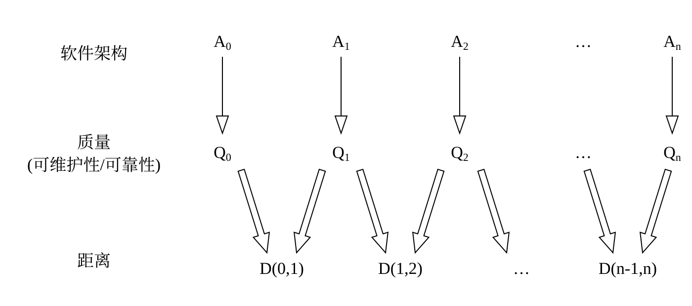

# 10.5 软件架构演化评估方法

本节主要介绍软件架构演化的评估方法，根据演化过程是否已知可将评估过程分为：演化过程已知的评估和演化过程未知的评估。

## 10.5.1 演化过程已知的评估

演化过程已知的评估其目的在于通过对架构演化过程进行度量，比较架构内部结构上的差异以及由此导致的外部质量属性上的变化，对该演化过程中相关质量属性进行评估。本小节主要对演化过程已知的架构演化评估工作进行阐述，给出评估流程以及具体的相关指标的计算方法。

### 1. 评估流程

架构演化评估的基本思路是将架构度量应用到演化过程中，通过对演化前后的不同版本的架构分别进行度量，得到度量结果的差值及其变化趋势，并计算架构间质量属性距离，进而对相关质量属性进行评估。

架构演化评估的执行过程如图 10-8 所示。图中 `A0` 和 `An` 表示一次完整演化的起点和终点，可对应相邻的对外发布版本。我们可以将 `A0` 演化到 `An` 的过程拆分为一系列原子演化操作，一次完整的架构演化可以视为不同类型的原子演化操作形成的序列。每经过一次原子演化，即可得到一个架构中间演化版本 `Ai(i=1,2,…,n-1)`，因而经过一次完整的软件演化后可以得到架构中间版本形成的序列 `A0, A1, A2, …, An`。对每个中间版本架构进行度量，得到架构 `Ai` 的质量属性度量值 `Qi`，进而得到演化过程中架构质量度量结果形成的序列 `Q0, Q1, …, Qn`。对于相邻版本的架构 `Ai-1` 和 `Ai`，可以根据它们的质量属性度量值 `Qi-1` 和 `Qi`，计算相邻版本间的架构质量属性距离 `D(i-1,i)`。软件架构的两个端点 `A0` 和 `An` 间的质量属性距离 `D(0,n)` 可以通过 `Q0` 和 `Qn` 计算得出。最后综合各个版本架构的度量结果，对架构演化相关质量属性进行评估。

### 2. 架构演化中间版本度量

对于不同类型的质量属性，其度量方法不同，度量结果的类型也不同。本章主要度量的是架构的可维护性和可靠性，其具体度量方法在前面已经进行过详细阐述。其中对于可靠性，架构质量属性度量结果 `Qi` 是一个实数值；而对于可维护性，它包含圈复杂度、扇入扇出度、模块间耦合度、模块的响应、紧内聚度、松内聚度这 6 个子度量指标，度量结果 `Qi` 是这 6 个指标的度量值形成的六元组 `(q1,q2,…,q6)`。

对于每一次原子粒度的演化，我们可以明确该原子演化对架构内部逻辑结构或交互过程的影响；通过比较原子演化前后架构质量属性 `Qi-1` 和 `Qi` 间的变化，可以分析该类演化对待评估系统的外部质量属性的影响，进而找出架构内部结构变化和外部质量属性变化间的关联。

> 图 10-8 演化过程已知的架构演化评估执行过程

### 3. 架构质量属性距离

架构质量属性距离 `D(i-1,i)` 用来评估相邻版本架构间质量属性的差异。由于架构质量属性距离的计算直接依赖于架构质量属性度量值 `Qi-1` 和 `Qi`，所以对于不同的质量属性，`D(i-1,i)` 的计算有所不同。本节分别介绍架构可维护性和可靠性的质量属性距离计算方法，并介绍架构质量属性距离更一般的用法。

1）可维护性距离计算方法

可以参照表 10-1 的操作类型，将一次完整演化拆分成原子操作序列，对于每次原子演化操作，我们度量架构在演化前后可维护性指标的值(包括 `CCN`、`FFC` 等共 6 项)，得到演化前后架构 `A` 和 `B` 的可维护性指标向量 `(a1, a2, …, an)` 和 `(b1, b2, …, bn)`，逐项按两值之和归一化，再求差异向量的欧几里得范数，见式（10-1）。

$$
D_m(A,B)=\sqrt{\sum_{i=1}^{n}\left(\frac{a_i-b_i}{a_i+b_i}\right)^2}\tag{10-1}
$$

这里 $n=6$，$a_i$ 和 $b_i$ 是两版本在同一指标上的非负值。该式要求每项 $a_i+b_i>0$；若两值均为零，可约定该项差异为零，并在所有版本中一致使用。距离越大，仅表示指标差异越大，改善或退化要看具体指标的方向。由于软件可能经过许多轮演化，其架构与原始架构会有很大差距，某些实现与原设计不符，从而导致一些不易察觉的质量问题。而即使是相邻版本的架构也会产生某些质量属性的极大差距。因而我们试图追踪和控制软件质量属性，将其控制在某个适当区间，保持当前软件的正确性和可用性等，且为其之后的演化提供良好的扩展性和适应性，使得软件能够持续演化和重用。

2）可靠性距离计算方法

同样可以参照表 10-2 的操作类型，将一次完整演化拆分成原子操作序列，对于每次原子演化操作，度量演化前后架构 `A` 和 `B` 的可靠性度量值 非负值 $a$ 和 $b$（测量口径相同），架构 `A` 和 `B` 之间的可靠性距离计算公式如公式 10-2 所示。

$$
D_r(A,B)=\sqrt{\left(\frac{a-b}{a+b}\right)^2}=\frac{|a-b|}{a+b},\qquad a+b>0.\tag{10-2}
$$

该式是式（10-1）在单个指标上的形式。若两个非负值均为零，可以沿用相同的零差异约定；其余情形所得值介于 0 和 1 之间，表示相对差异的大小。值得注意的是，本例用潜在风险指标表征可靠性；该指标的数值不等于软件的可靠度，而与架构的物理组织结构(模块间的逻辑依赖和调用等)没有必然因果联系。两个完全不同的软件在架构上的相似度很低，但它们的可靠性度量值可能相等；而同一个软件经过演化，相邻版本之间的架构可能由于某些不适当的修改而造成可靠性大幅度降低。同理，我们也无法通过可靠性度量值推断两个架构结构上的变化或差异。可靠性与软件运行过程中的逻辑交互复杂度相关，即使观测到可靠性变化，也要结合运行情况和修改记录核实其原因。

3）非相邻版本的架构质量属性距离

对于可维护性距离 `Dm(A,B)` 和可靠性距离 `Dr(A,B)`，当 `A` 和 `B` 为相邻版本的架构时，所得结果即为相邻版本架构间的质量属性距离。一般地讲，若 `A` 和 `B` 为任意两个架构演化版本，计算结果即为任意演化过程中两个架构在相关质量属性上的差异。对于可维护性和可靠性，仅凭质量属性距离不能推断架构内部结构差异的大小。对于两个完全不同的软件架构，它们的质量属性度量结果可能相近，导致质量属性距离较小，此时距离只能说明所选指标相近。要追踪同一架构的演化，应比较其不同版本，以对架构演化过程进行监控，保障架构能够持续健康演化。

值得注意的是，在架构中间版本序列 `A0, A1, A2, …, An` 中，架构 `A0` 和 `An` 间的质量属性距离 `D(0,n)` 一般不等于 `D(0,1)`、`D(1,2)`、`D(2,3)`…的叠加，即原子演化操作所产生的架构质量属性影响并不具有累加性，然而它却可以帮助我们观察在该次演化过程中每一步物理结构的变化对整体的影响范围，并对关键模块风险控制以及故障定位等有积极的作用。

### 4. 架构演化评估

基于度量的架构演化评估方法，其基本思路在于通过对演化前后的软件架构进行度量，比较架构内部结构上的差异以及由此导致的外部质量属性上的变化。基于度量的架构演化评估，可以帮助我们分析架构内部结构的修改对外部质量属性所产生的影响、监控演化过程中架构质量的变化、归纳架构演化趋势，并有助于开发和维护等相关工作开展，具体包括如下几个方面：

1. 架构修改影响分析：为了更好地归纳和说明架构演化的相关规律，本节对演化进行分类，比较不同类型的演化操作对架构相关质量属性的影响。通过将演化过程拆分成粒度很细的原子演化操作序列，具体分析架构内部逻辑结构和交互过程的修改会对哪些相关外部质量属性产生影响，并分析修改影响范围，进一步分析架构版本距离和相关质量属性距离的关联。
2. 监控演化过程：通过对架构演化过程中的中间版本架构进行度量，我们可以得到架构相关质量属性随时间推移的变化曲线。通过对架构演化过程中质量属性的监控，将有利于保持架构健康持续地演化。
3. 分析关键演化过程：架构质量属性距离评估不同版本的架构在质量属性上的差异。从质量属性距离形成的曲线可以观察到架构质量发生较大改变的时刻，在该时刻架构的逻辑依赖或交互过程可能发生重大改变，在开发和维护过程中应该予以重视，这将有利于架构维护及故障定位等。

## 10.5.2 演化过程未知的评估

当演化过程未知时，我们无法像演化过程已知时那样追踪架构在演化过程中的每一步变化，可以根据架构演化前后的度量结果提出可能的改变，再用版本差异等证据核实，并分析这些改变与架构相关质量属性的关联关系。

图 10-9 显示了演化过程未知时的架构演化评估过程。对于演化前后的相邻版本的架构，可以利用基于度量的架构评估方法分别对它们进行度量，得到架构演化前后的不同版本的度量结果，并根据度量结果的差异计算它们之间的质量属性距离。通过分析架构演化前后质量属性的变化以及质量属性间的距离，可以逆向推测出架构可能发生了哪些演化操作，以及这些演化操作发生的位置和作用的对象。可进一步结合版本差异和变更记录，分析候选操作对质量属性的影响及其可能动因（修复代码错误、提高性能、平台移植等）。据此归纳可能对应某一动因的演化操作集合，并分析这些演化操作所产生的架构质量属性变化是否符合预期。若这些演化操作对架构相关质量属性的影响符合预期，例如，我们希望对代码进行重构以使得架构更加清晰、易于维护和扩展，而最终分析得出此次版本演化确实使得架构的可维护性获得提高(圈复杂度减少、模块间耦合度降低等)，则这些指标为达成可维护性目标提供了证据。若变化不符合预期，应核对需求、实现和测试结果，再判断是否遗留或引入了问题。

> 图 10-9 演化过程未知时的架构演化评估过程示意图
