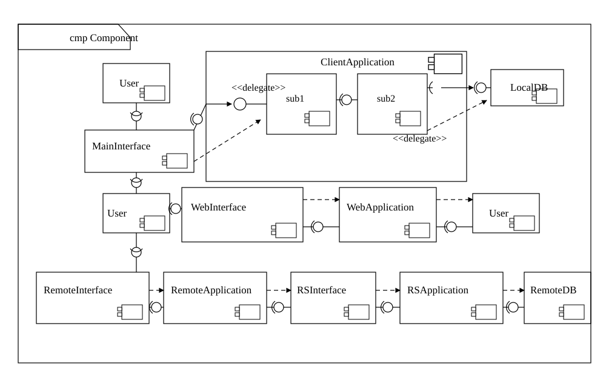
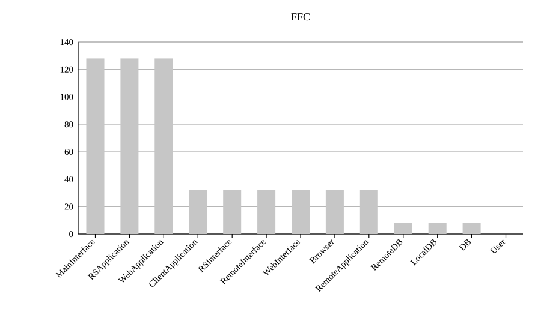
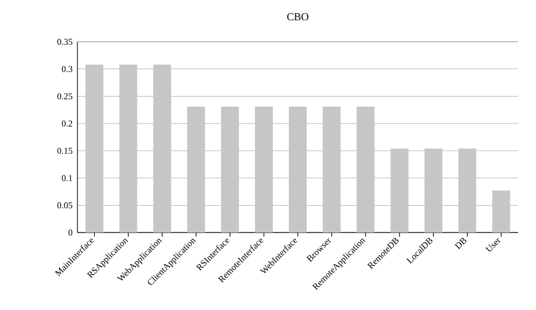
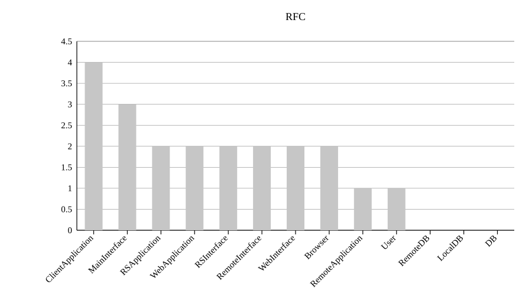

# 10.7 软件架构维护

软件架构是软件开发和维护过程中的一个重点制品，是软件需求和设计、实现之间的桥梁。软件架构的开发和维护是基于架构软件生命周期中的关键环节，与之相关的步骤包括导出架构需求、架构开发、架构文档化、架构分析、架构实现和架构维护。软件架构的维护与演化密不可分，维护需要对软件架构的演化过程进行追踪和控制，以保障软件架构的演化过程能够满足需求(亦有说法将架构维护作为架构演化的一个部分)。

由于软件架构维护过程一般涉及架构知识管理、架构修改管理和架构版本管理等内容，下面分别对它们进行简要介绍。

## 10.7.1 软件架构知识管理

软件架构知识管理是对架构设计中所隐含的决策来源进行文档化表示，进而在架构维护过程中帮助维护人员对架构的修改进行完善的考虑，并能够为其他软件架构的相关活动提供参考。

### 1. 架构知识的定义

Lago 等人给出了架构知识的定义：架构知识=架构设计+架构设计决策。即需要说明在进行架构设计时采用此种架构的原因。

### 2. 架构知识管理的含义

架构知识管理侧重于软件开发和实现过程所涉及的架构静态演化，从架构文档等信息来源中捕捉架构知识，进而提供架构的质量属性及其设计依据以进行记录和评价。架构知识管理不仅要涵盖架构的解决方案，也要涵盖产生该方案的架构设计决策、设计依据与其他信息，以有助于架构进一步的演化。

### 3. 架构知识管理的需求

许多人认为架构知识的可获得性能够极大地提升软件开发流程。如果对架构知识不进行管理的话，那么关键的设计知识就会“沉没”在软件架构之中，如果开发组人员发生变动，那么“沉没”的架构知识就会“腐蚀”。

### 4. 架构知识管理的现状

对于软件架构知识的讨论侧重于对架构信息的整理、存储和恢复。尽管如此，当前尚无实用的架构知识整理策略，构建架构的利益相关者(即拥有架构知识的人)通常不会使用文档来记录架构知识，原因在于对架构知识文档化和维护的动机不足：其好处看起来不够重大而成本相对较高；利益相关者对工程的短期兴趣比起长远的架构知识重用显得更重要；开发者被设计中的创造性工作所吸引，而不会反思设计决策的长远影响；缺乏此方面的培训。更为严重的是，即使实现了文档化，通常架构知识也不能在整个组织中得到充分的分享。例如，架构知识没有传播给合适的利益相关者；架构知识的接收者没有将之应用于他们的任务之中；知识笨重，难以在应用的时候快速地搜索和定位到合适的知识。

## 10.7.2 软件架构修改管理

在软件架构修改管理中，一个主要的做法就是建立一个隔离区域(`Region of Quiescence`)，保障该区域中任何修改对其他部分的影响比较小，甚至没有影响。为此，需要明确修改规则、修改类型，以及可能的影响范围和副作用等。

## 10.7.3 软件架构版本管理

软件架构版本管理为软件架构演化的版本演化控制、使用和评价等提供了可靠的依据，并为架构演化量化度量奠定了基础。

例如，王映辉等人在描述 `SA` 的组件-连接件模型的基础上，首先针对 `SA` 的静态演化建立了 `SA` 邻接矩阵和可达矩阵，凭借矩阵变换与运算对 `SA` 静态演化中的波及效应进行了深入的分析和量化界定，同时给出了组件在 `SA` 中贡献大小相对量的计算方法。同时针对 `SA` 的动态演化，给出了 `SA` 动态语义网络模型，分析了 `SA` 动态语义网络中基于不动点的浸润过程收敛的判定依据，提出了邻接矩阵原子过滤的概念，进而指出 `SA` 动态演化过程可用一系列邻接矩阵来描述。他们还给出了在两个层面上对 `SA` 演化波及效应进行分析的框架。

## 10.7.4 软件架构可维护性度量实践

架构可维护性评估针对架构组件图进行度量，评估高层次上的架构复杂程度，待评估的 `Web` 读写系统的组件图如图 10-20 所示。将该图导出为 `XML` 文件并输入架构评估系统 `MSAES`，解析出可维护性度量所需的数据，根据可维护性的 6 个子度量指标的计算公式进行计算。

> 图 10-20 Web 读写程序组件图

从待评估系统的组件图中解析出的评估所需数据如表 10-3 所示。`L`、`totalN` 和 `totalE` 分别表示组件图数目、组件图中所有外部组件及其相连的边的数目(不包括组件内部的子组件以及子组件之间的连接边)。然后针对每个组件，我们获取该组件的内部组件数目 `S`、依赖出边数目 `E`、依赖入边数目 `X`、使用接口数目 `R` 和提供接口数目 `W`。由于组件 `ClientApplication` 具有子组件，需要获取其内部组件的依赖关系形成的邻接矩阵来度量该模块的内聚度。此处 `sub1` 和 `sub2` 之间只有接口关系，没有依赖关系，因而其邻接矩阵是一个 2×2 的零矩阵。

> 表 10-3 Web 读写程序组件图解析数据

然后根据可维护性的 6 个子度量指标的度量公式，利用解析得到的架构评估数据分别进行度量。其中圈复杂度(`CCN`)度量整个架构的独立执行路径的条数，该结果值即为待评估架构的最终度量结果；而对于扇入扇出度(`FFC`)、模块间耦合度(`CBO`)、模块的响应(`RFC`)、紧内聚度(`TCC`)、松内聚度(`LCC`)这 5 个度量指标，它们针对每个组件进行度量，则待评估架构的最终度量结果为所有组件结果的平均值。我们以组件 `Client Application` 为例分析各个子度量指标的计算方法。

$$CCN=(totalE-totalN)+2L=(19-13)+2\times1=8$$

$$FFC=CCN\times((E+W)\times(X+R))^2=8\times((1+1)\times(0+1))^2=32$$

$$CBO=\frac{E+X+W+R}{totalN}=\frac{1+0+1+1}{13}=0.231$$

$$RFC=S+E+R=2+1+1=4$$

$$TCC=\frac{E+X+W+R}{P(S)}=\frac{1+0+1+1}{2\times(2-1)/2}=3$$

$$LCC=\frac{E+X+W+R+NIC(S)}{P(S)}=\frac{E+X+W+R+0}{P(S)}=TCC=3$$

待评估系统中其他组件的度量方法与 `Client Application` 相同。但是由于其他组件均没有子组件，使得 `P(S)` 的计算结果为 0，`TCC` 和 `LCC` 的计算公式中分母为 0。此时无法计算该组件模块的内聚度，以“not applied”表示。当一个组件没有子组件时，我们认为该组件的内聚度最小。

在依次计算出每个模块的相关指标度量结果后，除 `CCN` 外，其余架构可维护性度量指标的最终结果为各个模块的度量结果的平均值，如表 10-4 所示。值得注意的是，我们只对组件图中的外部模块进行度量，即度量架构中的所有最高层模块，而其余模块均作为内部子模块，用来度量高层模块的内聚度。

> 表 10-4 Web 读写系统可维护性度量结果

根据表 10-4 所示的 `Web` 读写系统的度量结果，我们分别对架构可维护性的 6 个度量指标进行分析；图 10-21～图 10-23 分别显示基于 `Web` 读写系统的各个组件的 `FFC`、`CBO`、`RFC` 度量结果，并按照结果值从高到低排序。

### 1) 圈复杂度(CCN)

由于在组件图中组件是独立的，每个组件代表一个系统或子系统中的封装单位，封装了完整的事务处理行为，组件图能够通过组件之间的控制依赖关系来体现整个系统的组成结构。对架构的组件图进行圈复杂度的度量，可以对整个系统的复杂程度做出初步评估，在设计早期发现问题和做出调整，并预测待评估系统的测试复杂度，及早规避风险，提高软件质量。圈复杂度高的程序往往是最容易出现错误的程序，实践表明程序规模以 `CCN ≤ 10` 为宜。

### 2) 扇入扇出度(FFC)

基于 `Web` 读写系统的各个组件的 `FFC` 度量值按照从高到低显示在图 10-21 中。扇入是指直接调用该模块的上级模块的个数，扇出指该模块直接调用的下级模块的个数。本文中用扇入扇出度综合评估组件主动调用以及被调用的频率。扇入扇出度越大，表明该组件与其他组件间的接口关联或依赖关联越多。从图 10-20 和图 10-21 中可以发现，`RSApplication`、`WebApplication` 及 `MainInterface` 的关联关系最多，`FFC` 度量值最大，而 `User`、`DB` 等组件与其他组件关联较少，`FFC` 度量值也较小，验证了度量模型和结果的一致性。

> 图 10-21 Web 读写系统各模块 FFC 度量结果

### 3) 模块间耦合度(CBO)

基于 `Web` 读写系统的各个组件的 `CBO` 度量值按照从高到低显示在图 10-22 中。模块间耦合度 `CBO` 度量模块与其他模块交互的频繁程度。`CBO` 越大的模块，越容易受到其他模块中修改和错误的影响，因而可维护性越差，风险越高。一般来说，组件与其他组件的依赖关系及接口越多，该组件的耦合度越大。从图 10-20 和图 10-22 中可以发现，`RSApplication`、`WebApplication` 等关联关系较多的组件，其 `CBO` 度量值也较大；反之，`User`、`DB` 等与其他组件关联较少的组件，其 `CBO` 度量值也较小。

> 图 10-22 Web 读写系统各模块 CBO 度量结果

### 4) 模块的响应(RFC)

基于 `Web` 读写系统的各个组件的 `RFC` 度量值按照从高到低显示在图 10-23 中。`RFC` 度量组件执行所需的功能的数量，包括接口提供的功能、依赖的其他模块提供的功能以及子模块提供的功能。从图 10-20 和图 10-23 中观察，`ClientApplication` 包含子模块，`MainInterface` 对其他组件的依赖较多，因而它们的 `RFC` 度量值较大；而 `DB`、`RemoteDB`、`LocalDB` 等没有对其他模块的依赖和调用，且不包含子模块，因而其 `RFC` 度量值为 0。

> 图 10-23 Web 读写系统各模块 RFC 度量结果

### 5) 模块间内聚度 TCC 和 LCC

由于只有组件 `ClientApplication` 具有子模块，因而对该组件进行度量，并将该组件的度量值作为待评估系统的最终结果。好的架构设计应该遵循“高内聚-低耦合”原则，提高模块的独立性，降低模块间接口调用的复杂性。
