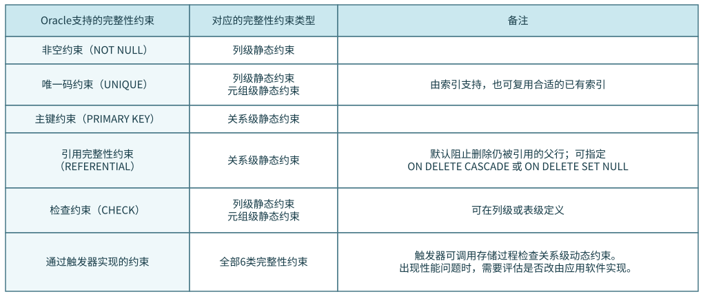

# 18.6 数据库系统的安全设计

在数据库系统中，由于数据的集中管理，随之而来的是多用户存取，以及近年来跨网络的分布系统的急速发展。特别是，电子政务中所涉及的数据库密级更高、实时性更强。数据库的安全问题可以说已经成为信息系统最为关键的问题。因此，有必要根据其特殊性完善安全策略，这些安全策略应该能保证数据库中的数据不会被有意地攻击或无意地破坏，防止发生数据外泄、丢失和毁损，即实现了数据库系统安全的完整性、机密性和可用性。从数据库管理系统的角度而言，要采取的安全策略一般为用户管理、存取控制、数据加密、审计跟踪和攻击检测，从而解决数据库系统的运行安全和信息安全。

下面分别从数据库安全设计的评估标准和完整性设计两方面进行讨论。

## 18.6.1 数据库安全设计的评估标准

随着人们对安全问题的认识和对安全产品的要求不断提高，在计算机安全技术方面逐步建立了一套安全评估标准，以规范和指导安全信息系统的建设及安全产品的生产，并能较准确地评测产品的安全性能指标。具有历史代表性的标准之一是美国国防部1985年颁布的《可信计算机系统评估标准》（Trusted Computer System Evaluation Criteria，TCSEC），又称“橙皮书”（DoD 5200.28-STD）。1991年，美国国家计算机安全中心 (National Computer Security Center, NCSC) 又颁布了“可信计算机评估标准关于可信数据库管理系统的解释 (Trusted Database Interpretation,TDI)”。我国也于1994年2月发布了《中华人民共和国计算机信息系统安全保护条例》。在TCSEC中，将安全系统分为4大类7个等级。

TDI是TCSEC在数据库管理系统方面的扩充和解释，并从安全策略、责任、保护和文档4个方面进一步描述了每级的安全标准。按照TCSEC标准，D类为经过评估但未满足更高等级要求的系统；C类提供自主保护；B类提供强制保护；A类提供经验证的保护。本文讨论的安全数据库研究原型是以科研为目的、按B1级或更高等级要求设计、尚未产品化的数据库管理系统。

## 18.6.2 数据库的完整性设计

数据库完整性是指数据库中数据的正确性和相容性。数据库完整性由各种各样的完整性约束来保证，因此可以说数据库完整性设计就是数据库完整性约束的设计。数据库完整性约束可以通过DBMS或应用程序来实现，基于DBMS的完整性约束作为模式的一部分存入数据库中。通过DBMS实现的数据库完整性按照数据库设计步骤进行设计，而由应用软件实现的数据库完整性则纳入应用软件设计范畴。

### 1. 数据库完整性设计原则

在实施数据库完整性设计时，需要把握以下基本原则：

1. 根据数据库完整性约束的类型确定其实现的系统层次和方式，并提前考虑对系统性能的影响。一般情况下，静态约束应尽量包含在数据库模式中，而动态约束可根据业务规则由触发器或应用程序实现。
2. 实体完整性约束、引用完整性约束是关系数据库最重要的完整性约束，在不影响系统关键性能的前提下需尽量应用。用一定的时间和空间来换取系统的易用性是值得的。
3. 要慎用目前主流DBMS都支持的触发器功能，一方面由于触发器的性能开销较大；另一方面，触发器的多级触发难以控制，容易发生错误，需要使用触发器时，应按业务规则和DBMS支持的功能选择触发时机，以及行级或语句级的执行粒度。
4. 在需求分析阶段就必须制定完整性约束的命名规范，尽量使用有意义的英文单词、缩写词、表名、列名及下划线等组合，使其易于识别和记忆，如CKC_EMP_REAL_INCOME_EMPLOYEE、PK_EMPLOYEE、CKT_EMPLOYEE。如果使用CASE工具，一般有默认的规则，可在此基础上修改使用。
5. 要根据业务规则对数据库完整性进行细致的测试，以尽早排除隐含的完整性约束间的冲突和对性能的影响。
6. 要有专职的数据库设计小组，自始至终负责数据库的分析、设计、测试、实施及早期维护。数据库设计人员不仅负责基于DBMS 的数据库完整性约束的设计实现，还要负责对应用软件实现的数据库完整性约束进行审核。
7. 应采用合适的CASE工具来降低数据库设计各阶段的工作量。好的CASE工具能够支持整个数据库的生命周期，这将使数据库设计人员的工作效率得到很大提高，同时也容易与用户沟通。

### 2. 数据库完整性的作用

数据库完整性对于数据库应用系统非常关键，其作用主要体现在以下几个方面。

1. 数据库完整性约束能够防止合法用户使用数据库时向数据库中添加不合语义的数据。
2. 利用基于DBMS的完整性控制机制来实现业务规则，易于定义，容易理解，而且可以降低应用程序的复杂性，提高应用程序的运行效率。同时，基于DBMS的完整性控制机制是集中管理的，因此比应用程序更容易实现数据库的完整性。
3. 合理的数据库完整性设计，能够同时兼顾数据库的完整性和系统的效能。例如装载大量数据时，可在受控条件下暂时停用约束以降低装载开销，装载后重新启用约束并验证已有数据，处理所有违规记录后才能确认数据满足约束。
4. 在应用软件的功能测试中，完善的数据库完整性有助于尽早发现应用软件的错误。
5. 数据库完整性约束可分为6类：列级静态约束、元组级静态约束、关系级静态约束、列级动态约束、元组级动态约束和关系级动态约束。动态约束通常由应用软件来实现。不同DBMS支持的约束类型、语法和执行方式可能有所不同，Oracle支持的基于DBMS的完整性约束如表 18-2所示。

> 表 18-2 Oracle支持的基于DBMS的完整性约束

| Oracle支持的完整性约束 | 对应的完整性约束类型 | 备注 |
| --- | --- | --- |
| 非空约束（NOT NULL） | 列级静态约束 | — |
| 唯一码约束（UNIQUE） | 列级静态约束；元组级静态约束 | 由索引支持，也可复用合适的已有索引 |
| 主键约束（PRIMARY KEY） | 关系级静态约束 | — |
| 引用完整性约束（REFERENTIAL） | 关系级静态约束 | 默认阻止删除仍被引用的父行；可指定 ON DELETE CASCADE 或 ON DELETE SET NULL |
| 检查约束（CHECK） | 列级静态约束；元组级静态约束 | 可在列级或表级定义 |
| 通过触发器实现的约束 | 全部6类完整性约束 | 触发器可调用存储过程检查关系级动态约束。出现性能问题时，需要评估是否改由应用软件实现。 |

### 3. 数据库完整性设计示例

一个好的数据库完整性设计，首先需要在需求分析阶段确定要通过数据库完整性约束实现的业务规则。然后在充分了解特定DBMS提供的完整性控制机制的基础上，依据整个系统的体系结构和性能要求，遵照数据库设计方法和应用软件设计方法，合理选择每个业务规则的实现方式。最后，认真测试，排除隐含的约束冲突和性能问题。基于DBMS的数据库完整性设计大体分为以下几个阶段。

1）需求分析阶段

经过系统分析员、数据库分析员和用户的共同努力，确定系统模型中应该包含的对象，如人事及工资管理系统中的部门、员工和经理等，以及各种业务规则。

在完成寻找业务规则的工作之后，确定要作为数据库完整性的业务规则，并对业务规则进行分类。其中作为数据库模式一部分的完整性设计按下面的过程进行，而由应用软件来实现的数据库完整性设计将按照软件工程的方法进行。

2）概念结构设计阶段

概念结构设计阶段是将需求分析的结果转换成一个独立于具体DBMS的概念模型，即实体关系图 (Entity-Relationship Diagram, ERD)。在概念结构设计阶段就要开始数据库完整性设计的实质阶段，因为此阶段的实体关系将在逻辑结构设计阶段转化为实体完整性约束和引用完整性约束，到逻辑结构设计阶段将完成设计的主要工作。

3）逻辑结构设计阶段

此阶段就是将概念结构转换为某个DBMS所支持的数据模型，并对其进行优化，包括对关系模型的规范化。此时，依据DBMS提供的完整性约束机制，对尚未加入逻辑结构中的完整性约束列表，逐条选择合适的方式加以实现。

在逻辑结构设计阶段结束时，作为数据库模式一部分的完整性设计也就基本完成了。每种业务规则都可能有好几种实现方式，应该选择对数据库性能影响最小的一种，有时需通过实际测试来决定。
