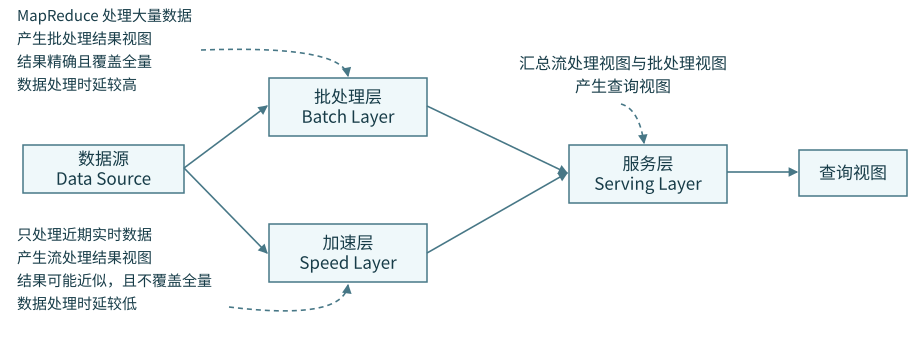
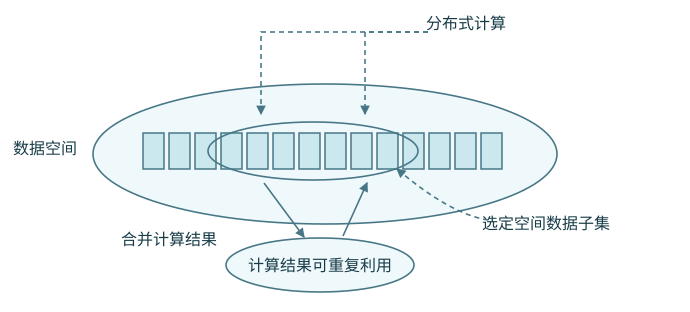
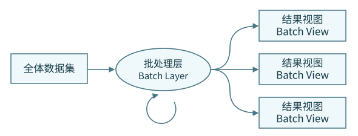
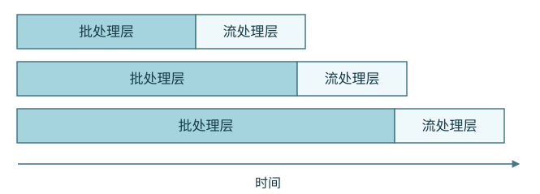
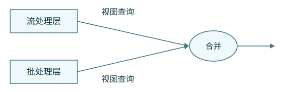
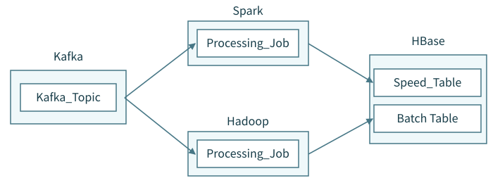

# 19.3 Lambda架构

## 19.3.1 Lambda架构对大数据处理系统的理解

Lambda架构由Storm的作者Nathan Marz提出，其设计目的在于提供一个能满足大数据系统关键特性的架构，包括高容错、低延迟、可扩展等。其整合离线计算与实时计算，融合不可变性、读写分离和复杂性隔离等原则，可集成Hadoop、Kafka、Spark、Storm等各类大数据组件。Lambda是用于同时处理离线和实时数据的，可容错的，可扩展的分布式系统。它具备强鲁棒性，提供低延迟和持续更新。

## 19.3.2 Lambda架构应用场景

### 1. 机器学习中的Lambda架构

在机器学习领域，扩大相关训练数据的规模有助于模型识别模式。但是，机器学习算法要从数据中识别模式，需要接收适合其任务的数据表示。因此，机器学习可以受益于由 Lambda架构构建的数据系统所处理的各类数据。据此，机器学习算法可以提出各种问题，并逐渐对输入到系统中的数据进行模式识别。

### 2. 物联网的Lambda架构

如果说机器学习利用的是Lambda架构的输出，那么物联网则更多地作为数据系统的输入。设想一下，一个拥有数百万辆汽车的城市，每辆汽车都装有传感器，并能够发送有关天气、空气质量、交通状况、位置信息以及司机驾驶习惯等数据。这些海量数据流，会被实时馈入Lambda体系架构的批处理层和速度层，进行后续处理。可以说，物联网设备是适合作为大数据源的绝佳示例。

### 3. 流处理和Lambda架构挑战

速度层也被称为“流处理层”。其目的是提供最新数据的低延迟实时视图。速度层处理尚未计入最新批处理视图的数据，维护相应的实时视图。当新一轮批处理视图覆盖这些数据时，对应的实时结果即可丢弃。

Lambda体系架构在其原始理论中，提到了最终精度 (eventual accuracy) 的概念。它是指：批处理层可计算精确结果，速度层为降低延迟可以采用近似计算。采用近似计算时，相应的实时结果最终由覆盖同一批数据的精确结果替代，以便系统向“最终精度”迈进。

在实际应用中，由于实时处理流以毫秒为单位，持续产生用于更新视图的数据流，是一个非常复杂的过程。因此，将基于文档的数据库、索引以及查询系统配合在一起使用，是一种比较好的选择。

## 19.3.3 Lambda架构介绍

如图 19-4 所示，Lambda架构可分解为三层，即批处理层、加速层和服务层。

1. 批处理层（Batch Layer）。存储数据集，Batch Layer在数据集上预先计算查询函数，并构建查询所对应的View。Batch Layer可以很好地处理离线数据，但有很多场景数据是不断实时生成且需要实时查询处理，对于这种情况，Speed Layer更为适合。
2. 加速层（Speed Layer）。Batch Layer处理的是全体数据集，而Speed Layer处理的是最近的增量数据流。Speed Layer为了效率，在接收到新的数据后会不断更新 Real-time View，而Batch Layer是根据全体离线数据集直接得到Batch View。
3. 服务层（Serving Layer）。在图 19-4 的实现中，服务层汇总批视图与实时视图的结果，向查询方提供合并结果。

> 图 19-4 Lambda架构

### 1. 批处理层

Batch Layer有两个核心功能：存储数据集和生成Batch View。

该层负责管理主数据集。主数据集中的数据必须具有以下三个属性：

1. 数据是原始的。
2. 数据是不可变的。
3. 数据记录当时观察到的事实。后续发现错误时，可追加更正记录。

幺半群（Monoid）在分布式聚合中应用广泛。它由一个集合、集合上满足结合律的封闭二元运算和该运算的单位元构成。例如，整数在加法下构成幺半群，单位元为 0。

不满足Monoid特性的函数很多时候可以转化成多个满足Monoid特性的函数的运算。例如，不能直接对各组平均值再取平均来计算一般情形下的总体平均值。可以分别保存每组的总和与个数，将各组的总和、个数分别相加。总个数非零时，用总和除以总个数即可得到总体平均值。

Monoid 的结合律特性在分布式计算中极其重要，结合律允许分组计算，并按原顺序合并各组结果；如果还要任意调换各组的合并顺序，则运算还需满足交换律。同时也意味着部分运算结果可以储存下来被别的运算共享利用（如果该运算也包含相同的部分子运算），从而减少重复运算的工作量。图 19-5 展示了 Monoid 特性。

> 图 19-5 Monoid特性

如果预先在数据集上计算并保存查询函数的结果，查询的时候就可以直接返回结果(或通过简单的加工运算就可得到结果)而无需重新进行完整费时的计算了。这里可以把Batch Layer看成是一个数据预处理的过程，如图 19-6 所示。我们把针对查询预先计算并保存的结果称为视图（View）。视图是 Lambda 架构的一个核心概念，它是针对查询的优化，通过 View 即可快速得到查询结果。

> 图 19-6 批处理层结构

如果采用HDFS来储存数据，我们就可以使用MapReduce来在数据集上构建查询的View。View是一个和业务关联性比较大的概念，View的创建需要从业务自身的需求出发。一个通用的数据库查询系统，查询对应的函数千变万化，不可能穷举。但是如果从业务自身的需求出发，可以发现业务所需要的查询常常是有限的。Batch Layer需要做的一件重要的工作就是根据业务的需求，考察可能需要的各种查询，根据查询定义其在数据集上对应的Views。

### 2. 加速层

加速层处理传入的数据流，并更新和存储实时视图。可为实时视图建立索引，以支持快速查询。

Batch Layer可以很好地处理离线数据，但有很多场景数据不断实时生成，并且需要实时查询处理。Speed Layer正是用来处理增量的实时数据。

Speed Layer和Batch Layer比较类似。如图 19-7 所示，Speed Layer对数据进行计算并生成 Realtime View，其主要区别在于：

1. Speed Layer处理的数据是最近的增量数据流，Batch Layer处理的是全体数据集。
2. Speed Layer为了效率，接收到新数据时不断更新 Realtime View，而Batch Layer根据全体离线数据集直接得到Batch View。

> 图 19-7 加速层结构

Lambda架构将数据处理分解为Batch Layer和Speed Layer有如下优点：

- 容错性。Speed Layer中处理的数据也不断写入 Batch Layer，当Batch Layer中重新计算的数据集包含Speed Layer处理的数据集后，实时视图中已被该批视图覆盖的部分就可以丢弃，这也就意味着Speed Layer处理中引入的错误，在批处理使用正确数据和算法重新计算后可以得到修正。随着相应的实时结果被批处理结果替代，查询结果可逐步收敛。
- 复杂性隔离。Batch Layer处理的是离线数据，可以很好地掌控。Speed Layer采用增量算法处理实时数据，复杂性比Batch Layer要高很多。通过分开 Batch Layer 和 Speed Layer，把增量处理的复杂性隔离到 Speed Layer，可以很好地提高整个系统的鲁棒性和可靠性。
- 横向扩容（Scalable）。当数据量或负载增大时，可以增加机器数量以维持性能；实际收益取决于可并行的工作量及节点间协调开销。

### 3. 服务层

在本节的实现中，服务层响应用户的查询请求，将批视图和实时视图的相应结果合并后返回。该层提供了主数据集上执行的计算结果的低延迟访问。读取速度可以通过数据附加的索引来加速。与加速层类似，该层也需要支持随机读取、批量写入，并具备可伸缩性和容错能力。

这涉及数据如何合并的问题。前面我们讨论了查询函数的 Monoid 性质，如果部分结果可以按同一幺半群运算合并，只需要简单地合并Batch View和Real-time View中的结果数据集即可。对于可分解的查询，可以把查询函数转换成多个满足Monoid性质的子查询的组合，单独对每个满足Monoid性质的查询函数进行Batch View和Real-time View中的结果数据集合并，然后再计算得到最终的结果数据集。另外也可以根据业务自身的特性，运用业务自身的规则来对Batch View和Real-time View中的结果数据集合并，如图 19-8 所示。

> 图 19-8 服务层结构

## 19.3.4 Lambda架构的实现

如图 19-9 所示，在这种Lambda架构实现中，Hadoop 分布式文件系统（HDFS）用于存储主数据集，Spark（或 Storm）可构成速度层（Speed Layer），HBase（或 Cassandra）作为服务层，由Hive创建可查询的视图。

HDFS 是一种设计用于在通用硬件上运行的分布式文件系统。它和现有的分布式文件系统有很多共同点。但同时，它和其他分布式文件系统的区别也很明显。HDFS是一个具有高度容错性的系统，能提供高吞吐量的数据访问，非常适合大规模数据集上的应用。HDFS放宽了一些约束，以达到流式读取文件系统数据的目的。

Apache Spark是专为大规模数据处理而设计的快速通用的计算引擎。Spark是加州大学伯克利分校 AMPLab 开源的通用并行处理框架，Spark 可以把重复使用的中间数据缓存在内存中，减少重复计算和磁盘读写。因此，它适用于数据挖掘与机器学习等需要迭代的任务。

HBase（Hadoop Database）是一个高可靠性、高性能、面向列、可伸缩的分布式存储系统，利用HBase技术可在廉价的 PC 服务器上搭建起大规模结构化存储集群。

> 图 19-9 技术选型

## 19.3.5 Lambda架构优缺点

### 1. 优点

1. 容错性好。Lambda架构为大数据系统提供了更友好的容错能力，一旦发现错误，可以更正输入或修复算法，再从保留的数据重新计算受影响的视图。
2. 查询灵活度高。在主数据集保留所需数据且查询引擎支持的情况下，可以进行即席查询。
3. 易伸缩。批处理层、加速层和服务层可以分别扩容。采用可分布式部署的组件时，可以增加机器以应对负载增长。
4. 易扩展。添加视图是容易的，只是给主数据集添加几个新的函数。

### 2. 缺点

1. 全场景覆盖带来的编码开销。
2. 对于部分具体场景，全量离线重算的额外收益可能有限。
3. 重新部署和迁移成本很高。

## 19.3.6 Lambda与其他架构模式对比

Lambda架构的诞生离不开很多现有设计思想和架构的铺垫，如事件溯源（Event Sourcing）架构和命令查询职责分离（Command Query Responsibility Segregation，CQRS）架构，Lambda架构的设计思想和这两者有一定程度的相似。

下面对Lambda架构和这两者进行分析。

### 1. 事件溯源（Event Sourcing）与Lambda架构

Martin Fowler 曾撰文阐述事件溯源（Event Sourcing）模式。Event Sourcing本质上是一种数据持久化的方式，其由三个核心观点构成：

1. 将所跟踪业务实体的状态变更记录为事件。
2. 事件是核心，系统的数据以事件为基础，事件要保存在某种存储上。
3. 业务数据只是一些由事件产生的视图，不一定要保存到数据库中。

Lambda架构中数据集的存储使用的概念与Event Sourcing中的思想有相似之处：两者都可以保存历史记录，据此重新计算派生状态或视图。这样在发生错误的时候，能够通过模型找到错误发生的原因，保留原有事件，必要时追加更正事件，再重放相关历史以重建派生状态或视图。

### 2. CQRS与Lambda架构

CQRS架构分离了对于数据进行的读操作(查询)和写(修改)操作。其将能够改变数据模型状态的命令和对于模型状态的查询操作实现了分离。CQRS 可与领域驱动设计（Domain-Driven Design，DDD）配合使用，分别优化命令处理和查询。报表输出是查询的一种用途。

Lambda架构中，数据的修改通过批处理和流处理实现，通过写操作将数据转换成查询时所对应的View。在Lambda架构中，对数据进行查询时，实际上是通过读取View直接得到结果，读出所需的内容。这实际上是一种形式的读写分离。

读写分离可使查询针对预计算视图进行，并减少写入负载对读取的影响。具体收益取决于读写负载和查询方式。在大数据系统中经常处理海量数据，进行读写分离重要性不言而喻。
