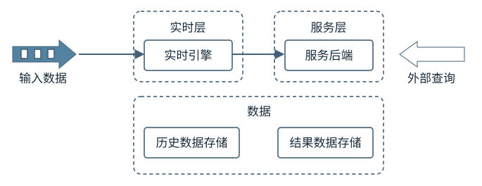
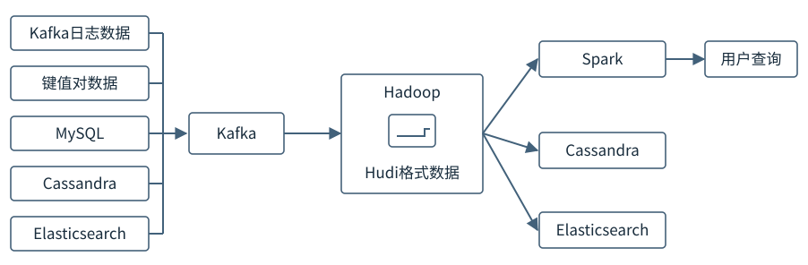
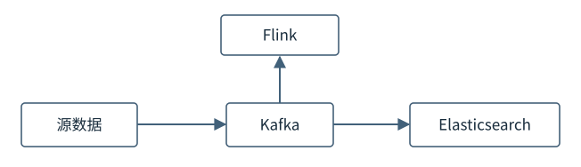

# 19.4 Kappa架构

## 19.4.1 Kappa架构下对大数据处理系统的理解

为了设计出能满足前述的大数据关键特性的系统，我们需要对数据系统有本质性的理解。我们可将数据系统简单理解为：

数据系统 = 数据 + 查询

进而从数据和查询两方面来认识大数据系统的本质。

### 1. 数据的特性

我们先从数据的特性谈起。在这里采用的事实模型中，一条数据记录描述一个事实，有两个关键的性质：When和What。

1. When。When是指数据是与时间相关的，数据一定是在某个时间点产生的。例如，日志记录有追加顺序，事件产生的时间顺序可能与追加顺序不同。消息必须先发出，接收者才能收到。数据库表中的行也不一定按事件发生顺序排列，较早插入的记录可能在较晚插入的记录之后更新。对于分布式系统，数据的时间特性尤其重要。来自不同节点的事件仅凭各自的时间戳，无法保证排出真实的全局先后顺序。对于与顺序有关的操作，处理次序会影响结果。例如，初值为1，先加2后乘3得到9，先乘3后加2得到5。
2. What。What是指数据的本身。在这种模型中，已经发生的事实（Fact）以不可变（Immutable）的记录保存，你不可能回到过去的某个时间点去改变数据事实。这也就意味着对数据的操作其实只有两种：读取已存在的数据和添加更多的新数据。采用数据库的记法，CRUD就变成了CR，Update和Delete通过追加新记录（Create）来表示。

### 2. 数据的存储

根据上述对数据本质特性的分析，Lambda架构中对数据的存储采用的方式是：数据不可变，存储所有数据。

通过采用不可变方式存储所有的数据，可以有如下好处：

1. 简单。采用不可变的数据模型，存储数据时只需要简单地往主数据集后追加数据即可。采用可变的数据模型时，为了快速找到要更新的记录，通常需要建立索引。

2. 应对人为和机器的错误。前面提到，人和机器每天都可能会出错，如何应对人和机器的错误，让系统能够从错误中快速恢复极其重要。不可变性 (Immutability) 和重新计算 (Re-computation) 则是应对人为和机器错误的常用方法。采用可变数据模型，引发错误的数据有可能被覆盖而丢失。采用不可变的数据模型时，原始记录仍在。修复时可以遍历保留的数据，过滤已识别的错误记录，再重新计算视图。要使重算结果可复现，需要保留所需输入，并按业务规则确定处理顺序，使用确定的计算逻辑。

当前业界有很多采用不可变数据模型来存储所有数据的例子。比如分布式数据库Datomic，基于不可变数据模型来存储数据，从而简化了设计。分布式消息中间件Kafka基于日志，以追加（append-only）的方式来存储消息。

## 19.4.2 Kappa架构介绍

Kappa架构由Jay Kreps提出。Lambda分别进行流计算和批计算并合并视图，Kappa则通过一条流计算链路产生视图。Kappa同样采用了重新处理事件的原则，对于历史数据分析类的需求，Kappa要求数据的长期存储能够以有序日志流的方式重新流入流计算引擎，重新产生历史数据的视图。本质上是通过改进Lambda架构中的速度层（Speed Layer），使它既能够进行实时数据处理，同时也有能力在业务逻辑更新的情况下重新处理以前处理过的历史数据。

Kappa架构的原理就是：省去独立的批处理层（Batch Layer），通过流处理链路处理新数据和重放的历史数据。历史数据可以保存在日志中，也可以存入数据湖，需要回溯时再送入流处理引擎。Kappa数据处理架构如图 19-10所示。

> 图 19-10 Kappa架构

如图 19-10所示，输入数据直接由实时层的实时数据处理引擎对源源不断的源数据进行处理，再由服务层的服务后端进一步处理以提供上层的业务查询。图中将存储的数据分为历史数据和结果数据。

Kappa方案通过精简链路解决了数据写入和计算逻辑复杂的问题，但它依然没有解决存储和展示的问题，特别是在存储上，Kafka支持对消息批次进行压缩，但长期保留可重放的完整历史记录仍有存储成本。一种方案是采用支持分层存储的消息系统，如使用Pulsar将历史消息转存到云存储。历史日志可供Kappa回填（backfill）作业或其他历史数据消费者使用。

从使用场景上来看，Kappa架构与Lambda相比，主要有两点区别：

1. 与Lambda相比，Kappa省去了独立的批处理链路，适合持续写入增量数据的分析场景，例如各种时序数据场景，天然存在时间窗口的概念，流式计算直接满足其实时计算和历史补偿任务需求；
2. Lambda直接支持批处理，因此更适合对历史数据分析查询的场景，比如数据分析师需要按任意条件组合对历史数据进行探索性的分析，并且有一定的实时性需求，期望尽快得到分析结果，批处理可以更直接高效地满足这些需求。

## 19.4.3 Kappa架构的实现

下面以Apache Kafka为例说明Kappa架构的实现过程。

部署Apache Kafka，并设置数据日志的保留期（Retention Period）。这里的保留期指的是你希望能够重新处理的历史数据的时间区间。例如，如果你希望重新处理最多一年的历史数据，那就可以把Apache Kafka中的保留期设置为365天。如果需要重放全部历史记录，除取消基于时间的删除限制外，还须确保容量限制、日志清理策略和可用存储空间允许保留所需记录。

如果我们需要改进现有的逻辑算法，那就表示我们需要对历史数据进行重新处理。保留原有作业，另起一个流处理作业实例，使用独立的消费进度读取Kafka日志，把重算结果写入新视图。Kafka的偏移量（offset）按分区记录位置。若要重放全部保留记录，新实例应从各分区最早可读的偏移量开始，该值可能大于0。

当新作业的输入处理进度赶上旧作业时，我们的应用便可以切换到从新的数据视图中读取。

停止旧版本的作业实例，并删除旧的数据视图。

## 19.4.4 Kappa架构的优缺点

Kappa架构的优点在于将实时和离线代码统一起来，方便维护而且统一了数据口径，省去了查询时合并批视图与实时视图的步骤，需要重算历史视图时可以重放保留的数据。而Kappa的缺点也很明显：

1. 消息中间件缓存的数据量和回溯数据有性能瓶颈。例如，若算法需要过去180天的数据，如果都存在消息中间件，无疑有非常大的压力。同时，一次性回溯订正180天级别的数据，对实时计算的资源消耗也非常大。
2. 在实时数据处理时，遇到大量不同的实时流进行关联时，非常依赖实时计算系统的能力，若事件乱序到达且超出窗口允许的迟到范围，关联结果可能漏掉本应匹配的记录。
3. Kappa省去独立的离线数据处理模块后，历史重算也依赖流处理链路。Lambda可以单独重算批视图，但两条计算链路和两套代码会增加维护成本。

对于以上Kappa框架存在的几个问题，目前也存在一些解决方案，对于消息队列缓存数据性能的问题，Kappa+框架使用HDFS保存可供回填的历史数据。针对Kappa框架展示层能力不足的问题，也有人提出了混合分析系统的解决方案。

## 19.4.5 常见Kappa架构变形

### 1. Kappa+架构

Kappa+是Uber提出的流式数据处理架构，它的核心思想是让流计算框架直接读HDFS里的数据仓库数据，一并实现实时计算和历史数据回填（backfill）计算，不需要为回填作业长期保存日志或者把数据拷贝回消息队列。Kappa+将数据任务分为无状态任务和时间窗口任务，无状态任务比较简单，根据吞吐速度合理并发扫描全量数据即可，时间窗口任务的原理是将数据仓库数据按照时间粒度进行分区存储，窗口任务按时间先后顺序一次处理一个分区的数据，同一分区内的文件可不按顺序并行读取，当前分区的文件全部读取完毕后，各输入源才进入下一个分区消费并更新水位线（watermark）。事实上，Uber开发了Apache Hudi框架来存储数据仓库数据。Hudi支持更新和删除表中的记录，也支持增量读取更新的数据，可用于处理上述历史数据存储问题。图中的底层数据文件可采用Parquet格式。图 19-11展示了Uber大数据处理平台中与Kappa+相关的数据流，包括从Hadoop经Spark到用户查询的路径。

> 图 19-11 Kappa+架构

如图 19-11所示，将不同来源的数据通过Kafka导入到Hadoop中，由HDFS保存仓库中的历史数据，再通过Spark对数据进行分析处理，最后交由上层业务进行查询。

### 2. 混合分析系统的Kappa架构

Lambda和Kappa架构都需要考虑如何利用结果视图支持热点数据的查询分析。一种解决方案是在Kappa架构上增加分析流程。

如图 19-12所示，该方案使用Kafka+Flink构建Kappa流计算数据架构；源数据进入Kafka后，一路交给Flink进行流计算，另一路进入Elasticsearch实时分析引擎。

> 图 19-12 混合分析系统架构

这种组合部分弥补了Kappa架构分析能力不足的问题。在这一方案中，Elasticsearch用于对热点数据建立索引，无法覆盖所有批处理相关的分析需求，因此这种混合架构在某种意义上属于Kappa和Lambda之间的折中方案。
