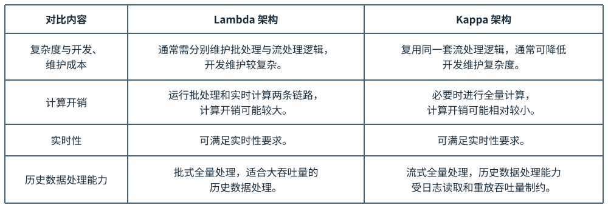

# 19.5 Lambda 架构与 Kappa架构的对比和设计选择

## 19.5.1 Lambda架构与Kappa架构的特性对比

一个大数据系统架构的设计思想很大程度上受到当时技术条件和思维模式的限制。Lambda架构将批处理层和速度层分为两层，分别进行离线数据处理和实时数据处理，这里分别采用适合离线计算和低延迟计算的工具。在这种实现中，将现有的成熟离线处理技术 (Hadoop) 和实时处理技术 (Storm) 相结合，用View模型将二者处理数据后得到的输出结果结合起来，在服务层 (Serving Layer) 中进行统一，开放给上层服务，是相当可行且高效的设计方式。

Kappa架构的提出者Jay Kreps参与过Apache Kafka的开发，也为Apache Samza的状态管理文档作过贡献。基于对流式计算深入的理解，Kappa架构在同一层次内进行实时处理和离线处理，当流式计算能够满足业务延迟和历史重算要求时，可以减少两条计算链路的维护工作。表 19-1从多个维度对Lambda架构和Kappa架构进行了对比分析。表中列出本节所举典型部署的取舍，实际成本和吞吐量取决于工作负载、引擎和资源配置。

> 表 19-1 Lambda架构和Kappa架构对比

| 对比内容 | Lambda 架构 | Kappa 架构 |
|---|---|---|
| 复杂度与开发、维护成本 | 通常需分别维护批处理与流处理逻辑，开发维护较复杂。 | 复用同一套流处理逻辑，通常可降低开发维护复杂度。 |
| 计算开销 | 运行批处理和实时计算两条链路，计算开销可能较大。 | 必要时进行全量计算，计算开销可能相对较小。 |
| 实时性 | 可满足实时性要求。 | 可满足实时性要求。 |
| 历史数据处理能力 | 批式全量处理，适合大吞吐量的历史数据处理。 | 流式全量处理，历史数据处理能力受日志读取和重放吞吐量制约。 |

### 1. 复杂度与开发、维护成本

对于大数据系统的评价与比较，首先需要考虑这个系统开发、上线的难度，以及这个系统是否能够以足够低的成本进行维护。

因为通常需要分别开发并维护两条计算链路，Lambda架构的复杂度相对更高。其中，一套负责进行离线的批处理计算，一般选择使用Hadoop作为批处理系统，将批处理结果View保存到HBase中；另一套需要进行实时的流式计算，一般选择Storm、Spark作为流处理系统，流式计算结果将保存到Redis中。

Lambda架构需要分别在批处理和实时计算系统上面运行两套代码，这两套代码产生可按同一查询口径合并的结果。并且，在进行全量计算时，批处理系统可能要长时间占用计算资源。这样的开发维护成本相对较高。

Kappa架构的复杂度相对低很多，实时处理和历史重算可以复用一套流处理逻辑。因为Kafka对于流式计算有良好支持，易于编程，故一般使用Kafka作为消息中间件，将数据保存在消息队列中。流式计算系统可使用Flink实现。Flink作为流处理框架，以数据并行和流水线方式执行任意流数据程序，且同时支持批处理和流处理。开发维护成本相对较低。

### 2. 计算开销

在使用大数据系统进行数据处理时，需要知道数据的存储位置。当数据量增长带来的I/O需求超过网络带宽时，数据传输会成为瓶颈，因此计算开销也是选择架构时的考虑因素之一。

Lambda架构在计算时，需要让数据同时支持批处理层系统和流处理层系统运行，批处理可以按计划运行；一路任务中断可能导致相应视图滞后。合并时要区分批视图已覆盖的数据与速度层应补充的数据。

Kappa架构的数据存储只需要面对流式计算，只在需要重算时重放历史数据。其计算开销取决于重算范围和频率。

### 3. 实时性

实时性要求系统对于一个服务调用可以进行快速响应。快速的定义可能从几毫秒到几秒，取决于用户对于这一功能响应速度的具体要求。在大数据系统中，用户对于快速的要求往往集中在随机读取功能。Lambda架构和Kappa架构都能够对数据进行实时处理并进行服务的响应。

Lambda架构需要在查询时结合批视图与实时视图。对于求和等可合并的聚合，可用满足结合律且有单位元的运算合并两层的结果。取值集合及其上的这种运算构成幺半群（monoid）。例如，速度层对新增数据求和，再与覆盖较早数据的批视图之和相加。这样做的优点是将实时处理变成了批处理和流处理结果的结合，稳定且实时计算成本可控。

Kappa架构的策略是使用Kafka或者类似的分布式消息中间件，保存输入事件。正常运行时，流处理作业持续处理新事件并更新视图，查询读取已有视图。如果需要全量重算，则另起流计算实例，重新读取所需的历史数据并写入新视图。等新作业的处理进度追上旧作业，先把读取方切换到新视图，再停用旧作业并删除旧视图。在进行实时的流式数据处理时，如果有大量不同的实时流同时计算，由于算法要求进行关联，十分考验实时计算系统的能力。当数据乱序且超过窗口允许的迟到范围时，部分记录可能未计入关联结果。

### 4. 历史数据处理能力

大数据系统在进行数据处理时，可能需要从大量历史数据中提取出对用户有价值的数据。

Lambda架构在设计上可以在批处理层中对于超大规模的历史数据进行批量计算。由于批处理层和速度层使用不同的计算系统，若两层资源已隔离，批量处理历史数据时，速度层仍能独立处理新数据。

若需要从消息队列重放大量历史数据，Kappa的处理能力可能受日志读取和流处理吞吐量限制。Kappa在设计上使用了消息队列对数据进行缓存，而消息队列对于数据量和历史数据回溯有性能的制约。在日常需求中算法可能需要一次处理过去一年或者更久的数据，如果这些数据都存在消息队列中，对消息中间件的性能会有非常大的压力。如果数据结果中出现错误需要重新计算，这样数量级的数据对实时流式计算的稳定性和正确性也是一种考验。

## 19.5.2 Lambda架构与Kappa架构的设计选择

根据两种架构对比分析，将业务需求、技术要求、系统复杂度、开发维护成本和历史数据处理能力作为选择考虑因素。只有在具体负载下测得两种实现的计算开销相近时，才可降低该因素在选型中的权重。

### 1. 业务需求与技术要求

如果业务需要分别运行批处理和低延迟流处理，并在查询时结合两类结果，可考虑Lambda架构。如果可以用同一套流处理逻辑处理新数据和重放的历史数据，可考虑Kappa架构。Hadoop、Spark、Storm或Flink等技术依赖也应纳入评估，但仅凭工具名称无法确定应选哪种架构。

### 2. 复杂度

如果项目中需要频繁地对算法模型参数进行修改，Lambda架构需要反复修改两套代码，则显然不如Kappa架构简单方便。同时，如果算法模型支持同时执行批处理和流式计算，或者希望用一份代码进行数据处理，那么可以选择Kappa架构。

在某些复杂的案例中，其实时处理和离线处理的结果不能统一，比如某些机器学习的预测模型，需要先通过离线批处理得到训练模型，再交由实时流式处理进行验证测试，这种场景需要分别实现训练与验证。若同一查询还需要合并批处理与实时处理的结果，可以考虑Lambda架构。

### 3. 开发维护成本

Lambda架构需要有一定程度的开发维护成本，包括两套系统的开发、部署、测试、维护，适合有足够经济、技术和人力资源的开发者。而Kappa架构可以复用一套流处理逻辑，适合不希望在开发维护上投入过多成本的开发者。

### 4. 历史数据处理能力

有些情况下，项目会频繁接触海量数据集进行分析，比如过往十年内的地区降水数据等，这种数据适合批处理；若还需结合实时视图，可以考虑Lambda架构。如果主要面对增量数据，且现有流处理系统能在要求的时间内完成历史重算，则可以考虑Kappa架构。
